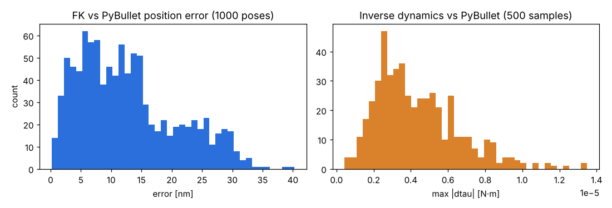
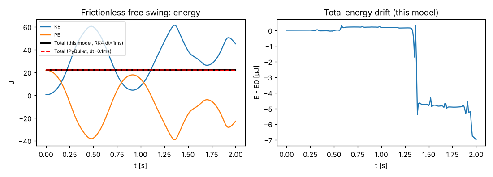
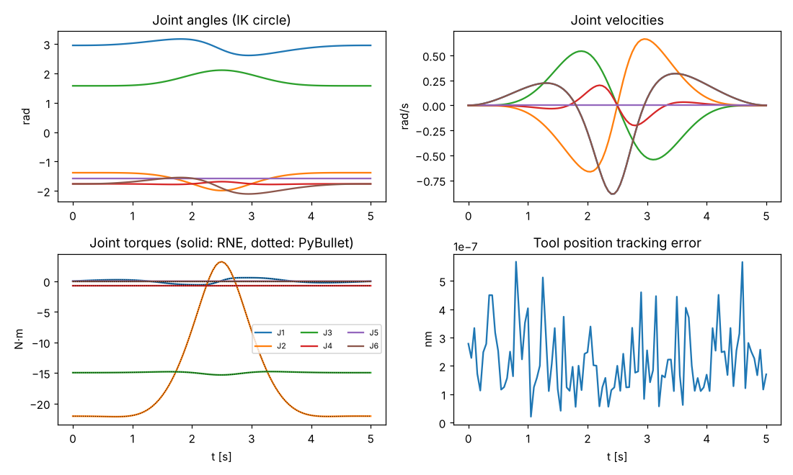
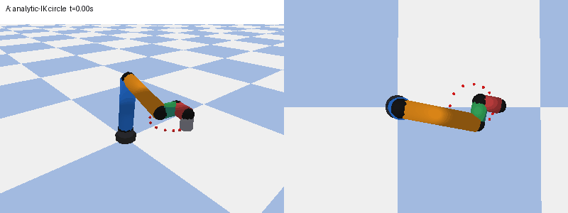

# 2026-11-01 T002：六軸手臂模型完整測試

## 1. 目的
驗證 T001 的數學模型（DH 運動學、封閉解 IK、幾何 Jacobian、遞迴牛頓-尤拉動力學）是否正確，
方法是與獨立實作（PyBullet 物理引擎、數值微分、能量守恆）交叉比對，並量測效能。

## 2. 模型與參數
* 幾何：UR5 類標準 DH（`sixaxis/robot.py::RobotParams`）：a=(0,-0.425,-0.39225,0,0,0) m，
  d=(0.089159,0,0,0.10915,0.09465,0.0823) m，α=(π/2,0,0,π/2,-π/2,0)。
* 質量：(3.7, 8.393, 2.275, 1.219, 1.219, 0.1879) kg；各連桿視為沿「關節原點→下一關節原點」的均質圓柱
  （半徑 0.060/0.055/0.045/0.040/0.040/0.035 m），質心在中點，慣性張量由圓柱公式求得。
* 限位：關節 ±2π rad、速度 π rad/s、力矩 (150,150,150,28,28,28) N·m。
* URDF 由 `python3 -m sixaxis.urdf` 從 DH 自動產生（`robots/ur5_like.urdf`），FK 與動力學共用同一組連桿座標系。
* 公式出處：Craig《Introduction to Robotics》RNE；Hawkins (2013) UR-5/UR-10 封閉解 IK（詳見 `sixaxis/robot.py` 檔頭）。

## 3. 重現步驟
```bash
python3 -m pip install "setuptools<70" wheel && python3 -m pip install --no-build-isolation pybullet==3.2.7
python3 -m pip install -r requirements.txt
ruff check .
python3 -m pytest -q                                   # 本次：23 passed
PYTHONPATH=. python3 scripts/t002_report.py 2026-11-01      # 重算指標、圖表、動畫
python3 scripts/t002_write_md.py 2026-11-01 "23 passed"      # 產生本報告
```

## 4. 指令序列（示範動畫）
* A（0–5 s）：`move_l` 等效——工具朝下、水平圓（圓心 (0.45,0,0.35) m、半徑 0.12 m），最小急動度時間律，
  每個取樣點以封閉解 IK 選最接近前一點的解；以 RNE 計算所需力矩。
* B（2 s）：零力矩、無摩擦自由擺動，初始 q0=(0.3,-0.4,0.8,-0.5,0.6,0.2)，q̇0=(0.5,-0.3,0.4,1.0,-0.8,0.6)，RK4 dt=1 ms。

## 5. 量化結果
| 項目 | 判定標準 | 結果 |
|---|---|---|
| FK vs PyBullet 位置（1000 隨機姿態） | max < 1e-6 m | max 4.02e-08 m，RMS 1.51e-08 m |
| FK vs PyBullet 姿態 | — | max 4.76e-07 rad |
| IK 往返（1000 組，全部解的 FK 殘差） | 殘差 < 1e-9 | max 6.99e-12 |
| IK 解集合含原始關節角 | 1000/1000 | 1000/1000 |
| IK 最近解＝原始解（q_ref=q） | 1000/1000 | 1000/1000 |
| IK 解數分布 | 最多 8 解 | 2 解: 29, 4 解: 157, 6 解: 43, 8 解: 771 |
| Jacobian vs 數值微分（200 姿態，h=1e-6） | max < 1e-6 | max 2.14e-10 |
| 逆動力學 vs PyBullet（500 隨機 q,q̇,q̈） | max < 1e-3 N·m | max 1.35e-05，RMS 4.89e-06 N·m |
| 無摩擦自由擺動能量守恆（2 s，RK4 dt=1 ms） | 相對漂移 < 1e-5 | E0=22.064 J，漂移 7.33e-06 J（相對 3.32e-07）；動能範圍 0.37–61.36 J |
| 自由擺動軌跡 vs PyBullet（dt=0.1 ms） | 0.5 s 內 < 2e-3 rad | 0.1 s: 1.4e-04；0.5 s: 6.0e-04；1 s: 3.9e-03；2 s: 5.40 rad |
| 笛卡兒圓 IK 追蹤誤差 | — | max 5.7e-16 m；單步最大關節跳變 0.045 rad |
| 圓軌跡最大力矩/上限 (N·m) | 不超限 | J1=0.59/150, J2=22.15/150, J3=15.33/150, J4=0.75/28, J5=0.00/28, J6=0.00/28；超限：無 |
| 圓軌跡 RNE vs PyBullet 力矩 | — | max 5.5e-06 N·m |
| 奇異點偵測 | 腕/肘奇異被標記、σ_min→0 | 一般姿態 無（σ_min=0.201）；q5=0 → ['wrist']（σ_min=5.6e-18）；q3=0 → ['elbow']（σ_min=3.0e-17） |

效能（單執行緒 Python/NumPy，單次平均）：FK 25 µs、Jacobian 168 µs、
IK 全部解 1.27 ms（含選解 1.50 ms）、RNE 259 µs、
質量矩陣 1276 µs、正動力學 1440 µs
（PyBullet C++ 逆動力學 4.9 µs 供參考）。

## 6. 圖表與動畫




動畫（A：IK 圓軌跡；B：自由擺動；左為斜視、右為俯視；紅點為目標路徑）：



MP4：[2026-11-01_T002.mp4](../media/2026-11-01_T002.mp4)（GIF 0.49 MB、MP4 0.21 MB，共 142 幀）。
關鍵畫面：[起始](../media/2026-11-01_T002_start.png)、[圓軌跡中段](../media/2026-11-01_T002_circle_mid.png)、[自由擺動](../media/2026-11-01_T002_swing.png)。

## 7. 問題與限制
* 慣性模型為均質圓柱近似，並非廠商實測值；質量取自 UR5 公開資料，仍適合作為控制/RL 的物理基礎，但絕對力矩與實機會有差異。
* 無關節摩擦、無減速機轉子慣量、無彈性；之後的控制器/RL 若需 sim-to-real 再補。
* PyBullet 比對：零力矩自由擺動中 j4 在 0.55 s 超過 ±2π，PyBullet 會撞關節限位而損失能量，故比對時
  放寬 PyBullet 限位（`PBRobot.make_frictionless`）；放寬後 PyBullet 總能量仍漂移 0.36 J
  （半隱式歐拉），與本模型 RK4 的 7.3e-06 J 相比大幅劣化；2 s 時軌跡因混沌系統放大差異而發散，屬預期，
  故軌跡比對的判定只取 0.5 s 內。
* FK 與 PyBullet 的 4.0e-08 m 殘差來自 PyBullet 內部單精度/四元數轉換，遠小於 1e-6 m 門檻。
* IK 在腕奇異時 θ6 取參考值（`q_ref`）；肩奇異、肘奇異僅偵測與避免除零，未做奇異穿越（之後軌跡規劃再處理）。
* 正動力學以 Python 實作，約 1.4 ms/次，RK4 模擬較慢；RL 訓練以 PyBullet 為主，本模型用於控制器（計算力矩、重力補償）。

## 8. 結論
T001/T002 完成：模型與 PyBullet 在 FK（4.0e-08 m）、逆動力學（1.3e-05 N·m）高度一致，
IK 封閉解 1000/1000 往返成功，Jacobian 與數值微分一致（2.1e-10），自由擺動能量守恆（相對漂移 3.3e-07）。可進入下一項：T003 軌跡規劃函式庫。
