# T003 測試報告：軌跡規劃函式庫（2026-11-01）

> 數值皆由 `scripts/t003_report.py` 與 `pytest tests/test_trajectory.py` 實際執行產生，原始數據：
> [`data/2026-11-01_T003_metrics.json`](data/2026-11-01_T003_metrics.json)。整體：**✅ 通過**

## 1. 目的
提供關節空間（五次多項式、梯形速度）與笛卡兒（直線、圓弧、姿態 SLERP）軌跡，並能檢查速度/力矩限制、
在超限時自動做時間縮放，作為後續控制器、指令介面（move_j / move_l / move_c）的基礎。實作：`sixaxis/trajectory.py`。

## 2. 模型與參數
- 手臂：T001 的 UR5 類模型（`SixAxisRobot`），速度上限 π rad/s、力矩上限 150/150/150/28/28/28 N·m；力矩由 RNE（含重力）計算。
- 時間律：五次 `s=10τ³−15τ⁴+6τ⁵`；梯形速度（加減速各占 f·T）。圓弧以三點定圓，姿態 `R(s)=R0·Exp(sφ)`。
- 笛卡兒→關節：逐點數值 IK（前點為初值）、`qd = Jᵀ(JJᵀ+λI)⁻¹·twist`（λ=1e-4）、`qdd` 對 qd 數值微分、取樣 dt=10 ms。

## 3. 重現步驟
```bash
ruff check .
python3 -m pytest -q                 # 含 tests/test_trajectory.py（12 項）
PYTHONPATH=. python3 scripts/t003_report.py 2026-11-01
```

## 4. 指令序列（示範動畫）
| # | 指令 | 說明 |
|---|---|---|
| 1 | move_j | 由 q_far 到 q_home，五次多項式，時間 = 以 50% 速度上限算出的最短時間 0.72 s |
| 2 | move_l | 直線 0.25 m（+y）並繞 z 旋轉 0.6 rad（SLERP），梯形速度 2 s |
| 3 | move_c | 過三點的半圓（YZ 平面，r=0.1 m），姿態同步旋轉 −0.4 rad，五次 3 s（綠色軌跡） |
| 4 | move_l | 回到起點與姿態，梯形速度 2.5 s |

## 5. 量化結果
| 項目 | 結果 | 判定 |
|---|---|---|
| 五次時間律 峰值速度 數值/解析 (T=2s) | 0.93750 / 0.93750 | ✅ |
| 五次時間律 峰值加速度 數值/解析 | 1.44338 / 1.44338 | ✅ |
| 梯形(f=0.25) 峰值速度/加速度 數值÷解析 | 1.00000 / 1.00000 | ✅ |
| 各時間律終點 s 誤差（最大） | 0.0e+00 | ✅ |
| 直線 直線度最大偏差 | 0.00e+00 m | ✅ |
| SLERP 角度對 s 線性誤差最大 | 1.11e-16 rad | ✅ |
| 圓弧 半徑最大誤差（r=0.100 m, 掃過 3.14 rad） | 4.16e-17 m | ✅ |
| 圓弧 通過中間點誤差 / 終點誤差 | 3.5e-18 / 2.8e-17 m | ✅ |
| 笛卡兒終點誤差（位置 / 姿態） | 1.1e-16 m / 2.8e-16 rad | ✅ |
| 示範全程 IK 未收斂點數 | 0 | ✅ |
| 示範全程 速度使用率 / 力矩使用率（最大） | 0.500 / 0.307 | ✅ |
| PyBullet FK 與軌跡位置一致（最大差） | 2.9e-08 m | ✅ |
| 時間縮放：T=0.4s 太快 → 自動拉長至 | 1.256 s（2 次迭代；速度 2.98→0.95，力矩 0.91→0.27） | ✅ |
| 笛卡兒取樣耗時 | 1.05 ms/點（IK+Jacobian+RNE） | ✅ |

各段落：
| 段落 | 時間 [s] | IK 失敗 | 位置追蹤誤差最大 [m] | 最大關節單步 [rad] | 速度使用率 | 力矩使用率 | 合格 |
|---|---|---|---|---|---|---|---|
| move_j (quintic) | 0.72 | 0 | nan | 0.016 | 0.500 | 0.307 | ✅ |
| move_l+SLERP (trapezoid) | 2.00 | 0 | 1.0e-11 | 0.007 | 0.236 | 0.215 | ✅ |
| move_c arc+SLERP (quintic) | 3.00 | 0 | 5.6e-11 | 0.009 | 0.290 | 0.171 | ✅ |
| move_l return (trapezoid) | 2.50 | 0 | 4.0e-11 | 0.010 | 0.304 | 0.216 | ✅ |

## 6. 圖表與動畫
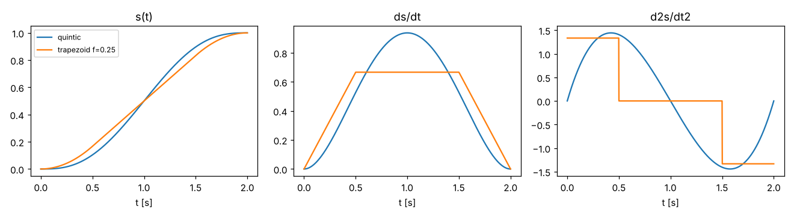
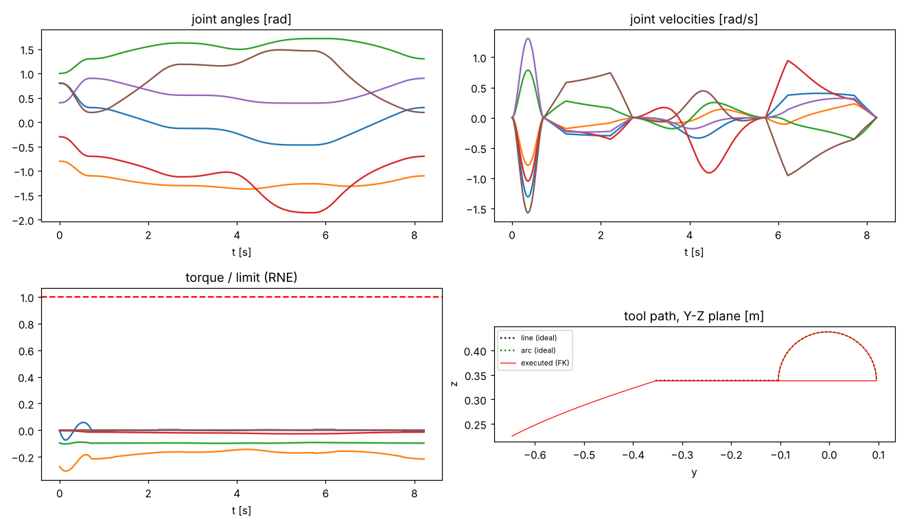
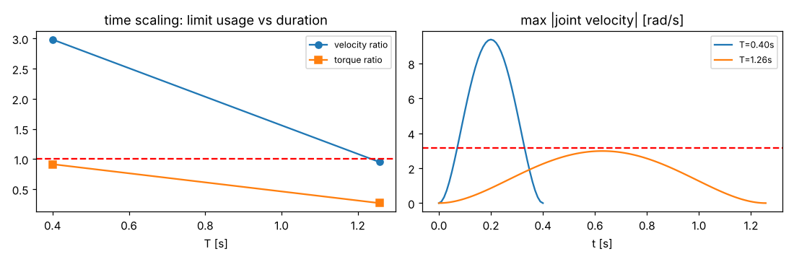
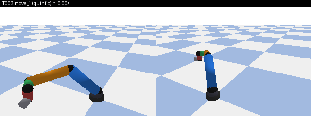

MP4：[`docs/media/2026-11-01_T003.mp4`](../media/2026-11-01_T003.mp4)（206 幀）。關鍵畫面：
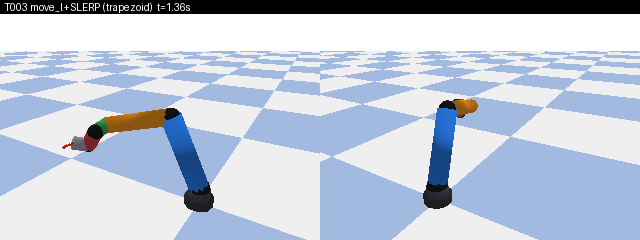 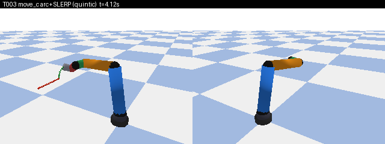 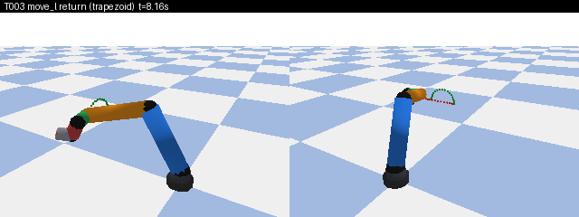

## 7. 問題與限制
- 關節加速度 `qdd` 為數值微分（笛卡兒取樣），端點使用二階單邊差分，端點附近精度略低；力矩使用率因此為近似值。
- 路徑本身可能穿越奇異點或限位：目前只靠 IK 失敗計數與 `check_samples` 偵測，尚未做奇異點迴避（後續控制/規劃任務處理）。
- 圓弧姿態只做起點→終點 SLERP，不保證姿態相對切線方向固定（焊接類任務需要時另行擴充）。
- 時間縮放只調整整段總時間（等比例），不做最佳化（如 TOPP）。
- 多段串接目前為各段 rest-to-rest（段間停頓），尚無 blend/過渡圓角。

## 8. 結論
關節/笛卡兒軌跡的端點、連續性、幾何（直線度、圓弧半徑、SLERP 線性）與 PyBullet 一致性皆達成；超限偵測與自動時間縮放可用。T003 完成。

## 附錄：新外觀版本動畫（T002a 之後重新渲染）
T003 完成時手臂仍是舊的單色圓柱外觀；T002a 改為 UR 型外觀後，以 `scripts/t003_render_v2.py` 重新渲染**同一條示範軌跡**
（程式碼與上方示範序列相同，已核對點數 823、時長 8.216 s 與原 metrics 一致），
相機位置與軌跡標記不變。上方原版動畫依規則保留。

```bash
PYTHONPATH=. python3 scripts/t003_render_v2.py 2026-11-01
```

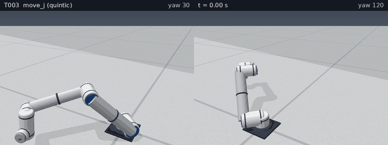

MP4：[2026-11-01_T003_v2.mp4](../media/2026-11-01_T003_v2.mp4)（206 幀、GIF 1.65 MB、MP4 0.35 MB，每視角渲染 422 ms）。
關鍵畫面：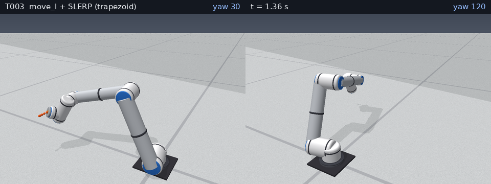 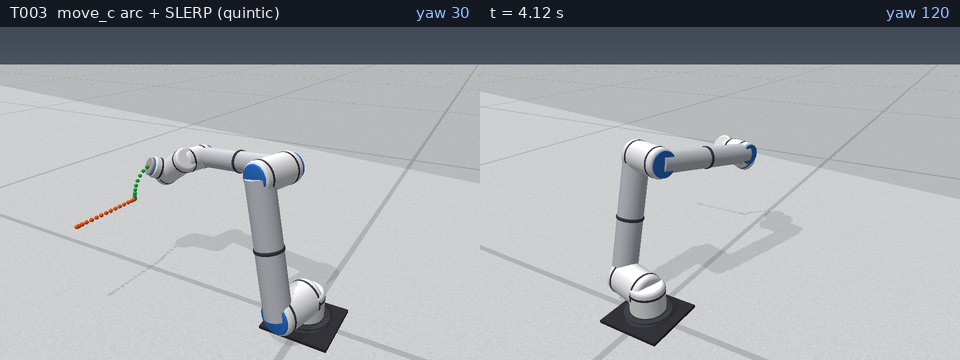 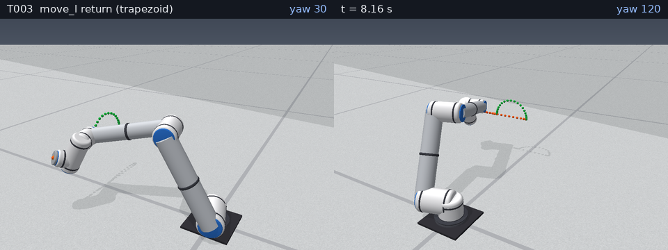
