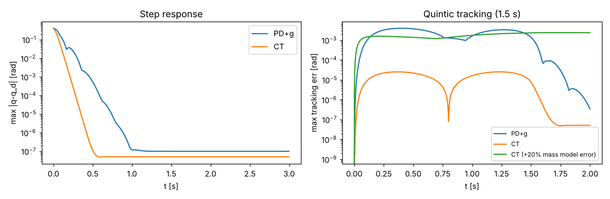
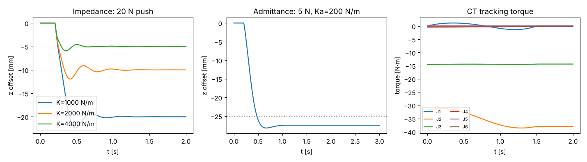

# T004 控制器（PD+重力補償、計算力矩、阻抗/導納）測試報告

日期：2026-11-02　　數據：`docs/test-reports/data/2026-11-02_T004_metrics.json`（由腳本實際執行產生）

## 1. 目的
在 PyBullet `TORQUE_CONTROL`（dt = 1 ms，控制週期 = 物理步長）驗證四種控制器的追蹤誤差與穩定性：
PD+重力補償、計算力矩（CT）、笛卡兒阻抗、平移導納（外環導納 + 內環 CT）。

## 2. 模型與公式（`sixaxis/control.py`、`sixaxis/ctrlsim.py`）
* PD+g：τ = g(q) + Kp(q_d−q) + Kd(q̇_d−q̇)（Takegaki & Arimoto 1981）。
* CT：τ = M(q)(q̈_d + Kd ė + Kp e) + C q̇ + g，誤差動態 ë + Kd ė + Kp e = 0（Spong 等《Robot Modeling and Control》）。
* 阻抗：τ = Jᵀ[K e + D(ẋ_d − J q̇)] + C q̇ + g（Hogan 1985），姿態誤差用 log(R_d Rᵀ)。
* 導納：M_a ẍ + D_a ẋ + K_a x = F_ext 產生參考偏移，內環以 J⁺ 積分出 q_ref 後交給 CT。
* 受控對象為 PyBullet 剛體模型（零阻尼/零摩擦，`make_frictionless`），控制器使用自寫 RNE 模型，因此模型—模擬器差異即為真實的「模型誤差」。
* 增益：PD 以各軸 M_ii 縮放（Kp = M_ii·30²、Kd = 2·30·M_ii）；CT ωn = 40 rad/s（臨界阻尼）；阻抗 K 平移 1000/2000/4000 N/m、D = 80 N·s/m，轉動 K = 30、D = 0.3。

## 3. 重現指令
```
python3 -m pytest tests/test_control.py
PYTHONPATH=. python3 scripts/t004_report.py 2026-11-02
```

## 4. 指令序列
起點 Q0 = [0.3,−1.1,1.3,−0.7,0.9,0.2] rad，終點 Q1 = Q0 + [0.3,0.2,−0.2,0.3,−0.3,0.4]。
A 階躍至 Q1（3 s）；B 五次多項式軌跡 1.5 s（模擬 2 s）；C 阻抗：t>0.2 s 於法蘭施加 −z 20 N；D 導納：t>0.2 s 施加 −z 5 N。

## 5. 量化結果
### 5.1 設定點階躍（3 s）
| 控制器 | 2% 整定時間 | 超調（最大位移軸） | 終值誤差 | 力矩峰值/上限 |
|---|---|---|---|---|
| PD+g | 0.326 s | 2.9% | 1.0e-7 rad | 2.59 |
| CT | 0.149 s | 0 | 5.1e-8 rad | 4.46 |

> 階躍指令造成力矩峰值超過額定（2.59×、4.46×），此測試只驗證穩定性/收斂，實務上階躍應先經 T003 軌跡規劃（見 5.2，力矩使用率 0.26）。

### 5.2 五次軌跡追蹤（1.5 s）
| 控制器 | RMS 誤差 | 最大誤差 | 力矩峰值/上限 |
|---|---|---|---|
| PD+g（無前饋） | 1.12e-3 rad | 3.99e-3 rad | 0.257 |
| CT（精確模型） | 1.15e-5 rad | 2.55e-5 rad | 0.257 |
| CT（質量 +20% 的誤差模型） | 1.05e-3 rad | 2.39e-3 rad | 0.257 |

### 5.3 笛卡兒阻抗（−z 20 N）
| K [N/m] | 期望位移 | 實測位移 | 相對誤差 |
|---|---|---|---|
| 1000 | −20.00 mm | −19.999 mm | 2.8e-5 |
| 2000 | −10.00 mm | −10.002 mm | 2.1e-4 |
| 4000 | −5.00 mm | −4.995 mm | 9.7e-4 |

### 5.4 導納（−z 5 N，K_a = 200 N/m，M_a = 2 kg，D_a = 30）
期望穩態 −25.0 mm，實測 −27.5 mm（偏差 10%，來源見 6）。

## 6. 問題與限制
* 腕軸（尤其 J6）等效慣量僅 ~1e-4 kg·m²，在 1 ms 離散控制下若用一般固定增益（如 Kd = 3）會發散；因此 PD/阻抗轉動增益需依慣量縮放（本報告的做法），阻抗轉動剛性只能取小值。慣量由「等效圓柱」估得，非實機值。
* 導納內環為無積分的 CT，外力造成腕軸約 0.07 rad 的穩態偏差（內環柔度），使實測位移比 F/K_a 大 10%；之後可加積分項或外力前饋（需力感測模型，留待 T108/T109）。
* 力/力矩感測以已知外力直接餵入導納，未模擬感測雜訊與延遲。
* 階躍測試力矩超限，僅作穩定性驗證。

## 7. 圖表與動畫



動畫（CT 軌跡追蹤 → 阻抗受 20 N 推力）：[GIF](../media/2026-11-02_T004.gif)／[MP4](../media/2026-11-02_T004.mp4)；關鍵畫面 [a](../media/2026-11-02_T004_key_a.png)、[b](../media/2026-11-02_T004_key_b.png)。

## 8. 結論
四種控制器皆在 PyBullet 力矩控制下穩定。CT 追蹤誤差（RMS 1.1e-5 rad）比 PD+g 小約兩個數量級；20% 質量誤差使 CT 降至與 PD+g 相當但仍有界；阻抗剛性與 F/K 吻合（<0.1%）；導納穩態偏差 10%。測試：`pytest` 共 46 項通過、`ruff` 通過。
