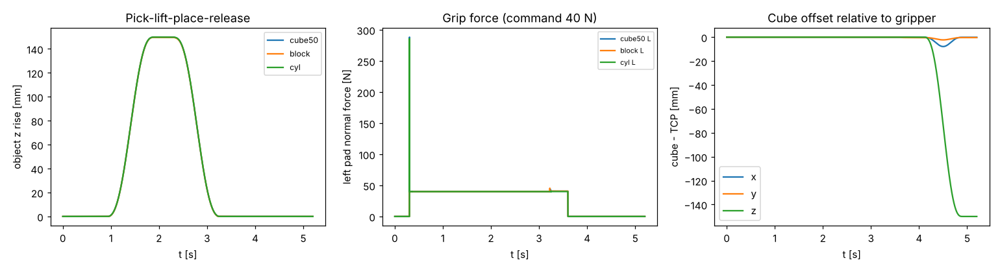
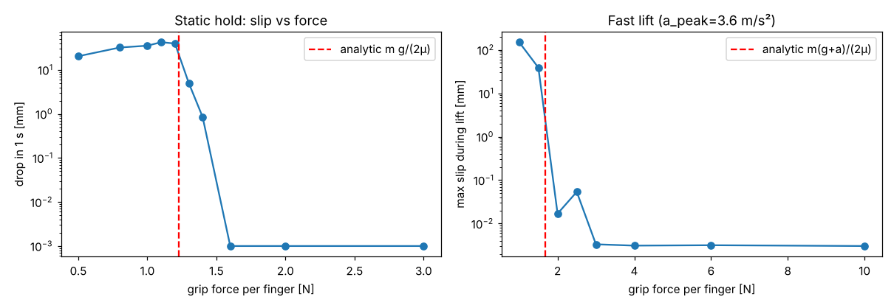
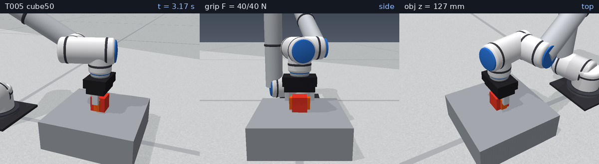

# T005 夾爪與物件模型 測試報告

日期：2026-11-03　　數據：`docs/test-reports/data/2026-11-03_T005_metrics.json`（由 `scripts/t005_report.py` 實際執行產生）

## 1. 目的
建立平行夾爪（兩指對向 prismatic）與可抓物件（方塊／長方塊／圓柱），在 PyBullet 驗證抓取、抬升、放回、釋放的接觸穩定性，
並以庫侖摩擦解析式 F_min = m(g+a)/(2μ) 比對模擬得到的最小夾持力。

## 2. 模型與參數（`sixaxis/gripper.py`、`sixaxis/graspsim.py`）
* 夾爪（類 2F-85 尺寸）：掌體 0.45 kg、單指 0.05 kg；全開間距 80 mm，單指行程 0–40 mm，額定單指力 235 N；
  夾爪座標系 = 法蘭座標系，TCP（指墊中心）在法蘭 z = 95 mm；指墊 20×10×40 mm。
* 與手臂同一個 multibody：`robots/ur5_gripper.urdf`（由 `write_arm_with_gripper()` 以 T001 的 URDF 加上夾爪片段產生；原 `ur5_like.urdf` 不變）。
* 兩指以 PyBullet GEAR 約束連動（s_l = s_r，等同齒條/連桿機構），否則等力馬達下物件會被推向一側（實測 30 mm 單側漂移）。
* 夾持力：位置馬達（目標＝全閉）加力上限 F，接觸後法向力 ≈ F（實測 F=0.5…3 N 時兩指皆為 F ±0.01 N）。
* 摩擦：PyBullet 取兩接觸體 lateralFriction 乘積，指墊 1.0 × 物件 0.8 → μ_eff = 0.8；啟用 frictionAnchor。
* 物件：cube50（50 mm、0.20 kg）、block（40×60×80 mm、0.30 kg）、cyl（r 25 mm、h 60 mm、0.15 kg）。
* 手臂：計算力矩控制（ωn = 60 rad/s），逆動力學用 PyBullet `calculateInverseDynamics`（含夾爪）。dt = 1 ms。
* 場景：基座（桌面高 100 mm、x = 0.45 m）；工具朝下，IK 以 `Q_REF` 選肘向外構型。
* 公式依據：Siciliano《Robotics: Modelling, Planning and Control》抓持章節；Murray/Li/Sastry 1994 第 5 章（Coulomb 摩擦錐）。

## 3. 重現指令
```
python3 -m pytest tests/test_gripper.py
PYTHONPATH=. python3 scripts/t005_report.py 2026-11-03
```

## 4. 指令序列（`run_pick_lift`）
開爪 0.3 s → 閉爪（40 N）0.6 s → 五次多項式關節軌跡抬升 15 cm（1.0 s）→ 保持 0.4 s → 放回 → 開爪 0.5 s → 退開。

## 5. 量化結果
### 5.1 取放（夾持力 40 N，抬升 1.0 s，TCP 加速度峰值 0.90 m/s²）
| 物件 | 單指實測法向力 L/R [N] | 指行程 L/R [mm] | 抬升滑移 [mm] | 物件抬升量 [mm]（目標 150） | 釋放漂移 [mm] | 傾角 [°] |
|---|---|---|---|---|---|---|
| cube50 | 40.06 / 39.95 | 15.010 / 15.010（期望 15） | 0.0012 | 149.72 | 0.060 | 0.62 |
| block | 39.95 / 40.05 | 10.010 / 10.011（期望 10） | 0.0012 | 149.58 | 0.109 | 0.99 |
| cyl | 39.95 / 40.05 | 15.011 / 15.012（期望 15） | 0.0010 | 149.79 | 0.033 | 0.23 |

三種物件皆抓穩（滑移 ≲ 1.2 µm），釋放後留在原位（漂移 < 0.11 mm）。

### 5.2 靜態夾持力下限（cube50，μ_eff = 0.8；解析 F_min = mg/(2μ) = 1.226 N）
先以 60 N 預夾、抬離桌面，再降到 F 並靜止 1 s：
| F [N] | 0.5 | 0.8 | 1.0 | 1.1 | 1.2 | 1.3 | 1.4 | 1.6 | 2.0 | 3.0 |
|---|---|---|---|---|---|---|---|---|---|---|
| 1 s 下滑 [mm] | 20.4 | 32.1 | 35.4 | 42.5 | 39.6 | 5.0 | 0.85 | <1e-4 | <1e-4 | <1e-4 |

模擬轉折在 1.2→1.3 N（完全不滑 ≥ 1.6 N），與解析值 1.226 N 相符（誤差約 6–30% 的有限摩擦錐離散化／蠕滑裕度）。

### 5.3 動態（快速抬升 0.5 s，a_peak = 3.61 m/s²；解析 F_min = 1.68 N）
| F [N] | 1.0 | 1.5 | 2.0 | 2.5 | 3.0 | 4.0 | 6.0 | 10 |
|---|---|---|---|---|---|---|---|---|
| 抬升最大滑移 [mm] | 150（脫落） | 38.9 | 0.017 | 0.054 | 0.003 | 0.003 | 0.003 | 0.003 |
| 抓住 | 否 | 否 | 是 | 是 | 是 | 是 | 是 | 是 |

轉折落在 1.5→2.0 N，包含解析下限 1.68 N。

## 6. 問題與限制
* 排錯紀錄（皆已解決）：(1) 夾爪掌體底面與物件頂面重疊（掌體 50 mm vs 物件頂 55 mm）→ 指墊下移；
  (2) 以 `createConstraint` 把獨立夾爪釘在法蘭上有彈性，改為同一 multibody；(3) 兩指等力 → 加 GEAR 連動；
  (4) PyBullet 預設無 frictionAnchor 時蠕滑嚴重；(5) 對手指關節呼叫 `changeDynamics(maxJointVelocity=…)` 會讓手臂動力學出現 ~0.3 rad 追蹤誤差（原因未深究，已移除該設定）；
  (6) 位置馬達與每步 resetJointState 驅動手臂皆造成不真實的滑移，改用精確模型計算力矩。
* 夾爪質量未納入 `SixAxisRobot` 的 RNE 模型（只存在於 PyBullet 的組合 URDF）；之後閉迴路用 T004 控制器抬夾爪時需補償負載。
* 手指慣量為估值（1e-4）；指墊為剛性盒，無彈性接觸、無觸覺感測；夾持力為馬達力上限而非力感測閉迴路。
* 解析下限與模擬的差異受 PyBullet 摩擦錐近似影響；實務夾持力應取安全係數 ≥ 1.5–2。

## 7. 圖表與動畫




動畫（方塊與圓柱取放，三視角）：[GIF](../media/2026-11-03_T005.gif)（4.7 MB）／[MP4](../media/2026-11-03_T005.mp4)

## 8. 結論
夾爪與物件模型可穩定抓取三種物件；夾持力下限與庫侖摩擦解析式一致（靜態 ≈1.3–1.6 N vs 1.226 N；動態 1.5–2.0 N vs 1.68 N）。
下一步 T006 場景（工作台、輸送帶、料盤、治具與碰撞群組）。
