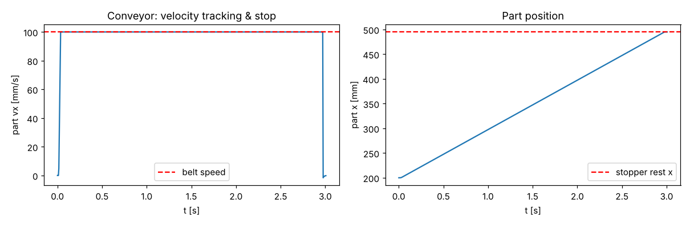
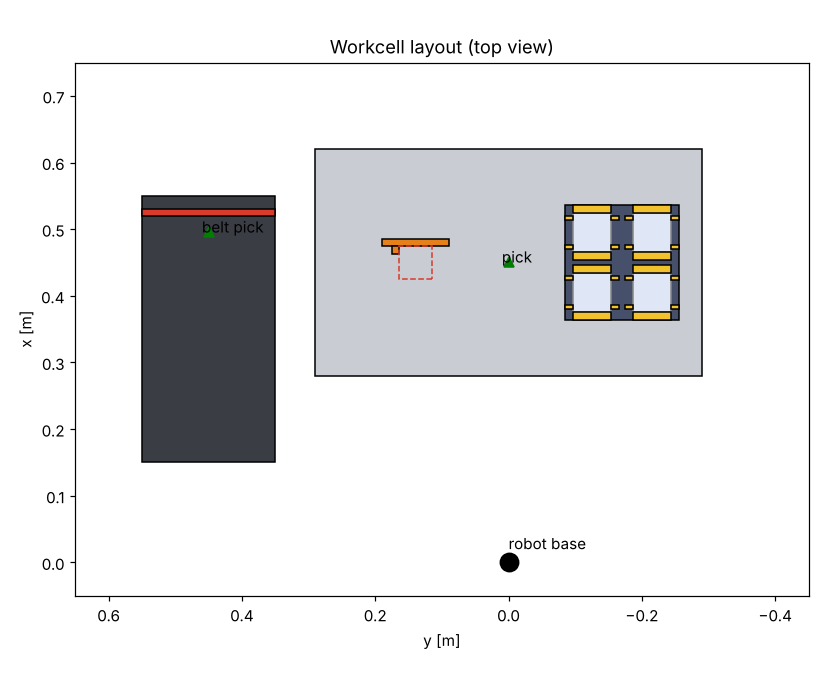
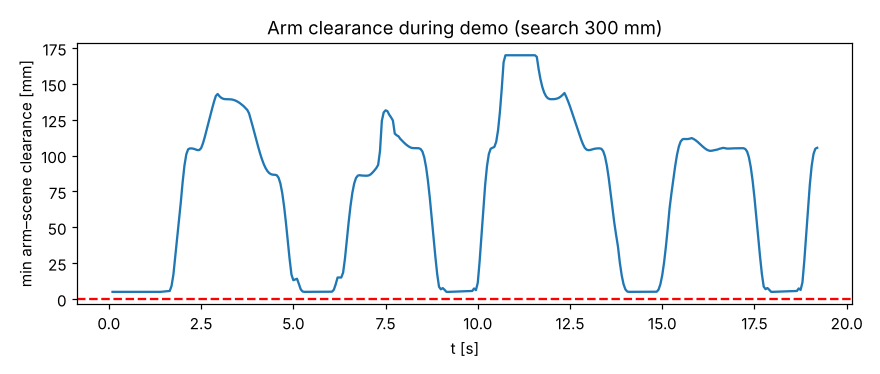
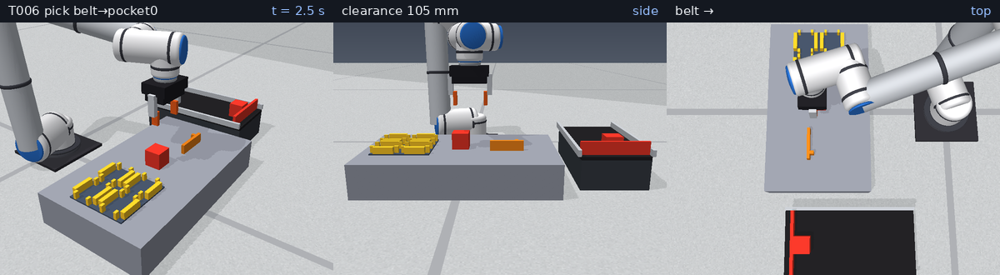
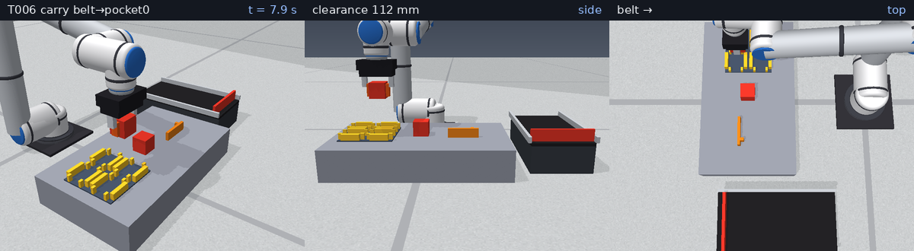
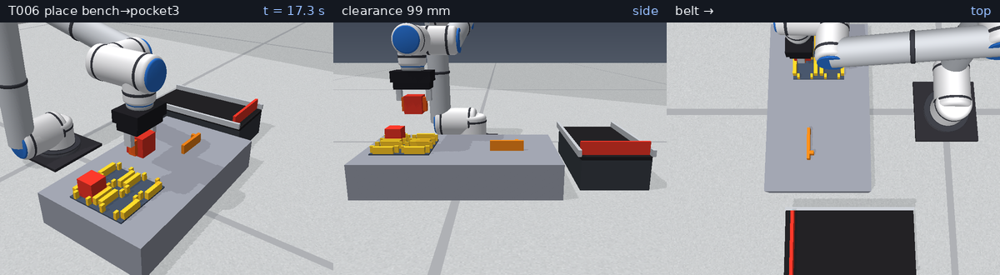

# 2026-11-04 T006 工作站場景 測試報告

日期：2026-11-04　　數據：`docs/test-reports/data/2026-11-04_T006_metrics.json`（由 `scripts/t006_report.py` 實際執行產生）

## 1. 目的
建立工作站場景（工作台、輸送帶＋擋料板、料盤、固定治具）與碰撞群組，驗證：零件被工作台承載、輸送帶速度與擋料定位、
料盤格定位、治具基準、各工位對手臂可達且無碰撞，並提供手臂—場景碰撞/間隙查詢（供 T110 避障規劃使用）。

## 2. 模型與參數（`sixaxis/scene.py`）
* 版面（俯視圖見下圖）：工作台 x∈[0.28,0.62]、y∈±0.29、頂面 0.10 m（= T005 基座高度，取料點 (0.45,0)）；
  料盤中心 (0.45,−0.17)，2×2 格、間距 90 mm、格內淨寬 58 mm（50 mm 方塊單邊間隙 4 mm），
  每格以 ±x 兩片端板 + ±y 側 4 根小銷（x=±22 mm，兩指墊 x 範圍 ±10 mm 不干涉）定位，高 20 mm；
  治具：+x 後擋板 + +y 側銷（μ_eff≈0.3）構成 2D 基準，標稱零件中心 (0.45,0.14)；
  輸送帶 x∈[0.15,0.55]、y∈[0.35,0.55]、帶面 0.10 m、+x 方向 100 mm/s，末端擋料板，零件停在 (0.495,0.45)。
* 輸送帶模型：PyBullet 無表面速度接觸，故帶面摩擦設 0，每步對與帶面接觸的零件施力
  F = m·clip((v_belt − v_x)/dt, ±μg)（μ_belt = 0.5）——庫侖限幅的理想摩擦驅動帶；脫離帶面（被夾起）即不受驅動。
* 碰撞群組（`setCollisionFilterGroupMask`，規則 (gA & mB) && (gB & mA)）：arm=1（含夾爪）、static=2（工作台/料盤/治具/機架/擋板）、
  belt=4、part=8。arm↔static/belt/part、part↔所有群組皆碰撞；belt↔static、arm↔arm 不碰撞（避免機架與帶面互相卡死）。
  另有群組/遮罩皆為 0 的 ghost 體用於驗證過濾。
* 查詢：`Workcell.arm_collisions(margin)` 回傳與手臂（含夾爪）距離 ≤ margin 的場景體；`min_clearance()` 回傳最小距離（負＝穿透）。
* `GraspScene(..., workcell=True)` 改用此場景（T005 原行為不變，預設仍為單一基座）。

## 3. 重現指令
```
python3 -m pytest tests/test_scene.py
PYTHONPATH=. python3 scripts/t006_report.py 2026-11-04
python3 scripts/t006_write_md.py 2026-11-04 "74 passed"
```

## 4. 指令序列（示範，`scripts/t006_report.py`）
輸送帶送料（零件 x=0.34 → 擋料板，約 1.4 s）→［垂直抬起 → 高處中繼點 (0.45,0.2,0.30) → 目標上方 12 cm → 下降 → 閉爪 40 N →
抬升 → 搬運至料盤格上方 → 下降 → 開爪 → 抬起］，依序執行 ①輸送帶零件 → 料盤格 0、②工作台零件 → 料盤格 3。
全程為關節空間五次多項式 PTP，計算力矩控制（T005 的 `GraspScene.move_to`）。

## 5. 量化結果
### 5.1 輸送帶（零件由 x=0.20 起送）
| 指標 | 數值 |
|---|---|
| 穩態速度（指令 100 mm/s） | 100.00 mm/s（誤差 +0.00 %） |
| 速度達 98 % 時間 | 36 ms |
| 擋料板停止位置誤差（相對 (0.495,0.45)） | 0.011 mm |
| 側向漂移 | 0.0006 mm |
| 起送至靜止 | 3.01 s |



### 5.2 料盤格定位（方塊落下 3 cm；單邊間隙 4.0 mm；4 格 × 4 種偏移）
全部停留在格內且貼平底板：True；z 最大誤差 0.010 mm。
| 格 | 落下偏移 (x,y) mm | 靜止誤差 (x,y) mm | z 誤差 mm |
|---|---|---|---|
| 0 | (+3.0, -3.0) | (+3.00, -3.00) | -0.010 |
| 0 | (-3.0, +3.0) | (-3.00, +3.00) | -0.010 |
| 0 | (+3.8, +0.0) | (+3.80, +0.00) | -0.010 |
| 0 | (+0.0, -3.8) | (-0.00, -3.80) | -0.010 |
| 1 | (+3.0, -3.0) | (+3.00, -3.00) | -0.010 |
| 1 | (-3.0, +3.0) | (-3.00, +3.00) | -0.010 |
| 1 | (+3.8, +0.0) | (+3.80, +0.00) | -0.010 |
| 1 | (+0.0, -3.8) | (-0.00, -3.80) | -0.010 |
| 2 | (+3.0, -3.0) | (+3.00, -3.00) | -0.010 |
| 2 | (-3.0, +3.0) | (-3.00, +3.00) | -0.010 |
| 2 | (+3.8, +0.0) | (+3.80, +0.00) | -0.010 |
| 2 | (+0.0, -3.8) | (-0.00, -3.80) | -0.010 |
| 3 | (+3.0, -3.0) | (+3.00, -3.00) | -0.010 |
| 3 | (-3.0, +3.0) | (-3.00, +3.00) | -0.010 |
| 3 | (+3.8, +0.0) | (+3.80, +0.00) | -0.010 |
| 3 | (+0.0, -3.8) | (-0.00, -3.80) | -0.010 |

### 5.3 治具基準（10 次，初始偏離標稱 ≤ 14 mm，以 0.6 m/s 對角滑向基準角）
最大誤差 5.62 mm，RMS 2.37 mm。
| # | x 誤差 mm | y 誤差 mm |
|---|---|---|
| 1 | -0.18 | +0.11 |
| 2 | -0.04 | +0.03 |
| 3 | -1.29 | +0.45 |
| 4 | -0.13 | +0.08 |
| 5 | -0.12 | +0.06 |
| 6 | -3.69 | +2.40 |
| 7 | -4.63 | +3.19 |
| 8 | -1.55 | +0.72 |
| 9 | -0.19 | +0.11 |
| 10 | -0.37 | +0.18 |

### 5.4 工位可達性與碰撞（工具朝下、IK 取最接近 `Q_REF` 的解；間隙 = 手臂與場景最小距離）
| 工位 | 距基座 m | 抓取高度 IK 解數 | 間隙 mm | 上方 12 cm IK 解數 | 間隙 mm |
|---|---|---|---|---|---|
| pick | 0.450 | 8（無碰撞 4） | 5.0 | 8（無碰撞 4） | 105.1 |
| belt | 0.669 | 8（無碰撞 4） | 5.0 | 4（無碰撞 2） | 86.6 |
| fixture | 0.471 | 8（無碰撞 4） | 5.0 | 8（無碰撞 4） | 95.4 |
| pocket0 | 0.459 | 8（無碰撞 4） | 5.0 | 8（無碰撞 4） | 105.5 |
| pocket1 | 0.424 | 8（無碰撞 4） | 5.0 | 8（無碰撞 4） | 105.5 |
| pocket2 | 0.540 | 8（無碰撞 4） | 5.0 | 8（無碰撞 4） | 105.5 |
| pocket3 | 0.511 | 8（無碰撞 4） | 5.0 | 8（無碰撞 4） | 105.5 |

（抓取高度間隙 5.0 mm 為指墊底面距桌面；所有工位的首選解皆無碰撞。）
碰撞查詢驗證：工具中心置於桌面下 5 cm → 命中 ['bench']，穿透 70.0 mm。



### 5.5 示範取放（動畫）
| 週期 | 週期時間 | 放置誤差 (x,y) mm | 放置高度 z (m) |
|---|---|---|---|
| ① 輸送帶 → 格 0 | 8.8 s | (-0.13, +0.41) | 0.1290 |
| ② 工作台 → 格 3 | 8.8 s | (-0.19, +0.36) | 0.1290 |

輸送帶零件停止誤差 0.013 mm；全程 314 個取樣（每 50 ms）手臂與場景最小間隙 4.98 mm，
碰撞取樣數 0。



動畫：[GIF](../media/2026-11-04_T006.gif)（7.6 MB）／[MP4](../media/2026-11-04_T006.mp4)（1.0 MB），314 格，三視角。





## 6. 問題與限制
* 開發中發現：①最初的「角柱」料盤只擋斜向，純 x/y 方向可自由滑出，改為端板 + 側銷；②示範第二輪曾因從夾爪抱著工件的姿態直接 PTP 橫掃，
  把桌面零件掃走，且 PTP 路徑曾擦到治具擋板（clearance=0）→ 示範改為「先垂直抬起、經高處中繼點」。這正是 T110 避障規劃的需求。
* 料盤無導入倒角：偏移超出單邊間隙（4 mm）的零件會停在擋牆頂（實測 6 mm 偏移 z 高出 8 mm），所以純軸向測試取 0.95 倍間隙；定位精度 = 間隙（±4 mm）。
* 治具以「滑入基準角」定位：PyBullet 接觸無恢復係數建模，零件會輕微反彈/停在途中，10 次中最大 5.6 mm、RMS 2.4 mm，
  不是精密夾持；之後若需精確定位應加氣動夾具（主動夾緊）。測試中另以 5 次、2 mm 門檻驗證（pytest 通過）。
* 輸送帶是力模型而非表面速度；零件被夾爪抬離後不受驅動、與帶面無摩擦（帶面 μ=0），零件在帶上不會因偏轉而自動對正（示範皆以 yaw=0 生成）。
* 碰撞間隙查詢僅針對手臂（含夾爪）對場景靜態體，不含手持零件；地板未建碰撞體。

## 7. 結論
工作站場景與碰撞群組可用：輸送帶速度誤差 +0.00 %、擋料板定位 0.011 mm；料盤 4 格皆可收容；所有工位可達且首選 IK 解無碰撞；
示範兩個取放週期放置誤差 < 0.5 mm、全程無碰撞（最小間隙 5.0 mm）。測試：74 passed。下一步 T007 指令介面。
