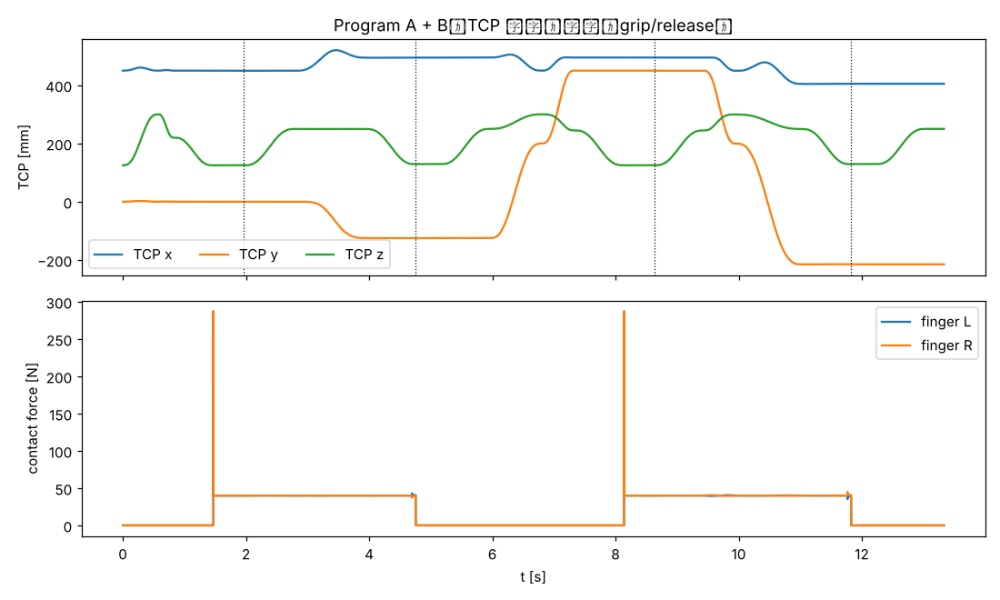
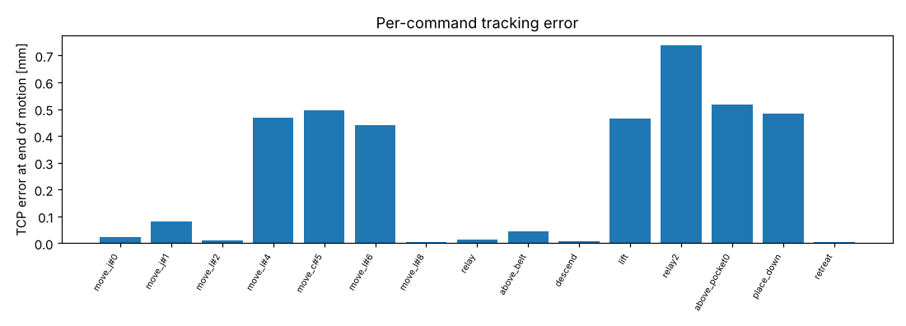
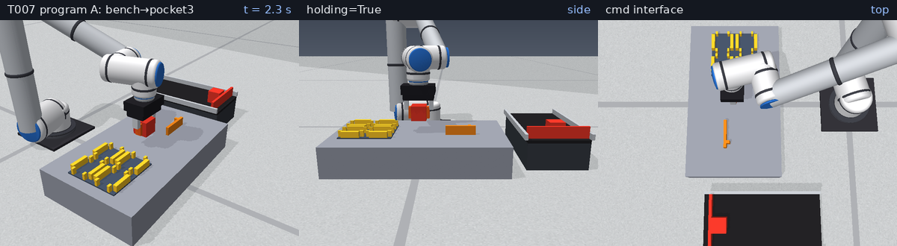
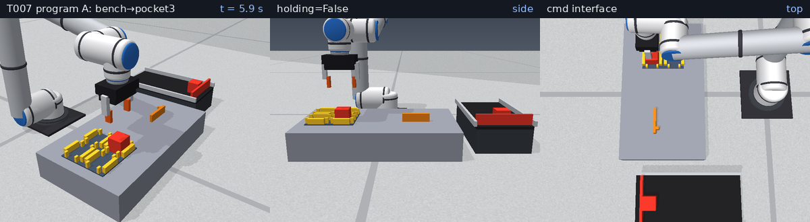
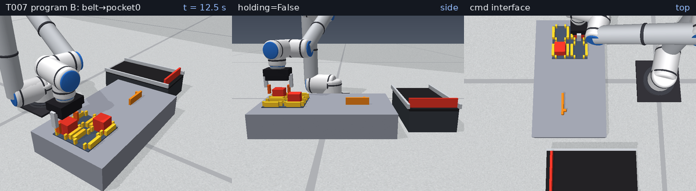

# 2026-11-05 T007 指令介面（JSON / DSL）

## 目的
提供以文字下達的指令介面：解析與驗證（JSON 或 DSL）→ 執行器（運動學 dry-run 或 PyBullet 物理）→ 結構化錯誤回報，
作為 Phase 2 工廠動作與 Phase 3 RL 主動判斷層的共同動作語彙。

## 模型與參數
* 實作：`sixaxis/commands.py`；建構於 T003 軌跡（`joint_ptp`、`LinePath`、`ArcPath`、`sample_cartesian`、`fit_duration`）、
  T005 `GraspScene`（計算力矩手臂 + 夾爪）、T006 `Workcell`（碰撞查詢）。
* 指令：`move_j`（`q` / `q_deg` / `tcp`）、`move_l`、`move_c`（`via`+`tcp`）、`grip`（`force`，預設 40 N）、`release`、`wait`、`set_speed`；
  共用可選 `T`、`speed`、`profile`（quintic/trapezoid）、`id`。TCP 目標一律為夾持中心，`move_j tcp` 為工具朝下，
  `move_l/move_c` 保持當下姿態。
* 時間：未給 `T` → `fit_duration` 求速度與力矩使用率 ≤ 0.5·speed 的最短時間（0.5 為負載/抓持餘裕）；
  給了 `T` 但超限 → `LIMIT` 錯誤，不默默改時間。
* 錯誤碼：SYNTAX / RANGE / UNREACHABLE / LIMIT / COLLISION / GRIP_EMPTY；程式先整體驗證，驗證失敗不執行任何指令；
  執行中遇錯即停（`stop_on_error=False` 可繼續）。
* 碰撞：每 50 ms 查詢手臂與場景靜態體（工作台/料盤/治具/輸送帶…）距離 ≤ 0 → COLLISION。
* 空夾偵測：夾持 0.5 s 後兩指行程已到底或兩指接觸力 < 20 % 設定力 → GRIP_EMPTY。

## 可重現指令
```bash
PYTHONPATH=. python3 scripts/t007_report.py 2026-11-05
python3 scripts/t007_write_md.py 2026-11-05 "<pytest 摘要>"
ruff check . && python3 -m pytest        # 100 passed
```

## 指令序列
程式 A（DSL，桌面方塊 → 料盤格 3）與程式 B（JSON，輸送帶擋料位方塊 → 料盤格 0）見 `scripts/t007_report.py` 的 `PROG_A` / `PROG_B`。
DSL 範例：
```
move_j tcp=0.45,0,0.30
move_l tcp=0.45,0,0.125
grip force=40
move_c via=0.52,-0.0625,0.25 tcp=0.495,-0.125,0.25
release
```

## 量化結果
### 物理執行
| 程式 | 成功 | 時間 [s] | 放置 XY 誤差 [mm] | 放置 Z 誤差 [mm] |
|---|---|---|---|---|
| A（DSL） | True | 5.96 | 0.488 | -0.010 |
| B（JSON） | True | 7.37 | 0.533 | -0.010 |

* 全部運動指令終點 TCP 誤差最大 0.737 mm；速度使用率最大 0.50、力矩使用率最大 0.30（上限 1.0）。
* 程式 A 的 dry-run 預估總時間 5.55 s，物理執行 5.96 s（差在夾持/釋放等待與取整）。
* 結束時手臂與場景最小間隙 106.4 mm；JSON↔DSL 往返解析一致：True。

程式 A 逐指令：
| # | id | 指令 | 時長 [s] | 速度使用率 | 力矩使用率 | 終點 TCP 誤差 [mm] |
|---|---|---|---|---|---|---|
| 0 | move_j#0 | move_j | 0.58 | 0.50 | 0.13 | 0.024 |
| 1 | move_j#1 | move_j | 0.25 | 0.50 | 0.16 | 0.081 |
| 2 | move_l#2 | move_l | 0.63 | 0.26 | 0.11 | 0.009 |
| 3 | grip#3 | grip | — | — | — | — |
| 4 | move_l#4 | move_l | 0.83 | 0.25 | 0.11 | 0.469 |
| 5 | move_c#5 | move_c | 1.15 | 0.17 | 0.14 | 0.496 |
| 6 | move_l#6 | move_l | 0.80 | 0.24 | 0.14 | 0.442 |
| 7 | release#7 | release | — | — | — | — |
| 8 | move_l#8 | move_l | 0.81 | 0.24 | 0.14 | 0.006 |

程式 B 逐指令：
| # | id | 指令 | 時長 [s] | 速度使用率 | 力矩使用率 | 終點 TCP 誤差 [mm] |
|---|---|---|---|---|---|---|
| 0 | relay | move_j | 0.84 | 0.48 | 0.12 | 0.015 |
| 1 | above_belt | move_j | 0.53 | 0.50 | 0.30 | 0.046 |
| 2 | descend | move_l | 0.80 | 0.21 | 0.23 | 0.006 |
| 3 | grip_belt_part | grip | — | — | — | — |
| 4 | lift | move_l | 0.80 | 0.21 | 0.23 | 0.466 |
| 5 | relay2 | move_j | 0.53 | 0.50 | 0.30 | 0.737 |
| 6 | above_pocket0 | move_j | 1.06 | 0.50 | 0.10 | 0.517 |
| 7 | place_down | move_l | 0.80 | 0.25 | 0.11 | 0.485 |
| 8 | release | release | — | — | — | — |
| 9 | retreat | move_l | 0.81 | 0.25 | 0.11 | 0.006 |
| 10 | wait#10 | wait | — | — | — | — |

### 錯誤回報（皆為實際執行結果）
| 案例 | 錯誤碼 | 指令序號 | 訊息 | 錯誤前已完成指令數 |
|---|---|---|---|---|
| 未知指令 | SYNTAX | #0 | 未知指令；可用：move_j, move_l, move_c, grip, release, wait, set_speed | 0 |
| 缺少必要參數 | SYNTAX | #0 | 缺少參數 tcp | 0 |
| 參數個數錯誤 | SYNTAX | #0 | tcp 需為 3 個數值 | 0 |
| 參數範圍錯誤 | RANGE | #0 | force=10000.0 超出範圍 | 0 |
| JSON 格式錯誤 | SYNTAX | #0 | JSON 解析失敗：Expecting property name enclosed in double quotes: line 1 column 3 (char 2) | 0 |
| 目標不可達 | UNREACHABLE | #0 | tcp=[2.0, 0.0, 0.3] 無可達 IK 解（限位內） | 0 |
| 圓弧三點共線 | RANGE | #1 | 圓弧三點共線：three points are collinear | 1 |
| T 過短 → 超速 | LIMIT | #1 | T=0.1s 超限：速度 3.33、力矩 1.96、限位違反=False | 1 |
| 關節超限位 | LIMIT | #0 | 目標關節角超出限位 | 0 |
| 空夾（無物件） | GRIP_EMPTY | #1 | 夾持落空：指行程 40.0 mm、接觸力 L/R = 0.0/0.0 N | 1 |
| 壓進工作台 | COLLISION | #1 | 手臂與 ['bench'] 接觸（t=1.627s） | 1 |

## 圖表與動畫
* 動畫：[GIF](../media/2026-11-05_T007.gif)（5.6 MB）／[MP4](../media/2026-11-05_T007.mp4)（0.73 MB），233 幀
* 
* 
* 關鍵畫面：  

## 問題與限制
* `move_l/move_c` 保持當下姿態，尚無姿態目標（yaw）參數；之後視需要擴充。
* 力矩檢查使用 T001 RNE 模型（未含夾爪與工件質量），因此 0.5 的名目使用率是為此預留的餘裕。
* 碰撞僅檢查手臂對靜態場景，不含夾持中工件對場景（T110 避障規劃處理）；取放需自行加入抬升/中繼點。
* `grip` 以接觸力判斷落空，無法區分「夾到錯誤物件」；後續主動判斷層（T208）再處理。
* 執行器遇錯即停，不含自動恢復（T208）。

## 結論
文字指令（JSON/DSL）可完整驅動取放與輸送帶取料，錯誤以序號與錯誤碼回報，並可在不啟動物理的 dry-run 下預檢可達性/限位/超速。
下一步可進入 Phase 2（T101 點到點搬運）與 T201（Gymnasium reach 環境）。
