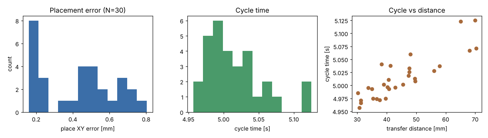
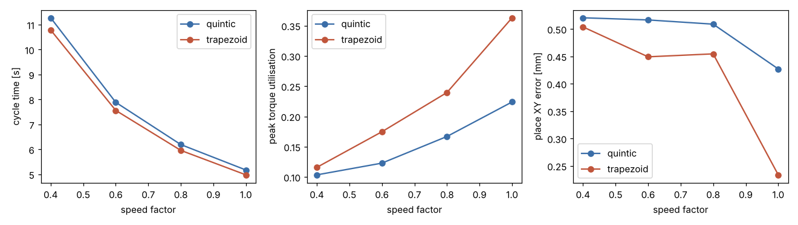
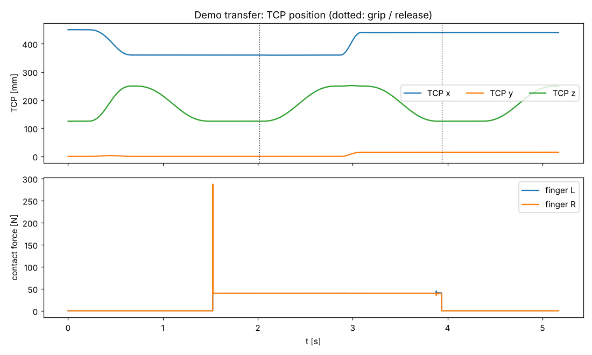

# 2026-11-06 T101 點到點搬運

## 目的
以 T007 指令介面組出「點到點搬運」任務（工作台上方塊由 A 點搬到 B 點），建立 Phase 2 共用的任務程式產生器與量測方法，
並以隨機起訖點、速度/速度曲線、夾持力三組實驗量化：放置位置/姿態誤差、週期時間、速度/力矩使用率、成功率。

## 模型與參數
* 實作：`sixaxis/tasks.py`（`transfer_program`、`random_pairs`、`run_transfer`），建構於 T007 `Executor`、T005 `GraspScene`（計算力矩手臂+夾爪）、T006 `Workcell`（碰撞檢查）。
* 工件：50 mm 方塊（`CUBE`）；TCP 搬運高度 0.25 m、抓放高度為方塊中心高度（工作台頂面 0.10 m + 25 mm）。
* 取放區：x∈[0.36, 0.44]、y∈[−0.01, 0.02] m（避開料盤與治具；見「問題與限制」）；起訖點距離 ≥ 30 mm；亂數種子 2026。
* 成功判定：指令全部成功且放置 XY 誤差 ≤ 2 mm、Z 誤差 ≤ 1 mm、傾角 ≤ 2°。
* 每次試驗皆使用全新場景（避免前次碰撞/物件狀態污染）。

## 可重現指令
```bash
PYTHONPATH=. python3 scripts/t101_report.py 2026-11-06
python3 scripts/t101_write_md.py 2026-11-06 "<pytest 摘要>"
ruff check . && python3 -m pytest        # 106 passed
```

## 指令序列
`transfer_program(src, dst)` 產生 8 道指令（示範：src=(0.36, 0.0)、dst=(0.44, 0.015)）：

| # | id | 指令 | 時長 [s] | 力矩使用率 | 終點 TCP 誤差 [mm] |
|---|---|---|---|---|---|
| 0 | above_src | move_j | 0.49 | 0.17 | 0.032 |
| 1 | descend_src | move_l | 0.83 | 0.10 | 0.006 |
| 2 | grip | grip | — | — | — |
| 3 | lift | move_l | 0.83 | 0.10 | 0.467 |
| 4 | transport | move_j | 0.25 | 0.22 | 0.186 |
| 5 | descend_dst | move_l | 0.83 | 0.10 | 0.395 |
| 6 | release | release | — | — | — |
| 7 | retreat | move_l | 0.83 | 0.10 | 0.006 |

DSL 等價：`move_j`（上方定位）→ `move_l`（下降）→ `grip force=40` → `move_l`（抬升）→ `move_j`（搬運，關節空間 PTP）→ `move_l`（下降）→ `release` → `move_l`（退出）。

## 量化結果
### 1. 隨機起訖點批次（N=30，速度 1.0、五次多項式、夾持 40 N）
| 指標 | 數值 |
|---|---|
| 成功率 | 30/30（100 %） |
| 放置 XY 誤差 平均 / RMS / 最大 [mm] | 0.423 / 0.468 / 0.804 |
| 放置 Z 誤差 絕對最大 [mm] | 0.010 |
| 放置傾角 最大 [deg] | 1.53 |
| 週期時間 平均（最小～最大）[s] | 5.02（4.96～5.13） |
| 運動學 dry-run 預估週期 平均 [s] | 4.52（差值為夾持 0.2 s 靜置、夾持/釋放等待與取整） |
| 速度使用率 最大 | 0.50（上限 1.0，名目餘裕 0.5） |
| 力矩使用率 最大 | 0.43（上限 1.0） |
| 指令終點 TCP 誤差 最大 [mm] | 1.646 |
| 搬運距離 平均 [mm] | 44.9 |

### 2. 速度 × 速度曲線掃描（固定起訖 (0.36, 0.0) → (0.44, 0.015)）
| 曲線 | speed | 週期 [s] | dry-run [s] | 速度使用率 | 力矩使用率 | XY 誤差 [mm] | 傾角 [deg] | 成功 |
|---|---|---|---|---|---|---|---|---|
| quintic | 0.4 | 11.27 | 10.57 | 0.20 | 0.10 | 0.520 | 0.80 | True |
| quintic | 0.6 | 7.88 | 7.34 | 0.30 | 0.12 | 0.516 | 0.79 | True |
| quintic | 0.8 | 6.19 | 5.73 | 0.40 | 0.17 | 0.509 | 0.75 | True |
| quintic | 1.0 | 5.17 | 4.77 | 0.50 | 0.22 | 0.427 | 0.41 | True |
| trapezoid | 0.4 | 10.78 | 10.18 | 0.20 | 0.12 | 0.504 | 0.76 | True |
| trapezoid | 0.6 | 7.56 | 7.10 | 0.30 | 0.17 | 0.449 | 0.54 | True |
| trapezoid | 0.8 | 5.96 | 5.54 | 0.38 | 0.24 | 0.455 | 0.02 | True |
| trapezoid | 1.0 | 4.97 | 4.62 | 0.50 | 0.36 | 0.233 | 0.37 | True |

### 3. 夾持力掃描（speed 1.0）
| 夾持力 [N] | 成功 | XY 誤差 [mm] | 週期 [s] |
|---|---|---|---|
| 5 | True | 0.484 | 5.17 |
| 10 | True | 0.471 | 5.17 |
| 20 | True | 0.445 | 5.17 |
| 40 | True | 0.427 | 5.17 |
| 80 | True | 0.430 | 5.17 |

## 圖表與動畫
* 批次統計：
* 速度/曲線掃描：
* 示範 TCP 與指力：
* 動畫：[GIF](../media/2026-11-06_T101.gif)（2.12 MB）／[MP4](../media/2026-11-06_T101.mp4)（0.28 MB）
* 關鍵畫面：[A](../media/2026-11-06_T101_key_a.png)、[B](../media/2026-11-06_T101_key_b.png)、[C](../media/2026-11-06_T101_key_c.png)
* 原始數據：`docs/test-reports/data/2026-11-06_T101_metrics.json`

## 問題與限制
* 取放區實際可用範圍很小（80 × 30 mm）：初版較大區域（x 至 0.52、y 至 0.06）出現手臂/夾爪與治具後擋板碰撞（COLLISION）、
  以及角落（x≳0.44、y≳0.027）抓取落空（GRIP_EMPTY，一指受力 ~670 N、另一指 0 N，疑似夾爪/手腕靠近治具造成偏載，未深入查因）。
  已將取放區縮到無失敗範圍；更大範圍的搬運須由 T110 避障規劃或換用不同工位姿態處理。
* 週期時間主要由 `move_l` 的自動求時（直線速度上限 ≈ 0.15 m/s·speed、夾持餘裕 0.5）決定，搬運距離僅 30–85 mm，
  因此週期對距離不敏感；speed 掃描顯示週期隨 speed 下降而增加（梯形 0.4→1.0：10.78→4.97 s，含固定的夾持/釋放等待，故不完全是 1/speed）。
* 所有試驗工件質量相同（方塊）；未做負載變化、工件初始偏位與姿態（yaw）隨機化，留待 T102 及 Phase 3。
* 成功率 100 % 僅代表在上述取放區內；統計信賴區間有限（N=30）。

## 結論
點到點搬運在取放區內 30/30 成功，放置 XY 誤差最大 0.80 mm、傾角 ≤ 1.5°，
速度使用率 ≤ 0.5、力矩使用率 ≤ 0.43；夾持力 5–80 N 皆可搬運（本場景為低速、低加速度）。
任務產生器與量測函式（`sixaxis/tasks.py`）可供 T102 取放、T103 疊棧等後續項目沿用。
