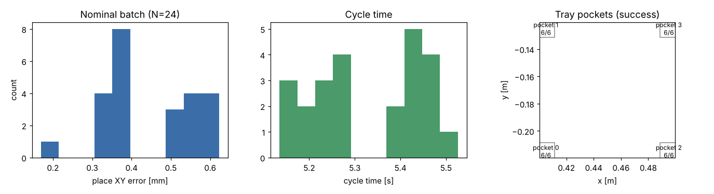
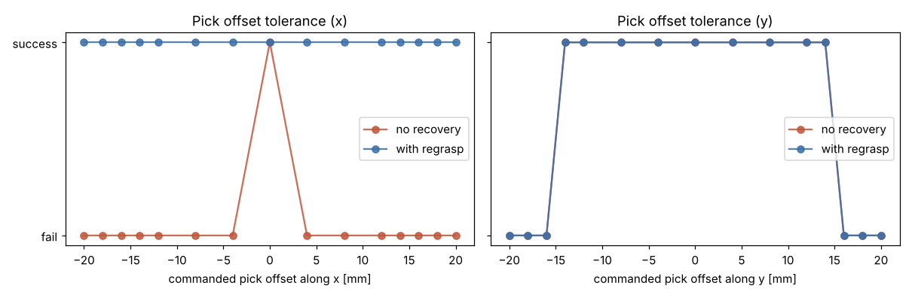
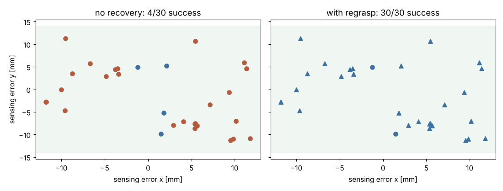

# 2026-11-10 T102 取放（pick & place）

## 目的
延續 T101，把「桌面取料 → 放入料盤格」做成完整取放任務：量化標稱取放的精度與週期，並測試**取點定位/感測誤差**對取放的影響
（夾爪自動對中範圍、x 向殘留偏差造成的放置失敗），再加入最簡單的**失敗偵測與重取（regrasp）**恢復，比較有/無恢復的成功率。

## 模型與參數
* 實作：`sixaxis/tasks.py` 新增 `pick_place_program`、`run_pick_place`、`inhand_ok`（沿用 T007 指令、T005 夾爪、T006 料盤）。
* 放置目標：T006 料盤 4 格（格內淨寬 58 mm、方塊 50 mm → 單邊間隙 4 mm；格中心高度 = 桌面 + 方塊半高 + 板厚 4 mm）。
* 取點區：x∈[0.36, 0.44]、y∈[−0.01, 0.02] m（同 T101）。成功判定：指令全部成功、放置 XY ≤ 3 mm、Z ≤ 1.5 mm、傾角 ≤ 2°、偏航 ≤ 5°
  （傾角 = 方塊 z 軸與世界 z 軸夾角；偏航由料盤格約束，單獨記錄）。
* 夾爪沿 y 軸閉合（開口 80 mm、方塊 50 mm）→ y 向偏差由兩指自動對中；x 向沒有任何對中作用，指墊寬 ±10 mm。
* 恢復策略（`recover=True`）：抬升後檢查方塊中心相對 TCP 的偏差（XY ≤ 1.5 mm、Z ≤ 3 mm、傾角 ≤ 3°，模擬視覺/觸覺回饋）；
  不合格（GRIP_EMPTY／COLLISION／INHAND_OFFSET）→ 若仍持有則原位放回 → 鬆開並垂直退到安全高度 → 讀回方塊實際位置（模擬重新感測）→ 重取，最多 3 次；
  方塊傾倒（>10°）或被撞離桌面則回報 UNRECOVERABLE。
* 每次試驗皆使用全新場景。亂數種子 2026。

## 可重現指令
```bash
PYTHONPATH=. python3 scripts/t102_report.py 2026-11-10
python3 scripts/t102_write_md.py 2026-11-10 "<pytest 摘要>"
ruff check . && python3 -m pytest        # 112 passed、ruff 通過
```

## 指令序列
`pick_place_program(pick, pocket)` = `transfer_program` 的 8 道指令（上方定位 → 直線下降 → 夾 → 直線抬升 → PTP 搬運 → 直線下降至格內 → 放 → 抬升）。
夾持後先垂直抬升再 PTP（T006 發現：抱著工件不可橫掃）。示範（取點指令偏 +12 mm x，放入格 2）最後一次完整執行的指令時序：

| # | id | 指令 | 時長 [s] | 力矩使用率 | 終點 TCP 誤差 [mm] |
|---|---|---|---|---|---|
| 0 | above_src | move_j | 0.46 | 0.15 | 0.033 |
| 1 | descend_src | move_l | 0.83 | 0.10 | 0.006 |
| 2 | grip | grip | — | — | — |
| 3 | lift | move_l | 0.83 | 0.10 | 0.399 |
| 0 | above_src | move_j | 0.10 | 0.20 | 0.057 |
| 1 | descend_src | move_l | 0.83 | 0.10 | 0.006 |
| 2 | grip | grip | — | — | — |
| 3 | lift | move_l | 0.83 | 0.10 | 0.468 |
| 0 | transport | move_j | 0.57 | 0.18 | 0.569 |
| 1 | descend_dst | move_l | 0.81 | 0.16 | 0.325 |
| 2 | release | release | — | — | — |
| 3 | retreat | move_l | 0.81 | 0.16 | 0.006 |

示範的取放嘗試記錄（偵測偏置 → 重取 → 放置）：

| 嘗試 | 階段 | 取點 x 指令 [m] | 結果 | 抬升後 dx [mm] |
|---|---|---|---|---|
| 1 | pick | 0.41200000000000003 | INHAND_OFFSET | -12.00 |
| 2 | pick | 0.3996494090268165 | 成功 | -0.00 |
| 2 | place | — | 成功 | — |

## 量化結果
### 1. 標稱批次（隨機取點 N=24，輪流放入 4 格，無定位誤差，無恢復）
| 指標 | 數值 |
|---|---|
| 成功率 | 24/24 |
| 放置 XY 誤差 平均 / 最大 [mm] | 0.446 / 0.623 |
| 放置 Z 誤差 絕對最大 [mm] | 0.010 |
| 傾角 最大 / 偏航 最大 [deg] | 0.001 / 1.16 |
| 週期時間 平均 [s] | 5.33 |
| 速度使用率 最大 / 力矩使用率 最大 | 0.50 / 0.21 |

各格成功數：

| 格 | 中心 (x, y) [m] | 成功 |
|---|---|---|
| 0 | (0.4050, -0.2150) | 6/6 |
| 1 | (0.4050, -0.1250) | 6/6 |
| 2 | (0.4950, -0.2150) | 6/6 |
| 3 | (0.4950, -0.1250) | 6/6 |

### 2. 取點偏差掃描（真值取點 (0.40, 0.0)，放入格 1）
沿單軸偏移「指令取點」（偏移量 = 感測/定位誤差）。左：整段一次執行（無恢復）；右：偵測 + 重取。

**x 軸偏差**
| 偏移 [mm] | 無恢復 | 放置 XY 誤差 [mm] | 有恢復 | 取點次數 | 放置 XY 誤差 [mm] |
|---|---|---|---|---|---|
| -20 | ✗  | 4.9 | ✓  | 2 | 0.6 |
| -18 | ✗  | 3.9 | ✓  | 2 | 0.5 |
| -16 | ✗  | 6.3 | ✓  | 2 | 0.6 |
| -14 | ✗  | 3.9 | ✓  | 2 | 0.6 |
| -12 | ✗  | 6.2 | ✓  | 2 | 0.5 |
| -8 | ✗  | 4.0 | ✓  | 2 | 0.5 |
| -4 | ✗  | 3.7 | ✓  | 2 | 0.6 |
| +0 | ✓  | 0.6 | ✓  | 1 | 0.6 |
| +4 | ✗ COLLISION@5 | 0.6 | ✓  | 2 | 0.6 |
| +8 | ✗ COLLISION@5 | 4.0 | ✓  | 2 | 0.6 |
| +12 | ✗ COLLISION@5 | 6.1 | ✓  | 2 | 0.6 |
| +14 | ✗ COLLISION@5 | 1.7 | ✓  | 2 | 0.5 |
| +16 | ✗ COLLISION@5 | 12.0 | ✓  | 2 | 0.6 |
| +18 | ✗ COLLISION@5 | 14.4 | ✓  | 2 | 0.6 |
| +20 | ✗  | 5.1 | ✓  | 2 | 0.6 |

**y 軸偏差**
| 偏移 [mm] | 無恢復 | 放置 XY 誤差 [mm] | 有恢復 | 取點次數 | 放置 XY 誤差 [mm] |
|---|---|---|---|---|---|
| -20 | ✗  | 1.0 | ✗ UNRECOVERABLE | 1 | 105.4 |
| -18 | ✗  | 1.0 | ✗ UNRECOVERABLE | 1 | 106.8 |
| -16 | ✗  | 0.8 | ✗ UNRECOVERABLE | 1 | 109.5 |
| -14 | ✓  | 0.6 | ✓  | 1 | 0.6 |
| -12 | ✓  | 0.6 | ✓  | 1 | 0.6 |
| -8 | ✓  | 0.6 | ✓  | 1 | 0.6 |
| -4 | ✓  | 0.6 | ✓  | 1 | 0.6 |
| +0 | ✓  | 0.6 | ✓  | 1 | 0.6 |
| +4 | ✓  | 0.6 | ✓  | 1 | 0.6 |
| +8 | ✓  | 0.5 | ✓  | 1 | 0.5 |
| +12 | ✓  | 0.5 | ✓  | 1 | 0.5 |
| +14 | ✓  | 0.6 | ✓  | 1 | 0.6 |
| +16 | ✗  | 5.2 | ✗ UNRECOVERABLE | 1 | 140.2 |
| +18 | ✗  | 3.3 | ✗ UNRECOVERABLE | 1 | 142.4 |
| +20 | ✗  | 6.5 | ✗ UNRECOVERABLE | 1 | 143.5 |

### 3. 隨機感測誤差批次（兩軸各均勻 ±12 mm，N=30，相同誤差兩種策略）
| 指標 | 無恢復 | 有恢復 |
|---|---|---|
| 成功率 | 4/30 | 30/30 |
| 放置 XY 誤差 平均 / 最大 [mm] | 3.35 / 6.04 | 0.45 / 1.63 |
| 週期時間 平均 [s] | 4.47 | 9.29 |
| 平均取點次數 / 需重取案例 | 1.00 / 0 | 1.93 / 28 |

## 圖表與動畫
* 標稱批次：
* 取點偏差掃描：
* 隨機感測誤差（▲ = 需重取）：
* 動畫：[GIF](../media/2026-11-10_T102.gif)（3.33 MB）／[MP4](../media/2026-11-10_T102.mp4)（0.46 MB）
* 關鍵畫面：[A](../media/2026-11-10_T102_key_a.png)、[B](../media/2026-11-10_T102_key_b.png)、[C](../media/2026-11-10_T102_key_c.png)
* 原始數據：`docs/test-reports/data/2026-11-10_T102_metrics.json`

## 問題與限制
* 無恢復時 x 向偏差在本次掃描的 ±4 mm 起即失敗（方塊偏離夾爪中心，撞到料盤側銷或放置偏位；±2 mm 未列入掃描，開發中探測 +2 mm 仍成功）；y 向在 ±14 mm 內由夾爪對中吸收；
  |y 偏差| ≥ 16 mm 時指墊壓在方塊頂面把方塊撞倒，簡單恢復無法處理（UNRECOVERABLE），需要更完整的感測與主動判斷（T208）。
* 「感測」是直接讀取模擬器的方塊位置（理想、無雜訊），並非視覺；真實系統須加入相機/力覺雜訊模型，恢復成功率會較低。
* 工具姿態固定（T007 move_l/move_c 無姿態目標），故不處理方塊 yaw 偏差；偏航僅記錄。
* 放置目標只測料盤 4 格，未測治具與疊放（T103）；工件僅單一方塊。
* 第 2 節為單一真值取點的單軸掃描，第 3 節 N=30，統計信賴區間有限。

## 結論
標稱取放 24/24 成功（放置 XY 誤差最大 0.62 mm、週期平均 5.33 s、力矩使用率 ≤ 0.21）。
取點存在 ±12 mm 隨機誤差時，無恢復僅 4/30 成功，加入「抬升後檢查 → 放回 → 重新感測 → 重取」後達 30/30
（平均週期 4.47 → 9.29 s）。此恢復機制與量測方法可作為 T103 疊棧、T104 輸送帶追蹤與 T208 主動判斷層的基礎。
