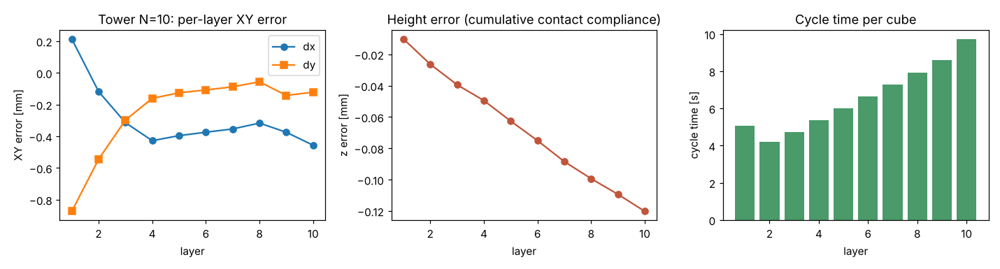
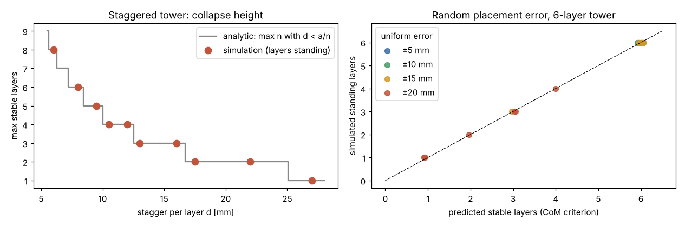
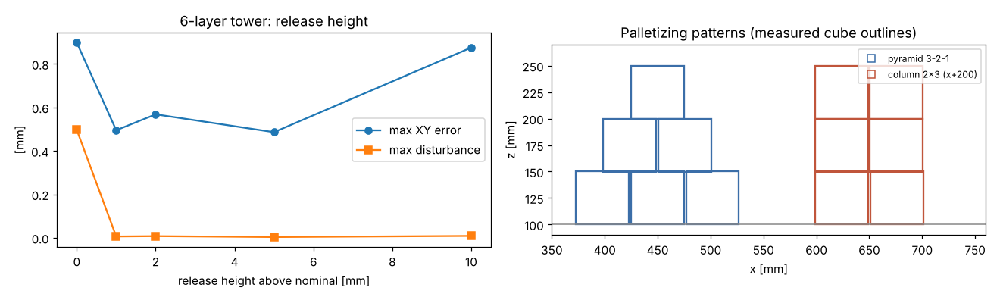
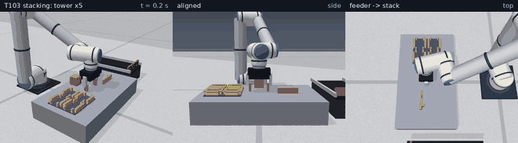

# 2026-11-11 T103 疊棧／碼垛

## 目的
延續 T102 取放，把方塊**逐層堆疊**：垂直疊棧（單柱多層）、壓縫金字塔與柱式碼垛。量化每層放置精度、累積誤差、後續放置對已放方塊的擾動、
週期時間與力矩使用率；並以**靜力學質心判據**預測「放歪的堆疊何時倒塌」，與物理模擬逐案比對，做為之後主動判斷（T208）「這一塊還能不能往上放」的依據。

## 模型與參數
* 實作：`sixaxis/stacking.py`（樣式 `tower_slots`／`pyramid_slots`／`column_slots`、`stack_program`、`run_stack`、判據 `stack_margins`／`stable_height`）；
  只組合 T007 指令（`tasks.transfer_program`），手臂計算力矩控制、夾持力 40 N（T005）。
* 工件：50 mm 方塊、0.20 kg；層高 50 mm；第 k 層（k 從 0）中心高度 = 桌面 0.10 + 0.025 + 0.05·k m。
* 供料：每放完一塊，在供料點 (0.34, 0.0) 生成下一塊（模擬供料器）。疊棧位置 (0.44, 0.0)；
  碼垛中心 (0.45, 0.0)，同層中心距 52 mm（間隙 2 mm）。
* 夾爪沿 y 閉合且工具姿態固定 → 同層方塊只沿 x 排列（指墊不需伸入相鄰方塊之間）。
* 搬運高度隨層數升高：TCP = max(0.25, 放置高度 + 0.07) m。抬升後以 `inhand_ok` 檢查方塊在夾爪內置中（T102）。
* 每放一塊並退回後檢查所有已放方塊是否在位（|z 誤差| ≤ 5 mm、傾角 ≤ 5°、XY ≤ 15 mm），否則記 `COLLAPSE@k` 並停止；
  全部放完靜置後再量一次。成功判定：全部在位且 XY ≤ 2 mm、|Z| ≤ 1.5 mm、傾角 ≤ 2°。

### 靜力穩定判據（依據）
剛體方塊單柱堆疊：對每個介面，其上方所有方塊的合質心水平投影必須落在該介面的接觸區（上下兩方塊底面的交集）內；
否則重力對接觸區邊緣的力矩無法由只能受壓的法向接觸力平衡而傾倒（靜力學零力矩條件，Meriam & Kraige《Statics》；
積木懸伸問題，Paterson & Zwick, "Overhang", Amer. Math. Monthly 116(1), 2009）。
等質量、每層等距錯位 d 的 n 層塔：介面上方有 m 塊時合質心相對下方方塊偏 d(m+1)/2，接觸區邊界在 a/2，
最嚴格為最底介面（m = n−1）→ **d < a/n**（a = 50 mm）。`stable_height` 對逐層堆疊的每個前綴都檢查所有介面。

## 可重現指令
```bash
PYTHONPATH=. python3 scripts/t103_report.py 2026-11-11
python3 scripts/t103_write_md.py 2026-11-11 "<pytest 摘要>"
ruff check . && python3 -m pytest        # 123 passed
```

## 指令序列
每塊 8 道指令（`stack_program`）：供料點上方定位 → 直線下降 → 夾 → 直線抬升 → PTP 搬運到堆疊上方 → 直線下降到層高 → 放 → 直線退回。
10 層塔最後一塊（第 10 層）的指令時序：

| # | id | 指令 | 時長 [s] | 力矩使用率 | 終點 TCP 誤差 [mm] |
|---|---|---|---|---|---|
| 0 | above_src | move_j | 0.23 | 0.40 | 0.145 |
| 1 | descend_src | move_l | 3.47 | 0.10 | 0.000 |
| 2 | grip | grip | — | — | — |
| 3 | lift | move_l | 3.47 | 0.10 | 0.484 |
| 0 | transport | move_j | 0.42 | 0.23 | 0.353 |
| 1 | descend_dst | move_l | 0.60 | 0.14 | 0.189 |
| 2 | release | release | — | — | — |
| 3 | retreat | move_l | 0.63 | 0.14 | 0.007 |

## 量化結果
### 1. 垂直疊棧 10 層（標稱，無放置誤差）
結果：✓ 10/10 層；總時間 69.0 s；速度／力矩使用率最大 0.50／0.43；
指令終點 TCP 誤差最大 0.484 mm。各層最終狀態（靜置後）：

| 層 | dx [mm] | dy [mm] | z 誤差 [mm] | 傾角 [deg] | 被後續放置擾動 [mm] | 週期 [s] |
|---|---|---|---|---|---|---|
| 1 | +0.21 | -0.87 | -0.010 | 0.000 | 0.50 | 5.06 |
| 2 | -0.12 | -0.54 | -0.026 | 0.012 | 0.17 | 4.22 |
| 3 | -0.31 | -0.30 | -0.039 | 0.017 | 0.01 | 4.74 |
| 4 | -0.43 | -0.16 | -0.049 | 0.017 | 0.02 | 5.37 |
| 5 | -0.40 | -0.13 | -0.063 | 0.022 | 0.04 | 6.00 |
| 6 | -0.37 | -0.11 | -0.075 | 0.026 | 0.05 | 6.64 |
| 7 | -0.35 | -0.09 | -0.088 | 0.029 | 0.06 | 7.28 |
| 8 | -0.32 | -0.06 | -0.099 | 0.027 | 0.07 | 7.92 |
| 9 | -0.37 | -0.14 | -0.109 | 0.027 | 0.04 | 8.59 |
| 10 | -0.46 | -0.12 | -0.120 | 0.028 | 0.00 | 9.71 |

### 2. 樣式比較
| 樣式 | 結果 | XY 最大 [mm] | \|Z\| 最大 [mm] | 傾角最大 [deg] | 擾動最大 [mm] | 平均週期 [s] | 總時間 [s] | 力矩使用率 |
|---|---|---|---|---|---|---|---|---|
| 垂直疊棧 10 層 | ✓ 10/10 | 0.90 | 0.120 | 0.029 | 0.50 | 6.55 | 69.0 | 0.43 |
| 金字塔 3-2-1（壓縫） | ✓ 6/6 | 0.54 | 0.031 | 0.002 | 0.01 | 4.71 | 31.0 | 0.24 |
| 柱式 2×3（對齊） | ✓ 6/6 | 0.72 | 0.032 | 0.003 | 0.28 | 4.67 | 30.7 | 0.21 |

### 3. 釋放高度與速度（6 層塔）
釋放高度 = 放開時方塊底面高於標稱接觸面的距離（>0 即讓方塊自由落下該距離）。

| 釋放高度 [mm] | speed | 結果 | XY 最大 [mm] | \|Z\| 最大 [mm] | 傾角最大 [deg] | 擾動最大 [mm] | 平均週期 [s] |
|---|---|---|---|---|---|---|---|
| 0 | 1.00 | ✓ 6/6 | 0.90 | 0.063 | 0.006 | 0.50 | 5.34 |
| 1 | 1.00 | ✓ 6/6 | 0.49 | 0.063 | 0.006 | 0.01 | 5.32 |
| 2 | 1.00 | ✓ 6/6 | 0.57 | 0.063 | 0.008 | 0.01 | 5.31 |
| 5 | 1.00 | ✓ 6/6 | 0.49 | 0.062 | 0.005 | 0.00 | 5.27 |
| 10 | 1.00 | ✓ 6/6 | 0.88 | 0.063 | 0.008 | 0.01 | 5.20 |
| 0 | 0.50 | ✓ 6/6 | 0.60 | 0.062 | 0.005 | 0.11 | 9.79 |
| 0 | 0.75 | ✓ 6/6 | 0.76 | 0.062 | 0.006 | 0.28 | 6.82 |

標稱高度釋放（0 mm）時夾爪把方塊壓在堆疊上再放開，下層被擠動最多 0.50 mm；
抬高 1 mm 釋放即降到 0.01 mm，且 XY 最大誤差 0.90 → 0.49 mm。

### 4. 錯位塔：倒塌層數 vs 解析判據（每層沿 +x 錯位 d，目標 8 層）
| d [mm] | a/d | 解析可堆層數 | 模擬可堆層數 | 模擬結果 | 一致 |
|---|---|---|---|---|---|
| 6.0 | 8.33 | 8 | 8 | — | ✓ |
| 8.0 | 6.25 | 6 | 6 | COLLAPSE@6 | ✓ |
| 9.5 | 5.26 | 5 | 5 | COLLAPSE@5 | ✓ |
| 10.5 | 4.76 | 4 | 4 | COLLAPSE@4 | ✓ |
| 12.0 | 4.17 | 4 | 4 | COLLAPSE@4 | ✓ |
| 13.0 | 3.85 | 3 | 3 | COLLAPSE@3 | ✓ |
| 16.0 | 3.12 | 3 | 3 | COLLAPSE@3 | ✓ |
| 17.5 | 2.86 | 2 | 2 | COLLAPSE@2 | ✓ |
| 22.0 | 2.27 | 2 | 2 | COLLAPSE@2 | ✓ |
| 27.0 | 1.85 | 1 | 1 | COLLAPSE@1 | ✓ |

一致 10/10。

### 5. 隨機放置誤差（6 層塔，每塊兩軸各均勻 ±e，種子 2026）
| e [mm] | N | 模擬堆滿 6 層 | 判據預測堆滿 | 層數一致 | 模擬層數 | 預測層數 |
|---|---|---|---|---|---|---|
| ±5 | 6 | 6/6 | 6/6 | 6/6 | 6, 6, 6, 6, 6, 6 | 6, 6, 6, 6, 6, 6 |
| ±10 | 6 | 6/6 | 6/6 | 6/6 | 6, 6, 6, 6, 6, 6 | 6, 6, 6, 6, 6, 6 |
| ±15 | 6 | 4/6 | 4/6 | 6/6 | 1, 6, 3, 6, 6, 6 | 1, 6, 3, 6, 6, 6 |
| ±20 | 6 | 0/6 | 0/6 | 6/6 | 1, 1, 2, 4, 3, 3 | 1, 1, 2, 4, 3, 3 |

判據與模擬層數一致 24/24。全部一致。
其中 4 案「6 層全部放上後」的整體判據餘裕 > 0，但堆到一半的前綴已不穩（上層尚未放上、缺少配重）而在中途倒塌——
逐層堆疊必須對**每個中間狀態**檢查，而不是只檢查最終樣式。

## 圖表與動畫
* 10 層塔各層誤差與週期：
* 穩定性（左：錯位塔；右：隨機誤差，預測 vs 模擬）：
* 釋放高度與碼垛樣式（量測外框）：
* 動畫（2× 速，GIF 每 3 幀取 1；5 層塔 → 金字塔 3-2-1 → 錯位 13 mm 塔倒塌）：
  [GIF](../media/2026-11-11_T103.gif)（6.19 MB）／[MP4](../media/2026-11-11_T103.mp4)（2.27 MB）
* 關鍵畫面：[A 5 層塔](../media/2026-11-11_T103_key_a.png)、[B 金字塔](../media/2026-11-11_T103_key_b.png)、[C 錯位塔倒塌](../media/2026-11-11_T103_key_c.png)
* 原始數據：`docs/test-reports/data/2026-11-11_T103_metrics.json`

動畫三段的實際結果：

| 段落 | 堆成層數 | 結果 | 模擬時間 [s] |
|---|---|---|---|
| tower5 | 5/5 | — | 26.7 |
| pyramid | 6/6 | — | 29.8 |
| stagger13 | 3/5 | COLLAPSE@3 | 20.8 |

## 問題與限制
* 供料為「在供料點直接生成方塊」的理想供料器，位置無誤差；未接輸送帶（留給 T104）。
* 工具姿態固定、夾爪沿 y 閉合，同層只能沿 x 排列；無法做逐層旋轉 90° 的交錯碼垛或 y 向並排（需 move_l 姿態目標與更大指間隙）。
* 穩定判據為剛體、等質量、無偏航、單柱的靜力條件，不含放開瞬間的動態衝擊與接觸柔度；餘裕接近 0 的案例模擬結果可能與判據差一層。
* 倒塌偵測直接讀模擬器方塊位姿（理想感測）；倒塌後不做清理/重建。
* 週期隨層數增加（5.06 → 9.71 s）：夾持後以直線垂直抬升到「放置高度 + 0.07 m」，高層的抬升行程長；未做路徑/時間最佳化。
* 高度只測到 10 層（0.5 m）；更高需檢查可達範圍與手腕碰撞。第 5 節每個誤差等級 N=6，統計量有限。

## 結論
垂直疊棧 10/10 層成功：XY 誤差最大 0.90 mm、|Z| 最大 0.120 mm、傾角最大 0.029°、
平均週期 6.55 s、力矩使用率 ≤ 0.43；金字塔 3-2-1 與柱式 2×3 碼垛皆 6/6、6/6 完成。
錯位塔的倒塌層數與解析判據 d < a/n 一致 10/10，隨機放置誤差下一致 24/24，
表示可用 `stable_height` 在放置前預判堆疊是否會倒。下一步 T104 輸送帶追蹤抓取。
