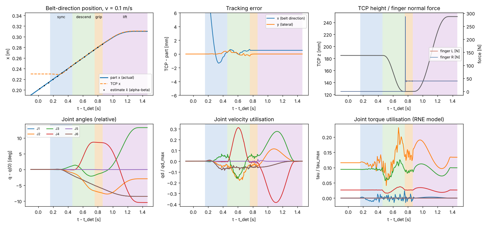
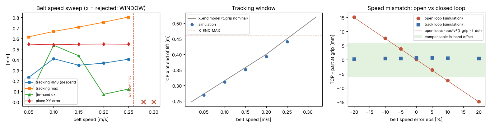
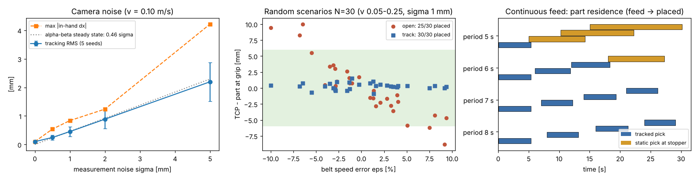
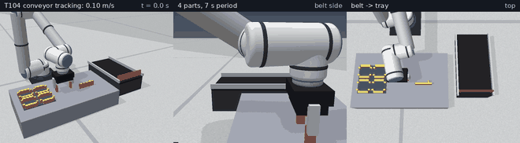

# 2026-11-12 T104 輸送帶追蹤抓取

## 目的
T102/T103 的工件都是靜止的。本項讓手臂**在輸送帶不停機的情況下抓取移動中的工件**（conveyor tracking / on-the-fly picking）並放入料盤：
估測工件位置與帶速 → TCP 與工件同步 → 追蹤中下降、夾持、抬升 → 放置。量化追蹤誤差、手內偏移、放置誤差、週期、速度/力矩使用率，
找出可追蹤的帶速上限（追蹤窗），並比較「只靠標稱帶速的開迴路預測」與「相機回授的閉迴路估測」在帶速有誤差時的差異；
最後做連續來料，觀察來料週期短於手臂週期時的行為（改在擋料板前靜態抓取）。

## 模型與參數
* 實作：`sixaxis/tracking.py`（`BeltEstimator`、`Tracker`、`track_pick`、`place_held`、`static_pick`、`run_track_cycle`、`run_flow`、
  判據 `x_end_pred`／`v_max_window`）。場景為 T006 工作站：輸送帶 x∈[0.15, 0.55]、y∈[0.35, 0.55] m，沿 +x 前進，x = 0.52 有擋料板；
  帶面為庫侖限幅的速度追隨模型（μ = 0.5）。工件：50 mm 方塊、0.20 kg；夾持力 40 N；手臂為計算力矩控制（T005）。
* 幾何：上料 x = 0.18、光電開關 x = 0.2、等待點 TCP = (0.23, 0.45, 0.185) m（指尖離工件頂面 15 mm）、
  抬升結束 TCP 的 x 上限 X_END_MAX = 0.46 m（工件前緣距擋料板 35 mm）。
* 時間：同步 T_SYNC = 0.3 s、追蹤下降 T_DESC = 0.3 s、夾持「兩指法向力 ≥ 0.5·F 持續 100 步（0.1 s）」即完成（上限 0.5 s，
  可行性判斷用標稱 0.15 s）、抬升 T_LIFT = 0.5 s（同時 x 向由帶速減到 0）。
* 感測：光電開關給第一筆位置；相機每 20 ms 量測工件 xy（讀模擬器位置 + 高斯雜訊 σ，預設 0.5 mm）。

### 依據
1. **α-β 濾波器**（等速目標的穩態卡爾曼濾波；Kalata 1984, IEEE Trans. AES 20(2)；Bar-Shalom, Li & Kirubarajan 2001, §6.5）：
   預測 x⁻ = x + v·T；殘差 r = z − x⁻；x = x⁻ + α·r；v ← v + (β/T)·r，α = 0.3、β = 0.03、T = 0.02 s。
   對等速目標穩態誤差為 0；位置估測變異數／量測變異數 = (2α² + 2β − 3αβ)/(α(4 − 2α − β)) = 0.211
   （標準差 ×0.46；單元測試以 4 萬筆蒙地卡羅驗證，誤差 < 8 %）。
2. **開迴路預測誤差**：帶速相對誤差 ε（實際 = 標稱·(1+ε)）時，TCP − 工件 = −ε·v_nom·(t − t_det)（等速積分）。
3. **同步**：p = p_w + s(τ)·(p̂ − p_w)，s 為五次時間律（s、ṡ、s̈ 端點為 0）→ 結束時 p = p̂、ṗ = ṡ(p̂ − p_w) + s·v̂ = v̂。
   觸發條件 x̂ ≥ x_w − v̂·T_SYNC/2（TCP 幾乎不需後退）。
4. **CLIK**（Siciliano 等 2009, §3.7）：q̇ = J⁻¹(q)·[ṗ_d + K(p_d − p(q)); K·log(R_d Rᵀ)]，K = 100 1/s，每 1 ms 積分得關節指令，
   q̈ 前饋取 q̇ 一階差分，交給計算力矩控制。工具姿態固定朝下。
5. **追蹤窗**：自同步觸發到抬升結束，TCP 沿帶向行進到
   x_end(v) = max(x_w − v·T_SYNC/2, X_DET) + v·(T_SYNC + T_DESC + t_grip + T_LIFT/2)，須 ≤ X_END_MAX。
   低速時 x_end = x_w + v·0.85；v > 0.20 m/s 時觸發點落在光電上游，只能在光電處觸發。
   解得 **v_max = 0.260 m/s**（`v_max_window`）。估測超窗 → 不追（WINDOW），可改用後備的擋料板前靜態抓取。
6. **手內偏移補償**：抬升後量測 d = 工件中心 − TCP，放置 TCP = 料盤格中心 − d。|dx| > 6 mm 視為失敗（INHAND_OFFSET：
   指墊 x 向 ±10 mm、料盤側銷內緣 17 mm，餘裕 7 mm）；橫向 |ŷ − 帶中心| > 12 mm 不追（LATERAL；指開口單邊 15 mm）。

成功判定：放入料盤格後 XY ≤ 3 mm、|Z| ≤ 1.5 mm、傾角 ≤ 2°、偏航 ≤ 5°（同 T102）。

## 可重現指令
```bash
PYTHONPATH=. python3 scripts/t104_report.py 2026-11-12
python3 scripts/t104_write_md.py 2026-11-12 "<pytest 摘要>"
ruff check . && python3 -m pytest        # 133 passed
```
注意：報告腳本與 pytest 不可同時執行（兩者都會重寫 `robots/ur5_gripper.urdf`）。

## 指令序列
單一週期（`run_track_cycle`）：
1. `move_l`（必要時先垂直抬到 0.25 m）→ `move_j tcp=(0.23, 0.45, 0.185)` 到等待點（T007 指令）
2. 上料（工件以帶速出現在 x = 0.18）→ 光電觸發 → 等待同步觸發
3. 同步 0.3 s → 追蹤下降 0.3 s → 追蹤中夾持 → 抬升 0.5 s（線上 CLIK，非 T007 指令）
4. 量測手內偏移 → `move_j`（料盤格上方）→ `move_l`（下降到格內高度）→ `release` → `move_l`（退回）（T007 指令）

## 量化結果
### 1. 標稱（帶速 0.10 m/s、σ = 0.5 mm）
| 項目 | 數值 |
|---|---|
| 結果 | ✓（track） |
| 光電觸發 → 開始同步 → 開始夾持 → 抬升結束 [s] | 0 → 0.159 → 0.759 → 1.465 |
| 追蹤誤差（下降段，TCP − 工件，帶向）RMS／最大／夾持瞬間 [mm] | 0.41／0.67／+0.67 |
| 夾持瞬間橫向誤差 [mm] | -0.29 |
| 夾持瞬間帶速估測 [m/s] | 0.1006 |
| 夾持完成時間 [s]；兩指法向力 L／R [N] | 0.106；39.9／40.1 |
| 手內偏移 dx／dy／dz [mm]、傾角 [deg] | -0.54／-0.000／-0.032、0.13 |
| 抬升結束 TCP x [m]（上限 0.46） | 0.311 |
| 放置 XY／Z 誤差 [mm]、傾角／偏航 [deg] | 0.54／-0.010、0.001／0.98 |
| 週期（上料 → 放好退回）[s] | 5.37 |
| 速度／力矩使用率（追蹤段；全程力矩） | 0.39／0.21 |

### 2. 帶速掃描（σ = 0.5 mm）
| 帶速 [m/s] | 結果 | 錯誤 | 追蹤 RMS [mm] | 追蹤最大 [mm] | 手內 dx [mm] | x_end [m] | 放置 XY [mm] | 週期 [s] | 速度使用率 | 力矩使用率 |
|---|---|---|---|---|---|---|---|---|---|---|
| 0.05 | ✓ track | — | 0.23 | 0.62 | -0.04 | 0.270 | 0.55 | 5.94 | 0.39 | 0.20 |
| 0.10 | ✓ track | — | 0.41 | 0.67 | -0.54 | 0.311 | 0.54 | 5.37 | 0.39 | 0.21 |
| 0.15 | ✓ track | — | 0.35 | 0.71 | -0.44 | 0.351 | 0.55 | 5.11 | 0.38 | 0.20 |
| 0.20 | ✓ track | — | 0.37 | 0.75 | -0.07 | 0.393 | 0.55 | 4.95 | 0.38 | 0.22 |
| 0.25 | ✓ track | — | 0.40 | 0.81 | -0.12 | 0.440 | 0.55 | 4.85 | 0.38 | 0.23 |
| 0.28 | ✗ track | WINDOW | — | — | — | — | — | 0.07 | — | — |
| 0.30 | ✗ track | WINDOW | — | — | — | — | — | 0.07 | — | — |

追蹤窗判據 v_max = 0.260 m/s：0.05, 0.10, 0.15, 0.20, 0.25 m/s 成功，
0.28, 0.30 m/s 被判定超窗（WINDOW）而不追，與判據一致。
後備：帶速 0.30 m/s 加上 `fallback=True` → 等工件被擋料板擋停後靜態抓取：✓（static），
放置 XY 0.54 mm、週期 7.23 s。

### 3. 帶速誤差：開迴路 vs 閉迴路（控制器假設 0.10 m/s，實際 = 0.10·(1+ε)）
「夾持瞬間誤差」= TCP − 工件（帶向）。開迴路解析值 = −ε·v_nom·(t_grip − t_det)，t_grip − t_det 平均 0.749 s。

| ε [%] | 開迴路解析 [mm] | 開迴路模擬 [mm] | 開迴路手內 dx [mm] | 開迴路結果 | 閉迴路模擬 [mm] | 閉迴路手內 dx [mm] | 閉迴路 v̂ [m/s] | 閉迴路結果 |
|---|---|---|---|---|---|---|---|---|
| -20 | +14.98 | +15.14 | -15.26 | ✗ INHAND_OFFSET | +0.28 | -0.25 | 0.0799 | ✓ |
| -10 | +7.49 | +7.65 | -7.71 | ✗ INHAND_OFFSET | +0.43 | -0.38 | 0.0901 | ✓ |
| -5 | +3.74 | +3.91 | -3.94 | ✓  | +0.44 | -0.39 | 0.0956 | ✓ |
| +0 | -0.00 | +0.16 | -0.16 | ✓  | +0.67 | -0.54 | 0.1006 | ✓ |
| +5 | -3.74 | -3.58 | +3.61 | ✓  | +0.67 | -0.54 | 0.1056 | ✓ |
| +10 | -7.50 | -7.34 | +7.40 | ✗ INHAND_OFFSET | +0.56 | -0.62 | 0.1119 | ✓ |
| +20 | -15.00 | -14.84 | +14.96 | ✗ INHAND_OFFSET | +0.49 | -0.55 | 0.1211 | ✓ |

開迴路模擬與解析式最大相差 0.16 mm；開迴路成功 3/7、閉迴路成功 7/7。

### 4. 相機量測雜訊（帶速 0.10 m/s，每級 5 個種子）
| σ [mm] | 成功 | 追蹤 RMS 平均 [mm] | 追蹤最大 [mm] | 手內 \|dx\| 最大 [mm] | 放置 XY 最大 [mm] | 力矩使用率最大 | α-β 穩態理論 0.46σ [mm] |
|---|---|---|---|---|---|---|---|
| 0.0 | 5/5 | 0.10 | 0.10 | 0.10 | 0.55 | 0.20 | 0.00 |
| 0.5 | 5/5 | 0.24 | 0.67 | 0.54 | 0.55 | 0.21 | 0.23 |
| 1.0 | 5/5 | 0.45 | 1.24 | 0.84 | 0.55 | 0.22 | 0.46 |
| 2.0 | 5/5 | 0.89 | 2.37 | 1.24 | 0.55 | 0.26 | 0.92 |
| 5.0 | 5/5 | 2.20 | 5.77 | 4.22 | 0.59 | 0.45 | 2.30 |

合計 25/25 成功。

### 5. 工件橫向偏移（帶速 0.10 m/s）
| 上料 y 偏移 [mm] | 結果 | 錯誤 | 手內 dy [mm] | 追蹤 RMS [mm] | 放置 XY [mm] |
|---|---|---|---|---|---|
| -20 | ✗ | LATERAL | — | — | — |
| -12 | ✗ | LATERAL | — | — | — |
| -8 | ✓ | — | -0.000 | 0.41 | 0.55 |
| +0 | ✓ | — | -0.000 | 0.41 | 0.54 |
| +8 | ✓ | — | -0.000 | 0.41 | 0.55 |
| +12 | ✓ | — | -0.000 | 0.41 | 0.55 |
| +20 | ✗ | LATERAL | — | — | — |

### 6. 隨機情境 N = 30（帶速 U(0.05, 0.25) m/s、帶速誤差 ε U(±10 %)、橫向 U(±10 mm)、σ = 1 mm；種子 2026；同一組情境兩種模式）
| 模式 | 成功 | 夾持瞬間 \|誤差\| 平均 [mm] | 最大 [mm] | 放置 XY 最大 [mm] | 平均週期 [s] | 失敗原因 |
|---|---|---|---|---|---|---|
| 閉迴路 track | 30/30 | 0.47 | 1.51 | 0.55 | 5.10 | — |
| 開迴路 open | 25/30 | 3.41 | 10.01 | 0.55 | 5.12 | INHAND_OFFSET×5 |

### 7. 連續來料（帶速 0.10 m/s，4 件依序放入料盤 4 格）
策略：目標 = 最下游未取工件；仍在追蹤窗內就追蹤夾取，否則等它被擋料板擋停後靜態抓取。

| 來料週期 [s] | 放好 | 追蹤夾取 | 靜態抓取 | 總時間 [s] | 產能 [件/分] | 放置 XY 最大 [mm] | 各件滯留時間（上料 → 放好）[s] |
|---|---|---|---|---|---|---|---|
| 8 | 4/4 | 4 | 0 | 29.1 | 8.25 | 0.55 | 5.4, 5.1, 5.3, 5.1 |
| 7 | 4/4 | 4 | 0 | 26.1 | 9.18 | 0.55 | 5.4, 5.2, 5.3, 5.1 |
| 6 | 4/4 | 3 | 1 | 27.2 | 8.82 | 0.55 | 5.4, 5.8, 6.3, 9.2 |
| 5 | 4/4 | 1 | 3 | 30.1 | 7.97 | 0.55 | 5.4, 9.2, 12.0, 15.1 |

## 圖表與動畫
* 標稱追蹤時間歷程（位置、追蹤誤差、TCP 高度與指力、關節角/速度/力矩使用率；底色為 同步／下降／夾持／抬升）：
  
* 帶速掃描、追蹤窗、帶速誤差（開/閉迴路）：
* 雜訊、隨機情境、連續來料：
* 動畫（2× 速，GIF 每 3 幀取 1；連續來料 4 件 → 0.25 m/s 追蹤 → 0.30 m/s 超窗改靜態抓取）：
  [GIF](../media/2026-11-12_T104.gif)（3.75 MB）／[MP4](../media/2026-11-12_T104.mp4)（1.78 MB）
* 關鍵畫面：[A 追蹤夾取中](../media/2026-11-12_T104_key_a.png)、[B 4 件放滿料盤](../media/2026-11-12_T104_key_b.png)、[C 超窗後靜態抓取完成](../media/2026-11-12_T104_key_c.png)
* 原始數據：`docs/test-reports/data/2026-11-12_T104_metrics.json`

動畫三段的實際結果：

| 段落 | 結果 | 模擬時間 [s] |
|---|---|---|
| 連續來料 0.10 m/s、週期 7 s | 4/4（追蹤 4、靜態 0） | 26.1 |
| 帶速 0.25 m/s 單件 | ✓ track | 4.9 |
| 帶速 0.30 m/s 單件（超窗） | ✓ static | 7.3 |

## 問題與限制
* 「相機」是讀模擬器位置加高斯雜訊，無延遲、無遮擋；夾爪下降後實際相機可能被遮住。光電開關位置視為精確。
* 夾爪模型（T005）為無速度上限的位置馬達，閉合只需約 0.11 s（含 0.1 s 力穩定判定）；實機氣動/電動夾爪更慢，追蹤窗會更小
  （判據已用標稱 0.15 s，可直接代入實際值）。
* 帶面為「庫侖限幅速度追隨」的等效模型（非真實帶面接觸），工件在帶上不會自轉；工具姿態固定，不處理工件偏航，橫向只容許 ±12 mm。
* 追蹤段以 CLIK 線上產生指令，未做事前的速度/力矩可行性規劃，只在執行中記錄使用率；力矩使用率由手臂 RNE 模型估算（不含夾爪與工件質量）。
  雜訊大時 q̈ 前饋（一階差分）會放大雜訊，力矩使用率隨 σ 上升（見第 4 節）。
* 追蹤窗受輸送帶長度（0.40 m）與擋料板限制，v_max 只有 0.26 m/s；等待點與各段時間未隨帶速最佳化。
* 連續來料只測 4 件（料盤容量）；來料週期短於手臂週期時工件在擋料板前排隊，未處理料盤滿載/換盤與帶上工件間距過小的情況。
* 放入料盤後的偏航約 1.0°（靜態抓取也有，來自料盤側銷的導正，非追蹤造成）。

## 結論
帶速 0.05–0.25 m/s 皆能在不停機下追蹤夾取並放入料盤：追蹤誤差 RMS ≤ 0.41 mm、
手內偏移 |dx| ≤ 0.54 mm、放置 XY ≤ 0.55 mm、
週期 4.85–5.94 s、力矩使用率 ≤ 0.23；
超過追蹤窗判據 v_max = 0.260 m/s 的帶速被正確拒絕並可由靜態抓取後備完成。
帶速有 ±20 % 誤差時，開迴路夾持誤差與解析式 −ε·v·Δt 相符（最大差 0.16 mm）且只在 |ε| 小時成功（3/7），
α-β 閉迴路則 7/7 成功；隨機情境 N = 30 閉迴路 30/30、開迴路 25/30。
連續來料週期 ≥ 7 s 時 4 件全部追蹤夾取；週期 6、5 s 時部分改為靜態抓取但仍全部放好。
下一步 T105 銲接路徑。
