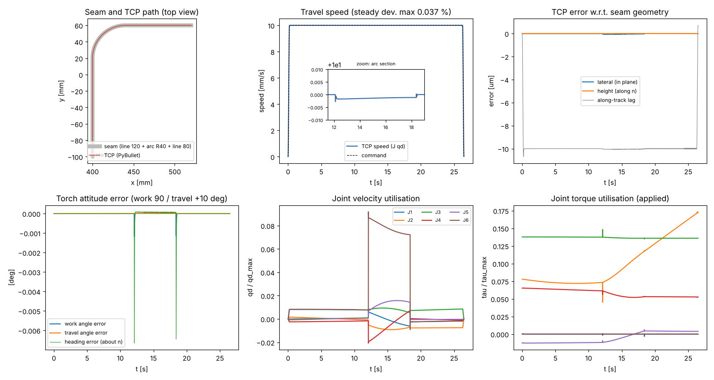
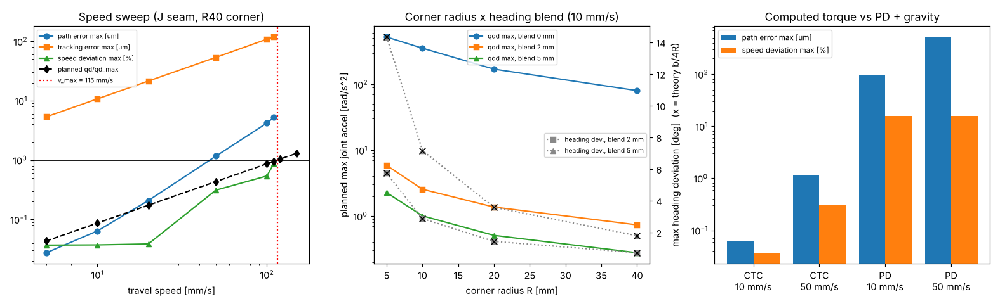
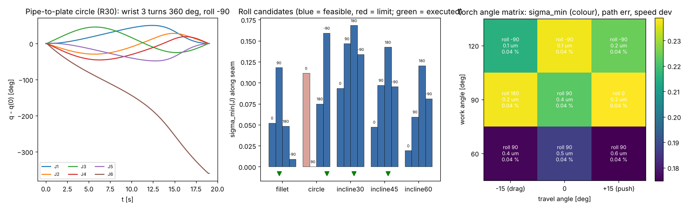
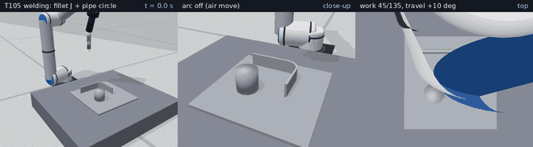
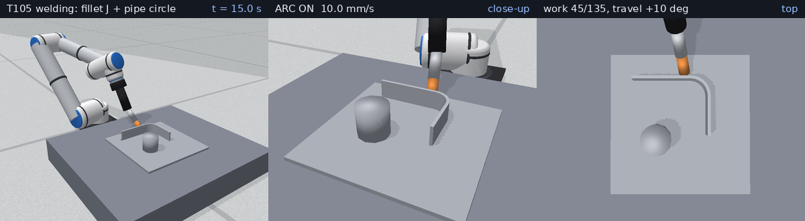
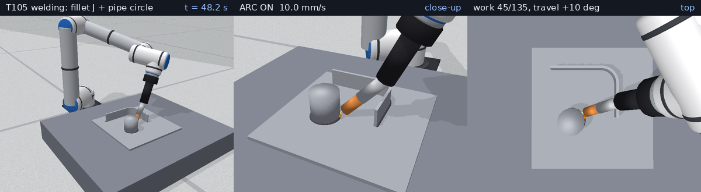
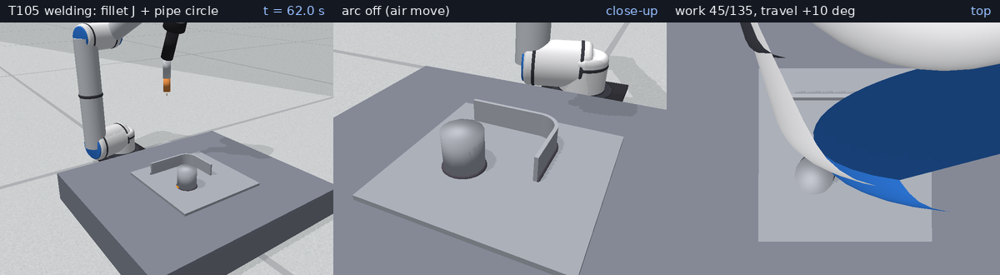

# T105 銲接路徑（直線＋圓弧焊道、固定銲槍姿態與速度）測試報告

- 日期：2026-11-13
- 測試：ruff check 通過；pytest 155 passed（新增 tests/test_welding.py 22 項）
- 程式：`sixaxis/welding.py`、`tests/test_welding.py`、`scripts/t105_report.py`、`scripts/t105_write_md.py`
- 數據：`docs/test-reports/data/2026-11-13_T105_metrics.json`（本報告所有數字由該檔產生）

## 目的
讓手臂帶著銲槍沿「直線＋圓弧」組成的焊道，以**固定的銲槍姿態（work／travel 角）與固定的行進速度**完成銲接，並量化：
TCP 對焊道幾何的路徑誤差、行進速度均勻度（決定入熱量與焊道截面均勻度）、銲槍角度誤差、關節速度／力矩使用率、噴嘴與工件間隙。
另外找出這項工作的實際限制：圓角處的腕部角速度上限、直線–圓弧接點的角加速度衝擊、繞銲絲 roll 的選擇、碰撞。

## 模型與參數
### 銲槍（`robots/ur5_torch.urdf`，由 `write_arm_with_torch()` 產生）
| 項目 | 數值 |
|---|---|
| 型式 | 彎頸 MIG 銲槍，固定於法蘭；質量 1.2 kg |
| 槍身（沿法蘭 z）／槍頸＋噴嘴／銲絲伸出 | 130／110／15 mm |
| 彎頸角 β | 22°（繞法蘭 y） |
| TCP（銲絲尖端）相對法蘭 | T_TCP = Tz(130 mm)·Ry(β)·Tz(125 mm) → 位置 (46.83, 0.00, 245.90) mm；z 軸 = 銲絲方向 |
| 噴嘴半徑 | 11 mm（銲絲不含碰撞幾何） |

TCP 位姿以 URDF 內的 `tcp` 連桿由 PyBullet 讀回（與 `fk(q)·T_TCP` 相差 < 1e-6，見測試）。

### 焊道座標與銲槍角度（AWS A3.0 定義）
焊道在法向量 n 的平面上，以弧長 s 參數化；t = 切線（行進方向）、b = n × t（行進方向左側）。
- 工作角 work（由工件表面量起；90° = 垂直表面，< 90° 槍身倒向 +b）：u = sin(work)·n + cos(work)·b
- 行進角 travel（+ = 前進法 push、− = 後退法 drag）：銲絲方向 a = −cos(travel)·u + sin(travel)·t
- 工具 x 軸 = t 在 ⟂a 平面的投影，再繞 a 轉 roll。**銲絲為軸對稱，roll 不影響製程**，是可用來避開限位／奇異／碰撞的自由度。
- 固定姿態 = work／travel 相對 (t, n, b) 固定：直線段為世界座標固定姿態；圓弧段銲槍繞 n 以 ω = κ·v 旋轉（κ = ±1/R）。
  平面焊道 R_tcp(s) = Rot(n, ψ(s))·R_tcp(0)，ψ(s) = ∫κ ds。

### 等速時間律與接點平滑
- 弧長速度：起／收弧各以 smoothstep（3τ² − 2τ³）在 t_ramp = 0.2 s 內加／減速，中間等速 v；T = L/v + t_ramp，峰值加速度 1.5·v/t_ramp。
- 直線–圓弧接點曲率不連續 → 銲槍角速度階躍 κ·v。可選「航向平滑」：ψ_o(s) = (1/2b)∫ψ dσ（半寬 b 移動平均），角速度變連續，
  代價是接點處航向偏離切線 |κ|·b/4 = b/(4R)（由積分式推得）。位置路徑不變，只有姿態被平滑。
- 規劃：沿時間律每 10 ms 取樣 → 數值 IK（前一點為初值）→ q̇ = J⁻¹·(法蘭 twist) → 三次 Hermite 樣條 → 1 kHz 參考。
- 進／退刀：沿銲絲反方向 50 mm；起弧停留 0.3 s、收弧（填弧坑）停留 0.3 s。

### 製程換算（不模擬電弧物理）
- 線入熱量 Q = η·U·I/v（EN 1011-1，GMAW η = 0.8）：U = 24 V、I = 180 A、v = 10 mm/s → **345.6 J/mm**
- 焊道截面積 A = (πd²/4)·WFS/v：線徑 1.2 mm、送絲 6 m/min → **11.31 mm²**
- 兩者皆 ∝ 1/v，所以「速度偏差 %」≈「入熱量／焊道截面偏差 %」。

### 控制與量測
- 計算力矩控制 ωn = 60 rad/s 臨界阻尼，逆動力學用 PyBullet `calculateInverseDynamics`（含銲槍質量）；對照組為 PD＋重力補償
  （ωn = 30 rad/s，增益依各軸等效慣量縮放）。力矩以 τ_max 限幅；步長 1 ms。
- 路徑誤差：實際 TCP 到**焊道幾何**最近點的偏差（側向＋高度），與時間無關；追蹤誤差：對同一時刻的參考點；速度：v = J_v q̇ + ω × r。
- 銲槍角度：由實際銲絲方向對最近焊道點的 (t, n, b) 量回 work／travel；航向偏差：工具 x 軸繞 n 相對切線航向的偏角。
- 間隙：手臂＋銲槍（不含銲絲）到工作台／工件的最小距離；規劃後先做運動學碰撞預檢（間隙 < 0.5 mm → COLLISION，不執行）。

## 可重現指令
```bash
python3 -m pip install "setuptools<70" wheel && python3 -m pip install --no-build-isolation pybullet==3.2.7
python3 -m pip install -r requirements.txt
PYTHONPATH=. python3 scripts/t105_report.py 2026-11-13
python3 scripts/t105_write_md.py 2026-11-13 "<pytest 摘要>"
ruff check . && python3 -m pytest
```
注意：報告腳本與 pytest 不可同時執行（兩者都會重寫 `robots/ur5_torch.urdf`）。

## 指令序列
每條焊道（`WeldCell.weld`）：
1. `move_j` 到進刀點（起點沿銲絲反方向 50 mm）
2. `move_l` 直線進刀到起點 → 起弧、停留 0.3 s
3. 沿焊道等速銲接（固定 work／travel 角）
4. 停留 0.3 s 收弧 → `move_l` 沿銲絲反方向退刀

示範動畫使用的 JSON 工作（`run_job`；未指定 `roll_deg` → 自動選 roll）：
```json
{"seams": [
 {"name": "fillet-J", "start": [0.4, -0.1, 0.108], "segments": [{"type": "line", "to": [0.4, 0.02, 0.108]}, {"type": "arc", "via": [0.411716, 0.048284, 0.108], "to": [0.44, 0.06, 0.108]}, {"type": "line", "to": [0.52, 0.06, 0.108]}], "speed": 0.01, "work_deg": 45, "travel_deg": 10},
 {"name": "pipe-circle", "start": [0.53, -0.08, 0.108], "segments": [{"type": "arc", "via": [0.56, -0.05, 0.108], "to": [0.53, -0.02, 0.108]}, {"type": "arc", "via": [0.5, -0.05, 0.108], "to": [0.53, -0.08, 0.108]}], "speed": 0.01, "work_deg": 135, "travel_deg": 10}
]}
```

## 量化結果
### 1. 標稱焊道（鋼板平銲，J 形：直線 120 mm + R40 圓弧 90° + 直線 80 mm，總長 262.8 mm；10 mm/s、work 90°、travel +10°）
| 項目 | 數值 |
|---|---|
| 結果 | ✓ |
| 路徑誤差（對焊道幾何）RMS／最大 | 0.02／0.06 µm（側向最大 0.06、高度最大 0.00 µm） |
| 追蹤誤差（對同時刻參考點）RMS／最大 | 9.97／10.70 µm（≈ v × 1 個控制週期 = 10 µm 的沿焊道延遲） |
| 行進速度（等速段）平均／標準差／最大偏差 | 9.9996 mm/s／0.61 µm/s／0.037 % |
| 入熱量偏差最大 | 0.037 %（標稱 345.6 J/mm） |
| work／travel 角誤差最大 | 0.0026°／0.00002° |
| 航向偏差最大（接點暫態） | 0.015° |
| 關節追蹤誤差最大 | 0.39 mrad |
| 圓弧段銲槍角速度 v/R | 0.25 rad/s；腕 3 行程 106° |
| 速度／力矩使用率 | 0.092／0.173；路徑上 σ_min(J) = 0.225 |
| 噴嘴–鋼板最小間隙 | 11.9 mm（伸出長度 15 mm） |
| 銲接時間／含進退刀週期 | 26.48 s／32.17 s |



### 2. 行進速度掃描（同一 J 形焊道）
| 速度 [mm/s] | 結果 | 路徑誤差 RMS／最大 [µm] | 追蹤誤差最大 [µm] | 平均速度 [mm/s] | 速度偏差最大 [%] | work／travel 角誤差最大 [°] | 航向偏差最大 [°] | 關節誤差最大 [mrad] | 速度使用率 | 力矩使用率 | 最小間隙 [mm] |
|---|---|---|---|---|---|---|---|---|---|---|---|
| 5 | ✓  | 0.01／0.03 | 5.35 | 5.000 | 0.037 | 0.001／0.000 | 0.01 | 0.16 | 0.05 | 0.17 | 11.9 |
| 10 | ✓  | 0.02／0.06 | 10.70 | 10.000 | 0.037 | 0.003／0.000 | 0.01 | 0.39 | 0.09 | 0.17 | 11.9 |
| 20 | ✓  | 0.08／0.21 | 21.41 | 19.999 | 0.039 | 0.008／0.000 | 0.04 | 0.54 | 0.17 | 0.17 | 11.9 |
| 50 | ✓  | 0.48／1.16 | 53.53 | 49.990 | 0.311 | 0.011／0.000 | 0.06 | 1.80 | 0.50 | 0.19 | 11.9 |
| 100 | ✓  | 1.76／4.19 | 108.51 | 99.958 | 0.540 | 0.035／0.002 | 0.20 | 3.46 | 1.06 | 0.26 | 11.9 |
| 110 | ✓  | 2.12／5.24 | 117.82 | 109.949 | 0.871 | 0.028／0.002 | 0.16 | 5.61 | 1.17 | 0.27 | 11.9 |
| 120 | ✗ LIMIT | — | — | — | — | — | — | — | 1.04 | — | — |
| 150 | ✗ LIMIT | — | — | — | — | — | — | — | 1.30 | — | — |

- 圓弧段需要腕部以 v/R 旋轉，規劃的關節速度使用率與 v 成正比（10 mm/s 時 0.0869）→ 預測上限 **v_max = 115.1 mm/s**；
  實測：規劃可行到 110 mm/s，120、150 mm/s 回報 LIMIT（不執行）。
- 可行但接點暫態使實際關節速度超過額定：100 mm/s（1.06）、110 mm/s（1.17）——未做航向平滑時，高速下接點的速度階躍會造成超調。

### 3. 圓角半徑 × 航向平滑（10 mm/s；直線 60 + 圓弧 90° + 直線 50 mm）
| R [mm] | 平滑半寬 b [mm] | 結果 | v/R [rad/s] | 規劃關節加速度最大 [rad/s²] | 關節誤差最大 [mrad] | 速度偏差最大 [%] | 路徑誤差最大 [µm] | 航向偏差最大 [°] | 理論 b/(4R) [°] | work／travel 誤差最大 [°] | 速度使用率 | 力矩使用率 |
|---|---|---|---|---|---|---|---|---|---|---|---|---|
| 5 | 0 | ✓ | 2.00 | 522.3 | 3.40 | 3.270 | 0.44 | 0.09 | 0.00 | 0.02／0.00 | 0.71 | 0.22 |
| 5 | 2 | ✓ | 2.00 | 5.9 | 2.04 | 0.905 | 0.42 | 5.73 | 5.73 | 1.01／0.05 | 0.63 | 0.14 |
| 5 | 5 | ✓ | 2.00 | 2.3 | 1.55 | 0.545 | 0.52 | 14.32 | 14.32 | 2.50／0.31 | 0.48 | 0.14 |
| 10 | 0 | ✓ | 1.00 | 353.5 | 1.80 | 0.599 | 0.23 | 0.07 | 0.00 | 0.01／0.00 | 0.36 | 0.19 |
| 10 | 2 | ✓ | 1.00 | 2.5 | 1.05 | 0.244 | 0.22 | 2.87 | 2.86 | 0.51／0.01 | 0.32 | 0.14 |
| 10 | 5 | ✓ | 1.00 | 1.0 | 1.00 | 0.231 | 0.22 | 7.16 | 7.16 | 1.26／0.08 | 0.31 | 0.14 |
| 20 | 0 | ✓ | 0.50 | 170.1 | 0.53 | 0.067 | 0.12 | 0.04 | 0.00 | 0.01／0.00 | 0.17 | 0.16 |
| 20 | 2 | ✓ | 0.50 | 1.4 | 0.54 | 0.065 | 0.11 | 1.43 | 1.43 | 0.25／0.00 | 0.17 | 0.14 |
| 20 | 5 | ✓ | 0.50 | 0.5 | 0.52 | 0.064 | 0.11 | 3.58 | 3.58 | 0.63／0.02 | 0.16 | 0.14 |
| 40 | 0 | ✓ | 0.25 | 80.3 | 0.65 | 0.076 | 0.07 | 0.02 | 0.00 | 0.00／0.00 | 0.10 | 0.15 |
| 40 | 2 | ✓ | 0.25 | 0.7 | 0.29 | 0.037 | 0.07 | 0.72 | 0.72 | 0.13／0.00 | 0.09 | 0.15 |
| 40 | 5 | ✓ | 0.25 | 0.3 | 0.28 | 0.037 | 0.06 | 1.79 | 1.79 | 0.32／0.00 | 0.09 | 0.15 |

- 無平滑時接點角速度階躍，規劃關節加速度達 80–522 rad/s²（10 ms 取樣內完成階躍）；
  b = 2 mm 降到 0.74–5.88 rad/s²。
- R5 小圓角：速度偏差由 3.27 %（無平滑）降到 0.91 %（b = 2 mm）／0.54 %（b = 5 mm），
  代價是接點航向偏差 5.7°／14.3°（理論 5.7°／14.3°）。
  因標稱銲槍接近垂直（travel 10°），航向偏差只反映成 work 角 ≤ 2.50° 的變化。
- 位置路徑誤差不受平滑影響（只平滑姿態）。



### 4. 銲槍角度矩陣（20 mm/s；直線 80 + R40 圓弧 + 直線 60 mm；自動選 roll）
| work [°] | travel [°] | 結果 | 選用 roll [°] | σ_min | 路徑誤差最大 [µm] | 速度偏差最大 [%] | work／travel 誤差最大 [°] | 速度使用率 | 力矩使用率 | 最小間隙 [mm] |
|---|---|---|---|---|---|---|---|---|---|---|
| 60 | -15 | ✓ | 90 | 0.176 | 0.44 | 0.038 | 0.010／0.021 | 0.20 | 0.40 | 5.5 |
| 60 | +0 | ✓ | 90 | 0.187 | 0.47 | 0.038 | 0.000／0.021 | 0.23 | 0.43 | 6.5 |
| 60 | +15 | ✓ | 90 | 0.175 | 0.58 | 0.038 | 0.010／0.021 | 0.24 | 0.44 | 5.5 |
| 90 | -15 | ✓ | 180 | 0.238 | 0.21 | 0.037 | 0.011／0.000 | 0.18 | 0.15 | 10.6 |
| 90 | +0 | ✓ | 90 | 0.223 | 0.40 | 0.037 | 0.000／0.000 | 0.17 | 0.22 | 14.0 |
| 90 | +15 | ✓ | 0 | 0.239 | 0.20 | 0.038 | 0.011／0.000 | 0.18 | 0.14 | 10.6 |
| 120 | -15 | ✓ | -90 | 0.215 | 0.11 | 0.037 | 0.010／0.021 | 0.13 | 0.30 | 5.5 |
| 120 | +0 | ✓ | -90 | 0.238 | 0.07 | 0.037 | 0.000／0.021 | 0.16 | 0.26 | 6.5 |
| 120 | +15 | ✓ | -90 | 0.224 | 0.17 | 0.037 | 0.010／0.021 | 0.19 | 0.36 | 5.5 |

9/9 組成功。

### 5. 接頭／工件形式（10 mm/s、travel +10°、自動選 roll）
| 案例 | 結果 | 路徑誤差 RMS／最大 [µm] | 追蹤誤差最大 [µm] | 平均速度 [mm/s] | 速度偏差最大 [%] | work／travel 角誤差最大 [°] | 航向偏差最大 [°] | 關節誤差最大 [mrad] | 速度使用率 | 力矩使用率 | 最小間隙 [mm] |
|---|---|---|---|---|---|---|---|---|---|---|---|
| T 形接頭填角焊（J 形、立板高 40 mm）work 45°；roll 90° | ✓  | 0.09／0.28 | 10.70 | 10.000 | 0.038 | 0.002／0.010 | 0.01 | 0.66 | 0.16 | 0.38 | 1.5 |
| 管–板整圓填角焊（管徑 60 mm）work 135°；roll -90° | ✓  | 0.19／0.38 | 10.75 | 10.000 | 0.058 | 0.000／0.000 | 0.00 | 0.54 | 0.17 | 0.28 | 1.6 |
| 斜板 30°；roll 180° | ✓  | 0.06／0.37 | 10.70 | 10.000 | 0.151 | 0.005／0.000 | 0.03 | 0.98 | 0.14 | 0.29 | 11.9 |
| 斜板 45°；roll 180° | ✓  | 0.09／0.55 | 10.70 | 10.000 | 0.171 | 0.005／0.000 | 0.03 | 0.99 | 0.14 | 0.30 | 11.9 |
| 斜板 60°；roll 0° | ✗ COLLISION | — | — | — | — | — | — | — | 0.12 | — | -12.4 |

繞銲絲 roll 候選（規劃摘要）與實際嘗試順序（依 σ_min 由大到小，碰撞預檢不過就換下一個）：
| 案例 | roll 候選 | 嘗試結果 |
|---|---|---|
| T 形接頭填角焊（J 形、立板高 40 mm）work 45° | 0°：σ_min 0.052、J6 ∈ [-2.99, -0.58] rad、可行<br>90°：σ_min 0.118、J6 ∈ [-1.82, 0.72] rad、可行<br>180°：σ_min 0.048、J6 ∈ [-0.58, 2.50] rad、可行<br>-90°：σ_min 0.009、J6 ∈ [1.50, 4.47] rad、可行 | 90° → 成功 |
| 管–板整圓填角焊（管徑 60 mm）work 135° | 0°：σ_min 0.111、J6 ∈ [-8.40, -2.12] rad、超限位<br>90°：σ_min 0.000、J6 ∈ [-6.97, -0.69] rad、超限位<br>180°：σ_min 0.075、J6 ∈ [-4.60, 1.68] rad、可行<br>-90°：σ_min 0.159、J6 ∈ [-3.22, 3.07] rad、可行 | -90° → 成功 |
| 斜板 30° | 0°：σ_min 0.094、J6 ∈ [-4.26, -2.71] rad、可行<br>90°：σ_min 0.147、J6 ∈ [-2.42, -1.49] rad、可行<br>180°：σ_min 0.168、J6 ∈ [-1.22, -0.09] rad、可行<br>-90°：σ_min 0.134、J6 ∈ [0.19, 1.78] rad、可行 | 180° → 成功 |
| 斜板 45° | 0°：σ_min 0.047、J6 ∈ [-4.25, -2.65] rad、可行<br>90°：σ_min 0.097、J6 ∈ [-2.27, -1.47] rad、可行<br>180°：σ_min 0.142、J6 ∈ [-1.15, -0.09] rad、可行<br>-90°：σ_min 0.095、J6 ∈ [0.20, 1.75] rad、可行 | 180° → 成功 |
| 斜板 60° | 0°：σ_min 0.019、J6 ∈ [-4.34, -2.64] rad、可行<br>90°：σ_min 0.059、J6 ∈ [-2.11, -1.46] rad、可行<br>180°：σ_min 0.121、J6 ∈ [-1.09, -0.07] rad、可行<br>-90°：σ_min 0.081、J6 ∈ [0.19, 1.68] rad、可行 | 180° → COLLISION；-90° → COLLISION；90° → COLLISION；0° → COLLISION |

- 整圓焊道：銲槍繞管一圈，腕 3 需轉 360°；不可行的 roll 候選（J6 超出 ±2π 限位或路徑經過奇異點，見上表）被排除，自動選用 roll -90°。
- 填角焊噴嘴離立板／管壁最小間隙僅 1.5／1.6 mm（work 45° 時噴嘴邊緣本來就貼近立板；幾何估算 15·sin45° − 11·cos45° ≈ 2.8 mm）。
- 60° 斜板：roll 候選依序嘗試 180° → COLLISION、-90° → COLLISION、90° → COLLISION、0° → COLLISION，最終失敗（COLLISION）。



### 6. 控制器比較（標稱 J 形焊道）
| 控制器／速度 | 結果 | 路徑誤差 RMS／最大 [µm] | 追蹤誤差最大 [µm] | 平均速度 [mm/s] | 速度偏差最大 [%] | work／travel 角誤差最大 [°] | 航向偏差最大 [°] | 關節誤差最大 [mrad] | 速度使用率 | 力矩使用率 | 最小間隙 [mm] |
|---|---|---|---|---|---|---|---|---|---|---|---|
| 計算力矩／10 mm/s | ✓  | 0.02／0.06 | 10.70 | 10.000 | 0.037 | 0.003／0.000 | 0.01 | 0.39 | 0.09 | 0.17 | 11.9 |
| 計算力矩／50 mm/s | ✓  | 0.48／1.16 | 53.53 | 49.990 | 0.311 | 0.011／0.000 | 0.06 | 1.80 | 0.50 | 0.19 | 11.9 |
| PD＋重力補償／10 mm/s | ✓  | 7.64／94.67 | 175.00 | 10.004 | 15.890 | 0.035／0.021 | 0.11 | 1.83 | 0.09 | 0.17 | 11.4 |
| PD＋重力補償／50 mm/s | ✓  | 123.07／516.32 | 874.57 | 50.177 | 15.895 | 0.179／0.104 | 0.48 | 8.48 | 0.46 | 0.18 | 11.4 |

PD＋重力補償沒有慣性／科氏前饋：10 mm/s 時路徑誤差最大 94.67 µm、速度偏差 15.9 %
（計算力矩：0.06 µm、0.037 %）；50 mm/s 時 516.32 µm、15.9 %。
速度偏差直接等於入熱量偏差，因此銲接這類「等速」製程需要有前饋的軌跡追蹤控制。

### 7. 示範工作（JSON → `run_job`：填角焊 J 形 + 管–板整圓，連續執行）
| 焊道 | 結果 | 路徑誤差 RMS／最大 [µm] | 追蹤誤差最大 [µm] | 平均速度 [mm/s] | 速度偏差最大 [%] | work／travel 角誤差最大 [°] | 航向偏差最大 [°] | 關節誤差最大 [mrad] | 速度使用率 | 力矩使用率 | 最小間隙 [mm] |
|---|---|---|---|---|---|---|---|---|---|---|---|
| fillet-J（roll 90°、263 mm、26.5 s） | ✓  | 0.09／0.28 | 10.70 | 10.000 | 0.038 | 0.002／0.009 | 0.02 | 0.68 | 0.16 | 0.38 | 1.5 |
| pipe-circle（roll -90°、188 mm、19.0 s） | ✓  | 0.18／0.37 | 10.78 | 10.000 | 0.060 | 0.000／0.000 | 0.00 | 0.51 | 0.16 | 0.30 | 1.6 |

整個工作（含進退刀、空移、回原點）61.1 s，全部成功；沿實際 TCP 軌跡每 3 mm 放一顆焊珠（共 151 顆，僅視覺）。

## 圖表與動畫
- 動畫（311 幀；左：全景、中：近拍、右：俯視；橘色＝剛銲的焊珠，灰色＝已冷卻）：
  [GIF](../media/2026-11-13_T105.gif)（2.4 MB）／[MP4](../media/2026-11-13_T105.mp4)（0.9 MB）



| 第一條焊道（填角焊 J 形）進行中 | 第二條焊道（管–板整圓）進行中 | 完成回原點 |
|---|---|---|
|  |  |  |

## 問題與限制
- 追蹤誤差是「理想模型」下的數值：計算力矩控制用的逆動力學與模擬器完全相同，沒有關節摩擦、齒隙、撓性、量測雜訊與延遲，
  所以 µm 級誤差只代表軌跡規劃與控制流程正確，不代表實機精度（實機一般 0.05–0.1 mm 重複精度）。
- 不模擬電弧、熔池、熱變形與銲絲接觸；入熱量與焊道截面只是由速度換算的指標；焊珠為視覺標記。
- 焊道限單一平面內的直線＋圓弧且切線連續（折角 > 1° 會拒絕）；不支援空間曲線、擺動（weaving）、多層多道。
- 圓角處速度上限由腕部角速度決定（v ≤ q̇_max·R 量級）；目前不會自動在圓角降速，超限直接回報 LIMIT。
- 碰撞只做「規劃後預檢＋執行中監測」，不會自動繞開；進／退刀的 PTP 空移未做碰撞預檢（T110 避障規劃處理）。
- roll 只在 0／90／180／−90° 四個候選中選，且整條焊道固定；未做連續最佳化。
- 填角焊噴嘴間隙只有 1–2 mm，實務上需依噴嘴尺寸調整 work 角或伸出長度。

## 結論
- 直線＋圓弧焊道在固定 work／travel 角與等速下完成：標稱 10 mm/s 路徑誤差最大 0.06 µm、速度偏差最大 0.037 %、
  銲槍角度誤差 ≤ 0.003°、力矩使用率 0.17。
- 速度上限由圓角處腕部角速度決定：R40 圓角 v_max ≈ 115 mm/s，超過即回報 LIMIT。
- 航向平滑可把接點關節加速度需求降低兩個數量級以上，代價為接點航向偏差 b/(4R)，與理論一致。
- 銲絲軸對稱提供的 roll 自由度必須利用：整圓焊道在 roll 0° 下會超出 J6 限位（J6 需到 -8.40 rad），自動選 roll 後 360° 一次銲完。
- 平銲、T 形填角、管–板整圓、30°／45° 斜板皆成功；60° 斜板：roll 候選依序嘗試 180° → COLLISION、-90° → COLLISION、90° → COLLISION、0° → COLLISION，最終失敗（COLLISION）。
- 下一步：T106 噴塗表面覆蓋（可沿用本模組的焊道座標、等速時間律與工具姿態定義）。
