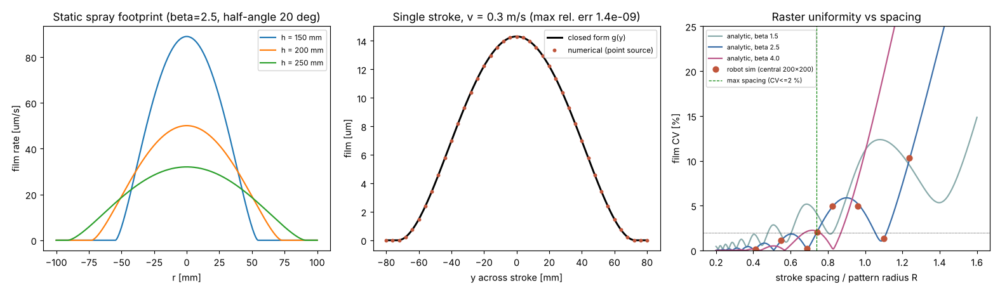
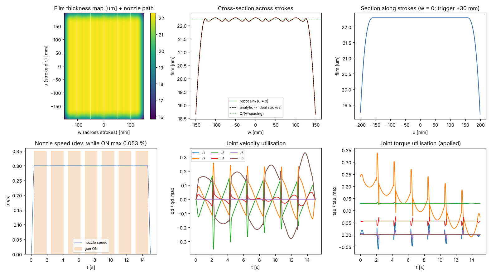
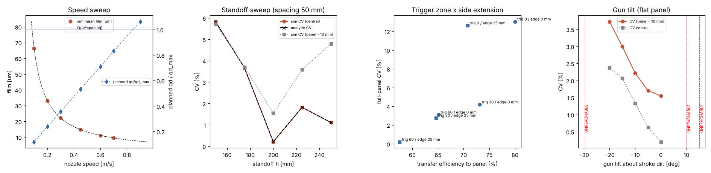
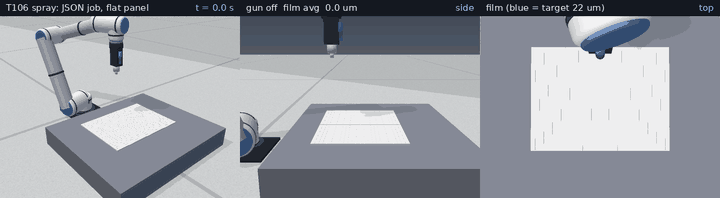

# T106 噴塗表面覆蓋 測試報告（2026-11-14）

## 1. 目的
建立噴塗製程的「塗料沉積模型 → 光柵（zig-zag）噴塗路徑 → 手臂力矩控制執行 → 由實際噴嘴位姿積分膜厚」整條鏈，
並以量化指標（平均膜厚、膜厚變異係數 CV、極差、目標 ±10 % 面積比、覆蓋率、轉移效率、路徑/速度偏差、力矩/速度使用率）
回答：道間距、噴塗速度、噴距、扳機區、噴槍傾角與控制器對塗層均勻度與可行性的影響。

## 2. 模型與參數
### 2.1 噴槍
直式自動噴槍以固定關節接在法蘭：法蘭 → 噴嘴口 160 mm、質量 0.9 kg（含於 PyBullet
逆動力學）。TCP = 噴嘴口（URDF 連桿 8），z 軸 = 噴霧中心軸。工作站沿用 T105 `WeldCell`（本次把工具 URDF 與 TCP 變換參數化，
銲槍為預設，既有 T105 測試不受影響）。

### 2.2 沉積模型（`sixaxis/spraying.py: SprayModel`）
* 參考平面（垂直噴軸、距離 h_ref）膜厚速率為 **beta 分佈**（Balkan & Arikan 1999；Conner et al., *IEEE T-ASE* 2(4), 2005）：
  f(r) = Q·β/(πR²)·(1 − r²/R²)^(β−1)，R = h_ref·tan φ，∫f dA = Q。
* 一般曲面推廣（點源）：角通量 F(θ) = f(h_ref·tan θ)·h_ref²/cos³θ，任意點膜厚速率 ḣ = F(θ)·cos γ/ρ²
  （θ：與噴軸夾角、γ：入射角、ρ：距離；背面不沉積、不計遮蔽）。垂直平面距離 h 時圖樣等比放大、峰值 ∝ 1/h²、總量守恆。
* 單道解析解：g(y) = Q·β/(πR²v)·B(½,β)·R^(2−2β)·(R² − y²)^(β−½)，∫g dy = Q/v；
  間距 Δ 的多道內部平均 = **Q/(v·Δ)**，均勻度 CV 只與 Δ/R、β 有關。

| 參數 | 值 |
|---|---|
| 沉積體積流量 Q（膜體積，已含轉移率） | 20.0 cm³/min |
| 參考噴距 h_ref、錐半角 φ、圖樣半徑 R | 200 mm、20°、72.8 mm |
| beta 指數 β | 2.5 |
| 標稱噴塗：速度、道間距、噴距 | 0.3 m/s、50 mm、200 mm |
| 每道超出面板 overrun、扳機區（\|u\| ≤ L/2 + trigger）、換道半徑 | 80 mm、+30 mm、Δ/2 |
| 起/停加減速（smoothstep） | 0.4 s |
| 平板 | 中心 (0.45, 0.0, 0.104)、400×300 mm（膜厚格點 2.5 mm；掃描 5 mm） |
| 膜厚統計區 | 「面板 − 10 mm 邊」為主；另列全面板與中央 200×200 mm |
| 控制 | 計算力矩（ωn = 60 rad/s）、1 kHz；對照 PD＋重力補償 |

### 2.3 路徑與時間律
噴嘴路徑位於與面板平行、距離 h 的平面：每道長 L + 2·overrun，道間以半徑 Δ/2 的 180° 圓弧轉向（切線連續，沿用 T105 `Seam`／
`SpeedProfile` 等速時間律）；道數 n = ⌈(W + 2·edge)/Δ⌉ + 1、對稱排列。噴槍姿態全程固定（若隨航向轉，換道時腕部角速度 = v/(Δ/2)
= 12 rad/s，遠超 π rad/s）。噴軸傾斜時整條路徑沿噴軸平移，使噴霧中心仍落在道中心線。逐點數值 IK、
q̇ = J⁻¹[v; 0]、三次 Hermite 插值、RNE 檢查力矩，再以碰撞預檢（間隙 ≥ 5 mm）把關。

## 3. 可重現指令
```bash
python3 -m pip install "setuptools<70" wheel && python3 -m pip install --no-build-isolation pybullet==3.2.7
python3 -m pip install -r requirements.txt
ruff check . && python3 -m pytest -q          # 不可與報告腳本同時執行（共用 robots/ur5_spray.urdf）
PYTHONPATH=. python3 scripts/t106_report.py 2026-11-14       # 實驗 → docs/test-reports/data/2026-11-14_T106_metrics.json、圖、動畫
python3 scripts/t106_write_md.py 2026-11-14 "<pytest 摘要>"
```
測試：ruff check 通過；pytest 165 passed（新增 tests/test_spraying.py 10 項）

## 4. 指令序列（動畫用 JSON 工作）
```json
{"gun": {"flow_cc_min": 20, "h_ref": 0.2, "half_angle": 20, "beta": 2.5}, "panels": [{"name": "flat-panel", "center": [0.45, 0.0, 0.104], "size": [0.4, 0.3], "normal": [0, 0, 1], "u": [0, 1, 0], "speed": 0.3, "spacing": 0.05, "standoff": 0.2}]}
```
`parse_job` → `SprayCell.spray`：move_j 到第一道起點上方 60 mm → move_l 下降到噴距 → 等速光柵（扳機依噴霧中心是否在
\|u\| ≤ L/2 + trigger 自動開/關）→ 沿噴軸退槍 → 回原點。動畫第二段為 45° 斜板（噴槍垂直板面）。

## 5. 量化結果
### 5.1 模型驗證（無手臂）
* 單道：點源數值積分 vs 解析 g(y) 最大相對誤差 **1.4e-09**（峰值 14.31 µm @ 0.3 m/s）。
* CV 隨 Δ/R **非單調**（beta 分佈支撐邊緣的 (R² − y²)^(β−½) 造成），β = 2.5 時 CV ≤ 1／2／5 % 的「連續區」最大道距為
  **39.7／53.9／60.4 mm**（從小間距往上掃到首次超標；之後雖有孤立甜蜜點但對噴距變化敏感，不採用）。
  標稱 Δ = 50 mm（Δ/R = 0.687）。

### 5.2 標稱噴塗（平板 400×300 mm）
| 情境 | 結果 | 道數 | 噴塗時間 [s] | 平均膜厚 [µm]（理論 Q/vΔ） | CV [%] | 極差 [%] | ±10 % 面積 [%] | 中央區 CV [%] | 轉移效率 [%] | 路徑偏差（開槍）最大 [mm] | 速度偏差（開槍）最大 [%] | 速度使用率 | 力矩使用率 |
|---|---|---|---|---|---|---|---|---|---|---|---|---|---|
| 標稱 | ✓ | 7 | 15.0 | 22.09（22.22） | 1.58 | 13.1 | 99.9 | 0.21 | 73.1 | 0.0050 | 0.053 | 0.36 | 0.34 |

* 全面板（含邊）：CV 4.24 %、最小 15.9 µm、±10 % 面積 94.1 %；
  週期（含進退槍）24.4 s、最小間隙 37.2 mm、噴軸誤差最大 0.0000°。

### 5.3 道間距掃描（v = 0.3 m/s、h = 200 mm）
| Δ [mm] | Δ/R | 結果 | 道數 | 噴塗時間 [s] | 平均膜厚 [µm]（理論） | 中央 CV 模擬 [%] | CV 解析 [%] | 中央極差 模擬 [%] | 極差 解析 [%] | CV（面板−10 mm）[%] | 轉移效率 [%] |
|---|---|---|---|---|---|---|---|---|---|---|---|
| 30 | 0.412 | ✓ | 11 | 22.5 | 36.28（37.04） | 0.16 | 0.17 | 0.4 | 0.5 | 4.38 | 75.8 |
| 40 | 0.549 | ✓ | 9 | 18.9 | 27.63（27.78） | 1.10 | 1.11 | 2.9 | 3.1 | 1.91 | 71.2 |
| 50 | 0.687 | ✓ | 7 | 15.0 | 22.09（22.22） | 0.20 | 0.21 | 0.6 | 0.6 | 1.55 | 73.1 |
| 54 | 0.742 | ✓ | 7 | 15.2 | 20.53（20.58） | 2.04 | 2.06 | 5.7 | 5.8 | 2.46 | 68.5 |
| 60 | 0.824 | ✓ | 6 | 13.2 | 18.53（18.52） | 4.97 | 4.86 | 13.0 | 13.3 | 4.93 | 71.6 |
| 70 | 0.962 | ✓ | 6 | 13.4 | 15.81（15.87） | 4.94 | 5.18 | 14.7 | 15.4 | 5.43 | 61.8 |
| 80 | 1.099 | ✓ | 5 | 11.4 | 13.83（13.89） | 1.37 | 1.29 | 4.2 | 4.4 | 1.72 | 64.5 |
| 90 | 1.236 | ✓ | 5 | 11.6 | 12.25（12.35） | 10.33 | 10.03 | 26.7 | 27.4 | 10.06 | 56.9 |

中央區模擬 CV 與無限多道解析 CV 最大差 0.29 個百分點（中央區 200 mm 不是 Δ 的整數倍、端道影響，造成小差異）。

### 5.4 速度掃描（Δ = 50 mm）
| 速度 | 結果 | 道數 | 噴塗時間 [s] | 平均膜厚 [µm]（理論 Q/vΔ） | CV [%] | 極差 [%] | ±10 % 面積 [%] | 中央區 CV [%] | 轉移效率 [%] | 路徑偏差（開槍）最大 [mm] | 速度偏差（開槍）最大 [%] | 速度使用率 | 力矩使用率 |
|---|---|---|---|---|---|---|---|---|---|---|---|---|---|
| 0.10 m/s | ✓ | 7 | 44.3 | 66.27（66.67） | 1.55 | 11.5 | 99.9 | 0.20 | 73.1 | 0.0006 | 0.006 | 0.12 | 0.25 |
| 0.20 m/s | ✓ | 7 | 22.4 | 33.14（33.33） | 1.55 | 11.5 | 99.9 | 0.20 | 73.1 | 0.0022 | 0.013 | 0.24 | 0.29 |
| 0.30 m/s | ✓ | 7 | 15.0 | 22.09（22.22） | 1.55 | 11.5 | 99.9 | 0.20 | 73.1 | 0.0050 | 0.053 | 0.36 | 0.34 |
| 0.45 m/s | ✓ | 7 | 10.2 | 14.73（14.81） | 1.53 | 11.4 | 100.0 | 0.20 | 73.0 | 0.0114 | 0.051 | 0.53 | 0.48 |
| 0.60 m/s | ✓ | 7 | 7.7 | 11.05（11.11） | 1.47 | 12.8 | 100.0 | 0.21 | 72.9 | 0.0252 | 0.053 | 0.71 | 0.69 |
| 0.70 m/s | ✓ | 7 | 6.7 | 9.48（9.52） | 1.47 | 14.4 | 100.0 | 0.21 | 72.8 | 0.0368 | 0.074 | 0.83 | 0.78 |
| 0.90 m/s | ✗ LIMIT | 7 | — | — | — | — | — | — | — | — | — | 1.06（規劃） | 1.02（規劃） |

* 平均膜厚與 Q/(vΔ) 最大相對差 0.59 %（膜厚 ∝ 1/v）；規劃速度使用率 ∝ v，預測上限 v_max = 0.3/0.357 =
  **0.84 m/s**；0.90 m/s 回報 LIMIT（不執行）。

### 5.5 噴距掃描（Δ = 50 mm 固定）
| 噴距 h [mm] | 圖樣半徑 [mm] | 結果 | 平均膜厚 [µm] | 中央 CV 模擬 [%] | CV 解析（等效 Δ·h_ref/h）[%] | CV（面板−10 mm）[%] | ±10 % 面積 [%] | 轉移效率 [%] | 最小間隙 [mm] |
|---|---|---|---|---|---|---|---|---|---|
| 150 | 54.6 | ✓ | 22.32 | 5.83 | 5.83 | 5.72 | 99.5 | 74.3 | 37.2 |
| 175 | 63.7 | ✓ | 22.25 | 3.68 | 3.68 | 3.71 | 100.0 | 73.9 | 37.2 |
| 200 | 72.8 | ✓ | 22.09 | 0.20 | 0.21 | 1.55 | 99.9 | 73.1 | 37.2 |
| 225 | 81.9 | ✓ | 21.89 | 1.82 | 1.82 | 3.59 | 98.7 | 72.2 | 37.2 |
| 250 | 91.0 | ✓ | 21.68 | 1.11 | 1.11 | 4.80 | 93.9 | 71.2 | 37.2 |

最大差（模擬 − 解析）0.01 個百分點。

### 5.6 扳機區 × 側邊外延（全面板含邊的指標）
| 扳機 trigger [mm] | 側邊外延 edge [mm] | 道數 | 開槍時間 [s] | CV 全面板 [%] | 最小膜厚 [µm] | 覆蓋率（≥ 0.9·平均）[%] | CV 面板−10 mm [%] | 轉移效率 [%] | 噴塗時間 [s] |
|---|---|---|---|---|---|---|---|---|---|
| 0 | 0 | 7 | 9.33 | 13.05 | 10.1 | 84.3 | 8.72 | 80.0 | 15.0 |
| 0 | 25 | 8 | 10.67 | 12.64 | 11.7 | 85.0 | 8.63 | 70.7 | 17.2 |
| 30 | 0 | 7 | 10.73 | 4.20 | 16.3 | 93.9 | 1.55 | 73.1 | 15.0 |
| 30 | 25 | 8 | 12.27 | 2.77 | 19.1 | 97.5 | 1.26 | 64.6 | 17.2 |
| 60 | 0 | 7 | 12.17 | 3.12 | 18.9 | 96.7 | 0.91 | 65.1 | 15.0 |
| 60 | 25 | 8 | 13.90 | 0.21 | 22.1 | 100.0 | 0.20 | 57.5 | 17.2 |

### 5.7 噴槍傾角（平板、繞道方向 u 傾斜）
| 傾角 | 結果 | 道數 | 噴塗時間 [s] | 平均膜厚 [µm]（理論 Q/vΔ） | CV [%] | 極差 [%] | ±10 % 面積 [%] | 中央區 CV [%] | 轉移效率 [%] | 路徑偏差（開槍）最大 [mm] | 速度偏差（開槍）最大 [%] | 速度使用率 | 力矩使用率 |
|---|---|---|---|---|---|---|---|---|---|---|---|---|---|
| +0°（σ_min 0.151） | ✓ | 7 | 15.0 | 22.09（22.22） | 1.55 | 11.5 | 99.9 | 0.20 | 73.1 | 0.0050 | 0.053 | 0.36 | 0.34 |
| -5°（σ_min 0.160） | ✓ | 7 | 15.0 | 22.08（22.22） | 1.71 | 12.5 | 99.9 | 0.63 | 73.1 | 0.0053 | 0.053 | 0.38 | 0.31 |
| -10°（σ_min 0.130） | ✓ | 7 | 15.0 | 22.05（22.22） | 2.22 | 14.6 | 99.9 | 1.33 | 72.9 | 0.0057 | 0.053 | 0.46 | 0.29 |
| -15°（σ_min 0.097） | ✓ | 7 | 15.0 | 22.00（22.22） | 3.00 | 17.4 | 99.5 | 2.06 | 72.7 | 0.0061 | 0.053 | 0.58 | 0.26 |
| -20°（σ_min 0.060） | ✓ | 7 | 15.0 | 21.92（22.22） | 3.73 | 20.6 | 98.8 | 2.37 | 72.3 | 0.0067 | 0.053 | 0.80 | 0.24 |
| -30°（σ_min 0.000） | ✗ UNREACHABLE | 7 | — | — | — | — | — | — | — | — | — | 346.86（規劃） | 1686.97（規劃） |
| +10°（σ_min 0.088） | ✗ UNREACHABLE | 7 | — | — | — | — | — | — | — | — | — | 0.55（規劃） | 0.37（規劃） |
| +15°（σ_min 0.000） | ✗ UNREACHABLE | 7 | — | — | — | — | — | — | — | — | — | 0.00（規劃） | 0.00（規劃） |

### 5.8 斜面板（噴槍垂直板面）
| 情境 | 結果 | 道數 | 噴塗時間 [s] | 平均膜厚 [µm]（理論 Q/vΔ） | CV [%] | 極差 [%] | ±10 % 面積 [%] | 中央區 CV [%] | 轉移效率 [%] | 路徑偏差（開槍）最大 [mm] | 速度偏差（開槍）最大 [%] | 速度使用率 | 力矩使用率 |
|---|---|---|---|---|---|---|---|---|---|---|---|---|---|
| 斜板 30°（噴槍垂直板面） | ✓ | 7 | 15.0 | 22.09（22.22） | 1.55 | 11.5 | 99.9 | 0.20 | 73.1 | 0.0048 | 0.053 | 0.52 | 0.25 |
| 斜板 45°（噴槍垂直板面） | ✓ | 7 | 15.0 | 22.09（22.22） | 1.55 | 11.5 | 99.9 | 0.20 | 73.1 | 0.0144 | 0.050 | 0.94 | 0.18 |

### 5.9 控制器比較
| 控制器／速度 | 結果 | 道數 | 噴塗時間 [s] | 平均膜厚 [µm]（理論 Q/vΔ） | CV [%] | 極差 [%] | ±10 % 面積 [%] | 中央區 CV [%] | 轉移效率 [%] | 路徑偏差（開槍）最大 [mm] | 速度偏差（開槍）最大 [%] | 速度使用率 | 力矩使用率 |
|---|---|---|---|---|---|---|---|---|---|---|---|---|---|
| 計算力矩／0.30 m/s | ✓ | 7 | 15.0 | 22.09（22.22） | 1.55 | 11.5 | 99.9 | 0.20 | 73.1 | 0.0050 | 0.053 | 0.36 | 0.34 |
| 計算力矩／0.60 m/s | ✓ | 7 | 7.7 | 11.05（11.11） | 1.47 | 12.8 | 100.0 | 0.21 | 72.9 | 0.0252 | 0.053 | 0.71 | 0.69 |
| PD＋重力補償／0.30 m/s | ✓ | 7 | 15.0 | 22.09（22.22） | 1.56 | 12.9 | 99.9 | 0.21 | 73.1 | 0.3553 | 6.635 | 0.35 | 0.34 |
| PD＋重力補償／0.60 m/s | ✓ | 7 | 7.7 | 10.96（11.11） | 2.67 | 17.4 | 98.7 | 0.27 | 73.3 | 4.4358 | 27.649 | 0.74 | 0.61 |

### 5.10 動畫 JSON 工作
| 面板 | 結果 | 道數 | 週期 [s] | 平均膜厚 [µm] | CV [%] | ±10 % 面積 [%] | 路徑偏差最大 [mm] | 速度偏差最大 [%] | 最小間隙 [mm] |
|---|---|---|---|---|---|---|---|---|---|
| flat-panel | ✓ | 7 | 24.4 | 22.09 | 1.58 | 99.9 | 0.0050 | 0.053 | 37.2 |
| tilt45 | ✓ | 7 | 24.3 | 22.09 | 1.55 | 99.9 | 0.0144 | 0.050 | 19.7 |

## 6. 圖表與動畫




動畫（左：全景、中：側視、右：俯視膜厚色塊，藍色 = 目標 22 µm；藍點為噴霧粒子示意）：


[MP4](../media/2026-11-14_T106.mp4)｜關鍵畫面：[平板噴塗中](../media/2026-11-14_T106_key_a.png)、[平板完成](../media/2026-11-14_T106_key_b.png)、[45° 斜板完成](../media/2026-11-14_T106_key_c.png)

## 7. 問題與限制
* 沉積模型為理想點源（beta 分佈、Q 為已含轉移率的膜體積流量）：不模擬霧化、氣流、靜電、反彈、流掛與溶劑揮發；未做遮蔽（凹面/遮蔽區不適用）；
  參數 β、φ 為代表值，實機須以單點/單道噴塗板量測擬合。
* CV(Δ) 非單調是理想 beta 分佈銳利邊界的結果；實際噴霧邊界較平滑，甜蜜點會較不明顯，故以「連續合格區」的保守準則選道距。
* 平板工作空間很緊：直式噴槍＋腕部朝下，面板中心 x = 0.50 m 時遠角 IK 無解，故標稱面板放在 x = 0.45 m；
  噴槍傾角 -30°, +10°, +15° 失敗（UNREACHABLE；
  正傾角＝噴軸偏向手臂，遠側道 IK 無解；−30° 時沿路徑 σ_min 降到 3.3e-05，
  腕部奇異使數值 IK 失敗）。直式噴槍繞噴軸的 roll 只轉 J6，無法像 T105 銲槍那樣用 roll 迴避。
* 只處理平面面板；曲面（例如圓柱外殼）需沿面法向改變姿態與噴距，留待後續（T107 以後若需要）。
* 膜厚以實際噴嘴位姿每 2 ms 矩形積分（單元測試確認每 1 ms 與每 4 ms 差 < 1 %）。

## 8. 結論
* 模型：單道解析解與點源數值積分一致（1e-09），平均膜厚 Q/(vΔ) 由速度掃描驗證（最大差 0.59 %）。
* 標稱噴塗 7 道、15.0 s：平均 22.09 µm（理論 22.22）、CV 1.58 %、
  ±10 % 面積 99.9 %、轉移效率 73.1 %；開槍段路徑偏差 ≤ 0.0050 mm、速度偏差 ≤ 0.053 %、
  力矩使用率 0.34。
* 道間距決定均勻度（CV 與解析解一致，最大差 0.29 pp）；速度決定膜厚（∝ 1/v）並受關節速度限制（v_max ≈ 0.84 m/s）；
  噴距改變圖樣半徑而改變等效 Δ/R。邊緣以扳機區與側邊外延改善：全面板 CV 13.05 % → 0.21 %、
  覆蓋率 84.3 % → 100.0 %，代價是轉移效率 80.0 % → 57.5 %。
* 斜面板 30°／45° 噴槍垂直板面時膜厚與平板一致（CV 1.55／1.55 %），但 45° 的規劃速度使用率
  0.94（平板 0.36）。PD＋重力補償於 0.3 m/s 的開槍段速度偏差 6.64 %
  （計算力矩 0.053 %），CV 1.56 % vs 1.55 %。
* 下一步：T107 鎖螺絲（定位＋姿態＋旋轉）。
