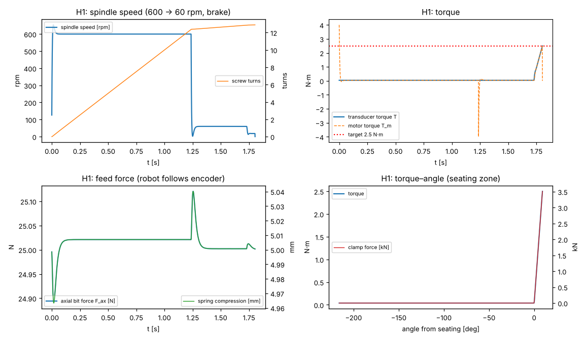
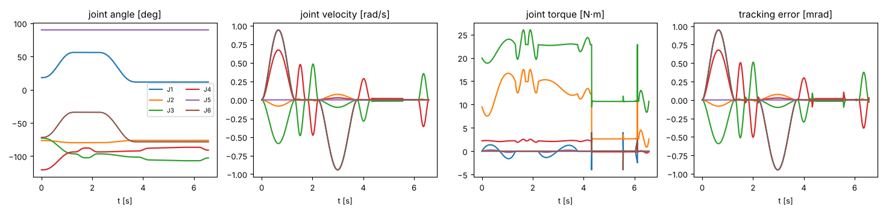
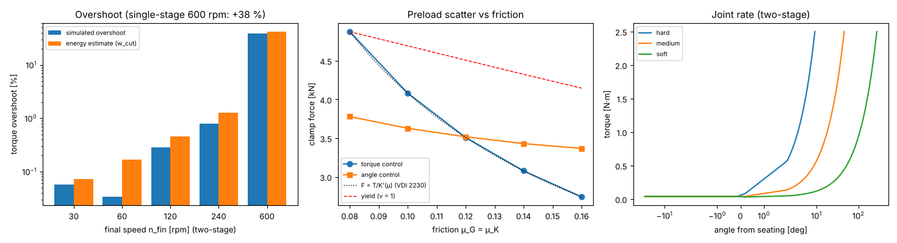
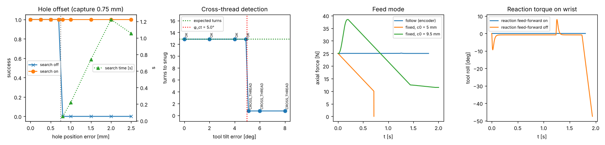
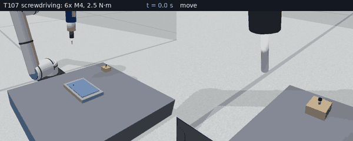

# T107 鎖螺絲（定位＋姿態＋旋轉）測試報告

* 日期：2026-11-15
* 對應 Roadmap：Phase 2 / T107（相依 T102）
* 程式：`sixaxis/screwing.py`；報告腳本 `scripts/t107_report.py`、`scripts/t107_write_md.py`；測試 `tests/test_screwing.py`
* 原始數據：[`data/2026-11-15_T107_metrics.json`](data/2026-11-15_T107_metrics.json)

## 1. 目的
建立「電動起子鎖螺絲」的完整模型與工作流程：手臂把螺絲**定位**到孔上方、**姿態**對準孔軸（含斜面），
起子主軸**旋轉**旋入並鎖到目標扭力，並以扭力/轉角監控判定品質。量化：定位/姿態誤差、最終扭力誤差、
夾緊力與其對摩擦的離散、過衝、進給力、反作用對手腕的影響、斜牙與找不到孔的偵測、週期時間。

## 2. 模型與參數（公式出處見 `sixaxis/screwing.py` 模組說明）
### 2.1 螺絲與接合
| 項目 | 值 | 依據 |
|---|---|---|
| 螺絲 | M4×0.7×12 內六角（ISO 4762），8.8 級 R_p0.2 = 640 MPa | ISO 898-1 |
| d2 / d3 / A_s | 3.545 / 3.141 mm / 8.78 mm² | ISO 724、ISO 898-1 |
| 頭部 d_k / 通孔 d_h / D_Km | 7.0 / 4.5 / 5.75 mm | ISO 4762、ISO 273 |
| 夾緊板厚 t_b、嚙合長 l_e | 3.0 mm、9.0 mm（座合 12.857 圈） | — |
| 摩擦 μ_G = μ_K（標稱） | 0.12 | 代表值 |
| K' = 0.16P + 0.58μ_G·d2 + μ_K·D_Km/2 | 0.7038 mm | VDI 2230 (R13) |
| 接合剛性 c（柔度法） | 1.967e+08 N/m → 扭力–轉角斜率 k_θ = 15.42 N·m/rad | VDI 2230 |
| 目標扭力 T_A → 夾緊力 F_M、利用率 ν | 2.50 N·m → 3510 N、ν = 0.778（ν = 0.9 對應 2.86 N·m） | VDI 2230 (R14) |
| 自鎖：導程角 vs 螺紋摩擦角 | 3.60° < 7.89°（μ = 0.12） | — |
| 斜牙臨界傾角 φ_ct = atan(P/2d) | 5.00°（本專案簡化幾何判據） | — |
| 殘留摩擦扭力 T_pv、斜牙扭力斜率 k_ct | 0.03 N·m、0.10 N·m/rad | 代表值 |

### 2.2 電動起子與手臂
| 項目 | 值 |
|---|---|
| 起子工具 | 法蘭→起子頭尖端 270 mm、1.6 kg（`robots/ur5_driver.urdf`，連桿 7 = 起子、8 = TCP） |
| 主軸 | J = 3.0e-04 kg·m²、T_max = 4.0 N·m、速度 PI 頻寬 300 rad/s、控制/積分週期 0.1 ms |
| 鎖固策略（標稱） | 二段式扭力控制：旋入 600 rpm → 座合前 0.5 圈降至 60 rpm → 到 2.5 N·m 切斷並以 −T_max 煞車 |
| 監控窗 | 旋入圈數 ±0.5 圈、峰值扭力 0.95–1.10×目標、snug（0.2·T_A）後轉角 0.5–1.7×標稱 |
| 浮動起子頭 | 標稱壓縮 5 mm、行程 10 mm、k_s = 3000 N/m、預壓 10 N（標稱 F_ax = 25 N） |
| 入孔捕捉半徑 e_cap | (d_h − d)/2 + 倒角 0.5 = 0.75 mm；螺旋搜尋間距 1.0 mm、10 mm/s、最大半徑 3.0 mm |
| 手臂控制 | 計算力矩控制 ωn = 60 rad/s（PyBullet 1 kHz）；起子反作用（−T_m 繞孔軸、−F_ax 沿孔軸）以外力施加於工具連桿；前饋 τ_ff = −J_tcpᵀ·w_ext |

## 3. 測試步驟（可重現）
```bash
python3 -m pip install -r requirements.txt   # pybullet 安裝方式見 CLAUDE.md
ruff check .
python3 -m pytest -q                         # 178 passed（含 tests/test_screwing.py 13 項）
PYTHONPATH=. python3 scripts/t107_report.py 2026-11-15     # 實驗 → JSON、圖、GIF/MP4（不可與 pytest 同時跑）
python3 scripts/t107_write_md.py 2026-11-15 "<pytest 摘要>"
```

## 4. 指令序列（每顆螺絲）
1. `move_j` 到供料器上方 → `move_l` 下降 40 mm 到螺絲頭 → 真空吸附 0.1 s → `move_l` 上升。
2. `move_j` 到孔軸上方 30 mm（TCP z 軸 = 孔軸；斜面時姿態依法向量）。
3. `move_l` 沿孔軸下降 0.5 s，螺絲端到螺紋口；若彈簧壓縮 > c_nom + 1.5 mm（頂到板面）→ 停止，
   螺旋搜尋（或回報 NO_ENGAGE）。
4. 起子旋入：手臂依主軸編碼器（深度 = P·θ/2π）沿孔軸跟隨；扭力/轉角監控；到目標切斷＋煞車。
5. `move_l` 沿孔軸退回 30 mm，判定 OK/NG。
JSON 工作格式：`{"holes": [{"name", "p", "a", "torque", "strategy", "angle_deg", "search"}]}`（`parse_job`／`run_job`）。

## 5. 量化結果
### A. 標稱：平板 6 孔（含取料、二段式扭力控制）— 6/6 OK
| 孔 | 結果 | 入孔位置誤差 [µm] | 傾角 [°] | 旋入圈數 | snug 後轉角 [°] | 峰值扭力 [N·m] | 扭力誤差 [%] | 夾緊力 [N] | ν | 進給力 [N] | 工具 roll 偏差 [°] | 力矩使用率 | 旋轉時間 [s] | 週期 [s] |
|---|---|---|---|---|---|---|---|---|---|---|---|---|---|---|
| H1 | OK | 0.006 | 0.0e+00 | 12.862 | 7.41 | 2.5008 | +0.034 | 3511 | 0.779 | 24.9–25.1 | 7.1e-13 | 0.150 | 1.81 | 6.57 |
| H2 | OK | 0.012 | 0.0e+00 | 12.862 | 7.41 | 2.5008 | +0.034 | 3511 | 0.779 | 24.9–25.1 | 2.0e-13 | 0.150 | 1.80 | 6.85 |
| H3 | OK | 0.001 | 0.0e+00 | 12.862 | 7.41 | 2.5008 | +0.034 | 3511 | 0.779 | 24.9–25.1 | 3.1e-13 | 0.151 | 1.81 | 6.93 |
| H4 | OK | 0.006 | 0.0e+00 | 12.862 | 7.41 | 2.5008 | +0.034 | 3511 | 0.779 | 24.9–25.1 | 8.4e-13 | 0.150 | 1.81 | 6.59 |
| H5 | OK | 0.012 | 0.0e+00 | 12.862 | 7.41 | 2.5008 | +0.034 | 3511 | 0.779 | 24.9–25.1 | 1.2e-12 | 0.150 | 1.80 | 6.28 |
| H6 | OK | 0.001 | 0.0e+00 | 12.862 | 7.41 | 2.5008 | +0.034 | 3511 | 0.779 | 24.9–25.1 | 5.3e-13 | 0.151 | 1.80 | 6.42 |

標稱旋入圈數 12.862、snug 後標稱轉角 7.43°（硬接合，ISO 5393：snug 後 ≤ 30° 達目標）。




### B. 鎖固策略與過衝
接合模擬台（不含手臂，F_ax = 25 N；ΔT_est 為能量法 ½Jω² = ½k_θΔθ² + (T_A+T_max)Δθ 以「實際切斷轉速」計算＋取樣延遲）：

| 段數 | 最終轉速 [rpm] | 切斷時轉速 [rpm] | 峰值扭力 [N·m] | 過衝 [%] | ΔT = T_peak − T_A [N·m] | ΔT 估計 [N·m] | 主軸時間 [s] | 判定 |
|---|---|---|---|---|---|---|---|---|
| 二段 | 30 | 9.1 | 2.5014 | +0.06 | 0.0014 | 0.0018 | 2.377 | OK |
| 二段 | 60 | 18.3 | 2.5008 | +0.03 | 0.0008 | 0.0043 | 1.805 | OK |
| 二段 | 120 | 37.2 | 2.5071 | +0.28 | 0.0071 | 0.0114 | 1.518 | OK |
| 二段 | 240 | 71.7 | 2.5199 | +0.80 | 0.0199 | 0.0316 | 1.372 | OK |
| 單段 | 600 | 517.7 | 3.4600 | +38.40 | 0.9600 | 1.0534 | 1.292 | NG：TORQUE_NG |

切斷時轉速低於指令（座合段扭力斜率 k_θ·ω ≈ 97 N·m/s 的斜坡負載使速度 PI 迴路落後），
故以實際切斷轉速估計過衝。估計把取樣延遲取滿一個週期 h（實際平均 h/2），故為保守上界；與模擬同量級
（單段 600 rpm：模擬 0.960 vs 估計 1.053 N·m）。

手臂上實鎖：

| 策略 | 結果 | 峰值扭力 [N·m] | 誤差 [%] | 夾緊力 [N] | ν | 旋轉時間 [s] | 週期 [s] |
|---|---|---|---|---|---|---|---|
| two-stage 600→60 rpm | OK | 2.5008 | +0.03 | 3511 | 0.779 | 1.80 | 3.80 |
| single-stage 600 rpm | NG：TORQUE_NG | 3.4600 | +38.40 | 4874 | 1.081 | 1.29 | 2.79 |
| slow 60 rpm only | OK | 2.5028 | +0.11 | 3514 | 0.779 | 12.93 | 14.43 |

### C. 摩擦離散：扭力控制 vs 扭力–轉角控制（模擬台；控制器只知道標稱 μ = 0.12）
| μ | 策略 | 峰值扭力 [N·m] | 夾緊力 [N] | F = T_A/K'(μ) [N] | snug 後轉角 [°] | ν | 判定 |
|---|---|---|---|---|---|---|---|
| 0.08 | 扭力 | 2.501 | 4878 | 4877 | 10.32 | 1.001 | OK |
| 0.08 | 扭力–轉角 | 1.944 | 3780 | 4877 | 7.44 | 0.775 | OK |
| 0.10 | 扭力 | 2.501 | 4083 | 4082 | 8.63 | 0.870 | OK |
| 0.10 | 扭力–轉角 | 2.226 | 3628 | 4082 | 7.44 | 0.773 | OK |
| 0.12 | 扭力 | 2.501 | 3511 | 3510 | 7.41 | 0.779 | OK |
| 0.12 | 扭力–轉角 | 2.507 | 3519 | 3510 | 7.44 | 0.781 | OK |
| 0.14 | 扭力 | 2.501 | 3079 | 3078 | 6.52 | 0.712 | OK |
| 0.14 | 扭力–轉角 | 2.783 | 3431 | 3078 | 7.44 | 0.793 | OK |
| 0.16 | 扭力 | 2.502 | 2744 | 2741 | 5.81 | 0.662 | OK |
| 0.16 | 扭力–轉角 | 3.065 | 3368 | 2741 | 7.44 | 0.812 | OK |

μ = 0.08–0.16 時夾緊力離散（(max−min)/mean）：扭力控制 58.3 %（±29.2 %），
扭力–轉角控制 11.6 %（±5.8 %）。扭力控制在 μ = 0.08 時 ν = 1.001（超過降伏）。
手臂實鎖驗證：

| μ | 策略 | 結果 | 峰值扭力 [N·m] | 夾緊力 [N] | ν |
|---|---|---|---|---|---|
| 0.08 | torque | OK | 2.501 | 4878 | 1.001 |
| 0.08 | angle | OK | 1.944 | 3780 | 0.775 |
| 0.16 | torque | OK | 2.502 | 2744 | 0.662 |
| 0.16 | angle | OK | 3.065 | 3368 | 0.812 |

### D. 接合剛性（硬 / 中 / 軟接合）
| 接合 | c [N/m] | k_θ [N·m/rad] | 段數 | snug 後轉角 [°] | 峰值扭力 [N·m] | 誤差 [%] | 主軸時間 [s] | 判定 |
|---|---|---|---|---|---|---|---|---|
| hard | 1.97e+08 | 15.421 | 二段 | 7.4 | 2.5008 | +0.03 | 1.80 | OK |
| hard | 1.97e+08 | 15.421 | 單段 | 10.9 | 3.4600 | +38.40 | 1.29 | NG：TORQUE_NG |
| medium | 3.93e+07 | 3.084 | 二段 | 37.2 | 2.5016 | +0.06 | 1.91 | OK |
| medium | 3.93e+07 | 3.084 | 單段 | 39.6 | 2.6466 | +5.86 | 1.30 | OK |
| soft | 6.56e+06 | 0.514 | 二段 | 223.0 | 2.5004 | +0.02 | 2.55 | OK |
| soft | 6.56e+06 | 0.514 | 單段 | 227.4 | 2.5412 | +1.65 | 1.37 | OK |



### E. 孔位偏差（手臂不知道）與螺旋搜尋
| 偏差 [mm] | 搜尋 | 結果 | 頂到板面 | 搜尋時間 [s] | 搜尋半徑 [mm] | 入孔時徑向誤差 [mm] | 週期 [s] |
|---|---|---|---|---|---|---|---|
| 0.00 | 無 | OK | 否 | — | — | 0.000 | 3.79 |
| 0.00 | 有 | OK | 否 | — | — | 0.000 | 3.31 |
| 0.25 | 無 | OK | 否 | — | — | 0.250 | 3.31 |
| 0.25 | 有 | OK | 否 | — | — | 0.250 | 3.31 |
| 0.50 | 無 | OK | 否 | — | — | 0.500 | 3.31 |
| 0.50 | 有 | OK | 否 | — | — | 0.500 | 3.31 |
| 0.70 | 無 | OK | 否 | — | — | 0.700 | 3.31 |
| 0.70 | 有 | OK | 否 | — | — | 0.700 | 3.31 |
| 0.80 | 無 | NG：NO_ENGAGE | 是 | — | — | — | 1.31 |
| 0.80 | 有 | OK | 是 | 0.052 | 0.34 | 0.750 | 3.66 |
| 1.00 | 無 | NG：NO_ENGAGE | 是 | — | — | — | 1.31 |
| 1.00 | 有 | OK | 是 | 0.220 | 0.79 | 0.746 | 3.83 |
| 1.50 | 無 | NG：NO_ENGAGE | 是 | — | — | — | 1.31 |
| 1.50 | 有 | OK | 是 | 0.738 | 1.51 | 0.741 | 4.35 |
| 2.00 | 無 | NG：NO_ENGAGE | 是 | — | — | — | 1.31 |
| 2.00 | 有 | OK | 是 | 1.222 | 1.95 | 0.750 | 4.83 |
| 2.50 | 無 | NG：NO_ENGAGE | 是 | — | — | — | 1.31 |
| 2.50 | 有 | OK | 是 | 1.055 | 1.81 | 0.748 | 4.67 |

偏差 ≤ e_cap = 0.75 mm 直接入孔；超過時無搜尋即 NO_ENGAGE，有搜尋時
5 例成功（搜尋時間 0.052–1.222 s）。

### F. 工具傾角誤差 → 斜牙偵測
| 指令傾角 [°] | 實測傾角 [°] | 斜牙 | 旋入圈數 | 標稱圈數 | 峰值扭力 [N·m] | 夾緊力 [N] | 判定 |
|---|---|---|---|---|---|---|---|
| 0.0 | 0.000 | 否 | 12.862 | 12.862 | 2.501 | 3511 | OK |
| 2.0 | 2.000 | 否 | 12.862 | 12.862 | 2.501 | 3511 | OK |
| 4.0 | 4.000 | 否 | 12.862 | 12.862 | 2.501 | 3511 | OK |
| 4.9 | 4.900 | 否 | 12.862 | 12.862 | 2.501 | 3511 | OK |
| 5.1 | 5.100 | 是 | 0.734 | 12.862 | 2.509 | 0 | NG：CROSS_THREAD |
| 6.0 | 6.000 | 是 | 0.734 | 12.862 | 2.509 | 0 | NG：CROSS_THREAD |
| 8.0 | 8.000 | 是 | 0.734 | 12.862 | 2.509 | 0 | NG：CROSS_THREAD |

### G. 進給方式（手臂是否跟隨旋入深度）
| 方式 | 結果 | F_ax 最小 [N] | F_ax 最大 [N] | 壓縮最小 [mm] | 壓縮最大 [mm] | 峰值扭力 [N·m] |
|---|---|---|---|---|---|---|
| follow (encoder) | OK | 24.9 | 25.1 | 4.96 | 5.04 | 2.501 |
| fixed, c0 = 5 mm | NG：BIT_LIFT | 0.0 | 25.0 | -0.00 | 5.00 | 0.039 |
| fixed, c0 = 9.5 mm | OK | 11.5 | 38.5 | 0.50 | 9.49 | 2.501 |

### H. 反作用力矩前饋
| 前饋 | 結果 | 工具 roll 偏差 [°] | TCP 徑向偏移 [mm] | 峰值扭力 [N·m] | 夾緊力 [N] | snug 後轉角 [°] | 力矩使用率 |
|---|---|---|---|---|---|---|---|
| 有 | OK | 0.0000 | 0.0000 | 2.5008 | 3511 | 7.41 | 0.150 |
| 無 | OK | 47.4931 | 1.4481 | 2.5064 | 3436 | 7.23 | 0.150 |

無前饋時，計算力矩控制在 J6 的等效剛性只有 M66·ωn² = 7.15e-04 × 60² = 2.57 N·m/rad，
2.5 N·m 反作用的靜態估計 roll ≈ 56°（模擬 47.5°）；
工具反轉吃掉部分轉角，使夾緊力 3436 N（有前饋 3511 N）。



### I. 斜面（20° 傾斜板）與 JSON 工作
| 孔 | 結果 | 入孔位置誤差 [mm] | 傾角 [°] | 峰值扭力 [N·m] | 夾緊力 [N] | 力矩使用率 | 週期 [s] |
|---|---|---|---|---|---|---|---|
| B0 | OK | 0.0000 | 0.0000 | 2.5008 | 3511 | 0.155 | 4.46 |
| B1 | OK | 0.0000 | 0.0000 | 2.5008 | 3511 | 0.156 | 3.31 |
| J1 | OK | 0.0000 | 0.0000 | 2.0023 | 2802 | 0.150 | 7.11 |
| J2 | OK | 0.0000 | 0.0000 | 2.0023 | 2802 | 0.150 | 5.70 |
| J3 | OK | 0.0000 | 0.0000 | 1.5016 | 2091 | 0.150 | 5.80 |

JSON 工作（J1 2.0 N·m 扭力、J2 2.0 N·m 扭力–轉角、J3 1.5 N·m）：全部 OK；格式錯誤拒絕 3/3。

## 6. 動畫與關鍵畫面
左：工作站全景；右：孔位特寫（紅色條紋為螺絲頭轉向標記），標頭顯示主軸狀態、轉速、扭力、圈數與夾緊力。
示範：平板 6 孔（H5 孔位偏 1.34 mm → 螺旋搜尋）＋ 20° 斜板 2 孔，共 8 顆，8/8 OK。



[MP4](../media/2026-11-15_T107.mp4)｜關鍵畫面：[旋入中](../media/2026-11-15_T107_key_a.png)、[螺旋搜尋](../media/2026-11-15_T107_key_b.png)、[斜板鎖緊](../media/2026-11-15_T107_key_c.png)

## 7. 問題與限制
* 螺紋接觸以解析模型（VDI 2230 扭力式＋線性接合剛性）處理，未以 PyBullet 接觸模擬螺紋；螺絲為運動學顯示物件。
  不含自攻/成形扭力、潤滑隨轉速變化、接合嵌入鬆弛（embedding）與降伏後塑性區；ν > 1 時只標示、不模擬降伏。
* 監控盲點：μ = 0.08 扭力控制（手臂實鎖）ν = 1.0007
  已達降伏，但 snug 後轉角 10.32° 仍在窗內
  （上限 1.7×7.43°）而判 OK；目標扭力 2.5 N·m 對低摩擦批次偏高，
  或須收窄轉角上限（≈ 1.3×）才能攔截。
* 斜牙判據 φ_ct = atan(P/2d) 與斜牙扭力斜率 k_ct 為簡化假設（非標準值），用於驗證「旋入圈數窗」偵測邏輯。
* 入孔捕捉只看徑向誤差 ≤ e_cap（假設浮動起子頭的徑向柔順可吸收）；螺旋搜尋以真實孔位判斷「掉入」，未模擬板面摩擦與起子頭打滑。
* 手臂採計算力矩控制（無積分項），對未建模的外力矩剛性低，故需反作用前饋（實際上起子內建扭力感測器可提供）；無前饋時 roll 偏差大。
* 主軸速度迴路在座合的斜坡負載下明顯落後，使實際過衝小於以指令轉速估計者；實機起子廠商會調整煞車/切斷補償，參數為代表值。

## 8. 結論
* 標稱 6 孔 6/6 OK：入孔位置誤差 ≤ 0.012 µm、傾角 ≤ 0.0e+00°，峰值扭力誤差
  +0.034～+0.034 %，夾緊力 3511 N（ν = 0.779），
  進給力 24.9–25.1 N，力矩使用率 ≤ 0.151，週期 6.28–6.93 s。
* 硬接合必須二段式：單段 600 rpm 過衝 +38.4 %（TORQUE_NG），二段 60 rpm 僅 +0.034 %；軟接合單段誤差小。
* 扭力控制的夾緊力受摩擦影響 ±29 %（與 F = T/K'(μ) 一致），扭力–轉角控制降至 ±6 %。
* 監控可偵測找不到孔（NO_ENGAGE，搜尋可恢復）、斜牙（傾角 > φ_ct 時旋入圈數過少）、起子頭脫離（BIT_LIFT，手臂不跟隨時）。
* 下一步：T108 去毛邊/拋光（力控、接觸力維持）。
