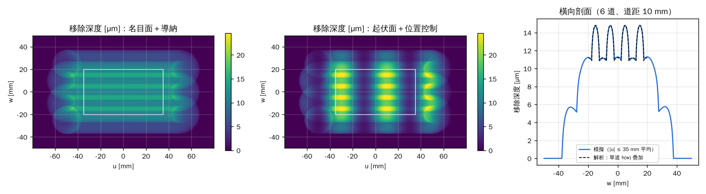
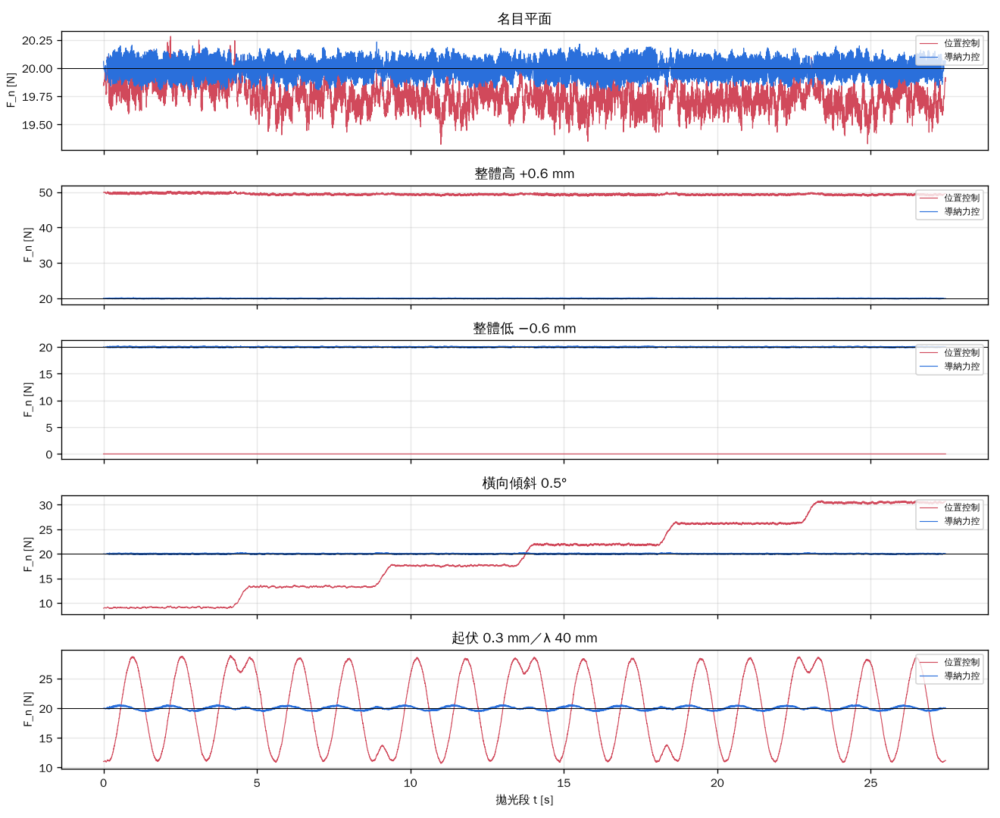
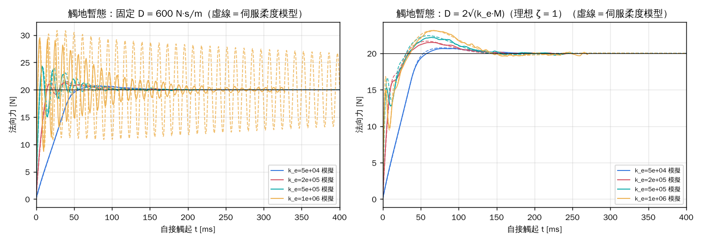
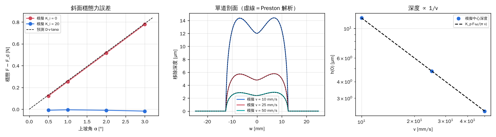
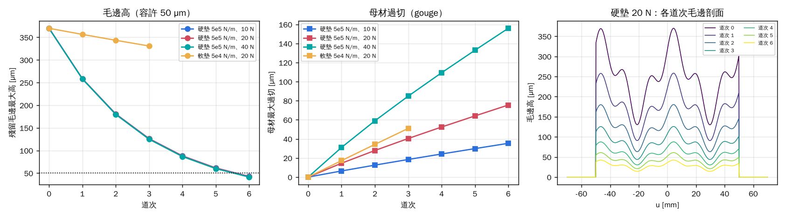
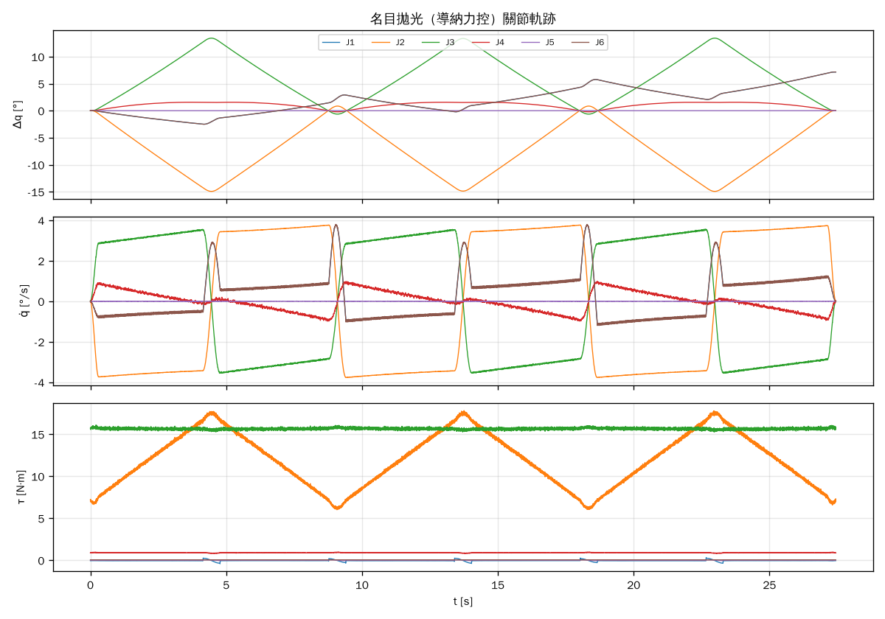
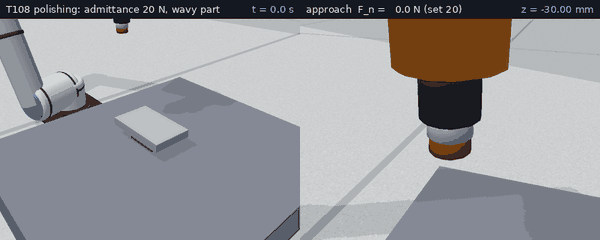
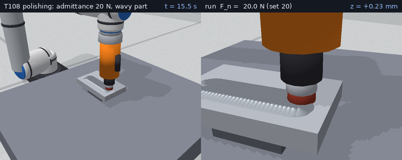
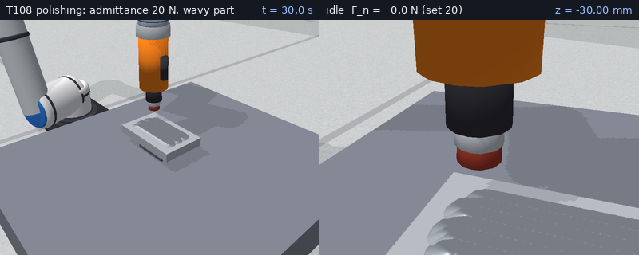
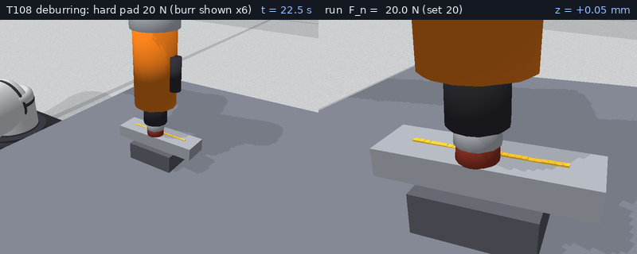

# T108 去毛邊／拋光（力控、接觸力維持）測試報告

日期：2026-11-16　狀態：完成　模組：`sixaxis/finishing.py`　測試：`tests/test_finishing.py`

## 1. 目的
以六軸手臂＋力控研磨主軸執行**拋光**（光柵掃描、材料均勻移除）與**去毛邊**（沿稜邊多道次移除毛邊），
驗證：(1) 法向接觸力在工件形狀未知誤差下的維持能力（導納力控 vs 純位置控制）；(2) 力控外環的觸地暫態與
穩定極限，並以含伺服柔度的集中參數模型預測；(3) 斜面的穩態力誤差 D·v·tanα 與積分項；
(4) Preston 移除模型的單道剖面、深度 ∝ 1/v 與多道均勻度；(5) 硬墊／軟墊去毛邊的選擇性與母材過切。

## 2. 模型與參數
### 2.1 工具
`robots/ur5_polisher.urdf`：法蘭 → 六軸力感測器 → 主軸馬達 → 主軸鼻 → 背板 → 研磨墊（半徑 12.5 mm），
法蘭到墊面 0.195 m、質量 2.2 kg。TCP = 未壓縮墊面中心，z 軸朝工件。研磨墊不設碰撞幾何，接觸力由解析模型計算後以外力/外力矩
施加於工具連桿（避免 PyBullet 剛體接觸重複計力），其餘工具外殼仍參與碰撞檢查。

### 2.2 接觸、摩擦與材料移除（公式見 `sixaxis/finishing.py` 模組說明）
* **Winkler 彈性基礎**（Johnson, *Contact Mechanics* §5.9）：工件頂面以高度場 H(u,w) 表示（拋光 0.5 mm、去毛邊 0.25 mm 格距），
  墊面足印內 p = k_w·max(H − h_p, 0)，k_w = k_e/(πR²)；名目 k_e = 5e+04 N/m（k_w = 1.019e+08 N/m³）。
* **Coulomb 摩擦**：μ = 0.3，每格依墊上該點相對速度 v_TCP + ω_s·a × r 計算；平面均壓時合力 ≈ 0、合力矩 = (2/3)μF_nR。
* **Preston 方程**（Preston 1927）：∂H/∂t = −K_p·p·|v|，K_p = 6e-11 m²/N（代表值），主軸 3000 rpm
  （ω = 314.2 rad/s）。平面單道剖面解析式 h(w) = K_p·p0·ω/v·(cR + w²·ln((R+c)/|w|))，c = √(R²−w²)；
  中心 h(0) = K_p·F·ω/(πv)。
* **毛邊**：工件頂面沿 u 的窄稜（寬 1 mm、高 0.13–0.37 mm 的雙正弦剖面、長 100 mm）；殘留毛邊高 = 稜頂 − 兩側 1 mm 內母材高。

### 2.3 力控
* **導納外環**（Hogan 1985；Siciliano §9.4）：M·z̈ + D·ż = (F_d − F_m) + K_i∫(F_d − F_m)，|ż| ≤ v_app；
  F_d = 20 N、M = 2 kg、D = 600 N·s/m、v_app = 10 mm/s、起始高 3 mm。
* **感測**：F/T 讀值 = 真實接觸力螺旋＋法向高斯雜訊 σ = 0.3 N，一階低通 f_c = 50 Hz。
* **內環**：名目路徑（plan_spray 等速時間律、姿態固定）關節軌跡 + Δq = J⁻¹[−n·z; 0]（含 ż、z̈ 前饋），計算力矩控制 ω_n = 60 rad/s；
  力前饋 τ_ff = −J_TCPᵀ·w_m。
* **理論**：理想內環時 ω_a = √(k_e/M) = 158 rad/s、ζ = 0.949；斜坡穩態誤差 e = D·ż_s；
  Routh（剛性內環＋感測低通）臨界剛性 k_crit = D(M + Dτ)/(Mτ) = 3.68e+05 N/m。
  **伺服柔度模型**：計算力矩對外力的誤差動態 Λ_n(ë + 2ω_nė + ω_n²e) = −F + F_m，Λ_n = 1/(nᵀJ_vM_q⁻¹J_vᵀn) = 4.93 kg
  （伺服剛性 Λ_nω_n² = 17732 N/m），實際位置 x = z + e。
* **位置控制基準**：沿名目面固定壓入 δ_0 = F_d/k_e = 0.40 mm，無力回授。

### 2.4 工作與路徑
工件 160×100 mm（頂面 z = 0.15 m，中心 (0.45, 0, 0.15)），拋光光柵 6 道 × 100 mm、道距 10 mm、
180° 圓弧換道（全程接觸）、進給 25 mm/s；量測區 |u| ≤ 35 mm、|w| ≤ 20 mm。
流程：關節 PTP 到起點上方 30 mm → 下降到 z_app → 導納觸地（|F − F_d| ≤ 5 % 持續 0.15 s）→ 沿路徑力控 → 抬起退刀。
錯誤碼：UNREACHABLE、LIMIT、NO_CONTACT（觸地 2 s 內未穩定）、OVERFORCE（> 3F_d 或 > 150 N）。

## 3. 可重現指令
```bash
python3 -m pip install -r requirements.txt   # pybullet 需 --no-build-isolation，見 CLAUDE.md
ruff check . && python3 -m pytest -q          # 全套測試
PYTHONPATH=. python3 scripts/t108_report.py 2026-11-16     # 實驗、圖、動畫 → docs/test-reports/data/2026-11-16_T108_metrics.json
python3 scripts/t108_write_md.py 2026-11-16 "<pytest 摘要>"  # 本報告
```
報告腳本與 pytest 不可同時執行（都會重寫 `robots/ur5_polisher.urdf`）。

## 4. 指令序列（拋光一個工件）
```python
c = FinishCell()
s = Surface((0.45, 0, 0.15), size=(0.16, 0.10)).set_shape(wave_amp=3e-4, wave_len=0.04)  # 形狀誤差規劃端未知
c.add_surface(s)
seam, _ = raster_on(s, 0.010, 6, 0.100)
m = c.finish(seam, FinishParams(speed=0.025, force=ForceParams(F_d=20, M=2, D=600)))
removal_stats(s, 0.035, 0.020)
```

## 5. 結果
### 5.1 拋光：表面形狀誤差 × 控制模式（光柵 6 道）
| 情境 | 控制 | 結果 | F 平均 [N] | F RMS 誤差 [N] | 最大誤差 [N] | F 範圍 [N] | 脫離 % | 觸地超越 % | 移除平均 [µm] | 移除 CV % | 移除範圍 [µm] | 橫向偏差 [mm] | 力矩使用率 | 週期 [s] |
|---|---|---|---|---|---|---|---|---|---|---|---|---|---|---|
| 名目平面 | 導納力控 | OK | 20.00 | 0.08 | 0.23 | 19.80–20.2 | 0.0 | 3.2 | 12.56 | 12.4 | 10.86–14.78 | 0.006 | 0.119 | 30.0 |
| 名目平面 | 位置控制 | OK | 19.75 | 0.28 | 0.68 | 19.32–20.3 | 0.0 | -0.3 | 12.39 | 12.4 | 10.72–14.59 | 0.006 | 0.118 | 29.7 |
| 整體高 +0.6 mm | 導納力控 | OK | 20.00 | 0.08 | 0.21 | 19.80–20.2 | 0.0 | 3.1 | 12.56 | 12.4 | 10.86–14.78 | 0.006 | 0.119 | 29.9 |
| 整體高 +0.6 mm | 位置控制 | OK | 49.37 | 29.37 | 30.27 | 48.73–50.3 | 0.0 | 149.9 | 30.97 | 12.4 | 26.79–36.42 | 0.006 | 0.071 | 29.7 |
| 整體低 −0.6 mm | 導納力控 | OK | 20.00 | 0.08 | 0.23 | 19.77–20.2 | 0.0 | 3.4 | 12.56 | 12.4 | 10.86–14.78 | 0.007 | 0.119 | 30.0 |
| 整體低 −0.6 mm | 位置控制 | OK | 0.00 | 20.00 | 20.00 | 0.00–0.0 | 100.0 | -100.0 | 0.00 | 0.0 | 0.00–0.00 | 0.006 | 0.183 | 29.7 |
| 橫向傾斜 0.5° | 導納力控 | OK | 20.01 | 0.08 | 0.29 | 19.79–20.3 | 0.0 | 3.4 | 12.56 | 12.5 | 10.28–14.78 | 0.006 | 0.118 | 30.0 |
| 橫向傾斜 0.5° | 位置控制 | OK | 19.75 | 7.17 | 11.19 | 8.81–30.9 | 0.0 | -54.8 | 12.39 | 28.1 | 6.31–19.43 | 0.006 | 0.149 | 29.7 |
| 起伏 0.3 mm／λ 40 mm | 導納力控 | OK | 20.00 | 0.29 | 0.62 | 19.40–20.6 | 0.0 | 3.3 | 12.56 | 40.3 | 4.92–21.92 | 0.011 | 0.119 | 30.0 |
| 起伏 0.3 mm／λ 40 mm | 位置控制 | OK | 20.02 | 6.29 | 9.32 | 10.68–28.9 | 0.0 | -44.3 | 12.39 | 57.0 | 2.70–25.44 | 0.011 | 0.135 | 29.7 |

解析預測（單道剖面疊加，忽略換道圓弧）：內部區平均 12.56 µm、CV 12.7 %；名目面導納模擬 12.56 µm、
CV 12.4 %。導納力控 5 種情境 F RMS 誤差 0.08–0.29 N、
移除 CV 12.4–40.3 %；位置控制 F RMS 誤差
0.28–29.37 N。




### 5.2 觸地暫態與穩定極限（40 mm 單道）
| k_e [N/m] | D [N·s/m] | 理想 ζ | Routh k_crit | 剛性內環＋低通 預測超越 % | 伺服柔度模型 % | 伺服柔度＋1 ms 離散 % | 模擬超越 % | 模擬末段 σ_F [N] | 觸地時間 [s] | 結果 |
|---|---|---|---|---|---|---|---|---|---|---|
| 1e+04 | 600 | 2.12 | 3.68e+05 | -0.0 | -0.0 | -0.0 | -0.2 | 0.09 | 0.68 | OK |
| 1e+04 | 283 | 1.00 | 1.29e+05 | 0.1 | 0.4 | 0.5 | 0.3 | 0.03 | 0.64 | OK |
| 5e+04 | 600 | 0.95 | 3.68e+05 | 2.9 | 3.8 | 4.4 | 3.3 | 0.18 | 0.50 | OK |
| 5e+04 | 632 | 1.00 | 3.99e+05 | 2.2 | 3.8 | 4.4 | 3.3 | 0.18 | 0.50 | OK |
| 2e+05 | 600 | 0.47 | 3.68e+05 | 37.8 | 7.9 | 7.3 | 6.7 | 0.12 | 0.49 | OK |
| 2e+05 | 1265 | 1.00 | 1.20e+06 | 16.1 | 8.3 | 9.8 | 7.5 | 0.08 | 0.54 | OK |
| 5e+05 | 600 | 0.30 | 3.68e+05 | 93.1（振盪） | 20.4 | 9.6 | 21.5 | 0.10 | 0.51 | OK |
| 5e+05 | 2000 | 1.00 | 2.63e+06 | 36.2 | 12.1 | 14.1 | 10.9 | 0.10 | 0.55 | OK |
| 1e+06 | 600 | 0.21 | 3.68e+05 | 162.9（振盪） | 54.2（振盪） | 27.1 | 47.6 | 0.28 | 0.63 | OK |
| 1e+06 | 2828 | 1.00 | 4.89e+06 | 53.0 | 15.6 | 18.1 | 15.7 | 0.14 | 0.69 | OK |
| 2e+06 | 600 | 0.15 | 3.68e+05 | 269.2（振盪） | 219.7（振盪） | 68.8 | 204.6 | 23.36 | 2.00 | NO_CONTACT |
| 2e+06 | 4000 | 1.00 | 9.26e+06 | 74.6 | 19.8 | 79.2（振盪） | 82.8 | 12.55 | 2.00 | NO_CONTACT |

穩定的情境中，模擬超越量與伺服柔度模型（連續時間）最大差 6.6 個百分點。



### 5.3 斜面穩態力誤差（60 mm 單道上坡、v = 25 mm/s）
| 坡度 [°] | K_i [1/s] | 預測 D·v·tanα [N] | 模擬 F − F_d [N] | 偏差（K_i=0：相對預測；K_i>0：殘留佔預測） | F RMS 誤差 [N] |
|---|---|---|---|---|---|
| 0.5 | 0 | 0.131 | +0.123 | -6.3 % | 0.152 |
| 0.5 | 20 | 0.131 | -0.009 | -6.8 % | 0.092 |
| 1.0 | 0 | 0.262 | +0.254 | -3.0 % | 0.272 |
| 1.0 | 20 | 0.262 | -0.005 | -2.0 % | 0.091 |
| 2.0 | 0 | 0.524 | +0.515 | -1.6 % | 0.531 |
| 2.0 | 20 | 0.524 | -0.009 | -1.8 % | 0.094 |
| 3.0 | 0 | 0.786 | +0.779 | -0.9 % | 0.793 |
| 3.0 | 20 | 0.786 | -0.017 | -2.2 % | 0.102 |

### 5.4 單道移除剖面與進給速度（Preston 解析比對）
| v [mm/s] | F 平均 [N] | 模擬 h(0) [µm] | 解析 h(0) [µm] | 差 % | 模擬最大 [µm] | 解析最大 [µm] | 剖面最大誤差（佔峰值）% |
|---|---|---|---|---|---|---|---|
| 10 | 19.99 | 12.014 | 11.997 | +0.14 | 14.406 | 14.392 | 0.48 |
| 25 | 20.00 | 4.797 | 4.799 | -0.04 | 5.789 | 5.757 | 0.91 |
| 50 | 20.01 | 2.401 | 2.401 | -0.00 | 2.923 | 2.880 | 1.72 |



### 5.5 力前饋與感測雜訊（起伏面 0.3 mm／λ 40 mm、80 mm 單道）
| 力前饋 | σ_F [N] | F RMS 誤差 [N] | 最大誤差 [N] | 觸地超越 % | 橫向偏差 [mm] | 結果 |
|---|---|---|---|---|---|---|
| 有 | 0.3 | 0.295 | 0.613 | 3.0 | 0.0103 | OK |
| 無 | 0.3 | 0.284 | 0.614 | -0.3 | 1.0778 | OK |
| 有 | 0.0 | 0.293 | 0.550 | 2.8 | 0.0095 | OK |
| 有 | 1.0 | 0.314 | 0.743 | 3.8 | 0.0130 | OK |

### 5.6 去毛邊（沿稜邊、墊心偏離稜線 7.5 mm、v = 10 mm/s，容許殘留 50 µm）
| 設定 | 結果 | 道次 | 毛邊最大高 [µm] | 母材最大過切 [µm] | 選擇性（毛邊降幅／過切） | 總時間 [s] |
|---|---|---|---|---|---|---|
| 硬墊 5e5 N/m、10 N | 達成 | 6 | 370 → 42.7 | 35.4 | 9.25 | 89.4 |
| 硬墊 5e5 N/m、20 N | 達成 | 6 | 370 → 42.2 | 75.5 | 4.34 | 87.6 |
| 硬墊 5e5 N/m、40 N | 達成 | 6 | 370 → 41.2 | 155.9 | 2.11 | 87.6 |
| 軟墊 5e4 N/m、20 N | 未達成 | 3 | 370 → 330.9 | 51.0 | 0.77 | 43.8 |

**毛邊衰減解析**：硬墊下母材壓縮 δ_b ≪ 毛邊高 h_b，毛邊壓力 ≈ k_w·h_b 與設定力無關（位移控制式移除），
每道衰減比 ρ = exp(−K_p·k_w·ω/v·I(y))，I(y) = c·R + y²·ln((R+c)/y)（y = 墊心偏離稜線 7.5 mm、c = √(R²−y²)）；
母材則承受其餘的力，過切 ∝ (F_d − 毛邊承載)。故**較小的設定力去毛邊速度相同、過切較少**。第 1 道含毛邊兩端（墊未全覆蓋）效應，
比值自第 2 道起算；「預測道次」= 由第 1 道後高度依 ρ 推到容許值所需道次。

| 設定 | 預測 ρ | 模擬逐道比 | 預測道次 | 模擬道次 |
|---|---|---|---|---|
| 硬墊 5e5 N/m、10 N | 0.6986 | 0.6960–0.6987 | 6 | 6 |
| 硬墊 5e5 N/m、20 N | 0.6986 | 0.6941–0.6979 | 6 | 6 |
| 硬墊 5e5 N/m、40 N | 0.6986 | 0.6886–0.6963 | 6 | 6 |
| 軟墊 5e4 N/m、20 N | 0.9648 | 0.9634–0.9635 | 56 | 3 |

逐道：
| 設定 | 道次 | 毛邊最大 [µm] | 毛邊平均 [µm] | 母材過切 [µm] | F RMS 誤差 [N] | F 最大 [N] | 力矩使用率 |
|---|---|---|---|---|---|---|---|
| 硬墊 5e5 N/m、10 N | 0 | 369.9 | 250.0 | 0.0 | — | — | — |
| 硬墊 5e5 N/m、10 N | 1 | 258.7 | 174.7 | 6.4 | 0.123 | 10.4 | 0.153 |
| 硬墊 5e5 N/m、10 N | 2 | 180.7 | 122.0 | 12.5 | 0.113 | 10.5 | 0.154 |
| 硬墊 5e5 N/m、10 N | 3 | 126.2 | 85.2 | 18.4 | 0.121 | 10.5 | 0.153 |
| 硬墊 5e5 N/m、10 N | 4 | 88.1 | 59.4 | 24.2 | 0.114 | 10.4 | 0.153 |
| 硬墊 5e5 N/m、10 N | 5 | 61.4 | 41.3 | 29.8 | 0.122 | 10.4 | 0.153 |
| 硬墊 5e5 N/m、10 N | 6 | 42.7 | 28.7 | 35.4 | 0.118 | 10.4 | 0.153 |
| 硬墊 5e5 N/m、20 N | 0 | 369.9 | 250.0 | 0.0 | — | — | — |
| 硬墊 5e5 N/m、20 N | 1 | 258.4 | 174.5 | 14.5 | 0.124 | 20.4 | 0.120 |
| 硬墊 5e5 N/m、20 N | 2 | 180.3 | 121.7 | 27.9 | 0.113 | 20.5 | 0.120 |
| 硬墊 5e5 N/m、20 N | 3 | 125.7 | 84.7 | 40.4 | 0.120 | 20.5 | 0.121 |
| 硬墊 5e5 N/m、20 N | 4 | 87.5 | 58.9 | 52.4 | 0.116 | 20.4 | 0.120 |
| 硬墊 5e5 N/m、20 N | 5 | 60.9 | 40.8 | 64.1 | 0.119 | 20.5 | 0.120 |
| 硬墊 5e5 N/m、20 N | 6 | 42.2 | 28.2 | 75.5 | 0.116 | 20.5 | 0.120 |
| 硬墊 5e5 N/m、40 N | 0 | 369.9 | 250.0 | 0.0 | — | — | — |
| 硬墊 5e5 N/m、40 N | 1 | 257.9 | 174.1 | 31.1 | 0.125 | 40.4 | 0.054 |
| 硬墊 5e5 N/m、40 N | 2 | 179.6 | 120.9 | 59.0 | 0.114 | 40.5 | 0.053 |
| 硬墊 5e5 N/m、40 N | 3 | 124.8 | 83.8 | 84.8 | 0.122 | 40.5 | 0.054 |
| 硬墊 5e5 N/m、40 N | 4 | 86.5 | 57.8 | 109.3 | 0.118 | 40.4 | 0.054 |
| 硬墊 5e5 N/m、40 N | 5 | 59.9 | 39.7 | 132.9 | 0.121 | 40.5 | 0.053 |
| 硬墊 5e5 N/m、40 N | 6 | 41.2 | 27.0 | 155.9 | 0.119 | 40.5 | 0.053 |
| 軟墊 5e4 N/m、20 N | 0 | 369.9 | 250.0 | 0.0 | — | — | — |
| 軟墊 5e4 N/m、20 N | 1 | 356.4 | 240.7 | 17.3 | 0.037 | 20.1 | 0.120 |
| 軟墊 5e4 N/m、20 N | 2 | 343.4 | 231.8 | 34.2 | 0.034 | 20.1 | 0.120 |
| 軟墊 5e4 N/m、20 N | 3 | 330.9 | 223.1 | 51.0 | 0.038 | 20.1 | 0.120 |



### 5.7 關節軌跡（名目拋光）


## 6. 動畫
左：全景；右：工具近景（相位、法向力、導納位移 z）。前段為起伏工件拋光（淺色軌跡＝已拋光區），後段為硬墊 20 N 去毛邊 3 道（黃色毛邊隨移除下沉，外觀高度放大 6 倍）。
示範結果：OK, OK, OK, OK。



[MP4](../media/2026-11-16_T108.mp4)（558 幀，GIF 6.2 MB、MP4 1.0 MB）

| 關鍵畫面 | |
|---|---|
|  |  |
|  | |

## 7. 問題與限制
* 接觸為 2.5D Winkler 高度場模型（非 PyBullet 剛體接觸）：忽略墊的剪切耦合、Hertz 非線性、墊磨耗與溫度；
  工具傾斜對接觸的影響未計（姿態誤差 < 0.01°）。
* K_p、μ、k_e 為代表值，非量測校正；Preston 係數依研磨材/工件材料差異可達數量級。
* 毛邊以頂面窄稜近似（2.5D），不含側向翻邊/根部撕裂；殘留量測假設完美雷射剖面量測。
* 力感測為模擬讀值＋高斯雜訊，未含溫漂、重力/慣性補償誤差；導納參數未自動依 k_e 估測調整（觸地表顯示固定 D 在硬接觸時超越大）。
* 去毛邊路徑偏心量（7.5 mm）與道次為固定設定，未最佳化；硬墊下母材仍有過切，實務需配合更硬的工具或浮動主軸。

## 8. 結論
* 導納力控在 ±0.6 mm 偏移、0.5° 傾斜、0.3 mm 起伏等規劃端未知的形狀誤差下皆維持 20 N 法向力（偏移/傾斜情境移除分佈與名目面相同）；
  純位置控制在 +0.6 mm 偏移時力增為約 50 N、−0.6 mm 完全脫離、傾斜/起伏時力在數 N 到 30 N 間變動。
  起伏面即使力控仍有較大移除 CV：墊足印（25 mm）內壓力集中在波峰，波峰移除較多（拋光的整平效果），並非力控誤差。
* 觸地暫態必須計入計算力矩伺服柔度（Λ_n ≈ 4.9 kg、伺服剛性約 18 kN/m）才能預測超越量
  （已穩定情境最大差 6.6 個百分點）；剛性內環＋低通的模型（含 Routh k_crit）在 k_e ≥ 2e5 N/m 高估超越量、
  並把 5e5／1e6 N/m、D = 600 判為振盪，而模擬仍收斂。k_e = 2e6 N/m 兩種阻尼皆 NO_CONTACT（2 s 內未穩定）：
  D = 2√(k_e·M) 時連續時間模型預測穩定、加入 1 ms 離散更新後才預測振盪，顯示此時 1 kHz 更新率是限制；
  1e6 N/m、D = 600 則相反（連續模型預測振盪、模擬收斂），模型在穩定邊界附近不可靠。
* 力前饋對法向力誤差無明顯影響（RMS 0.295 vs 0.284 N），但抑制墊摩擦對伺服的擾動：無前饋時橫向路徑偏差由 0.010 增為 1.08 mm。
* 斜面穩態誤差符合 D·v·tanα，加入積分項 K_i = 20 /s 後消除。
* Preston 單道剖面、深度 ∝ 1/v 與多道疊加皆與解析一致。
* 去毛邊：硬墊下毛邊衰減比與解析 ρ 一致且與設定力無關，10／20／40 N 道次相同而母材過切 ∝ 力 → 應以「維持接觸的最小力」去毛邊；
  軟墊壓力分散，每道毛邊僅降約 4 %，同時母材過切與毛邊降幅同量級，不適合去毛邊。

測試：188 passed（tests/test_finishing.py 10 項）；ruff check 通過
