# T109 軸孔插入 peg-in-hole（力控柔順）測試報告（2026-11-18）

## 1. 目的
以 Phase 1 的手臂模型、計算力矩內環與 T108 的力感測/導納架構，完成工廠常見的軸孔裝配：
銷（Ø12 mm）插入帶 45° 倒角的孔（Ø12.16 mm，徑向間隙 80 µm，
間隙比 c* = 0.0133）至 20 mm 深。量化：
(a) 倒角滑入力與準靜態理論、(b) 孔位誤差（規劃端未知）下各策略的成功範圍與捕捉判據、(c) 銷在夾爪中的角度誤差
（兩點接觸、幾何極限、楔住判據）與柔順中心位置的影響、(d) 螺旋搜孔恢復、(e) 力/力矩峰值、週期時間、關節力矩使用率。

## 2. 模型與參數
* 程式：`sixaxis/insertion.py`（模組說明含全部公式與出處）。工具 `robots/ur5_peg.urdf`：法蘭 → 六軸力感測器 → RCC 上板（連桿 7），
  TCP（連桿 8）= RCC 未變形時的銷端中心，法蘭→TCP 152 mm。
* **RCC 柔順腕**（Whitney 1982）：銷體（銷＋夾爪＋RCC 下板，m = 0.25 kg、I_xx = 3.0e-04、I_zz = 3.0e-05 kg·m²）
  與上板以 6 自由度彈簧–阻尼相連，柔順中心距銷端 L_c。
  K_lat = 4000 N/m、K_ax = 1e+05 N/m、K_rot = 15 N·m/rad、K_tor = 30 N·m/rad、ζ = 0.7。
  「剛性腕」基準：K_lat = 2e+05、K_ax = 5e+05 N/m、K_rot = K_tor = 400 N·m/rad
  （更硬的值在 1 ms 手臂–工具顯式耦合下數值不穩，見 §6）。
* **接觸**：罰函數 + 錨點切向彈簧摩擦（Cundall & Strack 1979），可表示靜摩擦黏著；取樣：銷端外緣 36 點 vs 工件實體有號距離
  （頂面/倒角/孔壁/孔底）、孔口兩條稜線各 72 點 vs 銷圓柱（側面或端面）。μ = 0.3、
  k_rim = 5e+05 N/m、k_edge = 1e+06 N/m、切向剛性比 0.5。銷體以 20 kHz 子步積分（手臂 1 kHz）。
* **控制**：內環 = 計算力矩（ω_n = 60 rad/s）＋力前饋 −Jᵀw_m；外環：
  - position：沿孔軸 v_ins = 10 mm/s 直線下壓（力保護 80 N）；
  - admittance：軸向 M z̈ + D ż = F_d − F_z（F_d = 15 N、M = 1.0、D = 1500 N·s/m、|ż| ≤ v_ins），
    側向 M_l ẍ + D_l ẋ = F_lat（D_l = 1500 N·s/m，側向力歸零 = 主動柔順）；
  - search：頂面著陸（力 ≥ 0.7 F_d、手部深度 < 0.4 mm、0.1 s）→ 以 F = 8 N 沿阿基米德螺旋
    （節距 1.5 mm < 2·e_cap、6 mm/s、最大半徑 4 mm）搜孔，深度 > 0.5 mm 即落孔。
  - 判定：OVERFORCE（|F| > 80 N）、MISS（停在頂面）、JAM（孔內 0.5 s 無進展）、成功 = 銷端深度 ≥ 20 − 0.2 mm。
* 感測：F/T 雜訊 σ = 0.2 N、一階低通 60 Hz；感測器已扣除銷體靜重（歸零）。

### 準靜態理論（`sixaxis/insertion.py`）
| 項目 | 公式 | 本例數值 |
|---|---|---|
| 捕捉半徑 | e_cap = w_c + c | 1.08 mm |
| 倒角滑入力比（α = 45°） | F_z/F_x = (1 + μ tanα)/(tanα − μ) | 1.857（μ = 0.3） |
| 倒角側向力峰值（L_c = 0） | F_x = K_lat·(e − c) | 見 §4.1 |
| 固定傾角 θ 的幾何極限深度 | d_b = (D_h − D cosθ)/tanθ − r sinθ（≈ Whitney (D_h − D cosθ)/sinθ） | 見 §4.3 |
| 楔住（Whitney） | 兩點接觸深度 l_2 < μD ⇔ θ ≳ 2c/(μD) | θ_w = 2.55° |
| 兩點接觸卡死 | N1 = −(M + (μr + l)F_x)/l、N2 = N1 + F_x；F_z ≤ μ(N1 + N2) | `two_point_statics` |
| 不卡死傾角（本專案推導） | θ_max = 2√(F_z c/(μ K_rot))（L_c = 0、F_x ≈ 0、θ(l) ≈ 2c/l） | 1.87°（F_z = 15 N、μ = 0.3、K_rot = 15） |

## 3. 可重現指令
```bash
python3 -m pip install "setuptools<70" wheel && python3 -m pip install --no-build-isolation pybullet==3.2.7
python3 -m pip install -r requirements.txt
ruff check . && python3 -m pytest -q
PYTHONPATH=. python3 scripts/t109_report.py 2026-11-18      # 掃描 4 行程平行，約 14 分鐘
python3 scripts/t109_write_md.py 2026-11-18 "<pytest 摘要>"
```

## 4. 指令序列與結果
每次插入：`move_j`（原點 → 孔口上方 40 mm）→ 直線下降至孔口上方 3 mm（0.5 s，五次）→
插入（position / admittance，可含 search）→ 保持。實際孔位 = 規劃孔位 + e·(cos30°, sin30°)，規劃端未知。

### 4.1 倒角穿越台（無手臂，手部以 2 mm/s 等速下壓；RCC L_c = 0）
| e [mm] | 側向力峰值（模擬）[N] | K_lat(e − c) [N] | 差 [%] | 倒角段最大軸向力（模擬）[N] | 理論 K_lat(e − c)·(1+μ)/(1−μ) [N] | 全程軸向峰值（含轉角尖峰）[N] | 滑動段 F_ax/F_lat 中位數 |
|---|---|---|---|---|---|---|---|
| 0.2 | 0.57 | 0.48 | +18.7 | 1.00 | 0.89 | 3.20 | — |
| 0.3 | 0.95 | 0.88 | +7.7 | 1.69 | 1.63 | 3.97 | — |
| 0.4 | 1.34 | 1.28 | +5.1 | 2.44 | 2.38 | 4.77 | 1.857 |
| 0.5 | 1.75 | 1.68 | +4.4 | 3.20 | 3.12 | 6.29 | 1.857 |
| 0.6 | 2.18 | 2.08 | +5.0 | 3.95 | 3.86 | 7.94 | 1.857 |
| 0.7 | 2.60 | 2.48 | +4.8 | 4.64 | 4.61 | 9.17 | 1.858 |
| 0.8 | 2.98 | 2.88 | +3.5 | 5.42 | 5.35 | 10.12 | 1.858 |
| 0.9 | 3.35 | 3.28 | +2.3 | 6.20 | 6.09 | 11.11 | 1.858 |
| 1.0 | 3.82 | 3.68 | +3.8 | 6.98 | 6.83 | 13.14 | 1.861 |

摩擦係數掃描（e = 0.8 mm）：

| μ | F_ax/F_lat（模擬中位數） | (1+μ)/(1−μ) | 差 [%] | 側向力峰值 [N] |
|---|---|---|---|---|
| 0.0 | 1.000 | 1.000 | +0.0 | 2.97 |
| 0.1 | 1.222 | 1.222 | +0.0 | 2.98 |
| 0.2 | 1.500 | 1.500 | +0.0 | 2.99 |
| 0.3 | 1.858 | 1.857 | +0.0 | 2.98 |
| 0.4 | 2.338 | 2.333 | +0.2 | 3.03 |
| 0.5 | 3.014 | 3.000 | +0.5 | 3.04 |

e − c ≥ 0.12 mm 的側向力峰值與 K_lat(e − c) 最大差 7.7 %；力比與準靜態式最大差 0.5 %。

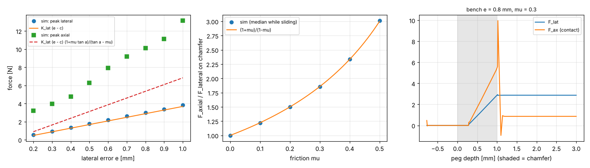

### 4.2 孔位誤差掃描（手臂閉迴路，結果／最大力／週期）
| e [mm] | 剛性腕＋位置 | RCC＋位置 | RCC＋導納 | RCC＋導納＋搜孔 |
|---|---|---|---|---|
| 0.00 | OK／1.7 N／3.77 s | OK／0.7 N／3.77 s | OK／0.7 N／3.77 s | OK／0.7 N／3.77 s |
| 0.30 | OK／43.9 N／3.77 s | OK／2.3 N／3.77 s | OK／2.0 N／3.78 s | OK／2.0 N／3.78 s |
| 0.60 | NG：OVERFORCE／80.0 N | OK／5.5 N／3.77 s | OK／7.0 N／3.80 s | OK／7.0 N／3.80 s |
| 0.90 | NG：OVERFORCE／80.6 N | OK／11.3 N／3.77 s | OK／9.4 N／3.82 s | OK／9.4 N／3.82 s |
| 1.05 | NG：OVERFORCE／81.2 N | OK／13.8 N／3.77 s | OK／10.3 N／3.83 s | OK／10.3 N／3.83 s |
| 1.20 | NG：OVERFORCE／82.5 N | NG：OVERFORCE／79.9 N | NG：MISS／15.8 N | OK／15.8 N／4.82 s（搜 0.87 s） |
| 1.60 | NG：OVERFORCE／81.7 N | NG：OVERFORCE／81.1 N | NG：MISS／16.0 N | OK／16.0 N／4.90 s（搜 0.97 s） |
| 2.50 | NG：OVERFORCE／82.2 N | NG：OVERFORCE／80.5 N | NG：MISS／16.1 N | OK／18.2 N／7.28 s（搜 3.27 s） |

成功數：剛性腕＋位置 2/8、RCC＋位置 5/8、RCC＋導納 5/8、RCC＋導納＋搜孔 8/8。捕捉半徑 e_cap = 1.08 mm：
RCC＋導納的成敗與「e ≤ e_cap」完全一致；RCC＋位置完全一致。

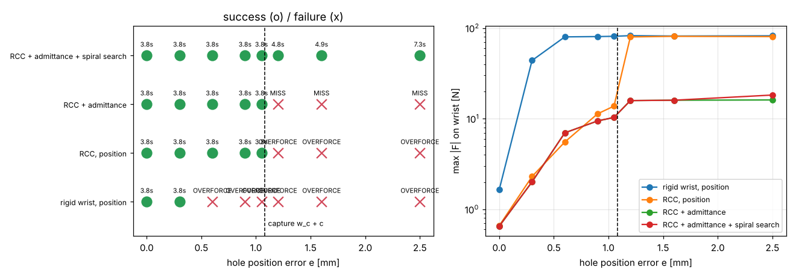

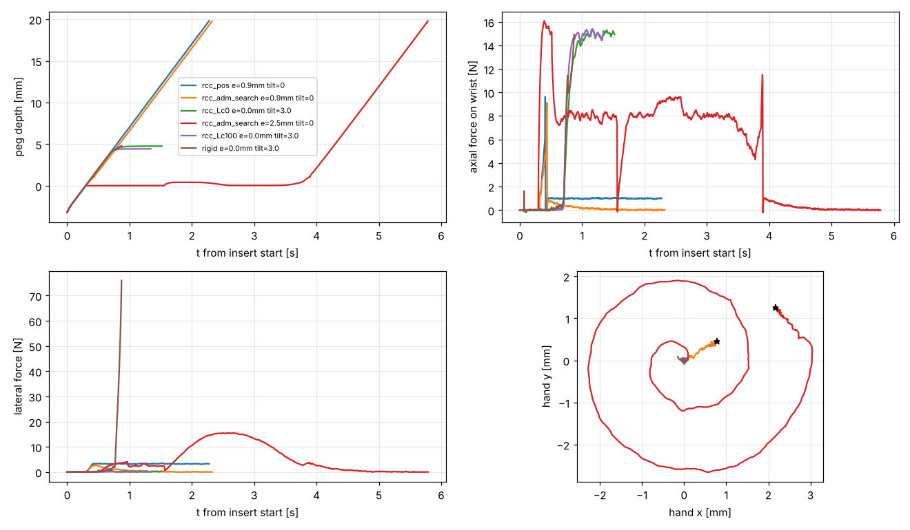

### 4.3 銷在夾爪中的角度誤差（導納控制；表內：結果／最大力／最大力矩／兩點接觸起始深度／週期）
幾何極限欄 = w_c + d_b(θ)（銷端中心距頂面）。楔住臨界角 θ_w = 2.55°。

| θ [°] | 幾何極限 [mm] | 剛性腕 | RCC L_c = 0（柔順中心在銷端） | 柔順腕 L_c = 100 mm |
|---|---|---|---|---|
| 0 | ∞ | OK／F 1.6 N／M 0.018 N·m／2 點 2.11 mm／3.77 s | OK／F 0.7 N／M 0.007 N·m／2 點 2.19 mm／3.77 s | OK／F 0.7 N／M 0.011 N·m／2 點 2.12 mm／3.77 s |
| 1 | 10.17 | NG：OVERFORCE／F 79.8 N／M 1.349 N·m／2 點 9.64 mm | OK／F 4.3 N／M 0.130 N·m／2 點 9.76 mm／4.05 s | OK／F 7.4 N／M 0.193 N·m／2 點 9.77 mm／4.47 s |
| 2 | 5.58 | NG：OVERFORCE／F 79.9 N／M 0.654 N·m／2 點 5.57 mm | NG：JAM／F 15.0 N／M 0.177 N·m／2 點 5.55 mm | NG：JAM／F 14.8 N／M 0.140 N·m／2 點 5.52 mm |
| 3 | 4.05 | NG：OVERFORCE／F 80.4 N／M 0.493 N·m／2 點 3.85 mm | NG：JAM／F 15.4 N／M 0.083 N·m／2 點 3.94 mm | NG：JAM／F 15.4 N／M 0.084 N·m／2 點 3.96 mm |
| 4 | 3.29 | NG：OVERFORCE／F 81.8 N／M 0.422 N·m／2 點 3.28 mm | NG：JAM／F 15.6 N／M 0.054 N·m／2 點 3.29 mm | NG：JAM／F 15.6 N／M 0.071 N·m／2 點 3.25 mm |

θ = 3° 的摩擦係數變化：

| 腕 | μ | 結果 | 最大力 [N] | 最大力矩 [N·m] | 兩點接觸起始 [mm] | 週期 [s] |
|---|---|---|---|---|---|---|
| RCC L_c = 0（柔順中心在銷端） | 0.1 | OK | 12.8 | 0.641 | 3.94 | 7.71 |
| RCC L_c = 0（柔順中心在銷端） | 0.5 | NG：JAM | 15.6 | 0.046 | 3.93 | 2.87 |
| 柔順腕 L_c = 100 mm | 0.1 | NG：JAM | 14.7 | 0.334 | 3.97 | 6.04 |
| 柔順腕 L_c = 100 mm | 0.5 | NG：JAM | 15.6 | 0.055 | 3.97 | 2.79 |

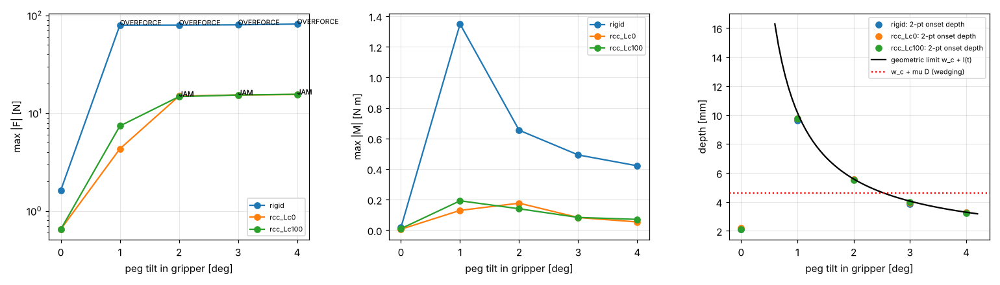

### 4.4 不卡死傾角判據驗證（RCC L_c = 0、導納、側向力歸零）
θ_max = 2√(F_z c/(μ K_rot))（推導見 `jam_free_tilt`）；卡死深度預測 = w_c + l_j（`jam_depth`）。

| θ0 [°] | F_d [N] | μ | K_rot [N·m/rad] | θ_max [°] | 預測 | 模擬 | 預測卡死深度 [mm] | 模擬停止深度 [mm] | 最大力 [N] |
|---|---|---|---|---|---|---|---|---|---|
| 1.5 | 15 | 0.3 | 30 | 1.32 | 卡死 | NG：JAM | 9.31 | 10.38 | 15.1 |
| 3.0 | 15 | 0.5 | 15 | 1.45 | 卡死 | NG：JAM | 4.26 | 4.47 | 15.6 |
| 1.0 | 15 | 0.3 | 15 | 1.87 | 不卡死 | OK | — | — | 4.3 |
| 1.5 | 15 | 0.3 | 15 | 1.87 | 不卡死 | OK | — | — | 9.5 |
| 2.0 | 15 | 0.3 | 15 | 1.87 | 卡死 | NG：JAM | 7.78 | 8.64 | 15.0 |
| 3.0 | 15 | 0.3 | 15 | 1.87 | 卡死 | NG：JAM | 4.43 | 4.76 | 15.4 |
| 4.0 | 15 | 0.3 | 15 | 1.87 | 卡死 | NG：JAM | 3.43 | 3.65 | 15.6 |
| 2.5 | 40 | 0.3 | 15 | 3.06 | 不卡死 | OK | — | — | 25.6 |
| 3.5 | 40 | 0.3 | 15 | 3.06 | 卡死 | NG：JAM | 4.52 | 5.46 | 40.2 |
| 2.0 | 15 | 0.3 | 5 | 3.24 | 不卡死 | OK | — | — | 6.0 |
| 3.0 | 15 | 0.1 | 15 | 3.24 | 不卡死 | OK | — | — | 12.8 |
| 3.0 | 15 | 0.3 | 5 | 3.24 | 不卡死 | OK | — | — | 12.9 |
| 4.0 | 15 | 0.3 | 5 | 3.24 | 卡死 | NG：JAM | 3.89 | 4.09 | 15.2 |

預測與模擬成敗一致 13/13；卡死深度預測與模擬停止深度最大差 1.08 mm。

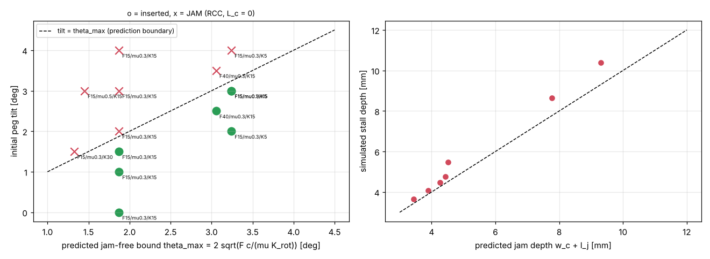

### 4.5 展示（渲染）
| 情境 | 結果 | 深度 [mm] | 最大力 [N] | 最大力矩 [N·m] | 週期 [s] | 關節力矩使用率 |
|---|---|---|---|---|---|---|
| RCC + admittance + spiral search, e=1.6 mm | OK | 19.81 | 16.0 | 0.065 | 4.90 | 0.177 |
| RCC (K_rot 5), peg tilted 3 deg | OK | 19.80 | 12.9 | 0.217 | 7.69 | 0.136 |
| rigid wrist, position ctrl, e=0.6 mm | NG：OVERFORCE | 6.87 | 80.0 | 0.449 | 2.48 | 0.624 |

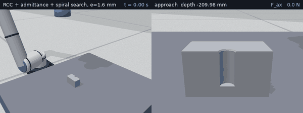

[MP4](../media/2026-11-18_T109.mp4)（0.25 MB；GIF 1.45 MB，173 幀）。左：全景；右：孔的剖視近照（工件 y > 0 半邊移除）。

| 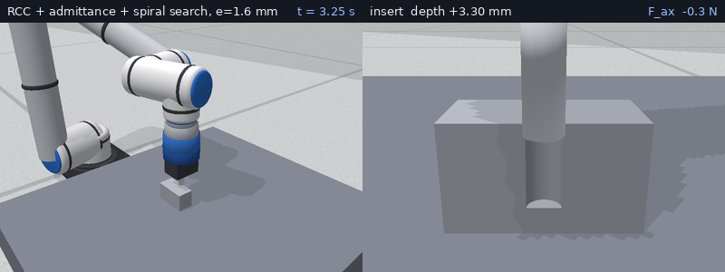 | 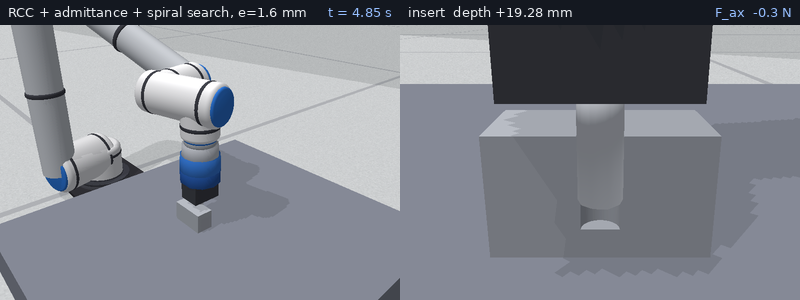 |
|---|---|
| 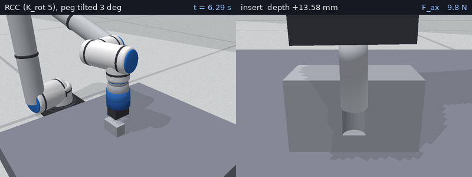 | 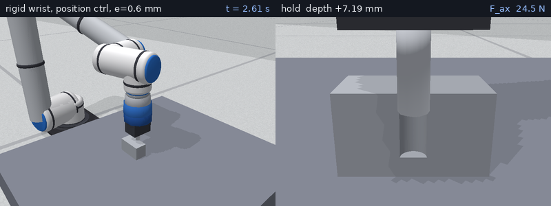 |

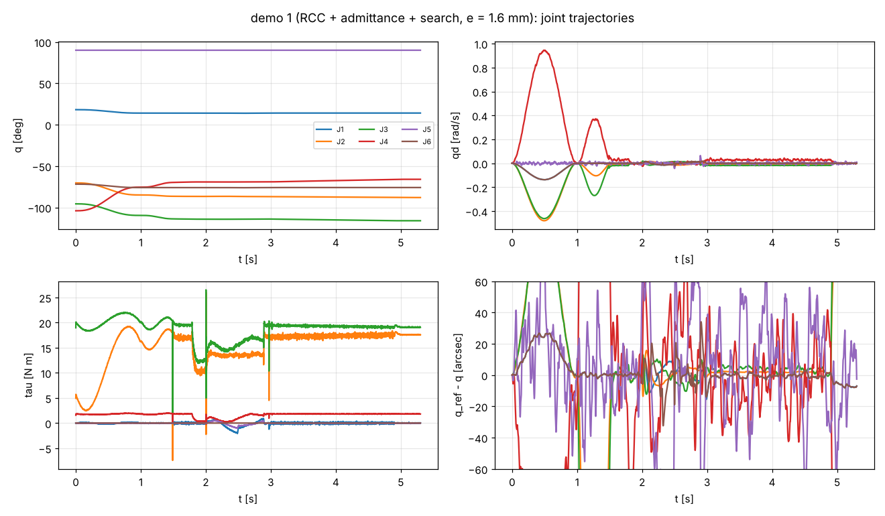

## 5. 發現與討論
1. **倒角滑入符合準靜態理論**：無手臂倒角台上，滑動段軸向/側向力比與 (1 + μ tanα)/(tanα − μ) 在 μ = 0–0.5 的差 ≤ 0.5 %；
   側向力峰值與 K_lat(e − c) 差 +2〜+5 %（e ≥ 0.4 mm；e = 0.2／0.3 mm 為 +19／+8 %，e 越小相對差越大，來自罰函數穿透與阻尼）。全程軸向峰值出現在倒角→孔壁轉角（深度 ≈ w_c）
   的瞬間尖峰（e = 0.8 mm：10.0 N vs 倒角段 5.6 N），倒角段本身符合理論。進入孔後手部仍停在 e，銷以 K_lat(e − c) ≈ 2.9 N 靠在孔壁上、
   軸向殘留摩擦 ≈ μ·2.9 N（手臂閉迴路 RCC＋位置 e = 0.9 mm 的軸向力穩態 ≈ 1 N 亦同）。
2. **捕捉判據 e ≤ w_c + c = 1.08 mm 完全決定無搜孔策略的成敗**：RCC＋位置與 RCC＋導納皆在 e ≤ 1.05 mm 成功、e ≥ 1.2 mm 失敗
   （位置控制 → 頂面硬推 OVERFORCE 80 N；導納 → 力維持在 F_d 並判 MISS，最大力只有 16 N）。導納的側向力歸零讓手部跟著銷移動，
   成功時側向力 ≤ 3.3 N，比 RCC＋位置（≤ 4.1 N）略低；軸向峰值也較低（e = 1.05：10.0 vs 13.3 N）。
3. **剛性腕只容許 e ≈ 0.3 mm**：e = 0.3 成功但側向力 42 N；e = 0.6 mm 雖能滑過倒角（剛性腕 2e5 N/m 與手臂計算力矩伺服的柔度串聯，
   實際側向剛性遠低於工具本身），進孔後在 6.9 mm 深處兩點接觸卡住並 OVERFORCE；e ≥ 0.9 mm 在倒角末端即超力。
4. **螺旋搜孔**：e = 1.2／1.6／2.5 mm 全部恢復，搜孔 0.87／0.97／3.27 s，週期 4.8／4.9／7.3 s。e = 2.5 mm 時銷緣先「勾」進倒角
   （深度 ≈ 0.4 mm，未達落孔門檻 0.5 mm），螺旋繼續外擴而拖著 RCC，側向力達 15.6 N，直到繞回才落孔（落孔時螺旋半徑 3.0 mm）。
   → 可加入「側向力突增即停止搜孔」或降低落孔門檻改善。
5. **傾斜銷與兩點接觸**：兩點接觸起始深度（模擬）與幾何極限 w_c + d_b(θ) 一致（θ = 2°：5.57 vs 5.58 mm；4°：3.28 vs 3.29 mm；
   1°：9.64 vs 10.17 mm）。剛性腕在 1–4° 全部 OVERFORCE；楔住判據 θ_w = 2.55°（l_2 < μD）只區分「楔住 vs 一般卡住」，
   對剛性腕兩者都會失敗。
6. **柔順中心在銷端也不保證成功——新推導的不卡死傾角 θ_max = 2√(F_z c/(μ K_rot))**：RCC（L_c = 0、K_rot = 15 N·m/rad）在 1° 成功、
   2–4° 卡死。以兩點接觸靜力（F_x ≈ 0，因側向力歸零）加上幾何約束 θ(l) ≈ 2c/l，RCC 回復力矩 K_rot(θ0 − 2c/l) 在某深度超過推力
   能克服的 F_z l/(2μ) → θ_max = 1.87°。以改變 F_d（40 N）、K_rot（5／30 N·m/rad）、μ（0.1／0.5）的 7 組額外案例驗證，
   連同傾角/摩擦掃描共 13 組成敗**全部**與預測一致；卡死深度預測（`jam_depth`）比模擬停止深度淺 0.2–1.1 mm
   （模擬含罰函數穿透與 0.5 s 無進展判定延遲）。L_c = 100 mm 的一般柔順腕在 1° 也成功，但最大力矩 0.19 N·m、最大力 7.4 N 皆高於
   L_c = 0（0.13 N·m、4.3 N），2–4° 同樣卡死；μ = 0.1、θ = 3° 時 L_c = 0 成功而 L_c = 100 mm 仍卡死（最大力矩 0.33 vs 0.64 N·m 的差異來自卡死前後的接觸型態），
   顯示柔順中心離開銷端會提高繞銷端的有效角剛性（≈ K_rot + K_lat L_c²），符合 Whitney 的 RCC 設計原則。設計含意：減小 K_rot、提高 F_d、降低 μ 都放寬容許角度（θ_max ∝ √(F_z/(μK_rot))）。
7. **手臂負載**：所有成功插入的關節力矩使用率 ≤ 0.18（剛性腕 e = 0.3 為 0.31、OVERFORCE 案例最高約 0.6）；
   插入段（接觸起至到深）約 2.3 s（10 mm/s），整體週期 3.8 s（含 0.5 s 接近）。

## 6. 問題與限制
* 接觸為罰函數模型（k_rim = 5e5、k_edge = 1e6 N/m/點）：大力時穿透數十 µm，與 80 µm 間隙同量級，使卡死/停止深度比理想剛體深 0.2–1 mm、
  剛性腕的極限深度被高估（θ = 1° 停在 14.9 mm vs 幾何 10.2 mm）。
* 「剛性腕」只能取 K_lat = 2e5 N/m、K_rot = 400 N·m/rad：更硬（1e6）時，手臂 1 kHz 與銷體 20 kHz 的顯式耦合（反作用力延遲一步）
  發散。實際剛性夾持的柔度主要仍來自手臂伺服，結論（剛性腕僅容許 ≈ 0.3 mm）不受此影響。
* 銷已在夾爪中（未模擬取料）；孔軸方向誤差未掃描（`hole_normal` 已支援）；孔口無毛邊/碎屑；摩擦為單一 μ（無黏滑速度相依）。
* 不卡死傾角推導為平面、小角度、F_x = 0、L_c = 0 的準靜態近似；L_c > 0 的有效角剛性受側向導納影響，未給出封閉式。
* 搜孔為固定節距螺旋（無力/力矩特徵定位），e = 2.5 mm 出現勾邊拖曳（見 §5-4）。

## 8. 結論
完成 T109 軸孔插入：在 80 µm 徑向間隙、1 mm 倒角的配合下，RCC＋軸向導納＋側向力歸零在孔位誤差 ≤ 1.05 mm 全部成功
（最大力 ≤ 10.3 N、週期 3.8 s），加上螺旋搜孔後 2.5 mm 誤差亦可恢復（週期 ≤ 7.3 s）；剛性腕僅容許 ≈ 0.3 mm。
倒角滑入力比與準靜態式差 ≤ 0.5 %、捕捉判據 w_c + c 與成敗完全一致、兩點接觸起始深度符合幾何極限，並推導且以 13 組模擬驗證
不卡死傾角 θ_max = 2√(F_z c/(μ K_rot))。下一步：T110 避障路徑規劃（RRT*／碰撞檢查）。


## 7. 測試
`tests/test_insertion.py`：理論公式、兩點接觸靜力平衡、孔有號距離、銷體靜止懸吊、倒角台 vs 準靜態（側向力 ±10 %、力比 ±10 %）、
固定傾角幾何極限（逐點干涉搜尋）、工件網格、RCC＋導納插入成功、剛性腕位置控制 OVERFORCE、MISS 後螺旋搜孔成功。
全套結果：199 passed（ruff check 通過）
