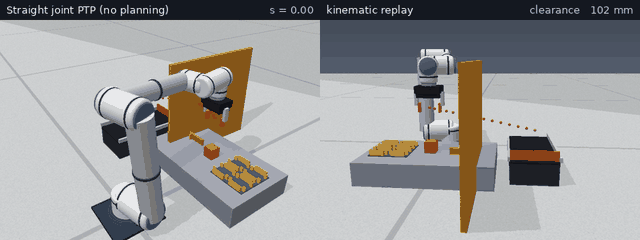
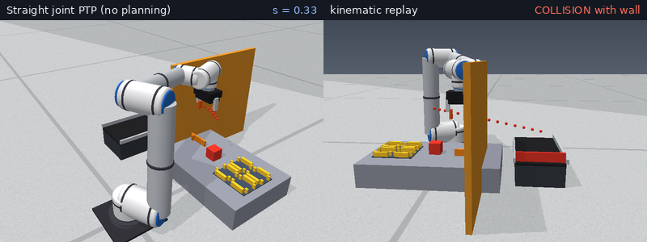
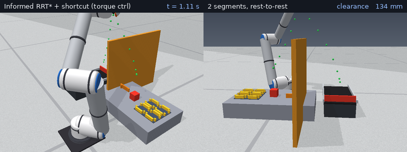
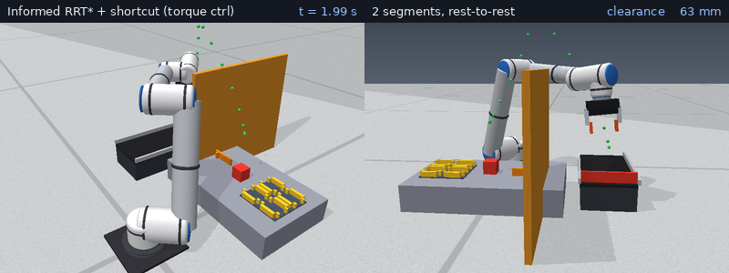
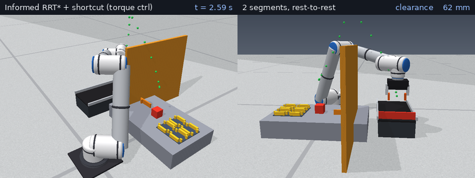
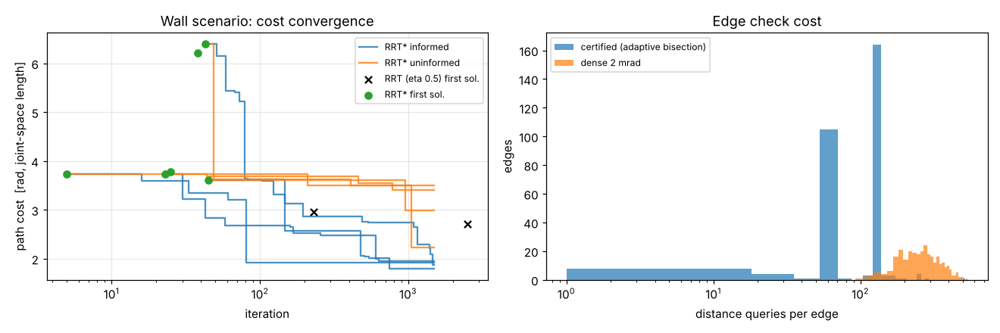
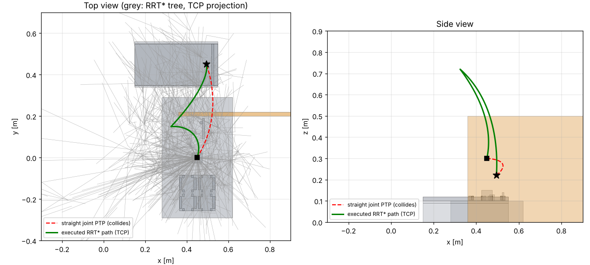
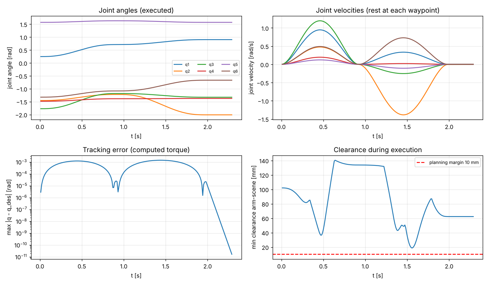
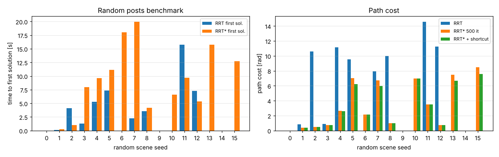

# T110 避障路徑規劃（RRT* ＋ 保證式碰撞檢查）測試報告

- 日期：2026-11-19
- 模組：`sixaxis/planning.py`（碰撞檢查、RRT/RRT*、捷徑、時間律）、`sixaxis/scenarios.py`（場景）
- 測試：`tests/test_planning.py`；206 passed（全套）、ruff check 通過

## 1. 目的
在 T006 工作站（工作台、料盤、治具、輸送帶）中加入障礙物，讓六軸手臂（含夾爪）自動規劃**無碰撞**的關節路徑並在物理模擬中執行。
量化：碰撞檢查的正確性（不得漏判）與成本、規劃成功率、第一解時間、路徑成本（關節空間長度）與其收斂、
執行時的最小間隙、追蹤誤差、週期時間與力矩使用率。

## 2. 模型與方法

### 2.1 碰撞/距離模型
* 規劃專用 PyBullet DIRECT client：手臂＋夾爪 URDF（指全開；寫在私有暫存目錄 → 可多行程平行）、
  障礙物 = T006 工作站 35 個方塊（含取料點上的方塊零件與額外障礙物）＋ 地板。
  PyBullet 3.2.7 的 `createCollisionShapeArray` 實測只保留前 16 個子形狀，故以 16 個一組建成複合剛體（測試以逐一方塊比對驗證）。
* 間隙 f(q) = min(d_obs − m_obs, d_self − m_self)，m_obs = 10 mm、m_self = 5 mm；d 由 `getClosestPoints`（GJK/EPA）取得，
  搜尋半徑 0.50 m（超出者以 0.50 m 計，保守）。自碰撞檢查 32 對非相鄰連桿。
  base/link1 只繞 z 轉，與地板距離為常數（外殼貼地），故不與地板比。
* 規劃空間（取樣盒）：q1, q3–q6 ∈ [−π, π]、q2 ∈ [−π, 0]（上臂不低於肩部水平面），體積 30764 rad⁶；
  均勻取樣自由比例 46.7 %（牆場景，3000 樣本）。

### 2.2 保證式（certified）邊檢查
依 Schwarzer, Saha & Latombe（IEEE T-RO 2005）：關節 i 轉 Δq_i 時，下游任一點位移 ≤ R_i|Δq_i|。
直線插值 q(λ) 上任一點位移 ≤ λ·D，D = Σ R_i|Δq_i|。障礙物距離與自碰撞距離沿邊皆為 D-Lipschitz，因此

  f(q(λ)) ≥ max(f_a − λD, f_b − (1 − λ)D) ≥ (f_a + f_b − D)/2，

**若 f_a + f_b > D 則整條邊無碰撞（證明，而非取樣近似）**；否則二分遞迴，子段 ∞-範數 < 1 mrad 仍無法證明者判碰撞（保守）。
R_i = max_k≥i(Σ_{m=i+1..k}‖p_m‖ + ρ_k)，‖p_m‖ 為相鄰連桿座標原點距離、ρ_k 為連桿 k（link6 併入夾爪）AABB 角點到其原點的最大距離：
R = [1.315 / 1.226 / 0.801 / 0.409 / 0.300 / 0.205] m。節點的 f 只算一次並存在樹上，短邊常可零額外查詢通過。

### 2.3 RRT / RRT* / Informed RRT*
* RRT（LaValle 1998）：最近節點朝樣本延伸 η，目標偏置 5 %，距目標解 ≤ η 且邊可行即連上。
* RRT*（Karaman & Frazzoli, IJRR 2011）：k-nearest 版本，k_n = ⌈e(1 + 1/d)·log n⌉（d = 6），選 cost-to-come 最小的可行父節點，再 rewire；
  成本變化沿子樹傳遞。半徑版之 γ* = 2(1 + 1/d)^{1/d}(μ(X_free)/ζ_d)^{1/d} = 7.69（ζ_6 = π³/6）；
  r_n 在 n ≤ 數千時遠大於 η，等同全用 η，6 維中鄰居太少，因此採 k-nearest。
* Informed RRT*（Gammell, Srinivasa & Barfoot, IROS 2014）：已有解 c_best 後只在長橢球 {q : ‖q − q_s‖ + ‖q − q_g‖ ≤ c_best} 內均勻取樣
  （x = C·L·u + 中心，L = diag(c/2, √(c² − c_min²)/2, …)）；多個目標 IK 解時在仍可能改善者中隨機挑一個當焦點。
* 目標集合：目標 TCP 位姿（工具朝下）的所有封閉解 IK 中，位於取樣盒內且無碰撞者，任一連上即可。
* 後處理：隨機捷徑 200 次（Geraerts & Overmars 2007），每條捷徑仍經保證式檢查。
* 執行：逐段關節直線、五次多項式 rest-to-rest（T003），各段時間 = 滿足 0.5·q̇_max 與 q̈ ≤ 4 rad/s² 的最短時間；
  執行路徑與已檢查的邊完全相同，故「規劃無碰撞」可直接延伸到執行（扣除追蹤誤差）。
  控制：T005 計算力矩（ω_n = 60 rad/s）於 1 kHz 物理步。

## 3. 可重現指令
```bash
python3 -m pip install "setuptools<70" wheel && python3 -m pip install --no-build-isolation pybullet==3.2.7
python3 -m pip install -r requirements.txt
ruff check . && python3 -m pytest -q
PYTHONPATH=. python3 scripts/t110_report.py 2026-11-19     # 4 行程平行規劃 + 依序物理執行與渲染（勿與 pytest 同時執行）
python3 scripts/t110_write_md.py 2026-11-19 "<pytest 摘要>"
```

## 4. 指令序列（場景）
* **牆場景**：工作台上隔板 center = (0.63, 0.21, 0.25) m、半邊長 (0.27, 0.01, 0.25) m（x ∈ [0.36, 0.90]、高 0.50 m）。
  起點 TCP = 取料點上方 (0.45, 0.0, 0.3)，終點 = 輸送帶擋料板上方 (0.495, 0.45, 0.22)（工具朝下）。
  `move_j` 等價的關節直線運動會掃過隔板；規劃後以 2 段 PTP 執行。
* **隨機立柱基準**：16 個種子，每個在工作站（pick / belt / fixture / tray0 / tray3 上方）中隨機挑起訖，
  在連線附近放 2–4 根立柱（截面 4–8 cm、高 0.25–0.55 m）；拒絕取樣保證起訖有無碰撞 IK 解，且**關節直線到所有目標解皆碰撞**（必須規劃）。

## 5. 量化結果

### 5.1 碰撞檢查器
| 項目 | 值 |
|---|---|
| 單次距離查詢（障礙物 3 個複合體＋地板＋32 自碰撞對） | 0.494 ms |
| Lipschitz 驗證：max \|Δd\| /(λD)（2400 個樣本，需 ≤ 1） | 最大 0.312、p99 0.199、中位 0.001 |
| 保證式判「無碰撞」的邊 | 289 / 300 |
| ├ 其中 2 mrad 密集取樣也無碰撞 | 289 |
| └ 其中密集取樣發現碰撞（**漏判，必須 0**） | **0** |
| 保證式判「碰撞」：密集取樣其實無碰撞（保守誤判） | 6（實際碰撞 5） |
| 50 mrad 粗取樣漏掉的碰撞（粗取樣說可行、2 mrad 說碰撞） | 0 / 5 |
| 平均查詢數／邊：保證式 vs 2 mrad 密集（全部邊） | 104.2 vs 279.4（2.7 倍） |
| 平均查詢數／邊：保證式 vs 2 mrad 密集（無碰撞邊） | 105.3 vs 279.9 |

### 5.2 牆場景
* 起點間隙 f = 7.7 mm；目標 IK 解（取樣盒內且無碰撞）1 個。
* 關節直線（不規劃）：目標0：保證式=碰撞、最小 d_obs = -94.2 mm；
  第一個接觸點在 s = 0.305。

| 規劃器 | 成功 | 迭代上限 | 第一解時間 [s] | 第一解迭代 | 第一解成本 [rad] | 最終成本 [rad] | 捷徑後 [rad] | 規劃總時間 [s] | 距離查詢數 | 捷徑後路徑最小 d_obs [mm] |
|---|---|---|---|---|---|---|---|---|---|---|
| RRT（η = 0.5，第一解停） | 2/6 | ≤ 4000 | 33.63（6.24–61.02） | 1372（231–2514） | 2.84（2.71–2.96） | 2.84（2.71–2.96） | 2.34（2.32–2.35） | 33.6（6.2–61.0） | 70076（12877–127274） | 18.4（17.2–19.6） |
| RRT*（第一解停） | 6/6 | ≤ 4000 | 3.09（0.51–4.93） | 30（5–45） | 4.57（3.60–6.39） | 4.57（3.60–6.39） | 4.20（3.36–5.72） | 3.1（0.5–4.9） | 6885（933–11248） | 25.2（14.8–28.2） |
| Informed RRT* | 4/4 | 1500 | 3.02（0.47–5.13） | 29（5–45） | 4.36（3.60–6.39） | 1.89（1.80–1.95） | 1.88（1.76–1.95） | 57.5（40.5–73.5） | 101762（69230–134313） | 18.4（12.2–21.7） |
| RRT*（均勻取樣） | 4/4 | 1500 | 3.07（0.54–5.11） | 29（5–45） | 4.36（3.60–6.39） | 3.04（2.23–3.50） | 3.04（2.23–3.50） | 145.9（138.6–152.8） | 306148（293689–318213） | 22.0（15.0–28.2） |

（格式：平均（最小–最大）；RRT 與「第一解停」兩列的最終成本 = 第一解成本。）
Informed RRT* 1500 次迭代最終成本 1.89（1.80–1.95） rad vs 均勻取樣 RRT* 3.04（2.23–3.50） rad。

### 5.3 物理執行（牆場景，最佳 Informed RRT* 路徑，seed 2）
| 項目 | 值 |
|---|---|
| 路徑段數 / 週期時間 | 2 段 / 1.99 s |
| 速度 / 力矩使用率（規劃軌跡逆動力學） | 0.44 / 0.27 |
| 執行中手臂–工作站靜態體最小間隙（含隔板；不含地板/自碰撞，每 10 ms） | 18.8 mm |
| 執行中接觸 | 無 |
| 最大關節追蹤誤差 | 1.40e-03 rad |
| 終點 TCP 誤差 | 0.000 mm |

### 5.4 隨機立柱基準（16 場景，皆需規劃）
| seed | 起→訖 | 立柱 | 目標解 | 直線最小 d_obs [mm] | RRT（η 0.5） | RRT 成本 | RRT* 第一解 | RRT* 成本 第一解→500 it | 捷徑後 | 執行最小間隙 [mm] | 執行接觸 |
|---|---|---|---|---|---|---|---|---|---|---|---|
| 0 | tray3->belt | 3 | 2 | -72 | ✘ | — | ✘ | — → — | — | — | — |
| 1 | tray0->tray3 | 3 | 3 | -1 | ✔ 0.1 s | 0.85 | ✔ 0.2 s | 1.78 → 0.38 | 0.38 | 13.2 | 無 |
| 2 | tray0->tray3 | 2 | 4 | 2 | ✔ 4.1 s | 10.58 | ✔ 1.0 s | 3.40 → 0.49 | 0.46 | 15.8 | 無 |
| 3 | tray0->pick | 2 | 2 | 11 | ✔ 1.3 s | 0.89 | ✔ 8.0 s | 2.10 → 0.73 | 0.73 | 10.9 | 無 |
| 4 | tray0->fixture | 4 | 2 | -29 | ✔ 5.3 s | 11.14 | ✔ 9.7 s | 4.76 → 2.68 | 2.58 | 16.7 | 無 |
| 5 | tray0->pick | 3 | 2 | -37 | ✔ 7.3 s | 9.55 | ✔ 11.1 s | 9.10 → 7.04 | 6.22 | 19.0 | 無 |
| 6 | belt->fixture | 3 | 3 | -57 | ✘ | — | ✔ 18.1 s | 6.23 → 2.13 | 2.13 | 12.6 | 無 |
| 7 | fixture->tray3 | 2 | 1 | 10 | ✔ 2.3 s | 7.92 | ✔ 20.0 s | 6.71 → 6.71 | 5.96 | 10.4 | 無 |
| 8 | belt->fixture | 2 | 3 | -15 | ✔ 3.5 s | 10.00 | ✔ 4.2 s | 1.90 → 0.97 | 0.97 | 11.8 | 無 |
| 9 | tray3->belt | 4 | 1 | -79 | ✘ | — | ✘ | — → — | — | — | — |
| 10 | pick->tray3 | 4 | 1 | -30 | ✘ | — | ✔ 6.6 s | 6.96 → 6.96 | 6.96 | 14.3 | 無 |
| 11 | tray3->fixture | 3 | 3 | 6 | ✔ 15.7 s | 14.58 | ✔ 9.7 s | 5.56 → 3.52 | 3.52 | 10.4 | 無 |
| 12 | tray0->pick | 4 | 3 | 5 | ✔ 7.3 s | 11.25 | ✔ 5.4 s | 2.05 → 0.74 | 0.74 | 12.3 | 無 |
| 13 | fixture->belt | 2 | 2 | -33 | ✘ | — | ✔ 15.8 s | 8.55 → 7.49 | 6.67 | 20.4 | 無 |
| 14 | fixture->belt | 4 | 2 | -54 | ✘ | — | ✘ | — → — | — | — | — |
| 15 | tray0->belt | 4 | 2 | -65 | ✘ | — | ✔ 12.7 s | 8.62 → 8.50 | 7.60 | 12.7 | 無 |

* 成功率：RRT 9/16、RRT*（500 次迭代）13/16；物理執行無接觸 13/13。
* 兩者皆成功的 9 場景：RRT* + 捷徑成本 / RRT 成本 = 0.37（0.04–0.82）。
* 執行：最小間隙 13.9（10.4–20.4） mm、週期 3.16（0.84–6.24） s、力矩使用率 0.20（0.10–0.33）。

### 5.5 發現與討論
* **保證式檢查的成本與安全性**：300 條隨機邊中，判可行的 289 條以 2 mrad 密集取樣複驗全部無碰撞（零漏判）；判碰撞的 11 條裡有 6 條其實可行
  （近接觸處二分到 δ_min 仍無法證明，屬保守誤判）。平均每邊 104 次查詢 vs 2 mrad 密集 279 次。實測 Lipschitz 比值最大 0.31（理論需 ≤ 1），
  表示 R_i 上界約保守 3 倍——這是查詢數仍偏高的主因；換更緊的逐連桿界可再降。本批隨機邊碰撞者很少（5 條），50 mrad 粗取樣在此樣本中沒有漏判，
  所以「粗取樣會穿隧」這點本次資料**沒有**證明，只能說保證式檢查在不增加成本下提供了證明。
* **RRT vs RRT\***：牆場景中基本 RRT（η = 0.5）只有 2/6 在 4000 次迭代內找到解。唯一的目標 IK 解位於隔板左端上方的窄區，
  「最近節點朝目標延伸」常被隔板擋住而反覆失敗（bug trap）；RRT* 在 k 個鄰居中選可行父節點，6/6 在 5–45 次迭代就找到解。
  隨機基準也一樣：RRT* 13/16、RRT 9/16，RRT 成功的場景 RRT* 也都成功。
* **Informed 取樣**：牆場景 1500 次迭代後 Informed RRT* 平均成本 1.87 rad，均勻取樣 RRT* 3.03 rad（同 seed、同第一解）。
  6 維 C-space 中均勻樣本落在「可改善成本的長橢球」內的機率很低，因此均勻 RRT* 幾乎不再進步。
* **捷徑**：對 RRT 路徑效果大（2.96 → 2.33、2.71 → 2.36 rad），對已收斂的 Informed RRT* 路徑幾乎沒有效果（僅 seed 2：1.80 → 1.76）。
* **「直線被擋」的定義**：隨機基準以「保證式檢查失敗」為準，包含 10 mm 安全餘裕；其中 rand3/7/11/12 的直線最小障礙物距離 5–11 mm（物理上未接觸；
  無法證明是因為 10 mm 餘裕、自碰撞/地板餘裕或 R_i 上界保守）。
* **失敗場景**：rand0、rand9、rand14 兩種規劃器都失敗（RRT* 500 次迭代、RRT 90 s 上限）；這三個場景的直線都深入立柱 54–79 mm，
  且只有 1–2 個目標 IK 解，屬窄通道。本次未加長迭代確認是否真的有解。
* **執行**：路徑點停頓的 rest-to-rest 使牆場景週期 1.99 s（2 段）；最大追蹤誤差 1.4 mrad 出現在高速段，路徑點與終點誤差 < 1e-8 mm。
  執行中最小間隙 18.8 mm 大於規劃餘裕 10 mm（執行量測不含地板與自碰撞）。


## 6. 圖表與動畫


MP4：[2026-11-19_T110.mp4](../media/2026-11-19_T110.mp4)。前段：不規劃的關節直線運動（運動學回放，紅點 = 其 TCP 軌跡）撞上隔板；後段：Informed RRT* + 捷徑路徑
（綠點 = 規劃 TCP 軌跡）以計算力矩控制於物理模擬中執行，右上角為即時最小間隙。

| 直線 PTP 撞牆 | 執行 1/3 | 執行 2/3 | 終點 |
|---|---|---|---|
|  |  |  |  |






## 7. 問題與限制
* 障礙物為靜態方塊；夾持中的工件未納入手臂幾何（搬運時需把工件當成夾爪的附加連桿，留待 T111/T112）。
* R_i 為簡單幾何上界（沿連桿鏈原點距離＋AABB 半徑），偏保守 → 狹窄處二分較深；未使用更緊的逐連桿/逐對界或連續碰撞（CCD）解析法。
* 路徑以 rest-to-rest 分段執行，每個路徑點停頓；平滑化（如 B-spline/拋物線混成）會偏離已證明的邊，需重新檢查（未做）。
* 成本為未加權關節空間長度，不等於 TCP 路徑長或時間；RRT* 漸近最佳但有限迭代下仍有剩餘差距。
* 距離查詢 ~0.49 ms 為瓶頸（Python 迴圈呼叫 32 對自碰撞）；規劃時間為單核數值。

## 8. 結論
保證式邊檢查在 300 條隨機邊上零漏判（289 條判可行者以 2 mrad 密集取樣複驗全部無碰撞），保守誤判 6 條，
平均查詢數為 2 mrad 密集取樣的 1/2.7。牆場景中不規劃的關節直線運動穿入隔板 94 mm；
RRT*（k-nearest）6/6 次找到解、RRT 僅 2/6，Informed 取樣 1500 次迭代成本比均勻取樣低約 38 %。
16 個必須規劃的隨機立柱場景中 RRT* 成功 13/16、RRT 9/16；所有規劃出的路徑（牆場景＋13 個隨機場景）在 PyBullet 物理執行時皆無接觸，
最小間隙 ≥ 規劃餘裕 10 mm。下一步：T111 多物件分類揀選（沿用本規劃器，並把夾持工件納入手臂幾何）。
