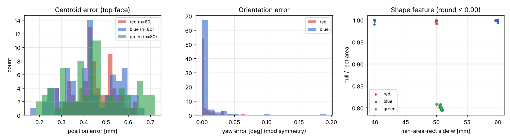
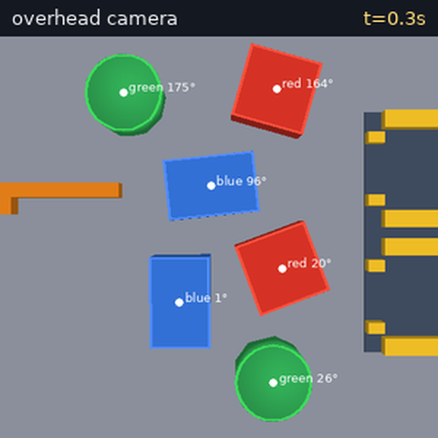
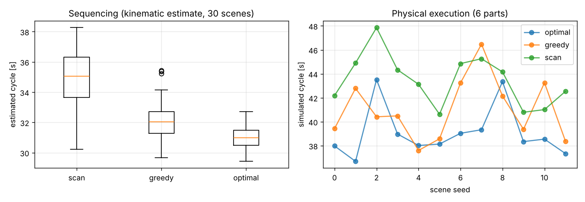
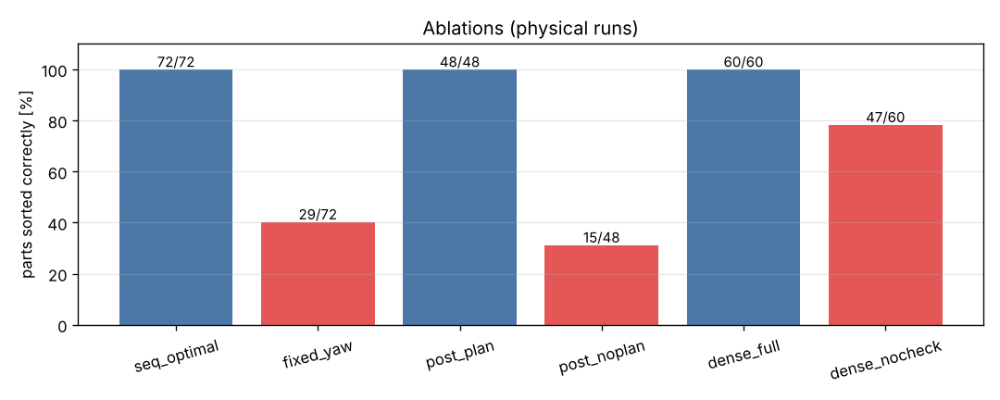
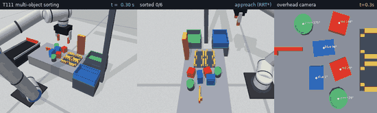
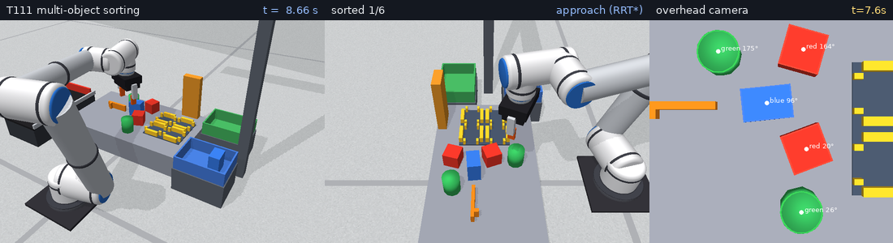
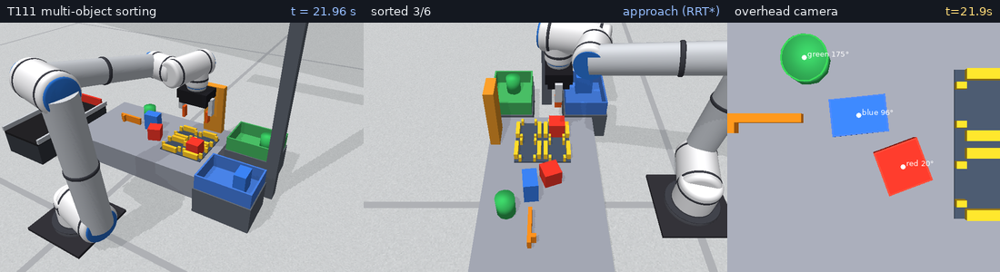
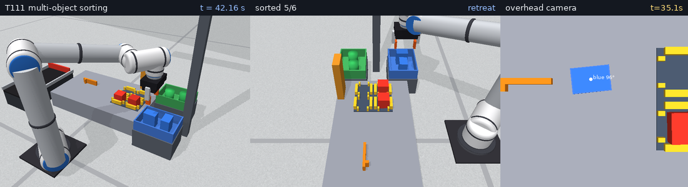
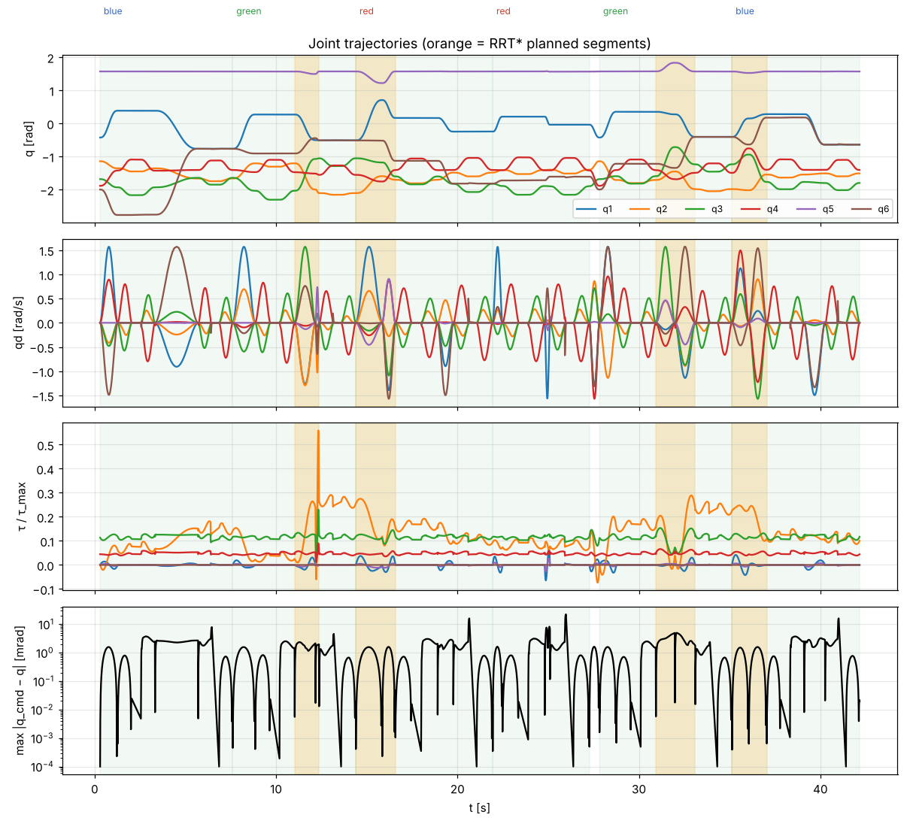
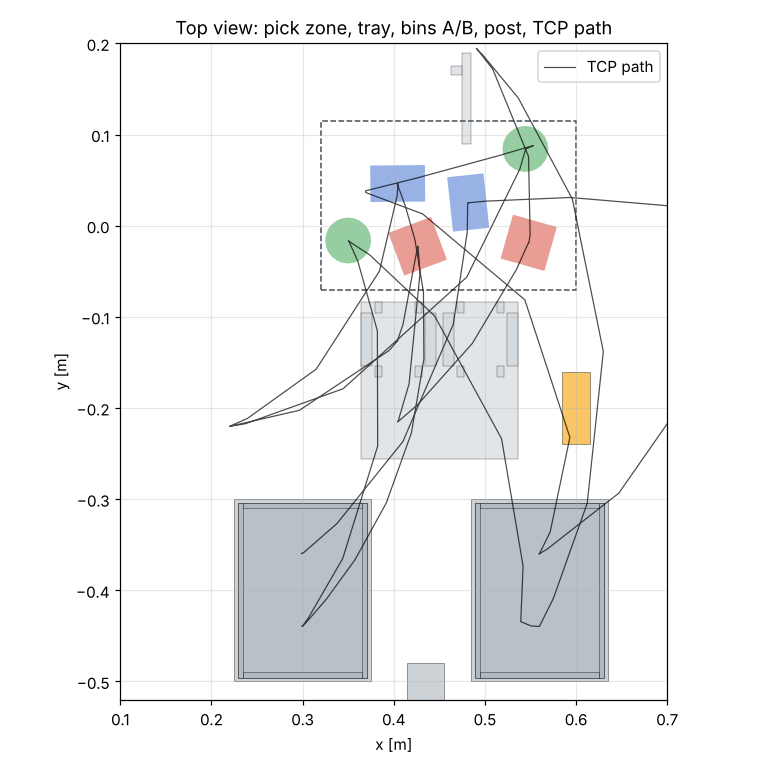

# T111 多物件分類揀選 — 測試報告（2026-11-20）

## 目的

在工作台取料區隨機散置三類物件（紅方塊、藍長方柱、綠圓柱），由俯視相機辨識類別與位姿，規劃無干涉的夾取方向與揀選順序，以避障搬運（T110 規劃器加入「其餘物件」與「夾持中工件」）分別送到料盤格與 A/B 料箱。量化：感知誤差、分類正確率、序列最佳化效益、成功率、週期時間、力矩使用率、與鄰物干涉／避障的消融比較。

## 模型與參數

| 項目 | 內容 |
|---|---|
| 物件類別 → 目的地 | 紅 方塊 [0.05, 0.05, 0.05] m、0.2 kg → 料盤 4 格（格內單邊間隙 4 mm）；藍 長方柱 [0.04, 0.06, 0.07] m、0.25 kg → A 箱；綠 圓柱（半徑, 高）[0.025, 0.06] m、0.15 kg → B 箱 |
| 取料區 | 物件輪廓須在 x∈[0.32, 0.6]、y∈[-0.07, 0.115] m，輪廓間距 ≥ 12 mm（密集組 4 mm），yaw 均勻隨機；每場景 2+2+2 件 |
| 料箱 | 中心 A [0.3, -0.4]、B [0.56, -0.4]，內尺寸 130×180 mm（x×y），壁頂 z = 0.154 m；投放點沿 y ±40 mm；放置時 ψ = 90°（兩指沿 x，指墊外緣距壁 10 mm）下降到物件底面離箱底 0 mm（即放到底）再鬆開 |
| 夾取高度 | 指墊上緣高出物件頂面 3 mm（TCP = 頂面 − 17 mm）：夾 50 mm 方塊時掌體下緣高出 70 mm 鄰物 8 mm；不取齊平以避免共面稜邊造成 PyBullet 接觸法向翻轉（鬆爪黏住） |
| 俯視相機 | 位置 [0.46, 0.02, 0.95]，FOV 21.0°，480×480 px，桌面像素 0.656 mm；TinyRenderer RGB＋深度 |
| 感知演算法 | 深度反投影（(PV)⁻¹·NDC）→ 背景高度圖相減（>6 mm）→ 8-連通標記 → 頂面點質心、最小面積外接矩形（旋轉卡尺）、圓形度 < 0.9 判圓、色度最近類別＋形狀/高度一致性；手臂遮住 ROI > 50 px 時退到觀測姿態重拍 |
| 抓取規劃 | 方塊兩組對邊、圓柱每 22.5°；兩指墊與掌體俯視矩形 vs 鄰物/靜態體（頂面高於部件下緣－餘裕者）距離 ≥ 4 mm；全開內距 80 mm |
| 序列 | 成本 = 兩段關節 PTP 最短時間（qd_max×0.5，五次多項式）＋固定 3.2 s；Held–Karp DP（含可抓相依）、貪婪最近鄰、掃描順序（x→y）；執行時每放一件重拍、重排、只做第一件 |
| 搬運 | 高度 TCP z = 0.27 m；T110 `CollisionChecker` ＋ 其餘物件（偵測方塊）＋ 夾持工件（附在 TCP）；關節直線保證式檢查不通則 Informed RRT*（第一解，≤ 30 s）＋捷徑 |
| 障礙物組 | 料盤右側光柵立柱 中心 [0.6, -0.2, 0.15]、半邊長 [0.015, 0.04, 0.15]（高 0.30 m），位於取料區與 B 箱之間 |
| 控制 | T007 執行器（計算力矩 ω_n = 60 rad/s、1 kHz、夾持力 40 N），夾取後檢查物件在手中偏差 ≤ 3 mm、傾斜 ≤ 5°，否則放回重拍重抓（≤ 3 次） |

## 可重現指令

```bash
python3 -m pip install -r requirements.txt   # pybullet 需 --no-build-isolation，見 CLAUDE.md
python3 -m pytest -q tests/test_sorting.py
PYTHONPATH=. python3 scripts/t111_report.py 2026-11-20        # 4 行程平行，約 20 分鐘；--anim 只重做動畫/圖
python3 scripts/t111_write_md.py 2026-11-20 "<pytest 摘要>"
```

## 指令序列（每件）

1. 拍照 → 偵測（若手臂遮住取料區：`move_j` 回觀測姿態再拍）
2. 序列規劃（DP）→ 取第一件；抓取候選（最大間隙者）
3. `move_j`（直線或 RRT* 路徑點）到物件上方 z = 0.27 m、夾爪 yaw ψ
4. `move_l` 下降到物件中心高 → `grip` 40 N → `move_l` 抬升；在手檢查
5. 夾持工件併入碰撞模型 → `move_j`（直線或 RRT*）到目的格上方（料盤 ψ = 0；長方柱讓 60 mm 邊沿 x）
6. 以取樣檢查選放置格（垂直行程手臂間隙 > 3 mm）→ `move_l` 下降（料盤：放入格；料箱：放到箱底）→ `release` → `move_l` 抬升

## 量化結果

### 1. 感知（40 個靜態場景、240 件）

偵測 240 個、與真值配對 240/240；分類正確 240/240；形狀/高度一致性 240/240；單張影像處理 433（170–908） ms。

| 類別 | n | 位置誤差平均 [mm] | 95% [mm] | 最大 [mm] | yaw 誤差 平均/最大 [°] | 高度誤差 [mm] | 圓形度 | 分類 |
|---|---|---|---|---|---|---|---|---|
| red | 80 | 0.45 | 0.58 | 0.64 | 0.01 / 0.07 | 0.01 | 0.998（0.991–0.999） | 80/80 |
| blue | 80 | 0.44 | 0.62 | 0.67 | 0.01 / 0.19 | 0.01 | 0.998（0.990–1.000） | 80/80 |
| green | 80 | 0.45 | 0.68 | 0.72 | —（旋轉對稱） | 0.97 | 0.798（0.793–0.809） | 80/80 |

物理執行中（最佳序列組 12 場景）共拍照 84 次，其中 12 次因手臂遮住取料區而退到觀測姿態重拍；配對物件位置誤差 0.44（0.18–0.66） mm。





### 2. 序列最佳化（30 個場景，運動學估計）

| 策略 | 估計週期 [s] | 相對 DP 多出 |
|---|---|---|
| 掃描順序 | 34.95（30.22–38.26） | 12.9（2.7–25.5） % |
| 貪婪最近鄰 | 32.22（29.67–35.43） | 4.0（0.0–11.0） % |
| Held–Karp DP | 30.97（29.43–32.70） | — |

DP 計算時間 8.25（3.57–11.47） s；貪婪恰為最佳的場景 3/30；標準間距下有被鄰物擋住（無可行抓取）的物件 0.6（0.0–3.0） 件/場景。
密集（4 mm）10 場景：被擋 1.7（0.0–3.0） 件/場景（不檢查鄰物則 0.0（0.0–0.0））；無可行序列（死結）場景數 掃描 0、貪婪 0、DP 0。

物理執行（同 12 場景，滾動時域）實際週期：
DP 39.1（36.7–43.5） s、貪婪 41.0（37.6–46.5） s、掃描 43.5（40.6–47.9） s。



### 3. 物理執行與消融

| 組別 | 場景成功 | 物件正確 | 料盤入座 | 抓取失敗 | 週期 [s]（成功場景） | 每件 [s] | RRT* 次數 | 力矩使用率 | 鄰物最大位移 [mm] | 錯誤 |
|---|---|---|---|---|---|---|---|---|---|---|
| 完整（DP 序列） | 12/12 | 72/72 | 24/24 | 0 | 39.1（36.7–43.5） | 6.52（6.12–7.25） | 0 | 0.26（0.26–0.27） | 0.0（0.0–0.0） | 無 |
| 完整（貪婪） | 12/12 | 72/72 | 24/24 | 0 | 41.0（37.6–46.5） | 6.84（6.27–7.75） | 0 | 0.26（0.26–0.26） | 0.0（0.0–0.0） | 無 |
| 完整（掃描順序） | 12/12 | 72/72 | 24/24 | 0 | 43.5（40.6–47.9） | 7.25（6.77–7.98） | 0 | 0.26（0.26–0.26） | 0.0（0.0–0.0） | 無 |
| 固定 ψ = 0（不用視覺方位） | 1/12 | 29/72 | 2/24 | 20 | 41.5（41.5–41.5） | 6.92（6.92–6.92） | 0 | 0.20（0.11–0.26） | 16.6（0.0–49.8） | COLLISION×10 |
| 立柱＋規劃 | 8/8 | 48/48 | 16/16 | 0 | 43.1（40.6–48.9） | 7.18（6.77–8.15） | 32 | 0.36（0.27–0.49） | 0.0（0.0–0.0） | 無 |
| 立柱＋不規劃（直線 PTP） | 0/8 | 15/48 | 9/16 | 3 | — | — | 0 | 0.18（0.11–0.26） | 0.0（0.0–0.0） | COLLISION×15 |
| 密集 4 mm＋抓取檢查 | 10/10 | 60/60 | 20/20 | 0 | 40.3（36.9–44.8） | 6.71（6.14–7.46） | 0 | 0.26（0.26–0.26） | 0.0（0.0–0.0） | 無 |
| 密集 4 mm、不檢查鄰物 | 6/10 | 47/60 | 16/20 | 17 | 40.6（36.9–44.9） | 6.77（6.14–7.48） | 0 | 0.23（0.11–0.26） | 8.3（0.0–48.0） | COLLISION×3 |

料盤放置（成功組 108 件）：格心誤差 0.94（0.08–1.89） mm、高度誤差 -0.01（-0.01–-0.01） mm、yaw 0.94（0.28–1.33）°；入座 108/108。料箱投放 216 件全部在正確箱內，直立（傾斜 < 5°）213/216。

立柱組 RRT* 共 32 次（接近 16、搬運 16、觀測 0），全部找到解 32/32；規劃時間 6.00（0.16–35.20） s；捷徑後路徑 2.48（1.49–3.49） rad、2.0（2.0–2.0） 段。



### 4. 示範執行（立柱場景 seed 0，動畫）

結果：6/6 正確、週期 41.9 s、RRT* 4 次（規劃 49.9 s）、重拍 1 次、力矩使用率 0.49、最大關節追蹤誤差 22.30 mrad。

| 件 | 類別 | ψ 夾取 [°] | 夾持寬 [mm] | 夾爪–鄰物間隙 [mm] | 目的地 | 結果 | 時間 [s] |
|---|---|---|---|---|---|---|---|
| 1 | blue | -89 | 60.0 | 4.3 | binA | PLACED | 7.31 |
| 2 | green | -23 | 50.8 | 31.5 | binB | PLACED | 6.79 |
| 3 | red | -16 | 50.0 | 19.9 | tray | PLACED | 7.54 |
| 4 | red | 20 | 50.0 | 11.4 | tray | PLACED | 5.33 |
| 5 | green | 0 | 50.9 | 33.2 | binB | PLACED | 7.31 |
| 6 | blue | -84 | 40.0 | 61.9 | binA | PLACED | 7.03 |



MP4：[2026-11-20_T111.mp4](../media/2026-11-20_T111.mp4)

| 開始 | 中段 | 完成 |
|---|---|---|
|  |  |  |





## 發現與討論

1. **感知**：以深度反投影＋背景高度圖分割，240 件全部偵測、分類正確，位置誤差平均 0.45 mm（≈ 0.7 像素，像素 0.656 mm），
   方塊/長方柱 yaw 誤差最大 0.19°。綠色圓柱量到的高度系統性多約 1 mm（0.97 mm），推測為 Bullet 圓柱碰撞外殼邊距使其靜置略高，
   不影響抓取（以實測頂面定夾取高度）。每次放置後重拍時，有 12/84 次手臂（停在料盤上方）遮住取料區，自我遮罩偵測到後退到觀測姿態重拍。
2. **序列最佳化**：Held–Karp DP 估計週期比掃描順序少 12.9 %、比貪婪最近鄰少 4.0 %（30 場景平均；貪婪恰為最佳僅 3/30）。
   物理執行（同 12 場景、滾動時域）實際週期 DP 39.1 s、貪婪 41.0 s（+4.9 %）、掃描 43.5 s（+11.3 %），與估計的排序與幅度一致；
   估計值比實際少約 8 s，差額來自固定段（升降/夾放/重拍）與執行器依力矩上限放慢的時間，各策略共有、比較時相消。
3. **抓取方位要用視覺**：固定 ψ = 0（T102 式）時只有 1/12 場景成功、29/72 件正確、料盤入座 2/24：
   旋轉物件被夾在稜角上或指墊撞到物件/料盤銷（COLLISION×10、抓取失敗 20 次）。
4. **避障**：料盤右側 0.30 m 光柵立柱擋住取料區 → B 箱的關節直線路徑；不規劃時 0/8 場景成功（15 次 COLLISION）；
   加入規劃器（其餘物件＋夾持工件併入碰撞模型）後 8/8、48/48，RRT* 32 次全部找到解，週期只增加約 4 s。
5. **夾爪–鄰物 2.5D 檢查**：密集（4 mm 間距）時不檢查鄰物 → 6/10 場景、47/60 件，抓取失敗 17 次、鄰物被推動最大 48 mm；
   檢查後 10/10、60/60，代價是每場景平均 1.7 件需等鄰物先取走（序列相依）。
6. **開發過程修正的問題（皆有重現與驗證）**：
   * 夾在物件中心高度時，掌體下緣（TCP 上方 45 mm）恰與 70 mm 方柱頂面同高 → 方柱旁的方塊無可行抓取，部分場景死結；
     改為「指墊上緣高出頂面 3 mm」夾取後，標準場景死結 2/30 → 0/30。
   * 指墊上緣與物件頂面**完全齊平**時，PyBullet 方塊–方塊接觸法向翻轉，鬆爪時物件黏在指墊上被帶走；改為高出 3 mm 消除。
   * 料箱原為「指墊高於壁頂 10 mm 時鬆開」（掉落 5 cm），70 mm 方柱偶爾翻出箱外；改為長形箱（130×180 mm）、兩指沿 x 下降到箱內放到底。
   * 懸空 5 mm 鬆爪時，Bullet 圓柱–指墊接觸法向偏斜＋錨點摩擦，偶發圓柱黏在指墊上被帶走、甩落地面（前一輪 44 個完整系統場景中 2 次）；改為放到箱底再鬆開後 0 次。
   * 垂直升降（move_l）不經規劃器：原立柱位置緊貼料箱時第二個投放點下降會擦撞立柱；加入升降行程取樣間隙檢查以選放置格，並把立柱移到料盤右側。

## 問題與限制

* 相機為理想針孔＋無雜訊深度（TinyRenderer），相機–手臂外參完全已知，背景高度圖為已知空場景；未模擬深度雜訊、反光、校正誤差。
* 物件皆直立放置、彼此不堆疊；圓柱以外接正方形方塊進入碰撞模型（保守）；夾持工件以方塊近似。
* 垂直升降段只做取樣式間隙檢查（非保證式）；夾爪–鄰物檢查為 2.5D（俯視多邊形 × 高度）。
* 序列成本只用直線 PTP 時間估計，未計入 RRT* 繞行；DP 為 Python 實作，n = 6 需 3.6–11.5 s（物件更多時需啟發式或 C 實作）。
* 每類目的地格數有限（料盤 4、每箱 2），超過時重複使用（會堆疊），本測試每類 2 件。
* 示範動畫的最大關節追蹤誤差 22 mrad 為指令切換/規劃段交接瞬間的暫態（圖中尖峰），運動期間一般為 1–3 mrad。

## 結論

T111 完成：俯視 RGB-D 感知、夾爪干涉感知的抓取規劃、含可抓相依的 Held–Karp 序列最佳化、滾動時域重拍重排、
與 T110 規劃器整合（其餘物件＋夾持工件）的避障搬運，在 54 個完整系統物理場景（含 8 個立柱障礙、10 個 4 mm 密集）共 324 件全部分類正確，
料盤 108/108 入座（格心誤差平均 0.94 mm）；消融顯示視覺方位、避障規劃、鄰物干涉檢查三者各自不可或缺。
下一步：T112 機台上下料。

## 測試

`ruff check .` 通過；`python3 -m pytest -q`：214 passed（5 分 40 秒）

原始數據：[data/2026-11-20_T111_metrics.json](data/2026-11-20_T111_metrics.json)
