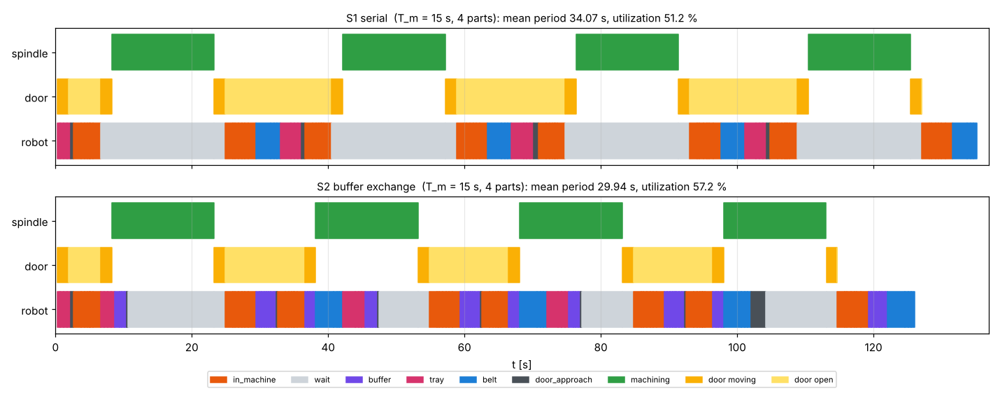
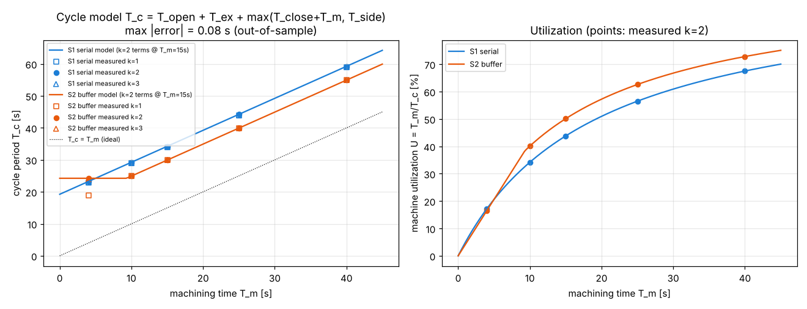
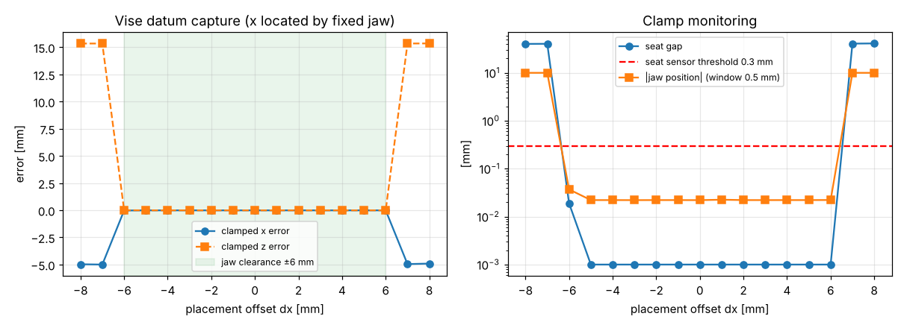
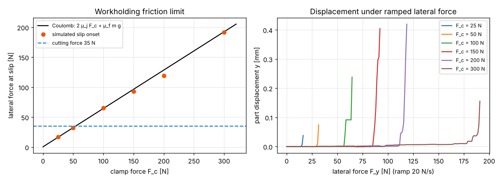
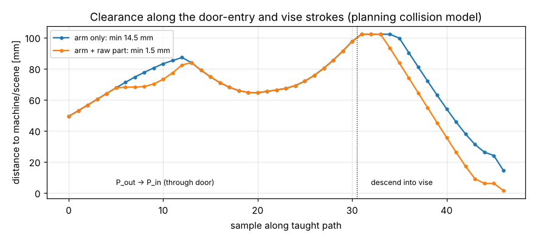
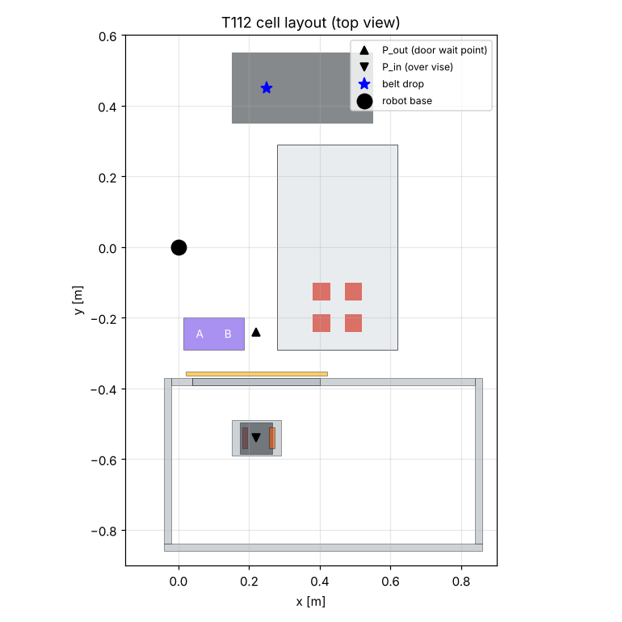
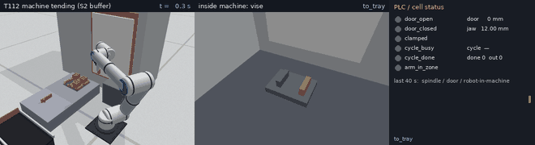
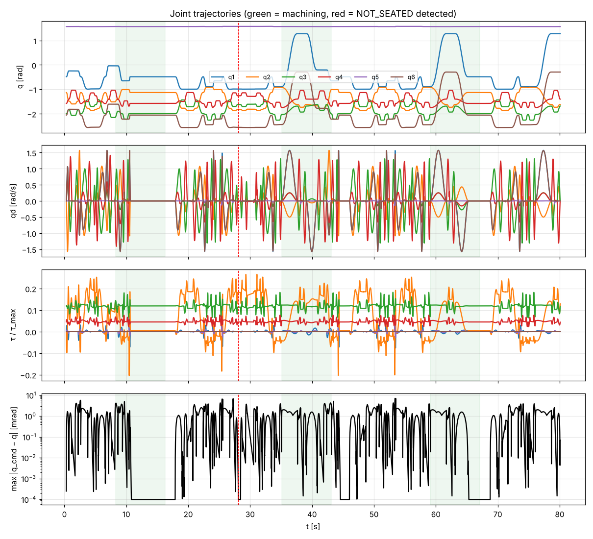

# T112 機台上下料（machine tending）測試報告

* 日期：2026-11-21
* 工作項目：T112（Phase 2 工廠複雜動作；相依 T102 取放、T110 避障規劃）
* 程式：`sixaxis/tending.py`（加工機 `Machine`、工作站 `TendCell`、週期模型、虎鉗/夾持實驗）、
  `scripts/t112_report.py`（實驗→JSON→圖→動畫）、`scripts/t112_write_md.py`（本報告）、`tests/test_tending.py`
* 原始數據：`docs/test-reports/data/2026-11-21_T112_metrics.json`

## 1. 目的

模擬工廠最常見的機器人應用之一：手臂替 CNC 加工機上下料。驗證
1. **加工機與手臂的協調**：自動門、虎鉗夾緊、主軸加工循環，以 PLC 信號與互鎖（門/啟動/光幕）交握；
2. **精度**：胚料放入虎鉗後由固定鉗口基準定位，夾緊監控（鉗口位置窗＋座面檢知）確認座正；
3. **夾持力學**：Coulomb 夾持門檻 F_slip = 2μ_jF_c + μ_f mg 與模擬滑移起點比較、加工中側向切削力下零件不滑移；
4. **週期與稼動率**：S1「依序」與 S2「緩衝交換」兩種策略，以週期模型 T_c = T_open + T_ex + max(T_close + T_m, T_side)
   做樣本外預測並與物理模擬比對；
5. **故障恢復**：切屑墊在零件下（座面檢知失敗→吹氣重放）、料盤空格、互鎖拒絕不良狀態。

## 2. 模型與參數

| 項目 | 值 |
|---|---|
| 虎鉗位置（夾緊後零件中心） | (0.22, -0.54) m；座面 z = 0.12 m |
| 前牆 / 門洞 | y = -0.37 m；x ∈ [0.04, 0.40]、z ∈ [0.16, 0.70] m |
| 自動門 | 行程 400 mm、v_max 0.30 m/s、a_max 1.0 m/s² → 梯形曲線 T = s/v + v/a = 1.633 s |
| 胚料 / 成品 | 50 mm 立方、200 g → 頂面口袋 30×30×15 mm：178.4 g（移除 21.6 g）、質心下移 2.12 mm |
| 虎鉗 | 活動鉗口稜柱關節、力上限 F_c = 200 N、全開間隙 12 mm（放置目標 = 開口中心，容許 ±6 mm） |
| 摩擦 | 鉗口 0.4、座面 0.3、零件 0.8（PyBullet 組合 = 乘積 → 有效 0.32 / 0.24） |
| 夾緊監控 | 鉗口位置窗 ±0.5 mm；座面檢知門檻 0.3 mm |
| 切削力 | F_cut = k_c a_p h = 700 N/mm² × 1.0 mm × 0.05 mm = 35 N（±y，每 2 s 換向） |
| 手臂直線段 | 峰值 TCP 速度 0.5 m/s（T = 1.875 L / v；超限則退回 T007 時間縮放）；進出門洞 TCP 高 0.30 m |
| 位置 | 門外等待點 P_out = (0.22, -0.24, 0.3)、虎鉗上方 P_in = (0.22, -0.54, 0.3)、緩衝台頂 0.20 m、輸送帶放料點 (0.25, 0.45) |

公式依據：梯形速度曲線（T003）；Coulomb 摩擦夾持（夾具設計標準做法：夾緊力 × 摩擦係數 × 接觸面數 ≥ 安全係數 × 切削力）；
Kienzle 比切削力 F = k_c·b·h（k_c 取常數）；機台照顧週期「機台時間 + 不重疊的手臂時間」（Groover）；
光幕停止為 IEC 61496 的功能等效（僅幾何偵測）。

## 3. 可重現指令

```bash
python3 -m pytest -q tests/test_tending.py          # 9 項
PYTHONPATH=. python3 scripts/t112_report.py 2026-11-21       # 全部實驗（4 行程平行）→ JSON / 圖 / 動畫
python3 scripts/t112_write_md.py 2026-11-21 "<pytest 摘要>"  # 本報告
```

## 4. 指令序列（S2 緩衝交換，一件的交換段）

```
[加工中] 緩衝A → 夾成品 → move_j 輸送帶上方 → move_l 下降 → release → 上升
         → 料盤格 → 夾胚料 → 緩衝B 放下 → move_j P_out（門外等待）
[CYCLE_DONE] PLC 開門（1.63 s）→ 等 door_open → move_l P_in → 下降 → grip → 鬆鉗 → 上升 → move_l P_out
         → 緩衝A 放成品 → 緩衝B 夾胚料 → P_out → P_in → 下降到開口中心（底面離座 1.5 mm）→ release
         → 夾緊（同時抬升 50 mm）→ 監控（鉗口位置窗＋座面）→ P_out → 關門命令＋預約啟動 → [門全關自動 CYCLE_START]
```
S1 依序：下料 → 輸送帶 → 料盤 → 上料，全部在機台停機期間進行。大範圍移動皆經 T110 保證式碰撞檢查
（0 段需要 RRT*；其餘關節直線即通過）。

## 5. 量化結果

### 5.1 策略比較（每組 4 件；週期 = 相鄰兩次 CYCLE_START 間隔）

| T_m [s] | S1 平均週期 [s] | S1 機台閒置 [s] | S1 稼動率 k=2 [%] | S1 成功 | S2 平均週期 [s] | S2 機台閒置 [s] | S2 稼動率 k=2 [%] | S2 成功 | S2 較 S1 縮短（k=2）[%] |
|---|---|---|---|---|---|---|---|---|---|
| 4 | 23.07 | 19.07 | 17.2 | ✔ | 22.38 | 18.38 | 16.5 | ✔ | -4.3 |
| 10 | 29.04 | 19.04 | 34.2 | ✔ | 24.94 | 14.94 | 40.1 | ✔ | 14.7 |
| 15 | 34.07 | 19.07 | 43.8 | ✔ | 29.94 | 14.94 | 50.1 | ✔ | 12.6 |
| 25 | 44.04 | 19.04 | 56.5 | ✔ | 39.94 | 14.94 | 62.6 | ✔ | 9.7 |
| 40 | 59.07 | 19.07 | 67.5 | ✔ | 54.94 | 14.94 | 72.8 | ✔ | 7.3 |

10 組全部 4/4 件成品送上輸送帶（`all_ok`），手臂與機台（牆/門/鉗口/主軸）接觸點 0、執行器錯誤 無、
最大力矩使用率 0.25。

**週期分量**（T_m = 15 s 量測；k = 第 k 件完成 → 第 k+1 件啟動）：

| 策略 | k | 週期 | T_open | T_ex | T_close | T_side | 機台閒置 |
|---|---|---|---|---|---|---|---|
| S1 | 1 | 33.92 | 1.63 | 15.65 | 1.63 | 0.00 | 18.92 |
| S1 | 2 | 34.25 | 1.63 | 15.97 | 1.63 | 0.00 | 19.25 |
| S1 | 3 | 34.03 | 1.63 | 15.76 | 1.63 | 0.00 | 19.03 |
| S2 | 1 | 29.94 | 1.63 | 11.67 | 1.63 | 4.03 | 14.94 |
| S2 | 2 | 29.94 | 1.63 | 11.67 | 1.63 | 10.94 | 14.94 |
| S2 | 3 | 29.94 | 1.63 | 11.67 | 1.63 | 10.76 | 14.94 |

**交換時間 T_ex 組成**（T_m = 15 s、k = 2，各動作區段實測秒數）：

| 動作 | S1 | S2 |
|---|---|---|
| 開門等待 | 1.64 | 1.64 |
| 進/出門洞 | 4.50 | 4.50 |
| 虎鉗下料（下降/夾/鬆鉗/抬升） | 2.29 | 2.29 |
| 虎鉗上料（下降/放/夾緊/抬升） | 1.72 | 1.72 |
| 送輸送帶 | 3.53 | 0.00 |
| 料盤取胚料 | 3.27 | 0.00 |
| 緩衝台放/取 | 0.00 | 2.95 |
| 回門外 | 0.66 | 0.20 |
| **合計（T_ex，不含開門）** | 15.97 | 11.66 |

### 5.2 週期模型樣本外驗證

以 T_m = 15 s 量得的 T_open、T_ex、T_close、T_side（各 k 分別）代入
T_c = T_open + T_ex + max(T_close + T_m, T_side)，預測其他 T_m 的每個週期：

| 策略 | T_m | k | 實測 [s] | 預測 [s] | 誤差 [s] | 瓶頸 |
|---|---|---|---|---|---|---|
| S1 | 4 | 1 | 22.93 | 22.92 | +0.01 | 機台 |
| S1 | 4 | 2 | 23.25 | 23.24 | +0.01 | 機台 |
| S1 | 4 | 3 | 23.03 | 23.03 | +0.01 | 機台 |
| S1 | 10 | 1 | 28.93 | 28.92 | +0.01 | 機台 |
| S1 | 10 | 2 | 29.25 | 29.24 | +0.01 | 機台 |
| S1 | 10 | 3 | 28.96 | 29.03 | -0.07 | 機台 |
| S1 | 25 | 1 | 43.92 | 43.92 | +0.01 | 機台 |
| S1 | 25 | 2 | 44.25 | 44.24 | +0.01 | 機台 |
| S1 | 25 | 3 | 43.96 | 44.03 | -0.07 | 機台 |
| S1 | 40 | 1 | 58.92 | 58.92 | +0.01 | 機台 |
| S1 | 40 | 2 | 59.25 | 59.24 | +0.01 | 機台 |
| S1 | 40 | 3 | 59.03 | 59.03 | +0.01 | 機台 |
| S2 | 4 | 1 | 18.94 | 18.93 | +0.00 | 機台 |
| S2 | 4 | 2 | 24.24 | 24.24 | -0.00 | 手臂 |
| S2 | 4 | 3 | 23.98 | 24.06 | -0.08 | 手臂 |
| S2 | 10 | 1 | 24.94 | 24.93 | +0.00 | 機台 |
| S2 | 10 | 2 | 24.94 | 24.93 | +0.00 | 機台 |
| S2 | 10 | 3 | 24.94 | 24.93 | +0.00 | 機台 |
| S2 | 25 | 1 | 39.94 | 39.93 | +0.00 | 機台 |
| S2 | 25 | 2 | 39.94 | 39.93 | +0.01 | 機台 |
| S2 | 25 | 3 | 39.94 | 39.93 | +0.01 | 機台 |
| S2 | 40 | 1 | 54.94 | 54.93 | +0.00 | 機台 |
| S2 | 40 | 2 | 54.94 | 54.93 | +0.01 | 機台 |
| S2 | 40 | 3 | 54.94 | 54.93 | +0.00 | 機台 |

最大絕對誤差 **0.078 s**（相對 0.33 %）。
由 k = 2 分量：S2 在 T_m < T_side − T_close = 9.31 s 時為手臂瓶頸；S1 與 S2 週期相等的交叉點 T_m* = 5.00 s
（T_m > T_m* 時 S2 較快，每件省 T_ex1 − T_ex2 = 4.31 s；T_m 更短時 S2 的加工期間側工作反而拖慢週期，T_m = 4 s 實測 S2 較 S1 慢）。

### 5.3 上料精度與夾緊監控（10 組策略實驗共 40 次上料）

| 指標 | 平均 | 最大 |
|---|---|---|
| 夾緊後 x 誤差（固定鉗口定位）[mm] | 0.013 | 0.016 |
| 夾緊後 y 誤差（不定位 = 手臂放置）[mm] | 0.533 | 0.597 |
| 夾緊後 z 誤差 [mm] | 0.010 | 0.011 |
| 夾緊推移量（鬆爪 → 夾緊，x）[mm] | -5.56 | -5.29 |
| 座面間隙 [mm] | -0.009 | -0.008 |
| 鉗口位置 |偏差| [mm] | 0.024 | 0.027 |
| 加工中零件位移（35 N 切削力）[mm] | — | 0.0052 |

刻意加入放置誤差（完整工作站）：(+4, 0) mm → 夾緊後 x 誤差 -0.011 / -0.014 mm；
(−4, +2) mm → x -0.014 mm、y +2.431 mm（y 誤差保留，符合「x 由基準定位、y 不定位」）。

### 5.4 虎鉗定位捕捉範圍（無手臂：由鉗口上方下降到鬆爪高度 → 放開 → 夾緊）

| dx [mm] | x 誤差 [mm] | z 誤差 [mm] | 鉗口位置 [mm] | 座面間隙 [mm] | 監控 OK |
|---|---|---|---|---|---|
| -8 | -4.971 | +15.34 | -10.00 | 40.12 | ✘ |
| -7 | -4.998 | +15.34 | -10.00 | 40.33 | ✘ |
| -6 | -0.025 | +0.00 | -0.04 | 0.02 | ✔ |
| -5 | -0.010 | -0.01 | -0.02 | -0.01 | ✔ |
| -4 | -0.010 | -0.01 | -0.02 | -0.01 | ✔ |
| -3 | -0.010 | -0.01 | -0.02 | -0.01 | ✔ |
| -2 | -0.010 | -0.01 | -0.02 | -0.01 | ✔ |
| -1 | -0.010 | -0.01 | -0.02 | -0.01 | ✔ |
| +0 | -0.010 | -0.01 | -0.02 | -0.01 | ✔ |
| +1 | -0.010 | -0.01 | -0.02 | -0.01 | ✔ |
| +2 | -0.010 | -0.01 | -0.02 | -0.01 | ✔ |
| +3 | -0.010 | -0.01 | -0.02 | -0.01 | ✔ |
| +4 | -0.010 | -0.01 | -0.02 | -0.01 | ✔ |
| +5 | -0.010 | -0.01 | -0.02 | -0.01 | ✔ |
| +6 | -0.010 | -0.01 | -0.02 | -0.01 | ✔ |
| +7 | -4.954 | +15.34 | -10.00 | 40.69 | ✘ |
| +8 | -4.908 | +15.35 | -10.00 | 41.05 | ✘ |

捕捉範圍實測 dx ∈ [-6, +6] mm，與幾何間隙 ±6 mm 一致（1 mm 取樣）；
超出時零件落在鉗口頂上，鉗口位置窗與座面檢知同時判 NG。y 偏 -3/+3 mm →
夾緊後 y 誤差 -3.00/+3.00 mm（不修正）。
切屑（12×12×3 mm）墊在零件下：座面間隙 3.41 mm（> 0.3 mm 判 NG），但鉗口位置 -0.02 mm 仍在窗內
——**只看鉗口位置會漏判**，座面檢知是必要的。

### 5.5 夾持力：Coulomb 門檻 vs 模擬滑移起點（側向力 20 N/s 斜坡，位移 > 0.5 mm 判滑移）

| F_c [N] | 鉗口實際法向力 [N] | 預測 F_slip [N] | 模擬 F_slip [N] | 誤差 [%] | 對 35 N 切削力安全係數 |
|---|---|---|---|---|---|
| 25 | 25.0 | 16.5 | 17.0 | +3.5 | 0.5 |
| 50 | 50.0 | 32.5 | 32.1 | -1.0 | 0.9 |
| 100 | 100.0 | 64.5 | 65.3 | +1.3 | 1.9 |
| 150 | 150.0 | 96.5 | 92.7 | -3.9 | 2.6 |
| 200 | 200.0 | 128.5 | 119.3 | -7.2 | 3.4 |
| 300 | 300.0 | 192.5 | 191.5 | -0.5 | 5.5 |

### 5.6 互鎖與光幕（同一工作站依序測試）

| 測試 | 結果 |
|---|---|
| 門關、無零件 → 啟動循環 | 拒絕 ✔ |
| 開門時間（命令 → door_open） | 1.634 s（模型 1.633 s） |
| 手臂在機台內 → 關門 | 拒絕 ✔（arm_in_zone = True） |
| 已夾緊、門開 → 啟動循環 | 拒絕 ✔ |
| 繞過互鎖強制關門、手臂在門洞平面 | 光幕 停止 ✔，門位置 400 mm（全開 400），門–手臂最小距離 134.7 mm |
| 手臂退出 → 關門 → 啟動 | 關門 ✔、啟動 ✔ |
| 循環中 → 開門 | 拒絕 ✔ |

門洞直線教導路徑（P_out → P_in，31 點取樣，規劃碰撞模型）最小間隙：空手 49.2 mm、夾持胚料 49.2 mm。

### 5.7 故障注入與恢復

| 情境 | 結果 |
|---|---|
| S2、第 1、2 件下料後虎鉗座面留切屑，恢復開啟 | 4 循環、4 件成品、all_ok = True；偵測 NOT_SEATED 2 次（座面間隙 3.39, 3.39 mm），各吹氣重放 1 次後監控 OK |
| 同上但不恢復（僅 1 片切屑） | PLC 拒絕啟動（INTERLOCK_START：part check failed），流程停止，完成 1 循環——不良裝夾不會被加工 |
| S1、料盤第 2 格空 | GRIP_EMPTY → 跳下一格，3 循環、3 件、all_ok = True |
| 恢復造成的週期增加（chip_recover vs buffer_10，k=1） | +3.90 s |

### 5.8 圖表與動畫













動畫（S2 緩衝交換、T_m = 8 s、3 件，第 1 件下料後注入切屑 → 偵測、吹氣、重放）：



MP4：[`docs/media/2026-11-21_T112.mp4`](../media/2026-11-21_T112.mp4)；關鍵畫面：
[上料](../media/2026-11-21_T112_key_load.png)、[加工中](../media/2026-11-21_T112_key_cycle.png)、[切屑恢復](../media/2026-11-21_T112_key_recover.png)、
[結束](../media/2026-11-21_T112_key_end.png)；關節曲線：



動畫執行：3 循環、3 件、all_ok = True、最大追蹤誤差
7.166 mrad、力矩使用率 0.23。

## 6. 發現與討論

1. **交換時間才是瓶頸，不是加工時間**：S1 每件 T_ex = 15.97 s（T_m = 15 s、k = 2），其中「進/出門洞 4.50 s＋虎鉗下料 2.29 s＋上料 1.72 s」
   共 8.51 s 是任何單夾爪策略都無法搬到加工期間的部分；S2 只把「送輸送帶 3.53 s＋料盤取胚料 3.27 s」換成「緩衝台放/取 2.95 s」，
   T_ex 降到 11.66 s，週期縮短 9.7–14.7 %（T_m = 10–25 s）。要再大幅縮短需雙夾爪（在門內一次完成換料，省去一次進出門洞與緩衝台放取），
   本次未模擬。
2. **S2 不是永遠較好**：S2 把 10.94 s 的側工作塞進加工期間，T_m < 9.31 s 時手臂變成瓶頸；交叉點 T_m* = 5.00 s，T_m = 4 s 實測 S2（24.24 s）
   比 S1（23.25 s）慢 4.3 %。週期模型可直接回答「該不該加緩衝台」：只要知道加工時間與兩個量測分量即可。
3. **週期模型樣本外誤差 ≤ 0.08 s**：分量只在 T_m = 15 s 量一次，預測 T_m = 4/10/25/40 s 共 24 個週期全部在 0.08 s 內，
   包含 S2 在 T_m = 4 s 由機台瓶頸切換到手臂瓶頸的轉折（模型的 max 項）。誤差來源是 10 ms 的等待輪詢步長與不同料盤格的移動時間差。
   注意這是確定性模擬，真實現場的分量會有變異，需改用統計分布（例如 T_ex 的 95 百分位）規劃。
4. **夾緊監控需要兩個感測**：切屑墊在零件下時座面間隙 3.41 mm，但活動鉗口位置只偏 −0.02 mm（在 ±0.5 mm 窗內）——零件被夾在
   兩鉗口之間仍保持 50 mm 寬，只是被墊高傾斜，鉗口位置窗看不出來。落在鉗口頂上（|dx| ≥ 7 mm）則兩者都判 NG。
   不恢復時 PLC 以「part check failed」拒絕啟動，確保不良裝夾不被加工。
5. **x 由基準定位、y 保留手臂誤差**：40 次上料 x 誤差 ≤ 0.016 mm（鉗口推移約 5.6 mm），y 誤差平均 0.53 mm（系統性 +y 偏移，
   T111 料盤放置的格心誤差 0.94 mm 同量級）。若加工要求 y 精度優於手臂放置精度，需加 y 向擋塊並讓手臂「推靠」，或用二次定位。
6. **Coulomb 夾持門檻吻合**：6 組夾緊力的模擬滑移起點與 2μ_jF_c + μ_f mg 相差 −7.2 %～+3.5 %（F_c = 200 N 時最大，模擬偏低）。
   預設 F_c = 200 N 對 35 N 切削力的安全係數 3.4，加工中零件最大位移 0.005 mm；F_c = 50 N 時安全係數 < 1 會被切削力推走。
7. **門洞教導路徑**：P_out → P_in 的 TCP 直線在規劃碰撞模型中最小間隙 49.2 mm（空手與夾持胚料相同，最近者為手臂連桿而非工件）。
   全部 15 組執行中手臂與機台（牆、門、鉗口、主軸）接觸點 0；大範圍移動的關節直線都通過 T110 保證式檢查，未觸發 RRT*。

## 7. 問題與限制

* **夾爪在搬運中繞工具軸自轉 180° 時夾持異常（已迴避、未查明根因）**：`ik_near(sym=True)` 可能選 ψ+π 的解，從緩衝台到輸送帶的
  移動中工具繞自身 z 軸轉 π。實測此時兩指墊法向力由 40 N 逐漸升到 80–120 N，鬆爪命令後手指不動、工件黏在夾爪上被帶走。
  改為 `sym=False`（固定 ψ，腕關節補償基座轉角）後消失；根因（夾爪齒輪約束/接觸在大角速度下的行為）留待之後檢查 T005 夾爪模型。
* **成品碰撞形狀簡化**：曾用 5 個方塊組成含口袋的複合碰撞形狀，指墊同時壓在底板與側壁兩個共面面上時接觸力異常、鬆爪黏住；
  改為完整外形方塊（口袋在頂面內部，不參與任何接觸），質量/質心仍依移除體積計算（慣量由 PyBullet 依外形方塊估算）。
* 加工以「定時循環＋側向定值切削力＋結束時換成成品」表示，未模擬切削動力學、切屑生成、主軸負載；切屑由故障注入產生，吹氣以移除物體表示。
* 自動門為運動學驅動，光幕只做幾何偵測（無反應時間、停止距離）；PLC 信號無通訊延遲。
* 鉗口無倒角、活動鉗口為理想位置控制＋力上限（無油壓動態）；y 向不定位。
* 單夾爪；未模擬雙夾爪換料、多機台、上料姿態翻面（第二序加工）。
* 確定性模擬（無感測雜訊、無動作時間變異）；料盤只有 4 格，S2 的穩態量測只有 k = 2、3 兩個週期。
* 直線段改用峰值 0.5 m/s（比 T007 預設快），動畫中最大追蹤誤差 7.17 mrad（較 T110/T111 的 ≤ 1.4 mrad 大），力矩使用率仍 ≤ 0.25。

## 8. 結論

建立了 CNC 機台上下料的完整模擬：自動門（梯形曲線，實測開門 1.634 s vs 模型 1.633 s）、虎鉗（基準定位＋夾緊監控）、
主軸循環與 PLC 互鎖（關門/啟動/開門互鎖、光幕停止全部按預期動作），手臂以 T110 碰撞檢查規劃大範圍移動、教導直線進出門洞。
10 組策略實驗 40 件全部完成（x 定位 ≤ 0.016 mm、座面間隙 ≤ 0 mm、零接觸），切屑故障 2/2 偵測並恢復、料盤空格跳格、
不恢復時 PLC 拒絕加工。週期模型 T_c = T_open + T_ex + max(T_close + T_m, T_side) 以單一 T_m 的量測分量預測其他 4 種加工時間，
24 個週期誤差 ≤ 0.08 s，並量化出緩衝交換策略的適用條件（T_m > 5.0 s 才有利，省 4.31 s/件）。


## 測試結果

```
python3 -m pytest -q → 223 passed in 310.34s（新增 tests/test_tending.py 9 項）；ruff check . → All checks passed!
```
