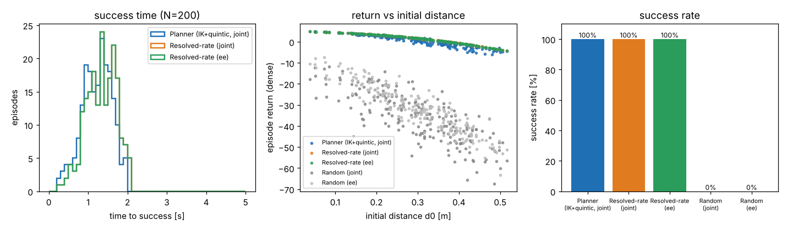
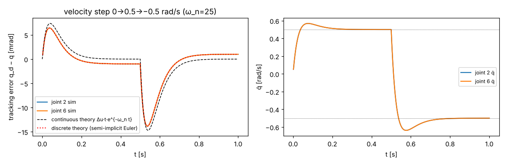
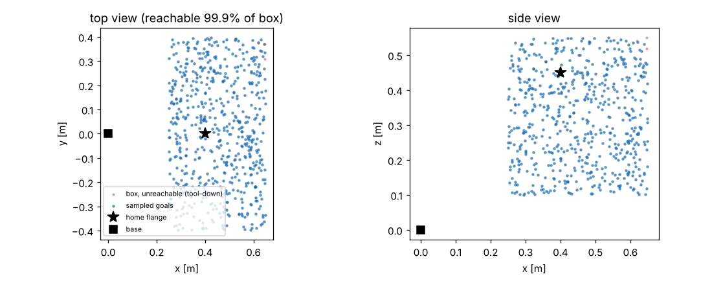
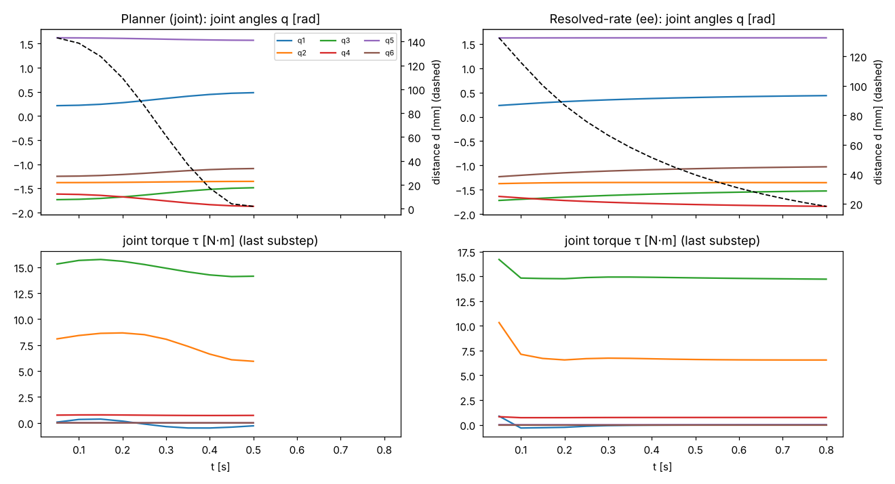
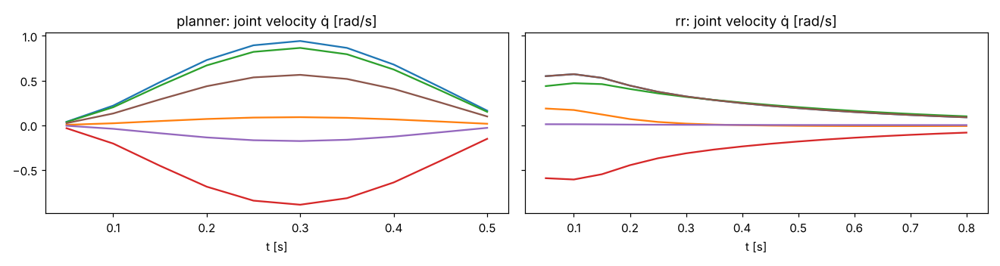
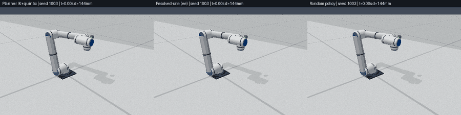
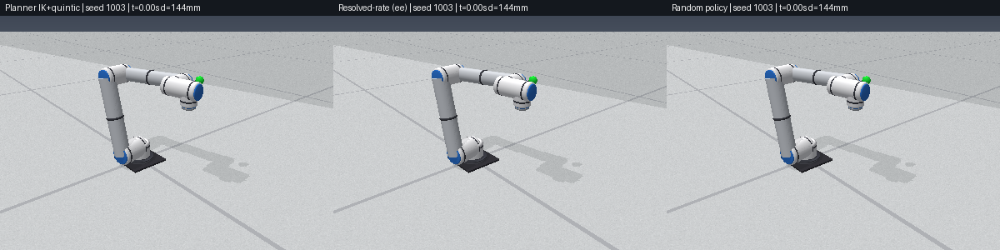
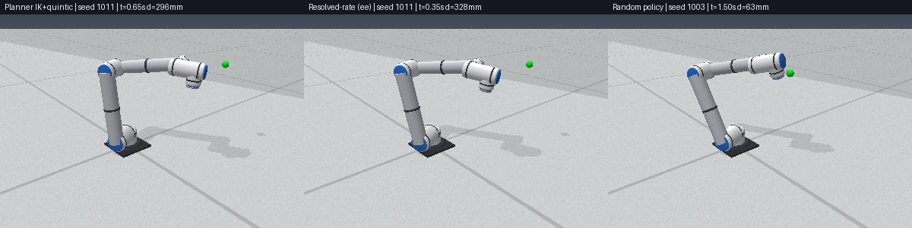

# T201 Gymnasium 環境：reach（測試報告）

日期：2026-11-22｜TaskID：T201｜Phase 3 第一項

## 1. 目的
建立第一個強化學習環境 `SixAxisReach-v0`（`sixaxis/rlenv.py`）：手臂法蘭到達工作空間中隨機目標點並停住。
本項完成觀測/動作/獎勵/終止條件的定義、低階控制器的模型驗證，並以傳統規劃控制（IK＋五次多項式、
笛卡兒解析率 P 控制）與隨機策略建立基準，供 T202（PPO/SAC 訓練）直接比較。

## 2. 模型與參數

### 2.1 物理與低階控制
* PyBullet DIRECT、UR5 類手臂（T001 URDF）＋地面；物理步長 Δt = 2 ms，策略頻率 20 Hz
  （每動作 25 子步）；回合上限 100 步（5 s）。
* 動作 → 參考：joint 模式 a ∈ [−1,1]⁶ → u = a·ω_max（ω_max = 1.0 rad/s）；
  ee 模式 a ∈ [−1,1]³ → v = a·v_max（v_max = 0.3 m/s），姿態保持 ω = 2·log(R₀Rᵀ)，
  阻尼最小平方 q̇ = Jᵀ(JJᵀ + λ²I)⁻¹[v; ω]（λ² = 10⁻³；Wampler 1986），超過 ω_max 時等比縮放。
  參考積分 q_ref ← q_ref + uΔt_c，夾在 |q_ref − q| ≤ 0.3 rad 與關節限位內，子步間線性內插。
* 內環計算力矩（T004 同一定律）：τ = M(q)(K_p e + K_d ė) + C(q,q̇)q̇ + g(q) = ID(q, q̇, K_p e + K_d ė)，
  ID 以 PyBullet `calculateInverseDynamics` 計算（T002 已驗證與自寫 RNE 一致），K_p = ω_n²、K_d = 2ω_n、ω_n = 25 rad/s，
  依 τ_max = (150, 150, 150, 28, 28, 28) N·m 飽和。

### 2.2 觀測、獎勵、終止
| 項目 | 定義 |
|---|---|
| 觀測（27 維） | q/π、q̇/q̇_max、p_ee、p_goal、p_goal − p_ee、上一步動作（ee 模式補零到 6 維），夾在 ±10 |
| 獎勵（dense） | r = −d − 0.01‖a‖² + 5·[成功] − 10·[碰撞]，d = ‖p_goal − p_ee‖ (m) |
| 獎勵（sparse，選用） | r = −1（未成功）／0（成功）− 10·[碰撞] |
| 成功 | d < 20 mm 且 ‖ṗ_ee‖ < 0.1 m/s（到達並停住）→ terminated |
| 碰撞 | link2–link6 與地面接觸、非相鄰連桿自碰（`getClosestPoints` 距離 ≤ 0）→ terminated |
| 截斷 | 100 步 → truncated |
| 初始 | home（法蘭 (0.40, 0, 0.45) m、工具朝下）＋各軸 U(±0.1) rad |
| 目標 | 方塊 x∈[0.25, 0.65]、y∈[-0.4, 0.4]、z∈[0.1, 0.55] m 均勻取樣，要求工具朝下封閉解 IK 存在且腕心離軸 1 ≥ 0.22 m（方塊內 99.9 % 合格） |

### 2.3 基準策略
* **規劃**（`PlannerPolicy`）：reset 後以封閉解 IK（工具朝下、離 q_ref 最近解）得 q₁，關節五次多項式 PTP（T003），
  時間取使峰值關節速度 = 0.9 ω_max 的最短時間；每步 a = (q_traj(t_{k+1}) − q_ref)/(Δt_c ω_max)，使參考精確沿軌跡。
* **解析率 P 控制**（`ResolvedRatePolicy`，Whitney 1969）：v = 2.5 (p_goal − p)，|v| ≤ v_max，姿態保持，DLS 換關節速度。
* **隨機**：a ~ U[−1,1]（下界）。

## 3. 可重現指令
```bash
python3 -m pip install gymnasium==1.4.0
PYTHONPATH=. python3 scripts/t201_report.py        # 基準 5×200 回合＋靜態 3×50＋速度步階＋目標分佈＋吞吐量＋動畫（4 行程，約 53 s）
PYTHONPATH=. python3 scripts/t201_write_md.py 236
python3 -m pytest tests/test_rlenv.py -q
```
```python
import gymnasium as gym, sixaxis.rlenv  # noqa  (註冊 SixAxisReach-v0)
env = gym.make("SixAxisReach-v0", action_mode="ee", reward_type="dense")
obs, info = env.reset(seed=0); obs, r, term, trunc, info = env.step(env.action_space.sample())
```

## 4. 指令序列（每回合）
1. `reset(seed)`：home＋雜訊 → 取樣可達目標 → 觀測。
2. 每 50 ms：策略輸出 a → 關節速度指令 u → q_ref 積分 → 25 個 2 ms 子步計算力矩控制 → 量測 d、ṗ、碰撞 → 獎勵。
3. 成功／碰撞 → terminated；滿 100 步 → truncated。

## 5. 量化結果

### 5.1 基準比較（N = 200 個相同 seed 的目標，成功即終止；平均初始距離 299 mm）
| 策略 | 成功率 | 碰撞率 | 成功時間平均 (s) | 成功時間 P95 (s) | 結束距離平均 (mm) | 回報（dense）| 路徑長/初始距離 | 最大 \|τ\|/τ_max |
|---|---|---|---|---|---|---|---|---|
| 規劃：IK＋關節五次多項式（joint 動作） | 100.0 % | 0.0 % | 1.19 | 1.75 | 3.0 | 0.42 ± 2.66 | 1.02 | 0.29 |
| 解析率 P 控制（joint 動作） | 100.0 % | 0.0 % | 1.31 | 1.90 | 18.8 | 1.27 ± 2.21 | 0.92 | 0.37 |
| 解析率 P 控制（ee 動作） | 100.0 % | 0.0 % | 1.31 | 1.90 | 18.8 | 1.27 ± 2.22 | 0.92 | 0.37 |
| 隨機（joint） | 0.0 % | 1.0 % | — | — | 369.8 | -35.61 ± 11.59 | 7.62 | 1.00 |
| 隨機（ee） | 0.0 % | 0.0 % | — | — | 326.1 | -32.16 ± 11.14 | 4.82 | 1.00 |

* 規劃與解析率皆 100 % 成功、無碰撞、力矩使用率 ≤ 0.37；
  規劃的成功時間平均為解析率的 91.0 %，68.5 % 的目標規劃較快
  （五次多項式終點速度為 0，到達即停；解析率指數趨近，需等 d 進入 20 mm 才算成功，故結束距離約 19 mm）。
* 回報排序與成功時間相反：解析率一開始就以 v_max 直線縮短 d，Σ(−d) 較小，回報 1.27 > 規劃 0.42。
  dense −d 獎勵偏好「早期快速接近」而非「最早停在目標」，T202 解讀學習曲線時須注意（可能需加時間懲罰或改用 d 的位能差塑形）。
* 解析率 joint/ee 兩種動作模式結果幾乎相同（差異 < 0.01 mm），驗證 ee 動作映射（DLS＋姿態保持）與 joint 模式下手寫的同一控制律等價。
* 隨機策略 0 % 成功，回報約 -35.6，力矩飽和回合比例 joint 86 %／ee 0 %
  （速度指令逐步跳變 → K_d Δu 大加速度），
  joint 模式 1.0 % 回合撞地 → 環境的獎勵/終止能區分好壞策略。

### 5.2 靜態精度（不在成功時終止，跑滿 5 s；N = 50）
| 策略 | 成功 | 5 s 末距離平均 (µm) | 最大 (µm) | 路徑長/初始距離 |
|---|---|---|---|---|
| 規劃：IK＋關節五次多項式（joint 動作） | 100 % | 0.015 | 0.030 | 1.037 |
| 解析率 P 控制（joint 動作） | 100 % | 1.843 | 7.554 | 1.000 |
| 解析率 P 控制（ee 動作） | 100 % | 1.843 | 7.554 | 1.000 |

參考 q_ref 為積分值、內環有速度前饋，靜止後誤差只剩數值層級；路徑長/初始距離 ≈ 1.00（解析率為直線）、1.04（規劃為關節空間內插，笛卡兒路徑略彎）。

### 5.3 低階控制模型驗證：速度步階
從靜止給單軸 u = 0.5 rad/s（0.5 s）再反向 −0.5 rad/s（0.5 s）。連續時間理論：精確計算力矩使誤差滿足 ë + 2ω_n ė + ω_n² e = 0，
速度步階 Δu 給 ė(0⁺) = Δu → e(t) = Δu·t·e^(−ω_n t)，峰值 Δu/(e·ω_n) = 7.358 mrad（Δu=0.5）、14.715 mrad（Δu=1），
於 t = 1/ω_n = 40 ms。離散理論：PyBullet 半隱式 Euler（q̇⁺ = q̇ + Δt q̈、q⁺ = q + Δt q̇⁺）＋子步末端參考的遞迴式。

| 關節 | 峰值 Δu=0.5 (mrad) | 峰值 Δu=1 (mrad) | 與離散理論最大偏差 (rad) | 最大 \|τ\| / τ_max (N·m) |
|---|---|---|---|---|
| 1 | 6.423 | 13.846 | 2.4e-16 | 20.04 / 150 |
| 2 | 6.423 | 13.846 | 7.2e-16 | 93.64 / 150 |
| 3 | 6.423 | 13.846 | 7.2e-16 | 30.24 / 150 |
| 4 | 6.423 | 13.846 | 7.2e-16 | 0.93 / 28 |
| 5 | 6.423 | 13.846 | 7.2e-16 | 0.06 / 28 |
| 6 | 6.423 | 13.846 | 7.2e-16 | 0.01 / 28 |

* 六軸模擬誤差完全相同，且與離散理論逐點一致到 7e-16 rad（數值捨入），證明計算力矩內環精確抵消
  M(q)、C、g（各軸慣量差 > 10⁴ 倍：τ 峰值 93.6 vs 0.0059 N·m），環境動作對每軸都呈相同的二階臨界阻尼響應。
* 連續理論峰值高 15 %、峰時 40 vs 模擬 36 ms：控制器使用子步末端參考（領先一步 uΔt），
  等速段穩態偏移恰為 uΔt = 1.0 mrad（圖中 ±1 mrad 平台）。

### 5.4 計算效能
隨機動作吞吐量：joint 876 步/s、ee 773 步/s（單核，每步含 25 個物理子步）。
→ T202 以 4 個平行環境，40 分鐘預算約可跑 6.7 M 步（估 80 % 效率；PPO/SAC 更新另計）。

## 6. 圖表與動畫






動畫（左：規劃、中：解析率 ee、右：隨機；同一組 4 個目標，綠球為目標）：
　[MP4](../media/2026-11-22_T201.mp4)

關鍵畫面： 

## 7. 測試
`tests/test_rlenv.py` 13 項：Gymnasium `check_env`（joint/ee）、`gym.make` 註冊、觀測內容與 FK 一致、同 seed 決定性、
零動作保持（漂移 < 0.5 mm）、速度指令追蹤（1 s 位移與速度誤差 < 0.02）、成功終止與獎勵值、截斷、撞地終止與懲罰、
兩種基準 10/10 成功且力矩不超限、隨機策略不成功。全套 236 passed、`ruff check .` 通過。

## 8. 問題與限制
* 地面碰撞排除 base 與 link1（link1 外殼底面在 PyBullet 中與地面接觸 1 mm，但只繞 z 旋轉不會撞地）；初版未排除導致每回合第一步就判碰撞。
* 目標只要求位置；姿態固定為 home 的工具朝下（ee 模式強制保持、joint 模式不限制），尚無姿態目標。
* 無感測雜訊、無延遲、無動力學隨機化（留待 T205 domain randomization）。
* 速度前饋與計算力矩使用與模擬相同的模型（PyBullet ID），內環為「理想模型」；隨機策略會使力矩飽和，屆時誤差動態不再是線性二階。
* dense 獎勵的回報排序與成功時間排序不一致（5.1 節），T202 會比較 dense/sparse 或加時間懲罰。

## 9. 結論
`SixAxisReach-v0` 符合 Gymnasium API（check_env 通過、可 `gym.make`），支援關節速度與末端速度兩種動作、dense/sparse 獎勵、
成功/碰撞終止。低階計算力矩控制與離散理論逐點一致（≈1e-16 rad）。傳統基準：規劃 IK＋五次多項式 100 % 成功、平均 1.19 s；
解析率 100 %、1.31 s；隨機 0 %。這些數字即 T202 學習策略的比較標竿。下一步：T202 PPO/SAC 訓練 reach 與學習曲線。
