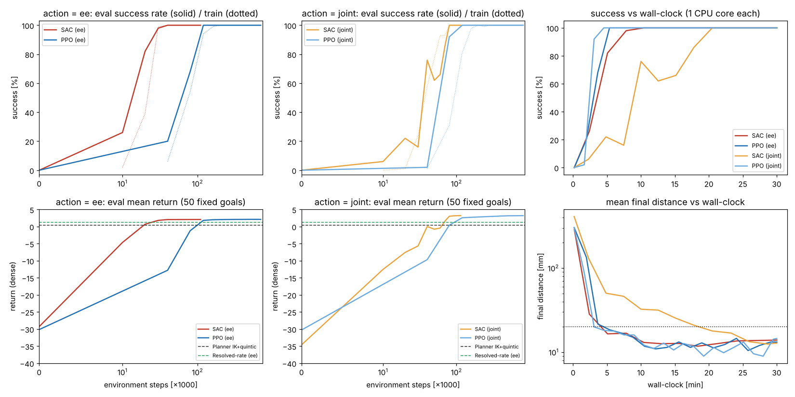
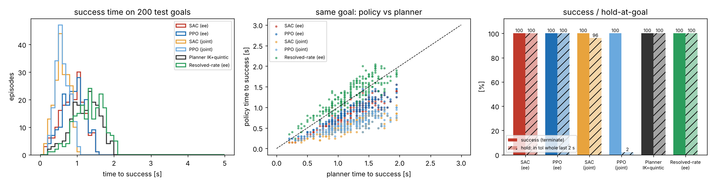
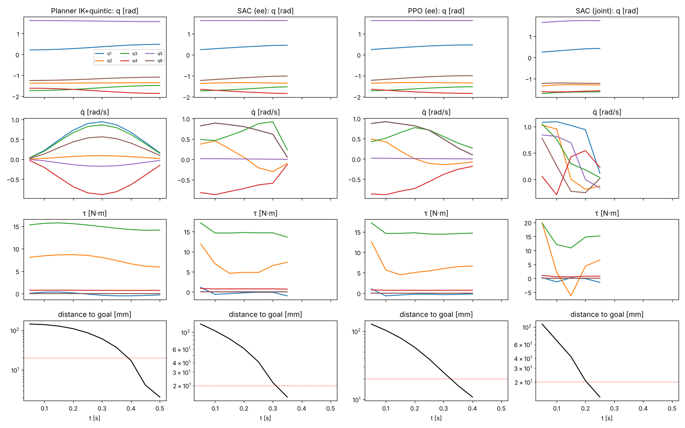
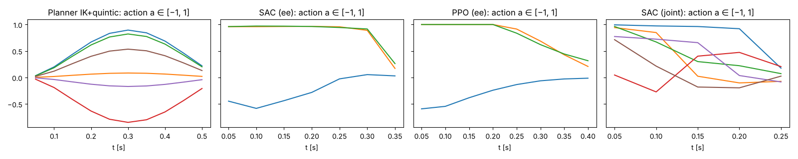
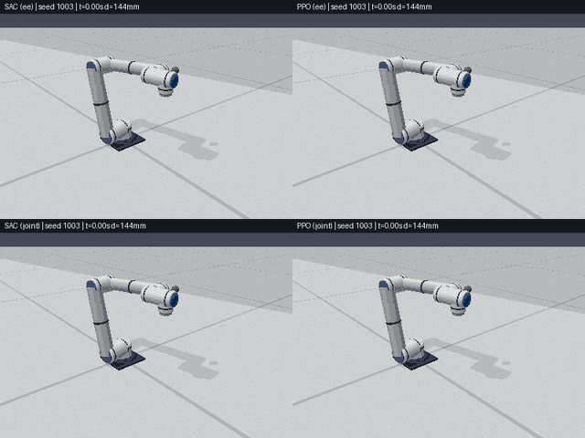

# T202 PPO/SAC 訓練 reach 與學習曲線（測試報告）

日期：2026-11-23｜TaskID：T202｜Phase 3 第二項｜相依：T201

## 1. 目的
以 Stable-Baselines3 的 **PPO** 與 **SAC** 在 T201 的 `SixAxisReach-v0` 環境訓練 reach 策略（ee 與 joint 兩種動作空間，共 4 組），
記錄學習曲線、把模型存到 `models/`，並在與 T201 **完全相同的 200 個測試目標**上，以相同指標和傳統規劃控制基準
（IK＋五次多項式、笛卡兒解析率 P 控制）比較；另做「到達後停住」與「起點擾動加大」兩項泛化測試。

## 2. 模型與參數
### 2.1 環境（T201，不變）
PyBullet 2 ms 物理子步、策略 20 Hz、回合 100 步（5 s）；計算力矩內環 ω_n = 25 rad/s；
joint 動作 u = a·ω_max（ω_max = 1.0 rad/s），ee 動作 v = a·v_max（v_max = 0.3 m/s，姿態保持＋DLS）；
觀測 27 維；dense 獎勵 r = −d − 0.01‖a‖² + 5·[成功] − 10·[碰撞]；
成功 = d < 20 mm 且 ‖ṗ‖ < 0.1 m/s（成功即終止）；起點 q_home ± 0.1 rad 均勻擾動。

### 2.2 演算法與超參數（`sixaxis/rltrain.py`）
* **PPO**（Schulman et al. 2017）：截斷比率目標 L = E[min(ρÂ, clip(ρ, 1−ε, 1+ε)Â)]，GAE(γ, λ)（Schulman et al. 2016）。
  lr = 0.0003, n_steps = 1024, batch = 256,
  epochs = 10, γ = 0.98, λ = 0.95, ε = 0.2,
  網路 2×256（tanh，策略與價值分開），log σ 初值 −1。
* **SAC**（Haarnoja et al. 2018a/b）：最大熵目標 Σ E[r + αH(π)]、雙 Q 取最小、Polyak τ = 0.005、
  溫度 α 自動調整至目標熵 −dim(A)。lr = 0.0003, buffer = 300,000,
  batch = 256, γ = 0.98, learning_starts = 2,000,
  每環境步 1 次梯度更新，網路 2×256（ReLU）。
* γ = 0.98：有效視界 1/(1−γ) = 50 步 = 2.5 s，涵蓋 T201 規劃基準 P95 成功時間 1.75 s。
* 學習曲線評估：每 10k（SAC）/ 40k（PPO）步以**固定** 50 個目標（種子 5000–5049，與測試集 1000–1199 不重疊）做確定性評估
  （取分佈均值動作）；以（成功率, 平均回報）字典序最佳者存 `models/<組態>_best.zip`，結束存 `<組態>_last.zip`（可續訓）。
* 計算預算：四組平行、各 1 個 CPU 核心（`torch.set_num_threads(1)`）、wall-time 上限 30 分鐘（CLAUDE.md：單次 ≲ 40 分鐘），
  單一隨機種子（seed 0）。

## 3. 可重現指令
```bash
python3 -m pip install torch==2.15.0 --index-url https://download.pytorch.org/whl/cpu
python3 -m pip install stable-baselines3==2.9.2
PYTHONPATH=. python3 scripts/t202_train.py            # 4 組平行訓練，各 1800 s（--resume 由 *_last.zip 接續）
PYTHONPATH=. python3 scripts/t202_report.py           # 評估、圖、動畫（約 36 s 評估＋渲染）
python3 scripts/t202_write_md.py 245
ruff check . && python3 -m pytest -q
```
訓練主控台紀錄：[data/2026-11-23_T202_train.log](data/2026-11-23_T202_train.log)；學習曲線原始資料 `models/*_log.json`；彙總 [data/2026-11-23_T202_metrics.json](data/2026-11-23_T202_metrics.json)。

## 4. 指令序列（每回合）
`env.reset(seed)` → 目標於前方方塊取樣（工具朝下 IK 可達）→ 每 50 ms：`a = model.predict(obs, deterministic=True)` →
`env.step(a)`（25 個 2 ms 計算力矩子步）→ 成功（停在 2 cm 內）／碰撞即終止，否則 100 步截斷。

## 5. 量化結果
### 5.1 訓練效率（30 分鐘、1 核）
| 組態 | 總環境步 | 時間 [min] | 步/s | 首次評估成功 ≥ 90 %（步 / 分鐘） | 首次 100 % 步數 | 最佳模型步數 | 模型檔 [MB] |
|---|---|---|---|---|---|---|---|
| SAC（ee 動作） | 110,289 | 30.0 | 61 | 30,000 / 7.8 | 40,000 | 110,000 | 3.16 |
| PPO（ee 動作） | 700,422 | 30.0 | 389 | 120,000 / 5.4 | 120,000 | 600,000 | 1.71 |
| SAC（joint 動作） | 114,820 | 30.0 | 64 | 80,000 / 20.5 | 80,000 | 110,000 | 3.20 |
| PPO（joint 動作） | 814,036 | 30.0 | 452 | 80,000 / 3.1 | 120,000 | 814,036 | 1.72 |

* PPO 每秒步數為 SAC 的 6–7 倍（SAC 每步一次 2×256 雙 Q 梯度更新，在此 CPU 約 11 ms/次）；以**樣本數**計 SAC（ee）
  最省（30,000 步達 90 %），以**時間**計 PPO（joint）最快（3.1 分鐘）。
* 四組均在 30 分鐘內達到評估集 100 % 成功、0 碰撞；預算到時（皆未跑完設定總步數）存檔停止，曲線已平穩（見圖）。

學習曲線（評估集，摘錄）：

<details><summary>SAC（ee）</summary>

| 步數 | 時間 [min] | 成功率 | 平均回報 | 平均末距離 [mm] | 平均成功時間 [s] |
|---|---|---|---|---|---|
| 1 | 0.2 | 0 % | -29.27 | 287.0 | — |
| 10,000 | 2.4 | 26 % | -4.65 | 28.3 | 1.48 |
| 20,000 | 5.1 | 82 % | 0.69 | 16.5 | 1.06 |
| 30,000 | 7.8 | 98 % | 1.82 | 16.8 | 1.07 |
| 40,000 | 10.4 | 100 % | 2.06 | 13.0 | 0.90 |
| 50,000 | 13.0 | 100 % | 2.07 | 12.6 | 0.89 |
| 60,000 | 15.6 | 100 % | 2.07 | 12.7 | 0.89 |
| 70,000 | 18.4 | 100 % | 2.08 | 11.8 | 0.89 |
| 80,000 | 21.2 | 100 % | 2.08 | 12.6 | 0.88 |
| 90,000 | 24.1 | 100 % | 2.08 | 13.6 | 0.88 |
| 100,000 | 27.0 | 100 % | 2.08 | 13.8 | 0.88 |
| 110,000 | 29.9 | 100 % | 2.09 | 13.9 | 0.87 |
| 110,289 | 30.0 | 100 % | 2.08 | 13.9 | 0.88 |
</details>
<details><summary>PPO（ee）</summary>

| 步數 | 時間 [min] | 成功率 | 平均回報 | 平均末距離 [mm] | 平均成功時間 [s] |
|---|---|---|---|---|---|
| 1 | 0.2 | 0 % | -30.16 | 301.5 | — |
| 80,000 | 3.6 | 68 % | -1.22 | 21.6 | 1.78 |
| 160,000 | 7.1 | 100 % | 2.00 | 16.9 | 1.00 |
| 240,000 | 10.5 | 100 % | 2.08 | 11.8 | 0.95 |
| 320,000 | 13.8 | 100 % | 2.10 | 11.4 | 0.93 |
| 400,000 | 17.3 | 100 % | 2.10 | 11.4 | 0.92 |
| 480,000 | 20.7 | 100 % | 2.12 | 11.3 | 0.91 |
| 560,000 | 24.1 | 100 % | 2.11 | 14.6 | 0.90 |
| 640,000 | 27.4 | 100 % | 2.12 | 12.0 | 0.91 |
| 700,422 | 30.0 | 100 % | 2.11 | 13.2 | 0.91 |
</details>
<details><summary>SAC（joint）</summary>

| 步數 | 時間 [min] | 成功率 | 平均回報 | 平均末距離 [mm] | 平均成功時間 [s] |
|---|---|---|---|---|---|
| 1 | 0.1 | 0 % | -34.62 | 410.0 | — |
| 10,000 | 2.3 | 6 % | -12.53 | 131.1 | 1.02 |
| 20,000 | 4.8 | 22 % | -7.57 | 50.3 | 2.10 |
| 30,000 | 7.5 | 16 % | -5.67 | 46.1 | 2.79 |
| 40,000 | 10.0 | 76 % | 0.03 | 32.4 | 1.26 |
| 50,000 | 12.5 | 62 % | -0.76 | 31.6 | 1.33 |
| 60,000 | 15.2 | 66 % | -0.43 | 25.3 | 1.40 |
| 70,000 | 17.8 | 86 % | 1.62 | 20.9 | 1.14 |
| 80,000 | 20.5 | 100 % | 3.02 | 17.9 | 0.76 |
| 90,000 | 23.3 | 100 % | 3.14 | 16.9 | 0.62 |
| 100,000 | 26.0 | 100 % | 3.19 | 13.3 | 0.58 |
| 110,000 | 28.7 | 100 % | 3.21 | 12.5 | 0.57 |
| 114,820 | 30.0 | 100 % | 3.20 | 12.8 | 0.57 |
</details>
<details><summary>PPO（joint）</summary>

| 步數 | 時間 [min] | 成功率 | 平均回報 | 平均末距離 [mm] | 平均成功時間 [s] |
|---|---|---|---|---|---|
| 1 | 0.1 | 0 % | -30.27 | 303.9 | — |
| 80,000 | 3.1 | 92 % | 0.40 | 20.0 | 2.38 |
| 160,000 | 6.0 | 100 % | 2.72 | 17.8 | 0.84 |
| 240,000 | 9.0 | 100 % | 2.89 | 16.0 | 0.72 |
| 320,000 | 11.9 | 100 % | 3.00 | 11.1 | 0.67 |
| 400,000 | 14.8 | 100 % | 3.10 | 10.6 | 0.65 |
| 480,000 | 17.8 | 100 % | 3.14 | 11.7 | 0.63 |
| 560,000 | 20.7 | 100 % | 3.17 | 11.3 | 0.62 |
| 640,000 | 23.6 | 100 % | 3.18 | 11.3 | 0.61 |
| 720,000 | 26.6 | 100 % | 3.19 | 9.6 | 0.60 |
| 800,000 | 29.5 | 100 % | 3.20 | 14.3 | 0.58 |
| 814,036 | 30.0 | 100 % | 3.21 | 14.5 | 0.58 |
</details>

### 5.2 主測試：與 T201 基準相同的 200 個目標（成功即終止）
| 策略 | 成功率 | 碰撞率 | 平均成功時間 [s] | P95 [s] | 平均末距離 [mm] | 回報 | 路徑比 | 最大力矩使用率 |
|---|---|---|---|---|---|---|---|---|
| SAC（ee 動作） | 100.0 % | 0.0 % | 0.85 | 1.35 | 13.4 | 2.16 ± 1.73 | 0.99 | 0.50 |
| PPO（ee 動作） | 100.0 % | 0.0 % | 0.89 | 1.35 | 10.1 | 2.18 ± 1.71 | 1.00 | 0.48 |
| SAC（joint 動作） | 100.0 % | 0.0 % | 0.57 | 0.90 | 12.9 | 3.23 ± 1.05 | 1.03 | 0.81 |
| PPO（joint 動作） | 100.0 % | 0.0 % | 0.59 | 0.90 | 14.4 | 3.21 ± 1.04 | 1.03 | 0.84 |
| 規劃：IK＋五次多項式（T201） | 100.0 % | 0.0 % | 1.19 | 1.75 | 3.0 | 0.42 ± 2.66 | 1.02 | 0.29 |
| 解析率 P 控制 ee（T201） | 100.0 % | 0.0 % | 1.31 | 1.90 | 18.8 | 1.27 ± 2.22 | 0.92 | 0.37 |

（基準重跑與 T201 報告數字完全一致；路徑比 = 法蘭路徑長 / 初始距離，只計 d0 > 5 cm。）

### 5.3 時間最佳性
| 策略 | 成功時間 / 規劃（同目標平均） | 比規劃快的目標比例 | 參考時間 | 成功時間 / 參考（平均） | 最小 | P95 |
|---|---|---|---|---|---|---|
| SAC（ee 動作） | 0.710 | 97.5 % | t_line | 0.949 | 0.696 | 1.147 |
| PPO（ee 動作） | 0.748 | 95.5 % | t_line | 1.009 | 0.700 | 1.230 |
| SAC（joint 動作） | 0.479 | 100.0 % | t_IK | 0.888 | 0.459 | 1.088 |
| PPO（joint 動作） | 0.506 | 99.0 % | t_IK | 0.938 | 0.505 | 1.143 |
| 規劃：IK＋五次多項式（T201） | 1 | — | t_IK | 1.855 | 1.697 | 1.947 |
| 解析率 P 控制 ee（T201） | 1.123 | 23.0 % | t_line | 1.524 | 1.237 | 2.157 |

參考時間（每個目標）：ee 動作 t_line = (d0 − tol)/v_max（以 v_max 沿直線，平均 0.931 s）；joint 動作
t_IK = min_解 max_i |Δq_i|/ω_max（無限加速度、到工具朝下 IK 解的關節速度上限時間，平均 0.647 s）。
理論：五次多項式峰值速度 = 1.875·Δq/T，規劃基準把峰值設為 0.9·ω_max ⇒ T = 2.083·t_IK；實測規劃比值 1.855
（略小於 2.083，因 2 cm 容差使成功早於軌跡結束）。學到的 joint 策略比值 < 1：joint 動作空間**不要求工具朝下**，
策略可同時用腕部關節縮短路徑（t_IK 對它不是嚴格下界）；ee 策略 v 各軸獨立飽和，對角方向 |v| 最高可達 √3·v_max，故比值可 < 1。

### 5.4 到達後停住（不終止，跑滿 5 s，50 目標）
| 策略 | 最後 2 s 全在容差內的回合 | 最後 2 s 在容差內時間比例 | 5 s 末距離平均 [mm] | 最大 [mm] | 末關節速度 ‖q̇‖ [rad/s] |
|---|---|---|---|---|---|
| SAC（ee 動作） | 100 % | 100.0 % | 6.03 | 11.69 | 0.000 |
| PPO（ee 動作） | 100 % | 100.0 % | 8.38 | 16.10 | 0.000 |
| SAC（joint 動作） | 96 % | 99.2 % | 9.42 | 31.02 | 0.195 |
| PPO（joint 動作） | 2 % | 33.2 % | 25.73 | 59.14 | 0.539 |
| 規劃：IK＋五次多項式（T201） | 100 % | 100.0 % | 0.00 | 0.00 | 0.000 |
| 解析率 P 控制 ee（T201） | 100 % | 100.0 % | 0.00 | 0.01 | 0.000 |

### 5.5 起點擾動加大（q0 ± 0.3 rad，訓練為 ± 0.1 rad；100 目標）
| 策略 | 成功率 | 碰撞率 | 平均成功時間 [s] | 平均末距離 [mm] | 最大力矩使用率 |
|---|---|---|---|---|---|
| SAC（ee 動作） | 100 % | 0 % | 0.93 | 14.4 | 0.56 |
| PPO（ee 動作） | 100 % | 0 % | 0.96 | 11.0 | 0.57 |
| SAC（joint 動作） | 100 % | 0 % | 0.60 | 12.7 | 1.00 |
| PPO（joint 動作） | 100 % | 0 % | 0.63 | 14.5 | 0.97 |
| 規劃：IK＋五次多項式（T201） | 100 % | 0 % | 1.30 | 4.6 | 0.28 |
| 解析率 P 控制 ee（T201） | 100 % | 0 % | 1.38 | 18.7 | 0.36 |

### 5.6 每步決策時間（單核，不含物理）
SAC（ee 動作） 0.471 ms ｜ PPO（ee 動作） 0.324 ms ｜ SAC（joint 動作） 0.346 ms ｜ PPO（joint 動作） 0.286 ms ｜ 規劃：IK＋五次多項式（T201） 0.043 ms ｜ 解析率 P 控制 ee（T201） 0.019 ms

## 6. 圖表與動畫








動畫（左上 SAC-ee、右上 PPO-ee、左下 SAC-joint、右下 PPO-joint；4 個測試目標，綠點為目標）：


[MP4](../media/2026-11-23_T202.mp4)｜關鍵畫面：[起始](../media/2026-11-23_T202_key_start.png)、[中段](../media/2026-11-23_T202_key_mid.png)

## 7. 問題與限制
* **獎勵設計的副作用（成功即終止）**：成功後的行為從未出現在訓練資料中，PPO（joint）到達後不會停住——
  不終止時僅 2 % 回合最後 2 s 全在容差內、末距離平均 25.7 mm；
  SAC（joint）96 %；ee 策略因姿態保持與 DLS 使動作→運動映射較平順，兩者皆 100 %。
  規劃與解析率基準本質上收斂到 0（末距離 ≤ 0.008 mm）。需要「到達並保持」的後續任務（pick）應改用不終止＋停留獎勵。
* **精度**：獎勵只要求 d < 20 mm，RL 策略的末距離平均 10–14 mm（剛跨過門檻即終止），規劃基準 3.0 mm；
  成功判據較嚴時需重新訓練或接傳統精定位。
* **力矩使用率**：joint 策略以接近 bang-bang 的關節速度（多軸同時飽和於 ω_max）換取時間，最大力矩使用率
  0.81–0.84（規劃 0.29）；
  起點擾動加大時 SAC（joint）達 1.00（力矩飽和）。獎勵僅含 0.01‖a‖² 動作懲罰，未懲罰加加速度/力矩。
* 單一隨機種子、單一超參數組（未調參），無法給出種子間變異；SAC 在此 CPU 上僅約 60 步/s，30 分鐘約 11 萬步。
* 決策時間 ≈ 0.3–0.4 ms/步（MLP 推論），遠小於 50 ms 控制週期；傳統基準 < 0.03 ms。
* 無感測雜訊、延遲與動力學隨機化（T205 再加入）；評估在 T201 同分佈目標，僅測了起點擾動的外推。

## 8. 結論
* PPO 與 SAC 在兩種動作空間下 30 分鐘（1 核）內都學會 reach：200 個測試目標 **100 % 成功、0 碰撞**，力矩不超限。
* 學到的策略比傳統基準**更快**：成功時間為規劃基準的 0.48（SAC-joint）–
  0.75（PPO-ee）倍，接近速度上限決定的參考時間（比值 0.89–1.01）；
  代價是精度只到獎勵門檻、力矩使用率較高、且 joint 策略不會停留——都是獎勵/終止設計直接造成，已量化。
* 樣本效率 SAC 優（ee：30,000 步達 90 %），時間效率 PPO 優（joint：3.1 分鐘達 90 %）。
* 模型存於 `models/`（每檔 ≤ 3.2 MB），`pytest` 以已存模型做回歸測試。
* 測試：`ruff check` 通過、`pytest` 245 passed。
* 下一步：T203 pick（夾爪抓取；採不終止＋停留/抓穩獎勵，起點用本項 ee 策略的經驗）。
