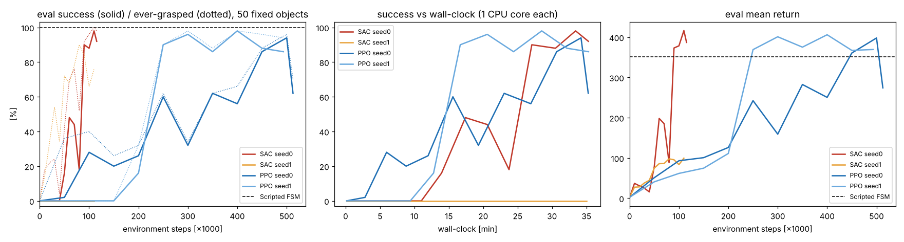
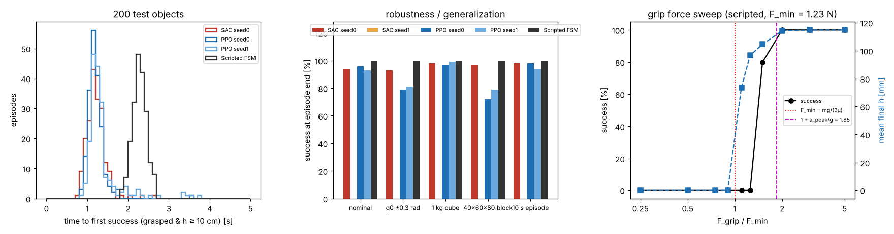
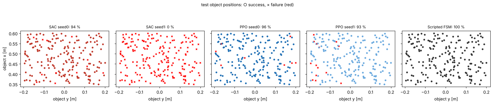
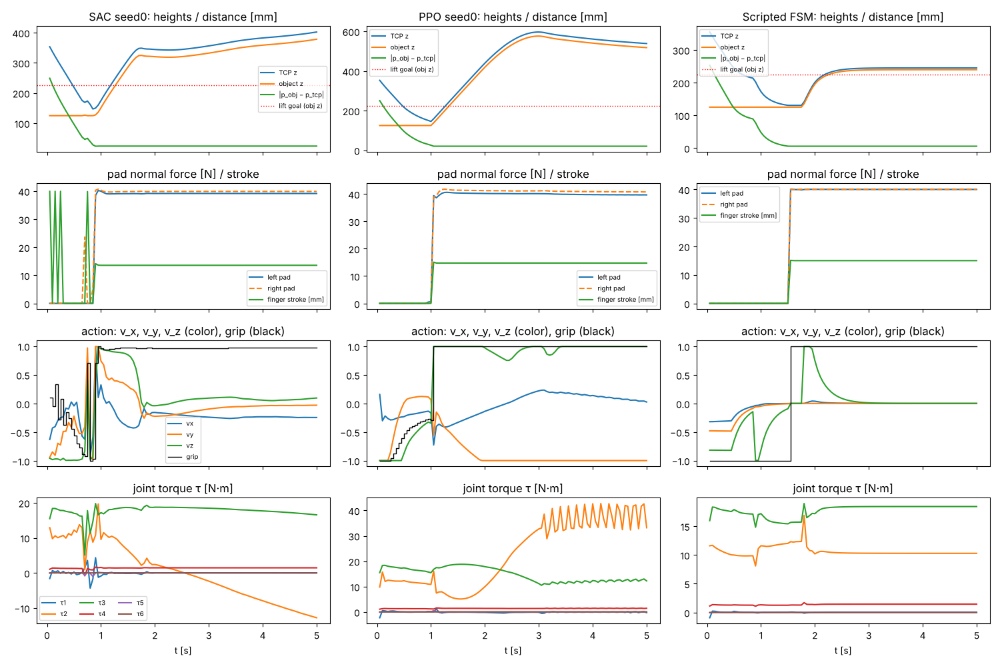
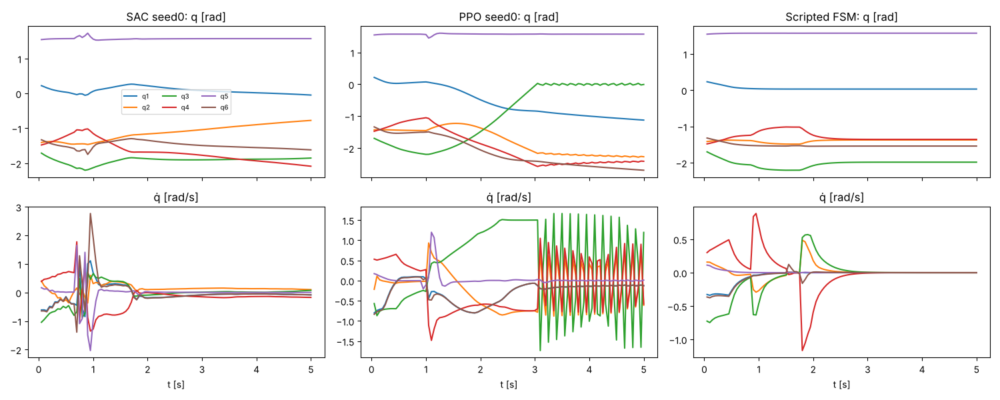
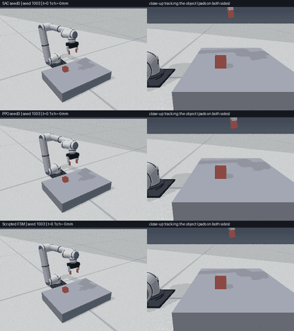

# T203 pick：夾爪抓取環境與 PPO/SAC 訓練（2026-11-24）

## 目的
Phase 3 第三項：把 T201/T202 的 reach 擴充為「抓起物件」——手臂＋T005 平行夾爪須移到桌上隨機位置的方塊、對中、閉合夾爪、
抬高 10 cm 並**保持到回合結束**。依 T202 的發現（成功即終止使「到達後」行為未受訓練），本環境成功不終止，以回合最後一步
仍抓住並維持高度作為成功判據。比較 SB3 PPO/SAC（各 2 個種子）與傳統教導式有限狀態機（FSM）基準，並驗證夾持物理
（法向力 ≈ 設定力、摩擦極限 F_min = mg/(2μ)）。

## 模型與參數
* 環境 `sixaxis/rlpick.py`：`PickEnv`（`gym.make("SixAxisPick-v0")`，需先 `import sixaxis.rlpick`）。
  PyBullet DIRECT，物理步長 2 ms、50 次求解迭代，策略 20 Hz（25 子步），回合 100 步 = 5 s。
* 機構：UR5 類手臂（T001）＋T005 平行夾爪（同一 multibody、私有暫存 URDF，可多行程平行）；工作台頂面 z = 0.10 m；
  方塊 50 mm、0.2 kg、μ_obj = 0.8（指墊 1.0，PyBullet 有效 μ = 0.8）；物件中心於 x ∈ [0.35, 0.60]、y ∈ [−0.20, 0.20] m 均勻隨機（yaw = 0）。
* 動作 4 維：TCP 線速度 v = a·0.3 m/s（工具朝下姿態保持 ω = 2·log(R_d Rᵀ)、阻尼最小平方 → 關節速度，|q̇| ≤ 1.5 rad/s 等比縮放）
  → q_ref 積分 → 計算力矩內環（含夾爪/手指 8 自由度 PyBullet 逆動力學，ω_n = 25 rad/s 臨界阻尼）；
  a₄ > 0 → 夾爪以力上限 F_grip = 40 N 閉合，否則張開。
* 觀測 30 維：p_tcp、ṗ_tcp、p_obj、p_obj − p_tcp、物件四元數、ṗ_obj、指開度、左右指墊接觸旗標、夾爪指令、q/π、抬升高度 h。
* 獎勵（分段 dense，依 robosuite Lift，Zhu et al. 2020）：
  r = (1 − tanh 10d) + 0.5·[grasped] + 2·[grasped]·min(h/0.10, 1) + 2·[success] − 0.01‖a_xyz‖² − 10·[碰撞] − 10·[掉落]；
  grasped = 兩指墊法向力皆 > 0.5 N 且夾爪指令閉合；success = grasped 且 h ≥ 0.10 m。
* 終止：手臂連桿 link1–6 撞地/撞台、物件掉出台面（z < 台面 − 3 cm）。成功**不**終止。
* 演算法（`sixaxis/rltrain.py` 加入 `task="pick"`）：SAC（lr 0.0003、batch 256、γ 0.98、
  緩衝 300,000、自動熵溫度、[256, 256]）與 PPO（n_steps 1024、batch 256、
  epochs 10、γ 0.98、GAE λ 0.95、clip 0.2、log σ₀ = −1、[256, 256]），
  種子 0/1；每組 1 核、wall-time 預算 35 分鐘；學習曲線評估集 = 物件種子 5000–5049（確定性）。
* 傳統基準 `ScriptedPickPolicy`：APPROACH（物件上方 8 cm）→ DESCEND（到物件中心）→ CLOSE（停住 6 步 = 0.3 s）→ LIFT（抬到 h = 12 cm），
  各段 resolved-rate 比例控制 v = 4(p_t − p)、|v| ≤ 0.3 m/s，讀真實物件位置（完美感知）。

## 可重現指令
```bash
PYTHONPATH=. python3 scripts/t203_train.py            # 4 組各 2100 s（SAC/PPO × 種子 0/1）
PYTHONPATH=. python3 scripts/t203_train.py --resume   # 由 models/<name>_last.zip 接續
PYTHONPATH=. python3 scripts/t203_report.py           # 評估＋圖＋動畫（4 行程，約 5 分鐘＋動畫）
PYTHONPATH=. python3 scripts/t203_write_md.py 261
ruff check . && python3 -m pytest -q
```

## 指令序列（每回合）
1. `reset(seed)`：重建方塊於隨機位置（清除接觸快取，相同種子＋動作逐位元重現）、手臂起點 = 工具朝下 TCP (0.45, 0, 0.32) 的 IK 解 ± 0.1 rad、夾爪全開。
2. 每 50 ms：策略輸出 (v_x, v_y, v_z, grip) → 25 個 2 ms 物理子步（計算力矩＋夾爪馬達）。
3. 量測 grasped／h／success／碰撞／掉落，跑滿 100 步；回合成功 = 最後一步 success。

## 量化結果

### 訓練
| 組態 | 總步數 | 時間 [min] | 步/s | 評估成功 ≥ 50 % 步數 | ≥ 90 % 步數 | 最佳評估成功（步數） | 最後評估成功 | 最佳模型 [MB] |
|---|---|---|---|---|---|---|---|---|
| SAC 種子 0 | 115,416 | 35.3 | 55 | 90,000 | 90,000 | 98 %（110,000 步） | 92 % | 3.20 |
| SAC 種子 1 | 110,000 | 35.0 | 52 | — | — | 0 %（110,000 步） | 0 % | 3.20 |
| PPO 種子 0 | 512,831 | 35.3 | 242 | 250,000 | 500,000 | 94 %（500,000 步） | 62 % | 1.74 |
| PPO 種子 1 | 493,261 | 35.3 | 233 | 250,000 | 250,000 | 98 %（400,000 步） | 86 % | 1.74 |

最佳模型（評估集成功率→回報字典序）：**SAC 種子 0**（`models/sac_pick_s0_best.zip`，記錄於 `models/T203_best.txt`）。



### 200 個測試物件位置（種子 1000–1199，確定性策略）
| 方法 | 回合成功 | 曾成功 | 曾夾住 | 碰撞 / 掉落 | 首次夾住 [s] | 首次成功 [s] | 成功 P95 [s] | 保持比例 | 重夾次數 | 末抬升 h [mm] | 回報 | 最大力矩使用率 |
|---|---|---|---|---|---|---|---|---|---|---|---|---|
| SAC 種子 0 | 94.0 % | 94.5 % | 98.5 % | 0.0 % / 1.5 % | 0.73 | 1.19 | 1.55 | 72.6 % | 0.23 | 212.3 | 402.0 | 1.00 |
| SAC 種子 1 | 0.0 % | 0.0 % | 85.0 % | 2.0 % / 0.0 % | 1.09 | — | — | 0.0 % | 0.01 | 6.6 | 105.6 | 1.00 |
| PPO 種子 0 | 96.0 % | 96.0 % | 98.5 % | 0.0 % / 1.0 % | 0.87 | 1.18 | 1.47 | 74.3 % | 0.01 | 364.8 | 413.1 | 0.97 |
| PPO 種子 1 | 93.0 % | 93.0 % | 96.5 % | 0.0 % / 4.5 % | 0.91 | 1.34 | 2.24 | 69.0 % | 0.07 | 395.1 | 388.7 | 1.00 |
| 腳本式 FSM 基準 | 100.0 % | 100.0 % | 100.0 % | 0.0 % / 0.0 % | 1.50 | 2.25 | 2.55 | 55.9 % | 0.00 | 114.7 | 351.5 | 0.52 |
| 隨機策略 | 0.0 % | 0.0 % | 1.0 % | 0.0 % / 0.0 % | 2.12 | — | — | 0.0 % | 0.03 | 0.0 | 2.2 | 1.00 |

同物件位置成功時間比（策略 / 腳本基準，兩者皆成功者）：

| 方法 | 平均時間比 | 比基準快的比例 |
|---|---|---|
| SAC 種子 0 | 0.529 | 99 % |
| SAC 種子 1 | — | — |
| PPO 種子 0 | 0.524 | 99 % |
| PPO 種子 1 | 0.593 | 95 % |




### 穩健性與泛化（各 100 回合；10 s 回合 50 回合）
| 方法 | 名目 | 起點擾動 ±0.3 rad | 1 kg 方塊 | 40×60×80 mm 長方塊 | 10 s 回合 | 10 s 回合 5–10 s 全程保持 | 5–10 s 高度標準差 [mm] |
|---|---|---|---|---|---|---|---|
| SAC 種子 0 | 94 % | 93 %（掉落 1 %） | 98 %（掉落 0 %） | 97 %（掉落 0 %） | 98 %（掉落 0 %） | 98 % | 43.88 |
| SAC 種子 1 | 0 % | 0 %（掉落 1 %） | 0 %（掉落 0 %） | 0 %（掉落 7 %） | 0 %（掉落 2 %） | 0 % | 0.88 |
| PPO 種子 0 | 96 % | 79 %（掉落 6 %） | 97 %（掉落 0 %） | 72 %（掉落 2 %） | 98 %（掉落 2 %） | 98 % | 9.94 |
| PPO 種子 1 | 93 % | 81 %（掉落 8 %） | 99 %（掉落 0 %） | 79 %（掉落 5 %） | 94 %（掉落 6 %） | 94 % | 25.60 |
| 腳本式 FSM 基準 | 100 % | 100 %（掉落 0 %） | 100 %（掉落 0 %） | 100 %（掉落 0 %） | 100 %（掉落 0 %） | 100 % | 0.00 |

### 夾持力–摩擦極限（腳本基準，各 10 回合）
理論：兩指 Coulomb 摩擦保持 2μF ≥ m(g + a) ⇒ F_min = mg/(2μ) = 1.226 N（m = 0.2 kg、μ = 0.8；T005）。

| F_grip / F_min | F_grip [N] | 成功 | 平均末抬升 h [mm] |
|---|---|---|---|
| 0.25 | 0.31 | 0 % | -0.0 |
| 0.50 | 0.61 | 0 % | -0.0 |
| 0.75 | 0.92 | 0 % | -0.0 |
| 0.90 | 1.10 | 0 % | -0.0 |
| 1.10 | 1.35 | 0 % | 73.5 |
| 1.25 | 1.53 | 0 % | 96.6 |
| 1.50 | 1.84 | 80 % | 104.6 |
| 2.00 | 2.45 | 100 % | 114.2 |
| 3.00 | 3.68 | 100 % | 114.7 |
| 5.00 | 6.13 | 100 % | 114.7 |

### 決策時間（每步，單核）
| 方法 | 策略 [ms] | P95 [ms] | 環境一步（25 子步）[ms] |
|---|---|---|---|
| SAC 種子 0 | 0.327 | 0.425 | 4.07 |
| SAC 種子 1 | 0.442 | 0.440 | 4.06 |
| PPO 種子 0 | 0.310 | 0.351 | 2.79 |
| PPO 種子 1 | 0.314 | 0.361 | 3.51 |
| 腳本式 FSM 基準 | 0.017 | 0.026 | 3.74 |

### 單回合曲線（種子 1003）



## 動畫
上至下：SAC 種子 0、另一演算法最佳種子、腳本基準；左為全景、右為沿 x 方向的近景側視（物件種子 1003、1011、1027）。



[MP4](../media/2026-11-24_T203.mp4)｜關鍵畫面：[開始](../media/2026-11-24_T203_key_start.png)、[夾取](../media/2026-11-24_T203_key_grasp.png)、[抬升](../media/2026-11-24_T203_key_lift.png)

## 觀察與分析
1. **三組學會 pick，一組卡在局部最優**：SAC 種子 0、PPO 種子 0/1 在 200 個測試位置回合成功 94.0 % / 96.0 % / 93.0 %、無碰撞；
   SAC 種子 1 在同樣 35 分鐘內「夾住率」達 85 %，但末抬升平均只有 6.6 mm、成功 0 %——停在「夾住不抬」的平台
   （每步可得 reach ≈ 1 ＋ grasp 0.5 的獎勵，抬升必須在保持閉合下同時往上，探索中未被發現）。同一超參數、只換種子即出現
   成功/失敗兩極，T202 單一種子的限制在 pick 上被放大；之後應以多種子＋中位數報告，或加入示範/課程（T204 以後）。
2. **比腳本基準快約一倍**：同物件位置首次成功時間比（策略/腳本）0.53（SAC s0）、0.52（PPO s0）、0.59（PPO s1），
   95–99 % 的位置比腳本快——策略邊下降邊對中、下降中即閉合，抬升時速度飽和；腳本基準則是逐段到位、停住 0.3 s 再閉合。
   代價：最大力矩使用率 RL 0.97–1.00（觸及 τ_max 飽和）vs 腳本 0.52；SAC s0 的夾爪在接近時開合抖動（平均重夾 0.23 次/回合），
   PPO 則幾乎一次閉合（0.015–0.07）。
3. **掉落仍存在**：RL 掉落 1.0–4.5 %（腳本 0 %），物件被推出台面或抬升中脫落（個別成因未逐一分析，留待 T205 失敗分類）。
4. **「過度抬升」與到達後漂移**：獎勵只要求 h ≥ 10 cm、對更高沒有懲罰，RL 末抬升 212–395 mm（腳本 115 mm）；
   10 s 回合中 5–10 s 仍抓住並高於 10 cm 的比例 98 / 98 / 94 %，但高度標準差 9.9–44 mm（腳本 0.0001 mm）——
   策略在成功後仍持續移動（例如 PPO s0 在單回合中 v_y 飽和在 −1、末段關節 2 力矩振盪）。不終止解決了 T202 的「跨門檻即停」，
   但「停住」本身仍需獎勵（T204 place 會以放置目標位姿約束）。
5. **泛化**：1 kg 方塊（訓練 0.2 kg）三組 97–99 %（40 N 夾持力仍 ≫ F_min(1 kg) = 6.1 N）；起點擾動 ±0.3 rad（訓練 ±0.1）
   SAC s0 93 %、PPO 79–81 %；未見過的 40×60×80 mm 長方塊 SAC s0 97 %、PPO 72–79 %——腳本基準皆 100 %（完美感知＋解析幾何）。
6. **夾持物理驗證**：腳本基準掃描 F_grip / F_min（F_min = mg/(2μ) = 1.226 N）：≤ 0.9 完全抬不起（h ≈ 0）、1.1–1.25 邊滑邊抬
   （末 h 74–97 mm，抬升起步時滑落而未達 10 cm）、1.5 → 80 %、≥ 2.0 → 100 %。量得抬升起步 TCP 鉛直加速度峰值 8.29 m/s²
   （2 ms 取樣、Savitzky–Golay 平滑），含慣性的極限 F/F_min ≥ 1 + a/g = 1.85，與 1.5–2.0 之間的成功轉折一致。
7. **訓練效率**：SAC 約 54 步/s（每步 1 次梯度更新），約 90 k 步達 ≥ 90 %；PPO 約 240 步/s，250 k（種子 1）/ 500 k（種子 0）步達 ≥ 90 %。
   PPO 種子 0 最後一次評估掉到 62 %（最佳 94 %），學習曲線非單調，因此以評估集最佳 checkpoint（`*_best.zip`）做測試。

## 問題與限制
* 只隨機化物件位置（yaw = 0、固定方塊尺寸與質量）；感知為真值（無相機/雜訊/延遲）；夾爪為二元指令（固定 40 N）。
* 獎勵未懲罰過度抬升與成功後的移動，策略會持續漂移並使用滿力矩；RL 掉落率 1–4.5 % 高於腳本基準。
* 訓練進行中修正了 `reset` 的決定性（改為每回合重建物件以清除接觸快取；原版在相同種子下末位差 ~3e-8）：
  訓練用的是舊版 reset，動力學相同；本報告所有評估與測試皆用新版。
* 每組單次 35 分鐘、各 2 個種子；SAC 種子 1 失敗顯示結果對種子敏感，成功率的種子間變異尚未充分量化。

## 結論
新增 `SixAxisPick-v0`（手臂＋平行夾爪＋工作台＋方塊，TCP 速度＋夾爪 4 維動作、分段 dense 獎勵、成功不終止）。
4 組 35 分鐘訓練中 3 組學會在隨機位置抓起並保持方塊（測試 93–96 %、無碰撞），首次成功時間約為腳本基準的 0.52–0.59 倍，
並泛化到 5 倍質量物件與未見過的長方塊（最佳 SAC 97–98 %）；1 組（SAC 種子 1）停在「夾住不抬」的局部最優。
夾持物理與 Coulomb 摩擦極限（含抬升慣性 1 + a/g）一致。T203 完成，下一步 T204 place / 完整 pick-and-place。


## 測試
`tests/test_rlpick.py` 12 項：`check_env`／`gym.make`、觀測與 FK 一致、決定性、零動作保持與姿態保持衰減 θ_n = θ₀(1 − k_RΔt)ⁿ、
TCP 速度追蹤、腳本基準成功、夾持法向力 ≈ F_grip 且抬升不滑、夾持力 < F_min 抬不起、物件掉落終止、隨機策略失敗、
`train(task="pick")` 短跑存檔、已存最佳 pick 模型在 20 個新位置 ≥ 80 % 成功且無碰撞。全套 **261 passed**、`ruff check` 通過。
