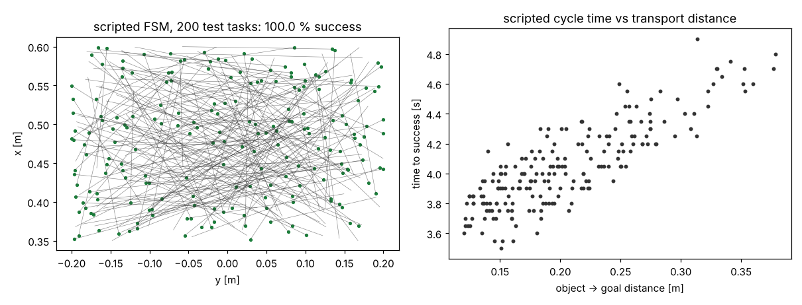
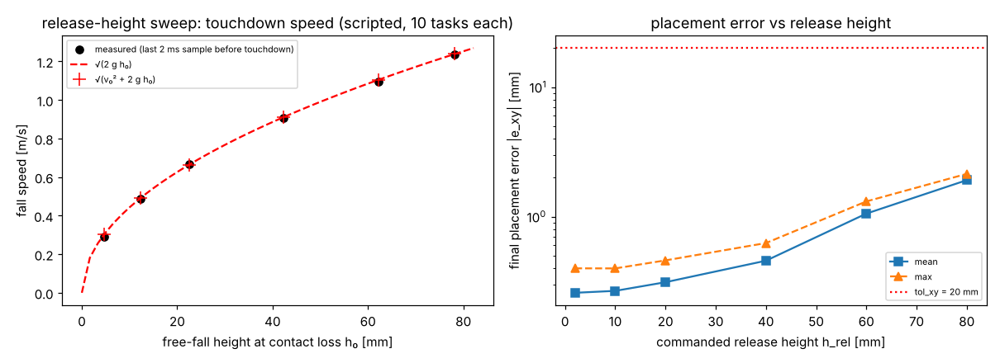
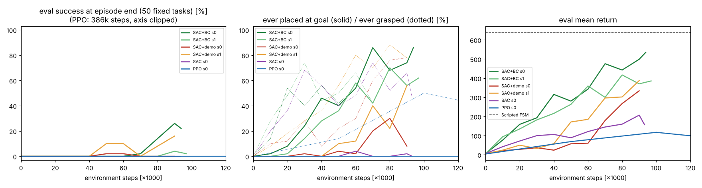
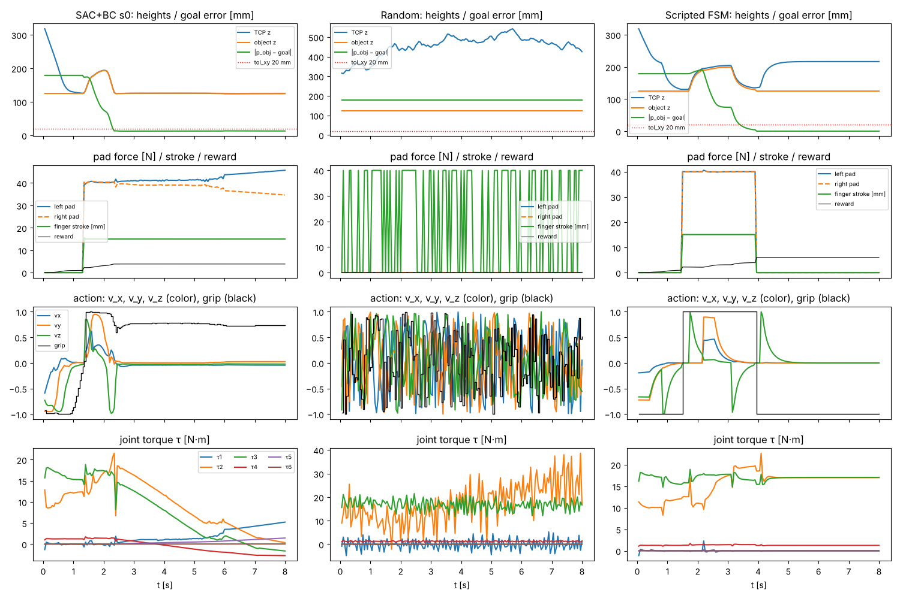
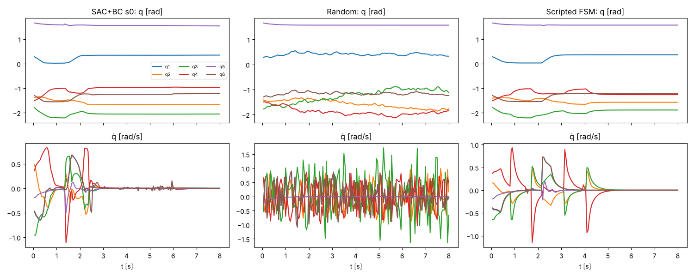
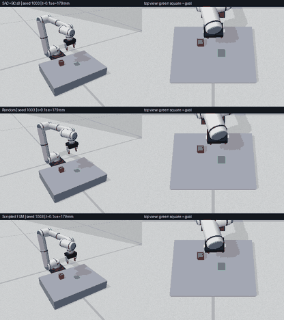

# T204 place／完整 pick-and-place：環境、示範學習與階段訓練結果（2026-11-25，**進行中**）

> 狀態：`[~]` 進行中。環境、腳本基準、物理驗證、示範學習機制與第一輪訓練（每組 ≈ 30–35 分鐘）已完成並推送；
> RL 尚未收斂（最佳評估集成功率 26 %），checkpoint 已存 `models/`，下次執行以 `--resume` 接續，
> 收斂後補上 200 組測試集比較、泛化與最終報告。

## 目的
Phase 3 第四項：把 T203 pick 延伸為完整取放——夾起桌上隨機位置的方塊、搬到隨機目標、放下、鬆爪退離，且物件須**靜置**在目標上
直到回合結束。這是目標條件化（goal-conditioned）的長視界任務（抓 → 抬 → 搬 → 放 → 鬆 五階段），稀疏成功只在最後一段出現，
因此另外研究以腳本示範加速學習（示範預填回放緩衝 vs 示範行為複製）。

## 模型與參數
* 環境 `sixaxis/rlplace.py`：`PlaceEnv(PickEnv)`（`gym.make("SixAxisPlace-v0")`，需先 `import sixaxis.rlplace`）。
  物理/控制同 T203：PyBullet 2 ms 子步、策略 20 Hz、4 維動作（TCP 線速度 ±0.3 m/s＋夾爪開閉，F_grip = 40 N）、8 自由度計算力矩內環；
  回合 160 步 = 8 s。方塊 50 mm／0.2 kg，起點 x ∈ [0.35, 0.60]、y ∈ [−0.20, 0.20] m；目標同區域均勻取樣且與起點距離 ≥ 0.12 m（綠色視覺標記、無碰撞）。
* 觀測 36 維：T203 的 30 維＋目標 g＋(p_obj − g)。
* 放置判據 at_goal：‖p_obj,xy − g_xy‖ < 20 mm、|z − z_rest| < 10 mm、傾角 < 10°；success = at_goal ∧ 夾爪張開 ∧ 兩指墊無接觸；
  成功不終止，回合成功 = 最後一步仍 success。
* 獎勵（分階段取最大值，robosuite PickPlace staged reward，Zhu et al. 2020）：
  r = 6（success）否則 max(1 − tanh 10d, [grasped](1.5 + 2.5(1 − tanh 5e)), 4.5·[at_goal ∧ ¬grasped]) − 0.01‖a_xyz‖² − 10[碰撞] − 10[掉落]，
  d = ‖p_obj − p_tcp‖、e = ‖p_obj − (g_xy, z_rest)‖。各階段上界 1 < 4 < 4.5 < 6 單調遞增 → 最佳策略為抓 → 搬 → 放 → 鬆 → 保持（測試驗證）。
* 腳本基準 `ScriptedPlacePolicy`：APPROACH → DESCEND → CLOSE(0.3 s) → LIFT(8 cm) → CARRY → LOWER（物件底離台 h_rel = 2 mm）→ OPEN(0.25 s) → RETREAT，
  各段 resolved-rate 比例控制 v = 4(p_t − p)、|v| ≤ 0.3 m/s，完美感知；搬運時補償夾持偏移。
* 示範：`collect_demos`——腳本基準＋動作高斯雜訊 σ = 0.15，只保留成功回合；每組 100 回合 = 16,000 筆轉移（收集 41 s）。
* 演算法（`sixaxis/rltrain.py` 加 `task="place"`、`demo_episodes`；新增 `sixaxis/sacbc.py`）：
  * **SAC 無示範**、**PPO 無示範**：同 T203 超參數（SAC lr 0.0003、batch 256、γ 0.98、緩衝 300,000、[256, 256]）。
  * **SAC＋示範預填緩衝**（DDPGfD 式，Vecerik et al. 2017）：示範直接放入回放緩衝、learning_starts = 0，與自身經驗均勻抽樣。
  * **SAC＋示範 Q-filter BC**（`SACBC`）：示範放在專屬緩衝，每梯度步另抽 64 筆與 256 筆自身經驗合併更新 critic；
    actor 損失 L = λ·L_SAC + E_D[1{Q(s,a_D) > Q(s,μ(s))}‖μ(s) − a_D‖²]，λ = 2.5/mean|Q|（Q-filter：Nair et al. 2018；尺度正規化：TD3+BC，Fujimoto & Gu 2021）。
* 訓練：每組 1 行程。前四組（SAC±示範預填、PPO）各 35 分鐘；SACBC 兩組在約 13 分鐘後加入、各 30 分鐘（期間 6 行程共用 4 核，步/s 因此較 T203 低）。
  學習曲線評估集 = 種子 5000–5049（50 組物件＋目標，確定性策略）。

## 可重現指令
```bash
PYTHONPATH=. python3 scripts/t204_train.py                                   # 前四組各 2100 s
PYTHONPATH=. python3 scripts/t204_train.py --budget 1800 sacbc_place_s0 sacbc_place_s1
PYTHONPATH=. python3 scripts/t204_train.py --resume sacbc_place_s0 ...       # 接續（示範重新收集）
PYTHONPATH=. python3 scripts/t204_report.py --interim                        # 本階段資料＋圖＋動畫（約 2 分鐘＋動畫）
PYTHONPATH=. python3 scripts/t204_write_md.py 277
ruff check . && python3 -m pytest -q
```

## 指令序列（每回合）
1. `reset(seed)`：取樣物件起點與目標（距離 ≥ 12 cm）、重建方塊、手臂於工具朝下 TCP (0.45, 0, 0.32) 的 IK 解 ±0.1 rad、夾爪全開。
2. 每 50 ms：策略輸出 (v_x, v_y, v_z, grip) → 25 個 2 ms 物理子步。
3. 量測 grasped／at_goal／released／success、碰撞、掉落；跑滿 160 步。

## 量化結果

### 1. 腳本基準與隨機策略（200 組測試任務，種子 1000–1199）
| 方法 | 回合成功 | 曾夾住 | 曾到目標 | 碰撞 / 掉落 / 傾倒 | 首次成功 [s]（P95） | 放置誤差 [mm]（P95） | 最大傾角 [°] | 保持比例 | 回報 | 最大力矩使用率 |
|---|---|---|---|---|---|---|---|---|---|---|
| 腳本式 FSM 基準 | 100.0 % | 100 % | 100 % | 0 % / 0 % / 0 % | 4.06（4.60） | 0.27（0.42） | 0.0031 | 49.9 % | 640 | 0.52 |
| 隨機策略 | 0.0 % | 1.0 % | 0 % | 0 % / 0.5 % / 0 % | — | —（中位誤差 194） | — | 0 % | 2.9 | 1.00 |

腳本基準穩健性（各 100 回合；15 s 回合 50 回合）：

| 條件 | 成功 | 首次成功 [s] | 放置誤差 [mm] |
|---|---|---|---|
| 15 s 回合 | 100 % | 4.04 | 0.26 |
| 起點擾動 ±0.3 rad | 100 % | 4.16 | 0.38 |
| 40×60×80 mm 長方塊 | 100 % | 4.04 | 0.31 |

決策時間：腳本 12 µs/步；環境一步（25 子步）2.52 ms（單核）。



### 2. 鬆爪落下高度掃描（腳本基準，各 10 回合）——自由落體驗證
理論：兩指失去接觸時刻物件離靜置高度 h₀、鉛直速度 v₀，之後只受重力，著地前速度 v = √(v₀² + 2 g h₀)。
量測以 2 ms 子步記錄物件 z、v_z 與兩指接觸力；「量得」= 著地前最後一個樣本的下降速度，故理論上比真實著地速度小 0～gΔt = 0.0196 m/s。

| h_rel 指令 [mm] | 量得 h₀ [mm] | v₀ [m/s] | 量得 v [m/s] | 理論 v [m/s] | 最大 \|差\| [m/s] | 放置誤差 平均/最大 [mm] | 傾角 [°] | 成功 |
|---|---|---|---|---|---|---|---|---|
| 2 | 4.7 | 0.0177 | 0.292 | 0.303 | 0.0123 | 0.26 / 0.40 | 0.0022 | 100 % |
| 10 | 12.4 | 0.0179 | 0.489 | 0.493 | 0.0050 | 0.27 / 0.40 | 0.0015 | 100 % |
| 20 | 22.5 | 0.0178 | 0.665 | 0.664 | 0.0018 | 0.31 / 0.46 | 0.0012 | 100 % |
| 40 | 42.3 | 0.0179 | 0.907 | 0.912 | 0.0115 | 0.46 / 0.63 | 0.0016 | 100 % |
| 60 | 62.2 | 0.0179 | 1.097 | 1.105 | 0.0090 | 1.06 / 1.31 | 0.0019 | 100 % |
| 80 | 78.2 | 0.0209 | 1.237 | 1.239 | 0.0029 | 1.91 / 2.14 | 0.0011 | 100 % |

* 所有高度的量得–理論差 ≤ 0.0123 m/s < gΔt，與離散取樣誤差一致；張開指令後第一個 2 ms 子步內兩指即失去接觸（T005 位置馬達立即退開）。
* 放置誤差隨落下高度增加（0.26 → 1.91 mm），但 8 cm 落下仍遠小於 20 mm 容差且不傾倒：50 mm 方塊、μ = 0.8 的台面在此速度下不會翻倒或彈跳。



### 3. 訓練（第一輪）
| 組態 | 總步數 | 時間 [min] | 步/s | 最佳評估成功（步數） | 最後評估成功 | 曾到目標（最高） | 曾夾住（最高） |
|---|---|---|---|---|---|---|---|
| SAC＋示範 Q-filter BC 種子 0 | 93,824 | 30.5 | 51 | 26 %（90,000 步） | 22 % | 86 % | 86 % |
| SAC＋示範 Q-filter BC 種子 1 | 96,966 | 30.4 | 53 | 4 %（90,000 步） | 2 % | 70 % | 74 % |
| SAC＋示範預填緩衝 種子 0 | 90,000 | 35.2 | 43 | 2 %（60,000 步） | 0 % | 30 % | 78 % |
| SAC＋示範預填緩衝 種子 1 | 90,000 | 35.4 | 42 | 16 %（90,000 步） | 16 % | 56 % | 88 % |
| SAC 無示範 種子 0 | 93,108 | 35.8 | 43 | 0 %（90,000 步） | 0 % | 4 % | 74 % |
| PPO 無示範 種子 0 | 386,353 | 35.8 | 180 | 2 %（250,000 步） | 0 % | 2 % | 62 % |



### 4. 各組目前最佳模型（評估集 50 組，確定性）
| 方法 | 回合成功 | 曾成功 | 曾夾住 | 曾到目標 | 碰撞 / 掉落 / 傾倒 | 首次成功 [s] | 成功者放置誤差 [mm] | 回報 | 最大力矩使用率 |
|---|---|---|---|---|---|---|---|---|---|
| SAC＋示範 Q-filter BC 種子 0 | 26 % | 26 % | 74 % | 74 % | 0 % / 0 % / 0 % | 2.05 | 7.1 | 499 | 0.69 |
| SAC＋示範 Q-filter BC 種子 1 | 4 % | 4 % | 56 % | 56 % | 0 % / 0 % / 0 % | 2.48 | 4.3 | 370 | 0.56 |
| SAC＋示範預填緩衝 種子 0 | 2 % | 2 % | 30 % | 2 % | 0 % / 0 % / 0 % | 2.15 | 19.6 | 60 | 1.00 |
| SAC＋示範預填緩衝 種子 1 | 16 % | 40 % | 78 % | 56 % | 0 % / 2 % / 10 % | 1.96 | 13.5 | 387 | 1.00 |
| SAC 無示範 種子 0 | 0 % | 2 % | 66 % | 2 % | 6 % / 6 % / 32 % | 4.55 | — | 207 | 1.00 |
| PPO 無示範 種子 0 | 2 % | 2 % | 62 % | 2 % | 6 % / 4 % / 34 % | 2.60 | 14.1 | 178 | 1.00 |
| 腳本式 FSM 基準 | 100 % | 100 % | 100 % | 100 % | 0 % / 0 % / 0 % | 4.05 | 0.2 | 640 | 0.51 |

### 單回合曲線（種子 1003；左：SAC＋示範 Q-filter BC 種子 0、中：隨機、右：腳本）



## 動畫
上至下：SAC＋示範 Q-filter BC 種子 0（目前最佳）、隨機策略、腳本基準；左為全景、右為俯視（綠色方塊為目標），任務種子 1003、1011。



[MP4](../media/2026-11-25_T204.mp4)｜關鍵畫面：[開始](../media/2026-11-25_T204_key_start.png)、[搬運](../media/2026-11-25_T204_key_carry.png)、[放置](../media/2026-11-25_T204_key_placed.png)

## 觀察與問題
* **長視界＋階段性**使無示範方法停在中間階段：SAC 無示範與 PPO 學會夾住（曾夾住最高 74 %／62 %），
  但幾乎從未把物件搬到目標（4 %／2 %）——與 T203 只需抓＋抬（9 萬步達 90 %）相比，難度明顯提高。
* **示範很有效，且 BC 損失比單純預填更有效**：SAC＋Q-filter BC 種子 0 在 7 萬步時 86 % 回合把物件放到目標，回報為無示範 SAC 的 2.4 倍；
  預填緩衝的兩個種子差異大（種子 1 到目標 56 %、種子 0 只有 30 %）。Q-filter 啟用比例在訓練後段約 19–30 %（只有示範動作的 Q 值較高時才模仿）。
* **目前瓶頸是「鬆爪退離」**：最佳模型 74 % 回合到目標但只有 26 % 完成鬆爪；成功的回合首次成功只要 2.05 s（腳本 4.05 s），
  且一旦成功即保持到結束（曾成功 = 回合成功）。到目標但仍夾著的獎勵上界 4 與鬆開過渡 4.5 差距小，鬆爪的信用分配訊號弱。
* RL 放置誤差（成功者 7.1 mm）比腳本（0.25 mm）大一個數量級：獎勵對 20 mm 內的誤差不敏感（tanh 5e 在 e→0 的斜率有限）。
* 限制：物件姿態固定（yaw = 0）、完美感知、二元夾爪、單一物件；6 行程共用 4 核使 SACBC 的 wall-time 對比不完全公平（以步數比較為準）；
  SAC 續訓時回放緩衝不存檔（> 50 MB），只重新收集示範。

## 下一步（下次執行）
1. `--resume` 接續 SACBC 兩組與 SAC＋示範預填種子 1（各 ≈ 35 分鐘），觀察鬆爪階段是否收斂；若仍停滯，考慮加大放置階段獎勵差（例如 r_rel 提高、到目標但仍夾住時下調）並重新訓練。
2. 收斂後以 200 組測試任務比較 RL vs 腳本（成功率、週期時間、放置誤差、力矩），並做起點擾動、長回合保持、未見物件泛化，產生最終報告與 `models/T204_best.txt`。

## 測試
`tests/test_rlplace.py` 11 項：`check_env`／`gym.make`、目標取樣（距離 ≥ d_min、範圍、觀測一致）、決定性、腳本基準成功（誤差 < 5 mm、傾角 < 1°、階段時序）、
分階段獎勵單調（抓前 ≤ 1、搬運 ∈ [1.5, 4]、成功 = 6 並保持）、放到目標不鬆爪不算成功、未搬運不算成功、隨機策略失敗、示範收集、
`train(task="place", demo_episodes=1)` 短跑；`test_trained_place_model` 待 `models/T204_best.txt` 產生後啟用。
`tests/test_rltrain.py` 已存模型載入測試涵蓋 place 模型（含 SACBC）。全套 **277 passed**、`ruff check` 通過。
