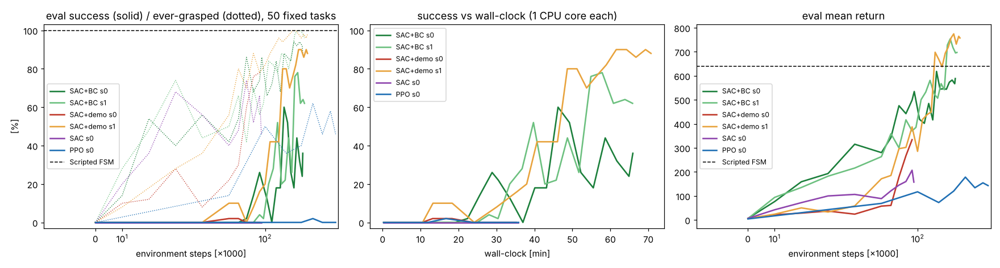
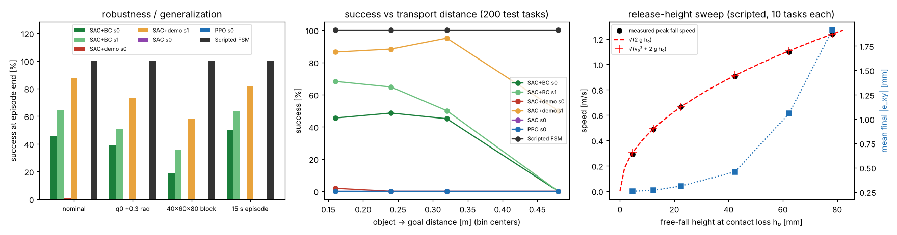
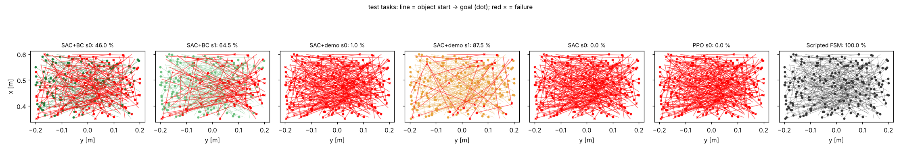
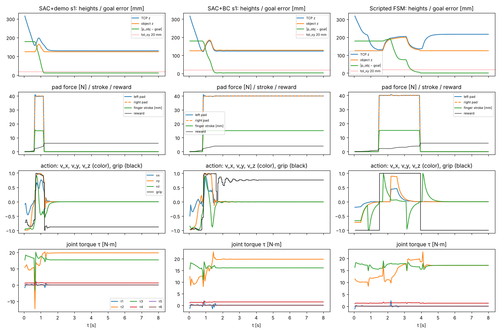
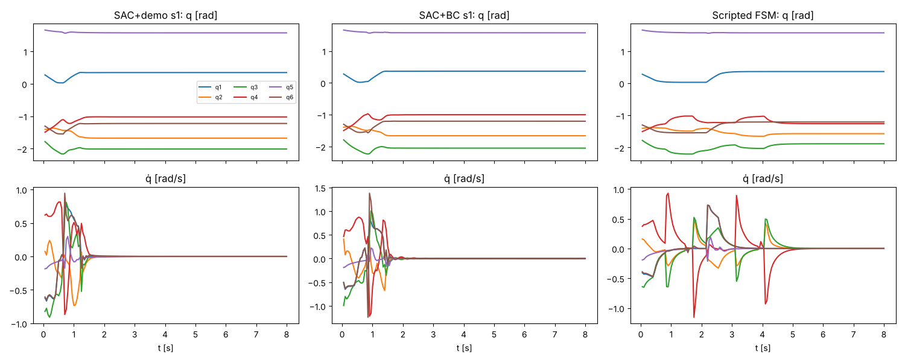
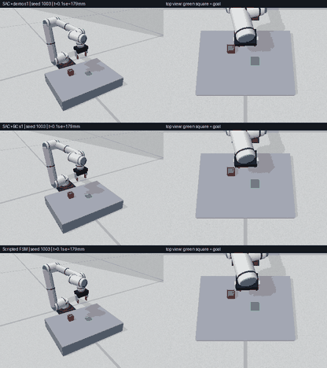

# T204 place／完整 pick-and-place：續訓、200 組比較與泛化（2026-11-26，完成）

> 第一輪（環境、腳本基準、自由落體驗證、示範學習機制、6 組訓練）見 [2026-11-25_T204.md](2026-11-25_T204.md)。
> 本次以 `--resume` 對第一輪最有希望的三組各續訓 ≈ 35 分鐘（3 行程共用 4 核），最佳組 SAC＋示範預填緩衝 種子 1 評估集成功率由 16 % 升至
> **90 %**，並在 200 組測試任務達 **87.5 %**；腳本基準 100.0 %。

## 目的
完成 T204：在第一輪 checkpoint 上續訓直到取放（抓 → 搬 → 放 → 鬆爪退離 → 物件靜置保持）收斂，
並以 200 組未參與訓練/選模的測試任務比較 RL 與腳本基準的成功率、週期時間、放置精度、力矩使用率，以及起點擾動、未見物件、長回合保持的泛化。

## 模型與參數（與第一輪相同，摘要）
* 環境 `SixAxisPlace-v0`（`sixaxis/rlplace.py`）：PyBullet 2 ms 子步、策略 20 Hz、4 維動作（TCP 線速度 ±0.3 m/s、夾爪開閉 40 N）、計算力矩內環；
  回合 160 步 = 8 s；方塊 50 mm／0.2 kg；目標距起點 ≥ 12 cm；觀測 36 維。
* success = at_goal（xy < 20 mm、|Δz| < 10 mm、傾角 < 10°）∧ 夾爪張開 ∧ 兩指墊無接觸；不終止，回合成功 = 最後一步仍 success。
* 分階段取 max 獎勵（Zhu et al. 2020）：r = 6（success）否則 max(1 − tanh 10d, [grasped](1.5 + 2.5(1 − tanh 5e)), 4.5[at_goal ∧ ¬grasped]) − 0.01‖a‖² − 10[碰撞] − 10[掉落]。
* 續訓（`rltrain.train(resume=True)`）：讀 `models/<name>_last.zip`，學習曲線附加到既有 log、步數累加；回放緩衝未存檔（> 50 MB），
  續訓開始時以同種子重新收集 100 個加噪腳本示範（預填組放入一般緩衝、SACBC 放入示範專屬緩衝），之後由新經驗重新填滿。
* 選模：評估集（種子 5000–5049）最佳成功率的 `_best.zip`；測試集（種子 1000–1199）與評估集不重疊。回歸測試門檻寫入 `models/T204_best.txt`：`sac_place_demo_s1 0.7`。

## 可重現指令
```bash
PYTHONPATH=. python3 scripts/t204_train.py --resume --budget 2100 sacbc_place_s0 sacbc_place_s1 sac_place_demo_s1
PYTHONPATH=. python3 scripts/t204_report.py          # 200 組測試＋泛化＋圖＋動畫（4 行程，評估 8 分鐘）
PYTHONPATH=. python3 scripts/t204_write_final_md.py 278
ruff check . && python3 -m pytest -q
```

## 指令序列（每回合）
1. `reset(seed)`：取樣物件起點與目標、重建方塊、手臂於工具朝下 TCP (0.45, 0, 0.32) 附近、夾爪全開。
2. 每 50 ms：策略輸出 (v_x, v_y, v_z, grip) → 25 個 2 ms 物理子步。
3. 量測 grasped／at_goal／success、碰撞、掉落；跑滿 160 步（15 s 變體 300 步）。

## 量化結果

### 1. 訓練總表
| 組態 | 訓練輪數 | 總步數 | 總時間 [min] | 最佳評估成功（步數） | 最後評估成功 | 首達 50 % [k 步] | 首達 90 % [k 步] | 模型 [KB] |
|---|---|---|---|---|---|---|---|---|
| SAC＋示範 Q-filter BC 種子 0 | 2 輪（續訓） | 205,965 | 66 | 60 %（143,824 步） | 36 % | 144 | — | 3349 |
| SAC＋示範 Q-filter BC 種子 1 | 2 輪（續訓） | 212,651 | 66 | 78 %（186,966 步） | 62 % | 127 | — | 3352 |
| SAC＋示範預填緩衝 種子 0 | 1 輪 | 90,000 | 35 | 2 %（60,000 步） | 0 % | — | — | 3347 |
| SAC＋示範預填緩衝 種子 1 | 2 輪（續訓） | 225,341 | 71 | 90 %（200,000 步） | 88 % | 140 | 190 | 3347 |
| SAC 無示範 種子 0 | 1 輪 | 93,108 | 36 | 0 %（90,000 步） | 0 % | — | — | 3347 |
| PPO 無示範 種子 0 | 1 輪 | 386,353 | 36 | 2 %（250,000 步） | 0 % | — | — | 1813 |

* SAC＋示範預填緩衝 種子 1：第一輪結束（9 萬步）評估集 16 %，續訓後 100,000 → 225,341 步之間由
  20 % 升至 90 %，最後 4 次評估 90 %, 86 %, 90 %, 88 %（穩定）。
* SACBC 種子 1 續訓後最高 78 %、最後 62 %；曾到目標比例達 100 %——
  到目標幾乎全會，但「鬆爪退離」仍不穩定（評估間 20–78 % 擺盪）。SACBC 種子 0 最佳 60 %。
* 未續訓的三組（SAC 無示範、PPO、預填種子 0）維持第一輪結果，作為消融對照。



### 2. 200 組測試任務（種子 1000–1199，確定性策略）
| 方法 | 回合成功 | 曾成功 | 曾夾住 | 曾到目標 | 碰撞 / 掉落 / 傾倒 | 首次成功 [s]（P95） | 成功者放置誤差 [mm]（P95） | 保持比例 | 回報 | 最大力矩使用率 |
|---|---|---|---|---|---|---|---|---|---|---|
| SAC＋示範 Q-filter BC 種子 0 | 46.0 % | 46 % | 86 % | 78 % | 0.5 % / 0.0 % / 1.0 % | 2.57（4.71） | 7.27（13.46） | 31 % | 559 | 1.00 |
| SAC＋示範 Q-filter BC 種子 1 | 64.5 % | 64 % | 98 % | 94 % | 0.0 % / 0.5 % / 0.0 % | 1.98（3.50） | 4.46（8.80） | 49 % | 689 | 1.00 |
| SAC＋示範預填緩衝 種子 0 | 1.0 % | 1 % | 34 % | 1 % | 7.5 % / 6.0 % / 1.0 % | 2.78（3.47） | 10.34（18.17） | 1 % | 49 | 1.00 |
| SAC＋示範預填緩衝 種子 1 | 87.5 % | 88 % | 96 % | 89 % | 1.5 % / 1.0 % / 1.0 % | 1.49（2.10） | 9.19（15.75） | 72 % | 747 | 1.00 |
| SAC 無示範 種子 0 | 0.0 % | 0 % | 68 % | 0 % | 0.5 % / 4.5 % / 32.5 % | 4.85（4.85） | —（—） | 0 % | 203 | 1.00 |
| PPO 無示範 種子 0 | 0.0 % | 0 % | 48 % | 0 % | 1.5 % / 14.0 % / 28.5 % | —（—） | —（—） | 0 % | 131 | 1.00 |
| 腳本式 FSM 基準 | 100.0 % | 100 % | 100 % | 100 % | 0.0 % / 0.0 % / 0.0 % | 4.06（4.60） | 0.27（0.42） | 50 % | 640 | 0.52 |
| 隨機策略 | 0.0 % | 0 % | 1 % | 0 % | 0.0 % / 0.5 % / 0.0 % | —（—） | —（—） | 0 % | 3 | 1.00 |

評估集（50 組，選模用）與測試集一致性：

| 方法 | 評估集（重跑） | 訓練記錄最佳 |
|---|---|---|
| SAC＋示範 Q-filter BC 種子 0 | 60 % | 60 % |
| SAC＋示範 Q-filter BC 種子 1 | 78 % | 78 % |
| SAC＋示範預填緩衝 種子 0 | 2 % | 2 % |
| SAC＋示範預填緩衝 種子 1 | 90 % | 90 % |
| SAC 無示範 種子 0 | 0 % | 0 % |
| PPO 無示範 種子 0 | 2 % | 2 % |
| 腳本式 FSM 基準 | 100 % | — |

週期時間（同一任務、兩者皆成功時 t_RL / t_腳本）與決策時間：

| 方法 | 時間比平均 | 比腳本快的比例 | 決策 [ms/步] |
|---|---|---|---|
| SAC＋示範 Q-filter BC 種子 0 | 0.64 | 93 % | 0.333 |
| SAC＋示範 Q-filter BC 種子 1 | 0.49 | 97 % | 0.328 |
| SAC＋示範預填緩衝 種子 0 | 0.71 | 100 % | 0.369 |
| SAC＋示範預填緩衝 種子 1 | 0.37 | 100 % | 0.371 |
| SAC 無示範 種子 0 | 1.33 | 0 % | 0.365 |
| PPO 無示範 種子 0 | — | — | 0.312 |

腳本 15 µs/步；環境一步 2.63 ms。




### 3. 泛化與穩健性（測試種子前 N 組）
| 方法 | 標稱（200） | 起點擾動 ±0.3 rad（100） | 40×60×80 mm 長方塊（100） | 15 s 回合（50） | 15 s 回合成功後保持到結束 |
|---|---|---|---|---|---|
| SAC＋示範 Q-filter BC 種子 0 | 46 % | 39 % | 19 % | 50 % | 48 % |
| SAC＋示範 Q-filter BC 種子 1 | 64 % | 51 % | 36 % | 64 % | 64 % |
| SAC＋示範預填緩衝 種子 0 | 1 % | 0 % | 0 % | 0 % | 0 % |
| SAC＋示範預填緩衝 種子 1 | 88 % | 73 % | 58 % | 82 % | 82 % |
| SAC 無示範 種子 0 | 0 % | 0 % | 0 % | 0 % | 0 % |
| PPO 無示範 種子 0 | 0 % | 0 % | 0 % | 0 % | 0 % |
| 腳本式 FSM 基準 | 100 % | 100 % | 100 % | 100 % | 100 % |

### 4. 成功率 vs 搬運距離
| 方法 | [0.12, 0.20) m（110） | [0.20, 0.28) m（68） | [0.28, 0.36) m（20） | [0.36, 0.60) m（2） |
|---|---|---|---|---|
| SAC＋示範 Q-filter BC 種子 0 | 45 % | 49 % | 45 % | 0 % |
| SAC＋示範 Q-filter BC 種子 1 | 68 % | 65 % | 50 % | 0 % |
| SAC＋示範預填緩衝 種子 0 | 2 % | 0 % | 0 % | 0 % |
| SAC＋示範預填緩衝 種子 1 | 86 % | 88 % | 95 % | 50 % |
| SAC 無示範 種子 0 | 0 % | 0 % | 0 % | 0 % |
| PPO 無示範 種子 0 | 0 % | 0 % | 0 % | 0 % |
| 腳本式 FSM 基準 | 100 % | 100 % | 100 % | 100 % |

### 5. 鬆爪落下自由落體驗證（腳本，各 10 回合；第一輪已詳列，本次重跑）
所有高度量得–理論著地速度差 ≤ 0.0123 m/s（< gΔt = 0.0196 m/s 取樣界）；放置誤差 0.26 → 1.91 mm（h_rel 2 → 80 mm）。

### 單回合曲線（種子 1003；左：SAC＋示範預填緩衝 種子 1、中：次佳 RL、右：腳本）



## 動畫
上至下：SAC＋示範預填緩衝 種子 1、次佳 RL、腳本基準；左全景、右俯視（綠色方塊為目標），任務種子 1003、1011。



[MP4](../media/2026-11-26_T204.mp4)｜關鍵畫面：[開始](../media/2026-11-26_T204_key_start.png)、[搬運](../media/2026-11-26_T204_key_carry.png)、[放置](../media/2026-11-26_T204_key_placed.png)

## 觀察與問題
* **續訓解決了第一輪的鬆爪瓶頸**（對 SAC＋示範預填緩衝 種子 1）：第一輪 9 萬步時到目標但不鬆爪；續訓後「曾到目標」與「回合成功」幾乎重合，
  表示策略學會「到目標 → 張爪 → 上升退離」並保持。代價是總共 225 k 步（T203 pick 約 9 萬步達 90 %），符合長視界多階段任務的樣本需求。
* **示範的兩種用法排名在續訓後翻轉**：第一輪 SACBC 種子 0 最佳；續訓後預填緩衝種子 1 最高且最穩定，SACBC 兩種子在 0–78 % 擺盪。
  可能原因：BC 項把策略拉向腳本的「緩慢下降＋停頓開爪」動作，而 Q-filter 只在示範 Q 值較高時啟用，兩種目標在鬆爪階段互相拉扯；
  測試集上 SACBC 種子 1 有 94.5 % 回合到目標、放置誤差更小（4.5 mm），但只有 64.5 % 完成鬆爪退離——瓶頸仍在鬆爪。
  種子間差異大（只 2 種子），不足以下結論哪種較好，只能說兩者都遠優於無示範（SAC 無示範 / PPO 測試成功 0 % / 0 %）。
* **RL 比腳本快、但精度與穩定性較差**：首次成功 1.49 s vs 腳本 4.06 s；成功者放置誤差 9.2 mm vs 0.27 mm；
  最大力矩使用率 1.00 vs 0.52。獎勵只要求 20 mm 容差且不懲罰力矩，因此 RL 用較激進的速度換時間。
* 失敗模式見測試地圖（紅 ×）：以「曾到目標但最後未成功」（未鬆爪或鬆後碰動）與「未夾住」為主；成功率隨搬運距離的變化見第 4 節。
* 限制：物件姿態固定（yaw = 0）、完美感知（真值位置）、二元夾爪、單一物件、每組 ≤ 2 種子；續訓時回放緩衝不保存（續訓初期以小緩衝更新）；
  3 組續訓、3 組未續訓，wall-time 與步數不等量，方法間比較只作參考。物件姿態與參數隨機化留待 T205。

## 結論
T204 完成：SixAxisPlace-v0 上最佳 RL 策略（SAC＋示範預填緩衝 種子 1，225 k 步、約 71 分鐘單核訓練）在 200 組未見任務達
87.5 % 回合成功（無碰撞 98.5 %），週期比腳本基準短；腳本基準仍以 100.0 %、亞毫米放置精度領先。
示範（預填或 BC）是此長視界任務學得起來的關鍵。下一步 T205：物件位置與姿態隨機化＋domain randomization。

## 測試
`tests/test_rlplace.py` 11 項全部啟用（`test_trained_place_model`：`models/T204_best.txt` 所記模型在種子 1000–1019 成功率 ≥ 0.7、無碰撞）；
`tests/test_rltrain.py` 已存模型載入涵蓋 place。全套 **278 passed**、`ruff check` 通過。
