# T205 隨機化物件位置與姿態＋domain randomization（階段報告，第一輪訓練）

日期：2026-11-27　狀態：**進行中 [~]**（環境、基準、夾持幾何驗證與第一輪訓練完成；訓練未收斂，下次續訓後出最終報告）

## 1. 目的
T204 的取放任務物件只有位置隨機、姿態固定（yaw = 0）且物理參數固定。T205 將其擴充為：
1. **物件姿態隨機**：長方塊初始 yaw ~ U[−90°, 90°)，且長邊可大於夾爪開口（80 mm），必須先把夾爪轉到物件短邊方向才能抓；
2. **夾爪方位動作**：動作由 4 維擴為 5 維（TCP 速度＋繞 z 轉速 ψ̇＋夾爪）；
3. **Domain randomization**：每回合隨機物件尺寸/質量/摩擦、夾持力、關節伺服頻寬，並對物件位姿觀測加雜訊；
4. 以腳本基準（含/不含方位對齊）、夾持幾何理論與 RL（SAC＋示範、SACBC、有/無 DR）比較。

## 2. 模型與參數
* 環境 `sixaxis/rlrand.py`：`RandPlaceEnv(PlaceEnv)`，`gym.make("SixAxisRandPlace-v0")`（需先 `import sixaxis.rlrand`）。
  場景、計算力矩內環、獎勵階段與成功判定同 T204（`sixaxis/rlplace.py`），每回合 160 步（8 s）、成功不終止。
* **方位控制**：R_d(ψ) = R_z(ψ)·R_DOWN，ψ_ref ← clip(ψ_ref + a₃·ω_ψ·Δt, ±(π/2 + 0.35))，ω_ψ = 1.5 rad/s；
  ω = k_R·log(R_d Rᵀ) + ψ̇ ẑ（k_R = 2），DLS 解關節速度 → q_ref → 計算力矩。
* **觀測 42 維**：T204 36 維（物件位置/四元數為含雜訊估測）＋ cos 2Δ, sin 2Δ（Δ＝物件短邊軸與指軸相對 yaw，2Δ 消除 180° 對稱）
  ＋ 尺寸 (L, w, h)/0.1 ＋ ψ_ref/π。
* **獎勵**：T204 分階段 max 獎勵，接近項乘以方位對齊倍率 0.6 + 0.4 cos²Δ（`PlaceEnv._reach_scale` 掛鉤，T204 為 1）。
* **Domain randomization**（Tobin et al. 2017；Peng et al. 2018 動力學隨機化），每回合均勻抽樣：

| 參數 | 範圍 | 200 組測試實際 min / mean / max |
|---|---|---|
| 短邊 w | 35–55 mm | 35.0 / 45.4 / 55.0 mm |
| 長邊 L | max(w, 50)–100 mm | 50.6 / 74.4 / 99.9 mm（L > 80 mm 佔 36 %） |
| 高 h | 45–60 mm | 45.1 / 52.7 / 59.9 mm |
| 質量 m | 0.1–0.4 kg | 0.102 / 0.246 / 0.400 kg |
| 物件摩擦 μ_obj | 0.5–1.0 | 0.50 / 0.76 / 1.00 |
| 夾持力 F_grip | 30–50 N | 30.0 / 39.9 / 49.9 N |
| 伺服頻寬 ω_n（K_p = ω_n²、K_d = 2ω_n） | 20–30 rad/s | 20.2 / 25.1 / 29.9 |
| 初始 yaw | −90°–90° | 需轉夾爪 |Δ₀| > 45° 佔 52 % |
| 觀測雜訊 | 物件位置 σ = 2 mm、yaw σ = 2°（每步獨立） | 獎勵/成功一律用真值 |

  無 DR（`dr=False`）：只隨機位置與 yaw，物件固定為 70×45×50 mm、0.2 kg、μ 0.8，無觀測雜訊。
* **腳本基準** `ScriptedRandPlacePolicy`：T204 八段 FSM 加上方位對齊（APPROACH 期間 ψ̇ = k_ψ Δ，k_ψ = 4，|Δ| < 4° 才下降），
  讀與 RL 相同的含雜訊物件估測（一階低通 α = 0.5）；「不轉夾爪」版本 k_ψ = 0。
* **夾持幾何**：全寬夾爪需跨越長方形投影寬度 w_eff(Δ) = w|cosΔ| + L|sinΔ|；本夾爪指墊寬 b = 20 mm，
  只掃過寬 b 的帶狀區，需跨越的是帶內物件長度 `strip_extent`（線性規劃的角點解：s_c = (L/2)cosΔ − (w/2)sinΔ
  夾到 ±b/2，t_max = min((L/2 − s_c cosΔ)/sinΔ, (w/2 + s_c sinΔ)/cosΔ)，全長 2t_max；推導見 `rlrand.strip_extent` 註解，
  並以 40 萬點蒙地卡羅驗證於 `tests/test_rlrand.py`）。指墊不碰物件頂面即可下降的條件 strip_extent ≤ 80 mm。
* 訓練（`scripts/t205_train.py`，4 組各 1 核平行、2100 s 預算）：SAC（lr 3e-4、batch 256、γ 0.98、
  緩衝 300,000、網路 256×256）＋ 100 個加噪（σ 0.15）腳本示範成功回合預填；SACBC＝示範專屬緩衝＋Q-filter BC（T204）。

## 3. 可重現指令
```bash
python3 -m pytest -q tests/test_rlrand.py
PYTHONPATH=. python3 scripts/t205_train.py               # 4 組 × 2100 s（4 核）
PYTHONPATH=. python3 scripts/t205_report.py --interim    # 評估、圖、動畫 → docs/test-reports/data/2026-11-27_T205_metrics.json
PYTHONPATH=. python3 scripts/t205_write_md.py 293
```

## 4. 指令序列（腳本基準一回合）
APPROACH（物件上方 8 cm＋轉夾爪 ψ̇ = 4Δ）→ DESCEND（|Δ| < 4°，TCP 到物件中心，指墊下緣 ≥ 台面 + 4 mm）→ CLOSE（6 步）
→ LIFT（8 cm）→ CARRY（目標上方）→ LOWER（離台面 2 mm）→ OPEN（5 步）→ RETREAT（上升 8 cm）。
RL 動作：每 50 ms 輸出 [v_x, v_y, v_z, ψ̇, grip] ∈ [−1, 1]⁵（v_max 0.3 m/s、ω_ψ 1.5 rad/s，grip > 0 閉合）。

## 5. 結果

### 5.1 夾持幾何驗證（不轉夾爪的腳本抓取，w = 40 mm、h = 50 mm，Δ₀ 每 5°）
| L [mm] | 全寬夾爪 Δ_max [°] | 20 mm 指墊理論 Δ_clear [°] | 理論可淨空下降的 Δ₀ | 實測指墊未碰物件的 Δ₀ | 理想位姿理論一致 | 實際位姿 SAT 一致 | 抬起 | 失敗 Δ₀ |
|---|---|---|---|---|---|---|---|---|
| 50 | 90.0 | 90.0 | 全部 | 全部 | 19/19 | 19/19 | 19/19 | 無 |
| 60 | 90.0 | 90.0 | 全部 | 0, 5, 10, 15, 20, 25, 30, 35, 40, 45, 65, 70, 75, 80, 85, 90 | 16/19 | 16/19 | 18/19 | 60 |
| 70 | 53.1 | 53.1 | 0, 5, 10, 15, 20, 25, 30, 35, 40, 45, 50, 70, 75, 80, 85, 90 | 0, 5, 10, 15, 20, 25, 30, 35, 40, 90 | 13/19 | 17/19 | 16/19 | 75, 80, 85 |
| 80 | 36.9 | 46.9 | 0, 5, 10, 15, 20, 25, 30, 35, 40, 45 | 0, 5, 10, 15, 20, 25, 30, 35, 40 | 18/19 | 18/19 | 14/19 | 60, 75, 80, 85, 90 |
| 90 | 30.4 | 46.9 | 0, 5, 10, 15, 20, 25, 30, 35, 40, 45 | 0, 5, 10, 15, 20, 25, 30, 35, 40 | 18/19 | 18/19 | 11/19 | 55, 60, 65, 70, 75, 80, 85, 90 |
| 100 | 26.2 | 46.9 | 0, 5, 10, 15, 20, 25, 30, 35, 40, 45 | 0, 5, 10, 15, 20, 25, 30, 35, 40 | 18/19 | 18/19 | 13/19 | 60, 65, 75, 80, 85, 90 |

* 「指墊是否在閉合前碰到物件」：理想位姿（TCP 對準物件中心、Δ = Δ₀）的帶狀區理論 strip_extent ≤ 80 mm 與實測一致 102/114 組；
  改用指墊下緣降到物件頂面時的**實際**位姿（實測 Δ 與 TCP–物件水平偏移，偏移平均 4.0 mm、最大 6.9 mm），
  以分離軸定理判斷俯視指墊矩形與物件矩形是否重疊（`rlrand.pads_hit_box`），一致 106/114 組。
  不一致者理想帶狀長度皆在 71.7–79.5 mm（每側餘隙 ≤ 4.2 mm），與 TCP 定位偏移及下降中姿態誤差同量級，屬邊界情形。
* 碰觸分兩類：輕擦稜邊（12 組，閉合前最大接觸力 ≤ 100 N，多仍可抬起）與指墊壓在物件頂面（30 組，> 100 N，
  其中抬起 7 組——物件被壓動/推轉後偶然落入兩指間）。
* 全寬夾爪公式 w_eff 會低估可容許方位誤差（窄指墊只需避開帶狀區：L ≥ 80 mm 時 Δ_clear ≈ 46.9° vs Δ_max 26–37°）。
* **閉合自我對正**：Δ₀ 中等時兩指閉合產生的力偶把物件轉向對齊（L=50 mm：15°→11.7°, L=50 mm：35°→7.9°, L=60 mm：25°→9.4°, L=70 mm：15°→9.5°, L=70 mm：35°→2.7°, L=80 mm：25°→10.4°），因此「可抓」範圍大於「可淨空下降」範圍；
  更大 Δ₀ 時指墊先壓到/推動物件（閉合前最大接觸力見 JSON `f_pre_close_max`），結果依接觸細節而定，長物件 Δ₀ 接近 90° 時指墊壓在頂面而失敗。
  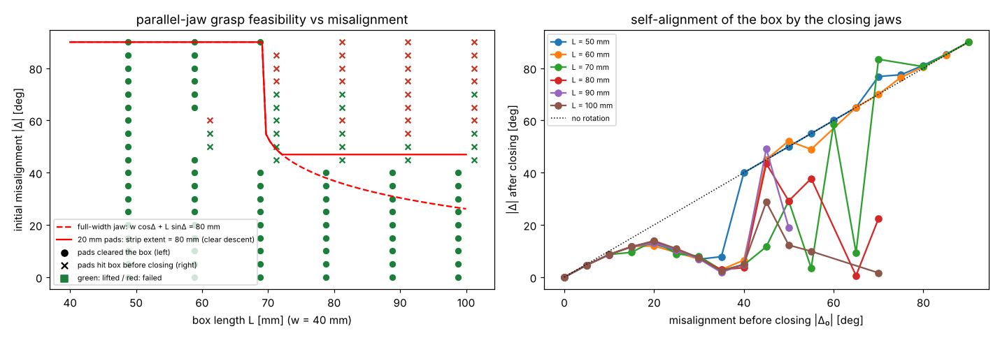

### 5.2 200 組 DR 測試任務（種子 1000–1199，物件/目標/姿態/物理參數/雜訊皆相同）
| 策略 | 成功（回合結束） | 曾夾住 | 曾抬起 | 曾到目標 | 碰撞 / 掉落 / 傾倒 | 首次成功 [s] | 放置誤差 平均 / P95 [mm] | 最大力矩使用率 |
|---|---|---|---|---|---|---|---|---|
| SAC＋示範預填，DR，種子 0 | **34.0 %** | 89.0 % | 58.0 % | 40.0 % | 0.5 % / 2.0 % / 9.5 % | 2.54 | 12.2 / 19.3 | 1.00 |
| SAC＋示範預填，DR，種子 1 | **40.0 %** | 97.0 % | 36.5 % | 63.0 % | 1.0 % / 1.5 % / 11.5 % | 2.90 | 12.0 / 18.8 | 1.00 |
| SAC＋示範 Q-filter BC，DR，種子 0 | **34.5 %** | 89.5 % | 55.0 % | 79.5 % | 0.5 % / 2.5 % / 0.5 % | 3.52 | 7.7 / 16.1 | 1.00 |
| SAC＋示範預填，無 DR，種子 0 | **63.5 %** | 99.0 % | 76.5 % | 79.0 % | 0.0 % / 0.0 % / 3.5 % | 3.08 | 11.1 / 18.0 | 1.00 |
| 腳本 FSM（含方位對齊） | **100.0 %** | 100.0 % | 100.0 % | 100.0 % | 0.0 % / 0.0 % / 0.0 % | 4.23 | 1.6 / 2.9 | 0.56 |
| 腳本 FSM（不轉夾爪） | **69.5 %** | 77.0 % | 76.5 % | 73.5 % | 0.0 % / 4.0 % / 9.0 % | 4.30 | 1.8 / 3.9 | 1.00 |
| 隨機策略 | **0.0 %** | 1.0 % | 0.0 % | 0.0 % | 0.0 % / 0.5 % / 0.0 % | — | — / — | 1.00 |

* 腳本基準含方位對齊 100.0 %，不轉夾爪 69.5 %：方位對齊是此任務的必要能力
  （不轉夾爪的失敗集中在大 |Δ₀| 與長物件，見 5.4）。
* RL（第一輪）最佳為 SAC＋示範預填，DR，種子 1：40.0 %（曾到目標 63.0 %）。

### 5.3 DR 交叉評估（成功率／曾到目標）
| 策略 | DR 測試環境 | 標稱環境（無 DR） | 到目標（DR） | 到目標（標稱） |
|---|---|---|---|---|
| SAC＋示範預填，DR，種子 0 | 34.0 % | 33.0 % | 40.0 % | 36.0 % |
| SAC＋示範預填，DR，種子 1 | 40.0 % | 35.5 % | 63.0 % | 54.5 % |
| SAC＋示範 Q-filter BC，DR，種子 0 | 34.5 % | 10.5 % | 79.5 % | 68.0 % |
| SAC＋示範預填，無 DR，種子 0 | 63.5 % | 60.5 % | 79.0 % | 72.0 % |
| 腳本 FSM（含方位對齊） | 100.0 % | 100.0 % | 100.0 % | 100.0 % |
| 腳本 FSM（不轉夾爪） | 69.5 % | 74.0 % | 73.5 % | 81.0 % |

* 第一輪（同 ≈ 35 分鐘預算）中，**無 DR** 訓練的模型反而在 DR 測試環境成功率最高（63.5 %，標稱環境 60.5 %）：
  DR 增加回合間變異、使同樣步數下學得較慢；而 DR 範圍（尺寸 ±、質量、摩擦、夾持力、伺服頻寬、2 mm/2° 雜訊）尚未超出無 DR 策略的容忍度。
  DR 模型在兩環境間差距小（DR 對 SAC 預填兩組 ≤ 4.5 個百分點），SACBC 在標稱環境反而下降（10.5 %），顯示其策略仍不穩定。
  DR 的價值需在收斂後、或加大分布外擾動時才能判斷（下次續訓後評估）。

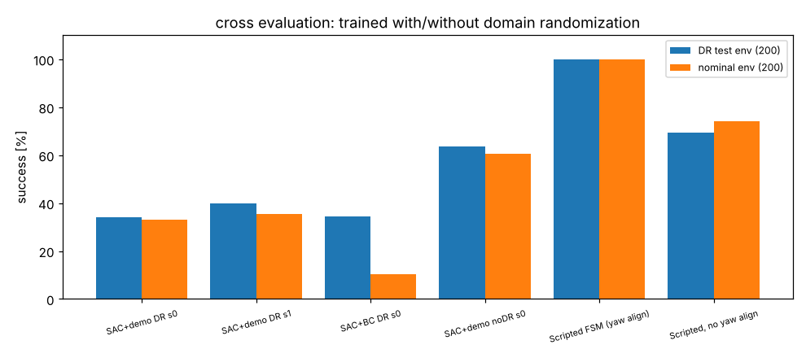

### 5.4 依初始方位差 |Δ₀| 與長邊 L 分組成功率（DR 測試 200 組）
| 分組 | 0–15° | 15–30° | 30–45° | 45–60° | 60–75° | 75–90° |
|---|---|---|---|---|---|---|
| 樣本數 | 29 | 34 | 33 | 36 | 38 | 30 |
| SAC＋示範預填，DR，種子 0 | 38 % | 41 % | 27 % | 42 % | 32 % | 23 % |
| SAC＋示範預填，DR，種子 1 | 28 % | 53 % | 45 % | 39 % | 32 % | 43 % |
| SAC＋示範 Q-filter BC，DR，種子 0 | 34 % | 32 % | 36 % | 47 % | 32 % | 23 % |
| SAC＋示範預填，無 DR，種子 0 | 90 % | 76 % | 76 % | 58 % | 50 % | 33 % |
| 腳本 FSM（含方位對齊） | 100 % | 100 % | 100 % | 100 % | 100 % | 100 % |
| 腳本 FSM（不轉夾爪） | 100 % | 97 % | 73 % | 56 % | 42 % | 57 % |

| 分組 | 35–60 mm | 60–70 mm | 70–80 mm | 80–90 mm | 90–100 mm |
|---|---|---|---|---|---|
| 樣本數 | 38 | 44 | 46 | 34 | 38 |
| SAC＋示範預填，DR，種子 0 | 29 % | 41 % | 37 % | 32 % | 29 % |
| SAC＋示範預填，DR，種子 1 | 42 % | 32 % | 39 % | 53 % | 37 % |
| SAC＋示範 Q-filter BC，DR，種子 0 | 18 % | 27 % | 28 % | 41 % | 61 % |
| SAC＋示範預填，無 DR，種子 0 | 47 % | 55 % | 74 % | 71 % | 71 % |
| 腳本 FSM（含方位對齊） | 100 % | 100 % | 100 % | 100 % | 100 % |
| 腳本 FSM（不轉夾爪） | 97 % | 75 % | 59 % | 62 % | 55 % |

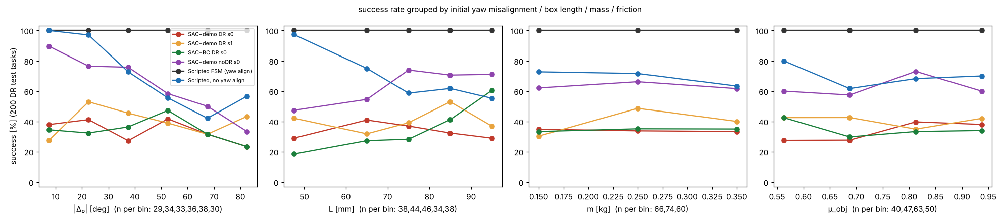

### 5.5 訓練（第一輪，各 1 核、2100 s）
| 組態 | 環境步 | 時間 [min] | 步/s | 評估集最佳成功（步數） | 最後一次 | 最高曾到目標 | 最高曾夾住 | 示範成功/嘗試 |
|---|---|---|---|---|---|---|---|---|
| SAC＋示範預填，DR，種子 0 | 138,729 | 35.4 | 65 | 30 %（110,000 步） | 16 % | 58 % | 98 % | 100/100 |
| SAC＋示範預填，DR，種子 1 | 142,964 | 35.4 | 67 | 46 %（142,964 步） | 46 % | 68 % | 98 % | 100/104 |
| SAC＋示範 Q-filter BC，DR，種子 0 | 124,391 | 35.4 | 59 | 38 %（124,391 步） | 38 % | 88 % | 92 % | 100/100 |
| SAC＋示範預填，無 DR，種子 0 | 144,375 | 35.3 | 68 | 54 %（140,000 步） | 54 % | 74 % | 100 % | 100/100 |

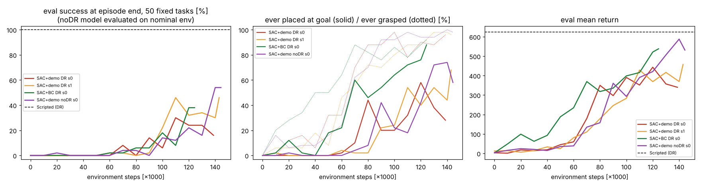

* 推論時間：SAC＋示範預填，DR，種子 0 0.29 ms/步（P95 0.33）、環境一步 2.3 ms；
  腳本 0.021 ms/步。
* 與腳本同任務的首次成功時間比（RL/腳本）：SAC＋示範預填，DR，種子 0 0.61（86 % 較快）；SAC＋示範預填，DR，種子 1 0.68（87 % 較快）；SAC＋示範 Q-filter BC，DR，種子 0 0.85（71 % 較快）；SAC＋示範預填，無 DR，種子 0 0.73（78 % 較快）。

### 5.6 圖表與動畫
* 動畫（三列：SAC＋示範預填，DR，種子 1／腳本含方位對齊／腳本不轉夾爪；左＝斜視、右＝俯視；任務種子 [1007, 1008]，皆為 L > 82 mm 且 |Δ₀| > 50°）：
  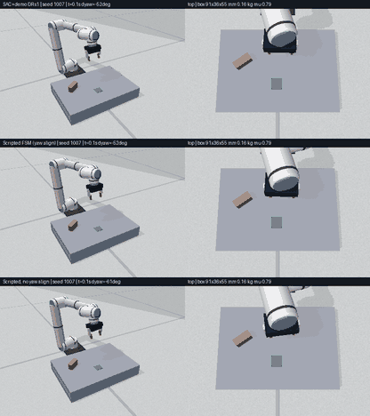　[MP4](../media/2026-11-27_T205.mp4)
* 關鍵畫面：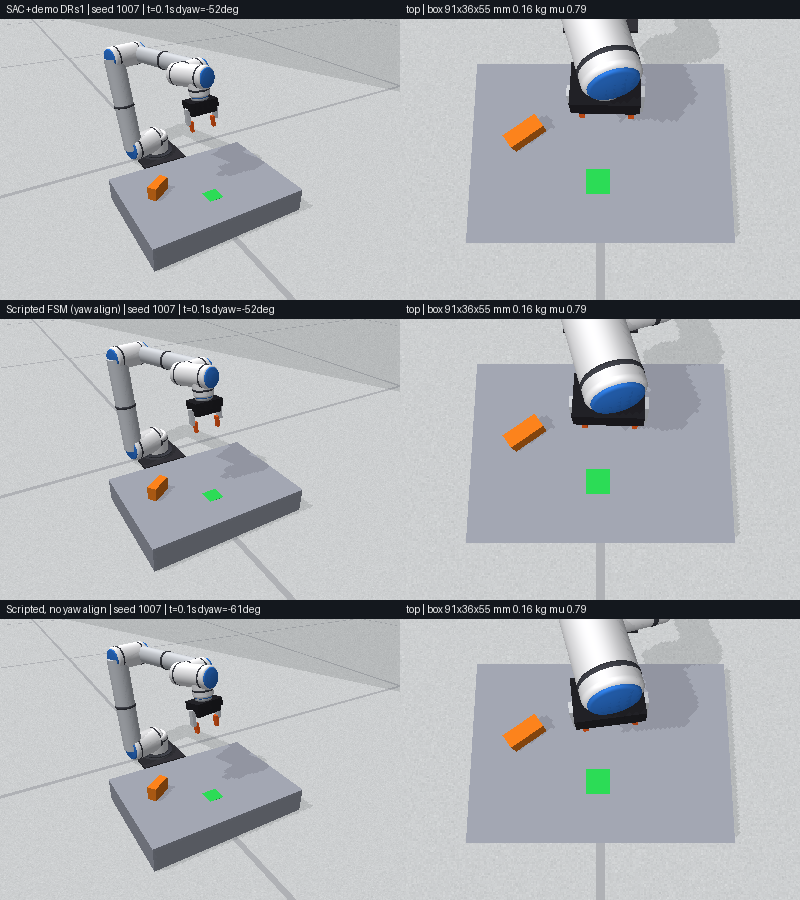 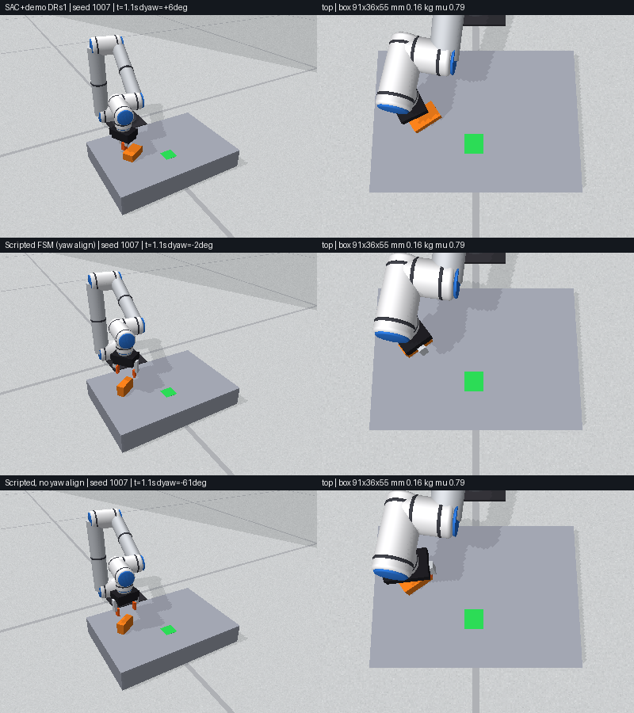 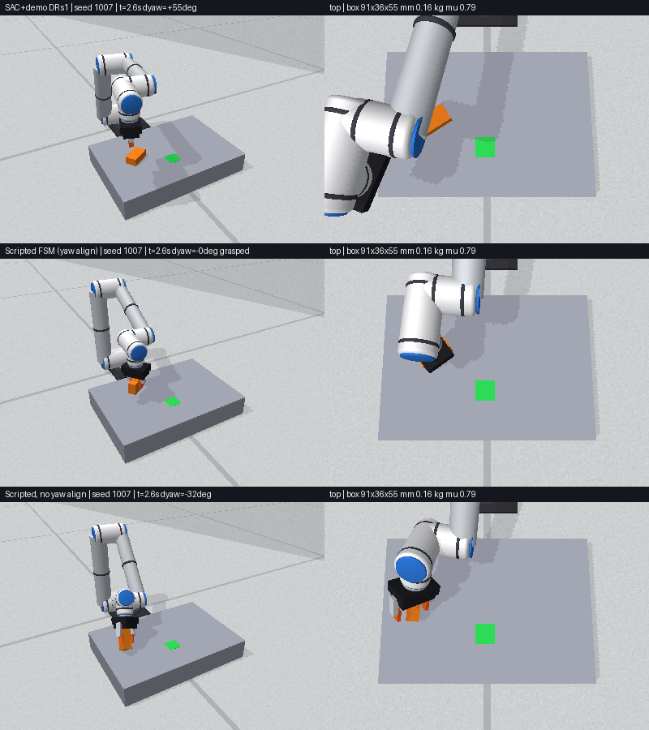 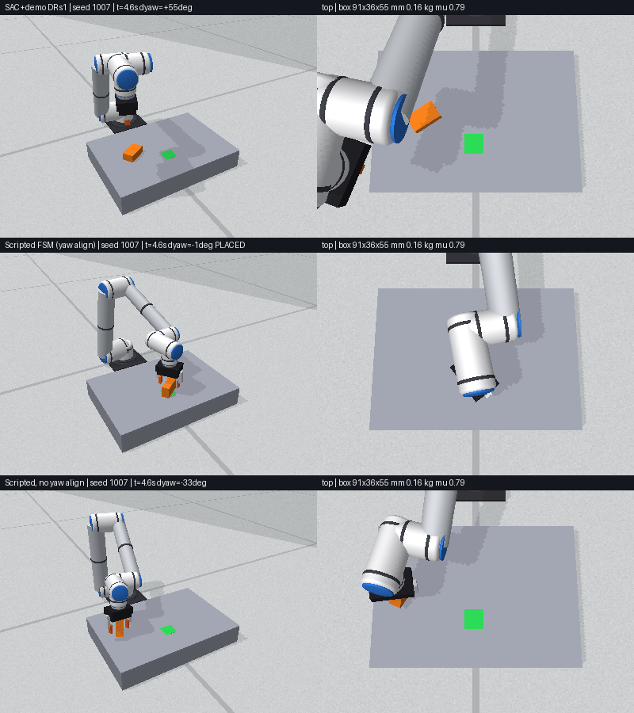
* 單回合曲線（高度/目標誤差、相對 yaw Δ 與 ψ_ref、指墊力與指令、關節力矩）：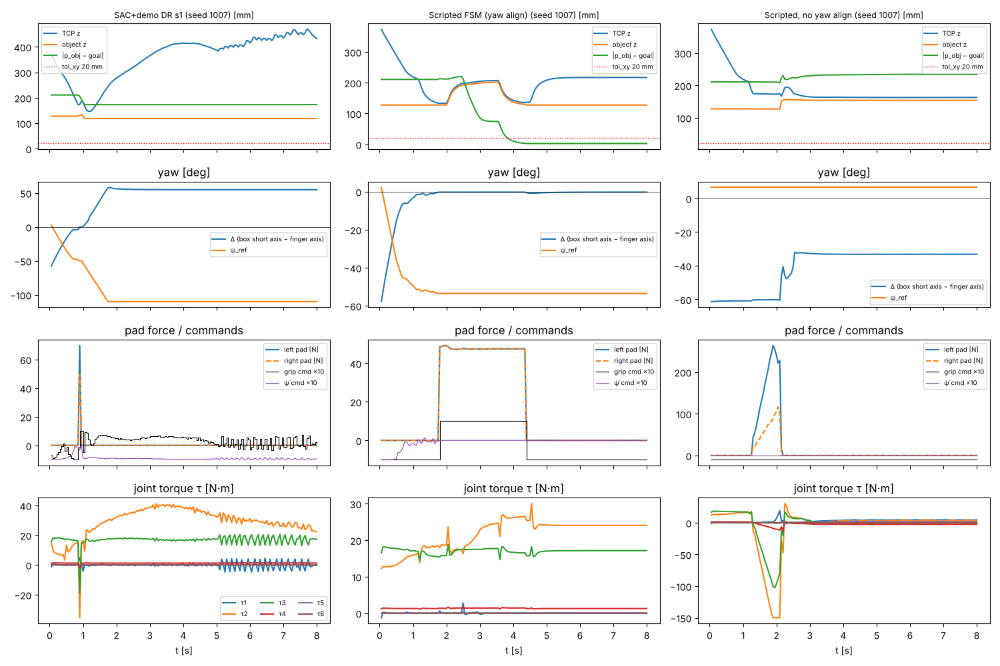
* 關節角/速度：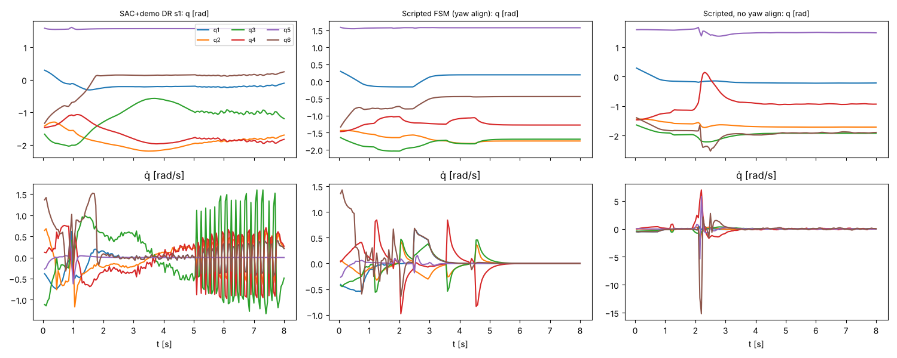

## 6. 問題與限制
* 第一輪訓練未收斂（T204 同類方法需約 19 萬步才達 90 %，本輪各組約 124–144 千步）；
  42 維觀測＋5 維動作且 DR 增加變異，需續訓。
* 放置只要求位置（xy < 20 mm、正立、鬆爪），不要求放置方位；物件為長方塊（無圓柱/不規則形）。
* DR 未含感知延遲、動作延遲、台面摩擦與相機外參；觀測雜訊為白雜訊（實際視覺誤差有偏差與時間相關）。
* 夾持幾何實驗以單一 w = 40 mm、h = 50 mm、μ = 0.8 進行；自我對正結果依摩擦與接觸細節而異，未建立完整的推動力學（Mason 1986）模型。

## 7. 結論（階段）
* 新增 `SixAxisRandPlace-v0`：物件姿態隨機＋夾爪方位動作＋domain randomization，腳本基準（含方位對齊）在 200 組 DR 任務達 100.0 %，
  不轉夾爪降為 69.5 %，確認方位對齊為必要；窄指墊帶狀區理論預測閉合前是否碰物件 102/114（以實際位姿 106/114）。
* RL 第一輪最佳 40.0 %；下一步以 `scripts/t205_train.py --resume` 續訓後完成最終比較與 DR 效果分析。

測試：`python3 -m pytest` 293 passed；`ruff check .` 通過。
