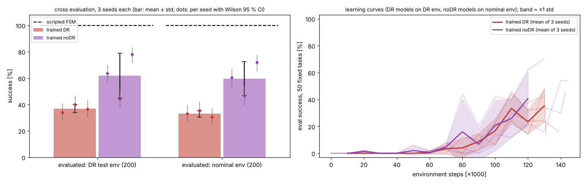
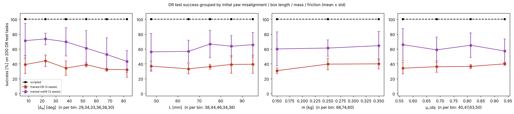
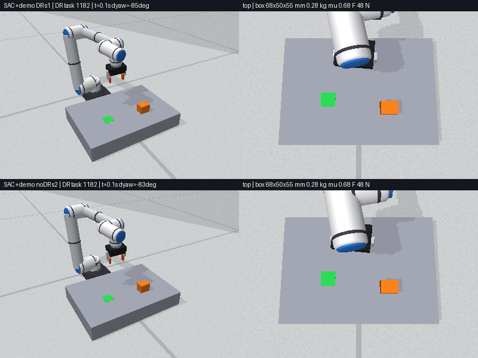
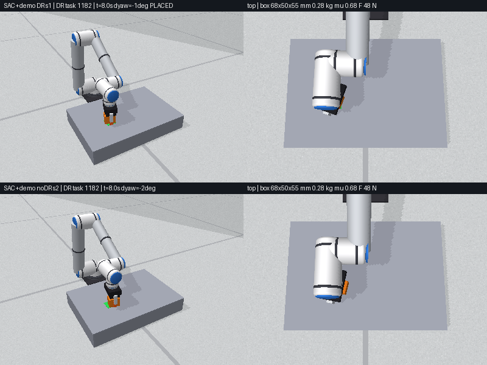
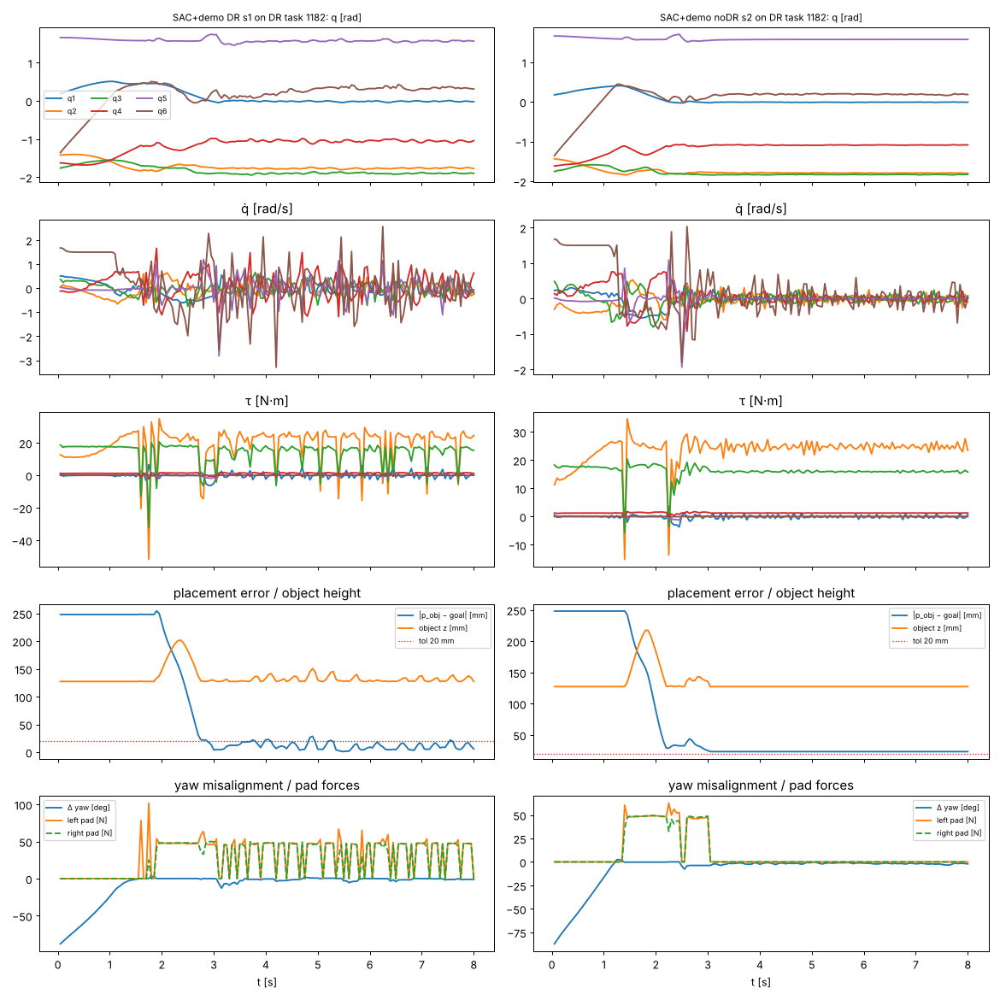

# T205 隨機化物件位置與姿態＋domain randomization — 第二輪階段報告（3 種子交叉評估）

- 日期：2026-11-28（台北 18:37 排程；當日前兩次排程無開發紀錄，本次改為開發執行）
- 狀態：**進行中 [~]**（本輪補齊 DR／無 DR 各 3 個種子並以等訓練預算做交叉評估；各組學習曲線仍在上升、尚未收斂，下輪續訓）
- 第一輪報告：[2026-11-27_T205.md](2026-11-27_T205.md)（環境、獎勵、DR 範圍、腳本基準、夾持幾何驗證）

## 1. 目的
依 ROADMAP T205 完成條件，「DR 訓練 vs 無 DR 訓練」須在標稱環境與 DR 環境交叉評估，並以 ≥ 3 個種子報告平均 ± 標準差與 95 % 信賴區間。
第一輪只有 DR 2 種子（＋SACBC 1）與無 DR 1 種子，本輪新訓 `sac_rand_demo_s2`、`sac_rand_nodr_demo_s1`、`sac_rand_nodr_demo_s2`，
使兩組都有 3 個種子、每組皆約 35 分鐘（單核）的同等訓練預算，先做「等預算」比較。

## 2. 模型與參數
- 環境 `SixAxisRandPlace-v0`（`sixaxis/rlrand.py`，第一輪報告第 2 節）：物件 yaw ~ U[−90°, 90°)、5 維動作（TCP 速度＋ψ̇＋夾爪）、42 維觀測、160 步（8 s）。
  - DR 開：尺寸 w 35–55／L ≤ 100／h 45–60 mm、質量 0.1–0.4 kg、摩擦 0.5–1.0、夾持力 30–50 N、伺服頻寬 20–30 rad/s，物件位置 σ 2 mm／yaw σ 2° 觀測雜訊。
  - DR 關（標稱）：70 × 45 × 50 mm、0.2 kg、μ 0.8、40 N、25 rad/s、無觀測雜訊；位置與 yaw 仍隨機。
- 演算法：SB3 SAC＋100 個加噪腳本示範預填回放緩衝（T204 最佳做法），超參數同第一輪；種子 0/1/2。
- 測試：200 組固定測試種子 1000–1199，各模型分別在 DR 環境與標稱環境（同種子 → 同位置/目標/yaw，僅 DR 參數與雜訊不同）評估，確定性策略。
- 統計（`sixaxis/stats.py`，新增）：單模型成功率 Wilson score 95 % 區間（Brown, Cai & DasGupta 2001）；
  種子間平均 ± 樣本標準差、Student t 95 % 區間 x̄ ± t₂,₀.₉₇₅ s/√3（t = 4.303；超出 [0, 1] 的部分截斷顯示）；兩組平均差 Welch t 檢定。

## 3. 可重現指令
```bash
PYTHONPATH=. python3 scripts/t205_train.py sac_rand_demo_s2 sac_rand_nodr_demo_s1 sac_rand_nodr_demo_s2  # 3 組各 1 核、2100 s
PYTHONPATH=. python3 scripts/t205_seeds.py        # 6 模型 × 2 環境 × 200 回合＋腳本基準、圖、動畫（約 6 分鐘，4 核）
PYTHONPATH=. python3 scripts/t205_seeds_md.py "<pytest 結果>"
python3 -m pytest tests/test_stats.py tests/test_rlrand.py
```

## 4. 指令序列（每回合）
reset(seed) → 物件（DR 參數）與目標標記生成 → 策略每 50 ms 輸出 (v_x, v_y, v_z, ψ̇, grip) → TCP 速度＋姿態保持 DLS 積分 q_ref → 2 ms 計算力矩內環 →
160 步後判定 success（物件 xy 距目標 < 20 mm、靜置、傾角 < 10°、夾爪張開且指墊無接觸）。

## 5. 量化結果

### 5.1 各模型（200 組測試；括號為 Wilson 95 % 區間）
| 模型 | 訓練步數 | 訓練時間 [min] | 評估集最佳（步數） | 評估集最後 | DR 測試成功 | 標稱環境成功 | DR 曾到目標 | DR 夾住 |
|---|---|---|---|---|---|---|---|---|
| DR 訓練 s0（第一輪） | 138,729 | 35.4 | 30 %（110,000） | 16 % | **34.0 %** [27.8, 40.8] % | 33.0 % [26.9, 39.8] % | 40.0 % | 89.0 % |
| DR 訓練 s1（第一輪） | 142,964 | 35.4 | 46 %（142,964） | 46 % | **40.0 %** [33.5, 46.9] % | 35.5 % [29.2, 42.3] % | 63.0 % | 97.0 % |
| DR 訓練 s2（本輪新訓） | 130,926 | 35.3 | 48 %（130,000） | 14 % | **36.5 %** [30.1, 43.4] % | 30.5 % [24.5, 37.2] % | 41.5 % | 92.0 % |
| 無 DR 訓練 s0（第一輪） | 144,375 | 35.3 | 54 %（140,000） | 54 % | **63.5 %** [56.6, 69.9] % | 60.5 % [53.6, 67.0] % | 79.0 % | 99.0 % |
| 無 DR 訓練 s1（本輪新訓） | 130,000 | 35.3 | 42 %（130,000） | 42 % | **44.0 %** [37.3, 50.9] % | 46.5 % [39.7, 53.4] % | 54.0 % | 96.0 % |
| 無 DR 訓練 s2（本輪新訓） | 129,617 | 35.3 | 70 %（129,617） | 70 % | **78.0 %** [71.8, 83.2] % | 72.0 % [65.4, 77.8] % | 82.0 % | 100.0 % |
| 腳本 FSM（含方位對齊） | — | — | — | — | **100.0 %** [98.1, 100.0] % | 100.0 % [98.1, 100.0] % | 100.0 % | 100.0 % |

### 5.2 交叉評估（3 種子平均 ± 標準差，[t 95 % 區間]）
| 訓練方式 | 在 DR 測試環境 | 在標稱環境 | 標稱 − DR 落差 |
|---|---|---|---|
| DR 訓練 | 36.8 ± 3.0 % [29.3, 44.3] % | 33.0 ± 2.5 % [26.8, 39.2] % | -3.8 ± 2.6 pp |
| 無 DR 訓練 | 61.8 ± 17.1 % [19.5, 100.0] % | 59.7 ± 12.8 % [27.9, 91.4] % | -2.2 ± 4.3 pp |

Welch t 檢定（DR − 無 DR，種子平均差）：DR 環境 -25.0 pp（t = -2.50, p = 0.122）；
標稱環境 -26.7 pp（t = -3.55, p = 0.064）。

### 5.3 其他指標（DR 測試環境，3 種子平均 ± 標準差）
| 指標 | DR 訓練 | 無 DR 訓練 |
|---|---|---|
| 曾成功率 | 41.2 ± 6.8 % | 67.2 ± 16.8 % |
| 曾到目標率 | 48.2 ± 12.9 % | 71.7 ± 15.4 % |
| 夾住率 | 92.7 ± 4.0 % | 98.3 ± 2.1 % |
| 碰撞終止率 | 0.7 ± 0.3 % | 0.3 ± 0.6 % |
| 掉落率 | 1.7 ± 0.3 % | 0.3 ± 0.6 % |
| 成功者放置誤差 [mm] | 12.48 ± 0.64 | 11.57 ± 0.57 |
| 首次成功時間 [s] | 2.79 ± 0.21 | 2.63 ± 0.43 |
| 最大力矩使用率 | 1.00 ± 0.00 | 1.00 ± 0.00 |

腳本基準：成功 100.0 %、放置誤差 1.6 mm、首次成功 4.23 s。

### 5.4 依初始方位差 |Δ₀| 分組（DR 測試，種子平均 ± 標準差）
| \|Δ₀\| | 任務數 | DR 訓練 | 無 DR 訓練 | 腳本 |
|---|---|---|---|---|
| 0–15° | 29 | 39 % ± 12 % | 71 % ± 23 % | 100 % |
| 15–30° | 34 | 44 % ± 8 % | 74 % ± 8 % | 100 % |
| 30–45° | 33 | 34 % ± 10 % | 70 % ± 19 % | 100 % |
| 45–60° | 36 | 39 % ± 3 % | 61 % ± 24 % | 100 % |
| 60–75° | 38 | 32 % ± 2 % | 53 % ± 22 % | 100 % |
| 75–90° | 30 | 32 % ± 10 % | 43 % ± 15 % | 100 % |

## 6. 圖表與動畫
- 交叉評估與學習曲線（3 種子平均 ± 標準差）：
- 依方位差／長度／質量／摩擦分組：
- 動畫（DR 測試任務 1182：上 = DR 最佳 `sac_rand_demo_s1`、下 = 無 DR 最佳 `sac_rand_nodr_demo_s2`；左斜視、右俯視）：
  [MP4](../media/2026-11-28_T205.mp4)／[GIF](../media/2026-11-28_T205.gif)；此任務選自「DR 模型成功、無 DR 模型失敗」的 19 組中 |Δ₀| 最大者（非代表性，整體上無 DR 模型較佳）。
- 關鍵畫面： 
- 該回合關節角/速度/力矩、放置誤差、方位差與指墊力：

## 7. 問題與限制
- **未收斂**：6 組在 ≈ 35 分鐘（12.9–14.4 萬步）時評估集成功率多數仍在上升（無 DR s1/s2 最佳即最後一次評估），本輪結果只代表「等短預算」比較，不能作為 DR 效果的最終結論。
- 種子數 3：t 區間寬（無 DR 組 DR 環境 [19.5, 100.0] %），兩組差 p ≈ 0.12／0.06，未達 0.05 顯著。
- 在此預算下 **無 DR 訓練在 DR 測試環境反而較佳**；DR 模型在兩環境間落差小但整體成功率低，符合「DR 增加任務變異 → 同預算學得較慢」的預期（Tobin 2017、Peng 2018 皆以更長訓練換取穩健度）。
  DR 模型對方位差較不敏感（各分組約 32–44 %），無 DR 模型隨 |Δ₀| 增大由 ≈ 71–74 % 降至 43 %。
- 兩組在標稱環境的成功率皆略低於 DR 環境（落差 −2 ～ −4 pp，小於單模型 Wilson 區間寬度）；DR 測試含較短物件（L < 70 mm）可能較易抓取，但本輪未分離此因素。
- 力矩使用率皆達 1.00（策略頻繁打滿速度命令），放置誤差 ≈ 12 mm 遠大於腳本 1.6 mm（同 T204 觀察）。
- SACBC（第一輪 1 種子）本輪未納入多種子比較。

## 8. 結論
本輪補齊 DR／無 DR 各 3 種子並完成等預算交叉評估：DR 訓練 36.8 ± 3.0 %（DR 環境）、33.0 ± 2.5 %（標稱）；
無 DR 訓練 61.8 ± 17.1 %、59.7 ± 12.8 %；腳本 100 %。短預算下 DR 尚未顯示優勢且組間差未達顯著。
下一步：6 組續訓（`--resume`，兩輪 3 組並行）至學習曲線平穩，再以 `t205_report.py`（最終）＋本腳本產生最終 DR 效果結論並標 [x]。

測試：300 passed, 1 skipped（364 s）；`ruff check .` 通過。
